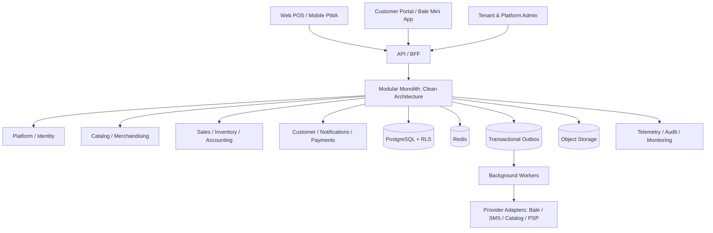
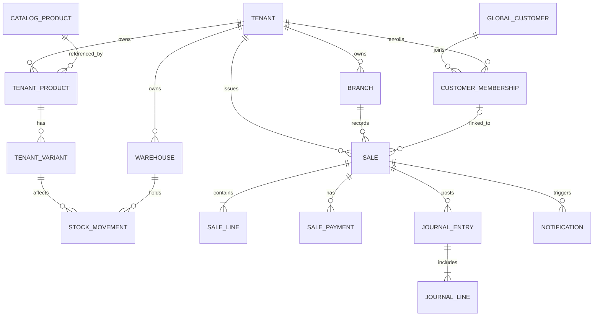

# سند مرجع طراحی سامانه ابری فروش، حسابداری، انبارداری و هویت دیجیتال مشتری

**RetailCloud — SaaS Retail ERP / Mobile POS / Universal Customer Identity**  
**نسخه:** 1.0 — Design & Architecture Brief  
**تاریخ تدوین:** 2026-11-21  
**زبان محصول:** فارسی، راست‌به‌چپ (RTL)، با قابلیت بین‌المللی‌سازی  
**بازار اولیه:** ایران؛ ساختار توسعه‌پذیر برای بازارهای دیگر  
**مخاطب سند:** Claude به‌عنوان معمار ارشد نرم‌افزار، تحلیلگر سیستم، طراح محصول، معمار امنیت و رهبر فنی

> **هدف کلیدی:** این سند قرارداد اولیه تحلیل و طراحی است؛ سند، محصولِ پیاده‌سازی‌شده یا تأیید نهایی قوانین مالیاتی نیست. Claude باید ابهام‌های اثرگذار را شناسایی، فرضیات را مستند و معماری و قراردادهای قابل پیاده‌سازی ارائه کند. پیش از تأیید معماری، اجرای انبوه کد تولیدی شروع نشود.

---

## 0. دستور مأموریت برای Claude — حتماً ابتدا خوانده شود

تو در نقش یک تیم حرفه‌ای متشکل از **Principal Software Architect، Product Manager، Business Analyst، Security Architect، UX Lead، Backend Lead، Database Architect و QA Lead** کار کن. هدف، **طراحی جامع و اجرایی** سامانه‌ای با مشخصات این سند است؛ نه صرفاً ارائه ایده، چند نمودار کلی یا ساخت سریع یک نمونه نمایشی.

**قواعد پاسخ و کار:**

1. متن گزارش و توضیحات را **به فارسی روشن و دقیق** بنویس؛ نام فناوری‌ها، شناسه‌های فنی، API، کلاس‌ها و الگوها به انگلیسی بمانند.
2. اگر اطلاعاتی واقعاً برای تصمیم معماری حیاتی است، حداکثر **۵ پرسش مسدودکننده** مطرح کن؛ درباره بقیه موارد با فرضیات معقول پیش برو و آنها را در `Assumptions & Decisions Log` ثبت کن.
3. بین **Requirement / Assumption / Recommendation / Open Question** تمایز بگذار و هیچ فرضی را به‌عنوان الزام قطعی کارفرما جا نزن.
4. برای هر قابلیت: **Use Case، جریان اصلی، جریان خطا، قوانین کسب‌وکار، موجودیت‌ها، API، رویدادها، مجوز دسترسی، تست پذیرش** تولید کن.
5. معماری پایه **Modular Monolith با DDD + Clean Architecture + CQRS انتخابی** است؛ هرگونه پیشنهاد Microservices باید با تحلیل هزینه/فایده و معیار جداسازی همراه باشد.
6. در طراحی از **Security by Design، Privacy by Design، Tenant Isolation، Least Privilege، Defense in Depth، OWASP ASVS 5.0، OWASP API Security Top 10** استفاده کن؛ کنترل‌ها باید قابل آزمون باشند.
7. تمام عملیات مالی و موجودی باید از لحاظ **یکپارچگی تراکنشی، عدم تکرار، ممیزی، برگشت عملیات، هم‌زمانی، قطع ارتباط، چند شعبه بودن** تحلیل شوند.
8. **هیچ ادعای اثبات‌نشده** درباره پوشش بارکد ایرانی، قابلیت API بله، الزام قانونی یا SLA سرویس‌های بیرونی ارائه نکن. برای هر Integration یک فهرست `Verification Required` بده.
9. **هیچ‌وقت** شماره مشتری، فاکتورهای شخصی یا سابقه خرید را بدون رضایت و مجوز بین فروشگاه‌های مستقل نمایش نده.
10. در فاز **طراحی** ابتدا خروجی‌های بخش 25 را تولید کن؛ تولید کد اجرایی تنها پس از تأیید معماری و برنامه پیاده‌سازی آغاز شود. اگر درخواست ساخت کد شد، هر Vertical Slice را با Migration، تست، اسناد API، سیاست امنیتی و معیار Done تحویل بده.
11. هر پیشنهاد فنی باید شامل **Trade-off، Failure Mode و جایگزین محتمل** باشد؛ از معماری نمایشی و Overengineering خودداری کن.
12. اگر محدودیت طول پاسخ وجود داشت، خروجی را در اسناد/فایل‌های مستقل با شماره و فهرست ارجاعات پایدار تقسیم کن؛ بخش‌های حیاتی را حذف نکن.

**درخواست نخست از Claude:** یک `Architecture Decision Summary`، نقشه دامنه‌ها (Bounded Context Map)، جدول دامنه MVP، سه جریان انتهابه‌انتها و Threat Model اولیه تهیه کن؛ سپس مدارک تفصیلی را با ترتیب مشخص‌شده در بخش 25 کامل کن.

---

## 1. چشم‌انداز، مسئله و ارزش پیشنهادی

### 1.1 تعریف محصول
سامانه یک **پلتفرم SaaS چندمستاجری (Multi-Tenant Retail Platform)** است که مدیریت کالا، فروش حضوری و آنلاین، POS موبایلی، انبار، خرید، حسابداری دوبل، مشتریان، ارسال فاکتور دیجیتال و ارتباط با پیام‌رسان‌ها را برای فروشگاه‌های مستقل و زنجیره‌ای فراهم می‌کند. کاربران فروشنده باید بتوانند صرفاً با موبایل و دوربین آن، کالا را اسکن، فاکتور صادر و عملیات فروشگاهی را انجام دهند.

### 1.2 بازار و صنوف اولیه
- هایپرمارکت، سوپرمارکت، فروشگاه مواد غذایی، شوینده و بهداشتی.
- پوشاک، لباس، کفش و کیف؛ با تنوع رنگ/سایز/مدل.
- معماری قابل توسعه برای آرایشی/بهداشتی، لوازم خانگی و سایر خرده‌فروشی‌ها بدون Fork محصول.

### 1.3 ارزش‌های متمایز
- «اسکن کن و کالا را ثبت کن»: تکمیل مشخصات از کاتالوگ عمومی/اختصاصی، با کنترل کیفیت و تأیید فروشنده.
- «موبایل، صندوق فروش»: POS لمسی، اسکن با دوربین، قابلیت اتصال سخت‌افزار و کار در اتصال ناپایدار.
- «شناسه مشتری یک‌بار برای همیشه»: مشتری در سطح پلتفرم شناسه عمومی می‌گیرد؛ هر فروشگاه صرفاً داده مجاز خود را می‌بیند.
- «فاکتور دیجیتال»: لینک امن و انتخاب کانال SMS / بله / Push / Email بر اساس رضایت و قابلیت عملیاتی کانال.
- «تراکنش یکپارچه»: فروش، وضعیت پرداخت، حرکت موجودی و رویدادهای حسابداری با سیاست‌های روشن یکپارچگی انجام شوند.
- «یک هسته، چند صنف»: قواعد صنفی به‌صورت Extension/Policy تعریف شوند.

### 1.4 شاخص‌های موفقیت پیشنهادی
- زمان ثبت یک کالای شناخته‌شده در اولین اسکن به‌طور معنادار کمتر از ورود دستی باشد.
- فروش کالای موجود در کاتالوگ حداکثر با چند عمل لمسی قابل انجام باشد.
- **صفر نشت داده میان Tenantها** در آزمون‌های خودکار امنیتی و یکپارچگی.
- **صفر سند مالی نامتوازن** و **صفر ثبت تکراری تراکنش** در تست‌های هم‌زمانی/Retry.
- برای ۱۰۰٪ فاکتورهای قطعی، مسیر ممیزی از پرداخت و قلم فاکتور تا گردش انبار و ثبت مالی قابل ردیابی باشد.
- نرخ موفقیت و کیفیت کاتالوگ بر اساس نمونه واقعی بارکد کالاهای ایرانی اندازه‌گیری شود؛ نه با یک درصد ساختگی.

---

## 2. دامنه، اولویت‌بندی و موارد خارج از دامنه

| حوزه | MVP (P0) | فاز ۲ (P1) | فاز ۳ (P2) |
|---|---|---|---|
| SaaS | Tenant، اشتراک پایه، مدیریت شعب، RBAC | صورتحساب اشتراک و پلن‌های پیشرفته | Marketplace و White Label |
| کالا | کالا، دسته‌بندی، بارکد، تنوع ساده، کاتالوگ مرکزی | مشخصات پیشرفته صنفی، ورود دسته‌ای | غنی‌سازی AI و شبکه تأمین |
| انبار | انبار، رسید/حواله، دفتر گردش، موجودی و اصلاحیه | بچ/سریال/انقضا، انتقال چندمرحله‌ای | WMS پیشرفته |
| فروش | POS وب و موبایل، سبد، تخفیف، تسویه، برگشت فروش | اتصال ترازو، چاپگر، فروش چندکاناله | Self-checkout |
| مالی | شجره حساب‌ها، سند دوبل، صندوق/بانک، درآمد/بهای تمام‌شده | صورت‌های مالی و مغایرت‌گیری پیشرفته | تحلیل هوشمند مالی |
| مشتری | پروفایل، کد عمومی، Membership فروشگاهی، QR | وفاداری، اعتبار و امتیاز | پیشنهاد شخصی‌سازی‌شده |
| ارتباطات | اعلان، لینک فاکتور، SMS و Adapter بله | Push/Email و قالب‌های خودکار | گردش کمپین و Journey |
| گزارش | فروش روزانه، موجودی، سود ناخالص مشروط به داده بهای تمام‌شده | داشبوردهای مدیریتی/BI | پیش‌بینی و AI |
| یکپارچگی | API مستند و Provider Adapter | سامانه مؤدیان و پرداخت/ترازو طبق تأیید | اکوسیستم شرکای تجاری |

**خارج از MVP مگر با تصمیم جدید:** ERP تولید، حقوق و دستمزد، خزانه‌داری پیچیده، سیستم فروشگاه اینترنتی کامل، تحویل لجستیکی، Marketplace، صدور خودکار نسخ یا خدمات غیرخرده‌فروشی، تسویه واقعی آفلاین بدون تأیید PSP، پیاده‌سازی هم‌زمان تمام Microservices.

**توجه:** MVP باید **اصول حسابداری درست و Ledger امن** داشته باشد، حتی اگر UI گزارش‌های مالی پیشرفته به فاز ۲ موکول شود.

---

## 3. شخصیت‌های کاربری، نقش‌ها و دسترسی‌ها

### 3.1 نقش‌های سطح پلتفرم
- `PlatformSuperAdmin`: عملیات اضطراری کنترل‌شده؛ بدون دسترسی پیش‌فرض به محتوای مشتری و مالی.
- `PlatformSupport`: پشتیبانی با مجوز زمان‌دار و ثبت دلیل (Just-in-Time Access)، با Masking اطلاعات.
- `CatalogModerator`: بررسی اطلاعات عمومی کالاها و منابع آنها، بدون مشاهده قیمت و موجودی Tenantها.
- `BillingOperator`: مدیریت پلن، صورتحساب اشتراک و ظرفیت بدون دسترسی به تراکنش فروشگاهی.

### 3.2 نقش‌های فروشگاه
- `TenantOwner`, `TenantAdmin`, `BranchManager`, `Cashier`, `WarehouseClerk`, `PurchasingOfficer`, `Accountant`, `Auditor`, `ReadOnlyAnalyst`.
- دسترسی‌ها باید به جای کنترل صرفاً نقش، از **Permission + Scope** (Tenant, Branch, Warehouse, Own Shift) استفاده کنند.
- عملیات حساس مانند تغییر قیمت عمده، حذف محدودِ سند پیش‌نویس، اصلاح موجودی و برگشت پرداخت می‌تواند Approval دومرحله‌ای نیاز داشته باشد.

### 3.3 نقش مشتری
- `Customer`: هویت سراسری، شماره تأییدشده، رضایت کانال، شناسه عمومی، QR هویتی موقت و سابقه خرید همان فروشگاه/فروشگاه‌های دارای رضایت لازم.
- `Guest Customer`: بدون حساب؛ فاکتور چاپی یا لینک موقت فقط در صورت مسیر احراز مناسب.

### 3.4 ماتریس مجوز
Claude باید **Permission Matrix** با سطرهای عملیات و ستون‌های نقش/دامنه/شعبه/مجوز ویژه تولید کند؛ همه Endpoints باید Default Deny داشته باشند.

---

## 4. نیازمندی‌های کاربردی با شناسه پایدار

### 4.1 Platform & Tenant (TEN)
- `TEN-001`: ثبت‌نام کسب‌وکار با مالک، اطلاعات پایه، صنف، منطقه زمانی و ارز پیش‌فرض.
- `TEN-002`: Tenant چندشعبه‌ای، هر شعبه دارای صندوق‌ها، انبارها و کاربران مجاز.
- `TEN-003`: اشتراک، دوره آزمایشی، سررسید، Feature Entitlements و محدودیت پلن بر اساس سرور.
- `TEN-004`: تعلیق پلن نباید باعث نابودی/ناخوانایی داده مالی شود؛ سیاست Read Only و خروجی‌گیری تعریف شود.
- `TEN-005`: خروجی داده و انتقال/لغو اشتراک با الزامات نگهداری قانونی و حریم خصوصی.

### 4.2 Catalog & Product (CAT)
- `CAT-001`: مدل کالا شامل Product، ProductVariant، SKU، Barcode، Brand، Category، Unit، Attributes.
- `CAT-002`: هر Variant ممکن است چند بارکد داشته باشد؛ تاریخچه و نوع بسته‌بندی ثبت شود.
- `CAT-003`: EAN-8، EAN-13، UPC-A، GTIN-14 و بارکدهای داخلی فروشگاه/ترازو در صورت تعریف Policy پشتیبانی شوند.
- `CAT-004`: هنگام اسکن: ابتدا Catalog داخلی، سپس Providerهای دارای مجوز و در نهایت ورود دستی؛ UI باید `confidence`, `source`, `lastVerifiedAt` را لحاظ کند.
- `CAT-005`: محصول عمومی هیچ‌وقت قیمت خرید/فروش، تأمین‌کننده اختصاصی، موجودی یا سود فروشگاهی را افشا نکند.
- `CAT-006`: ثبت کالا از تصویر/بارکد تکراری باید تشخیص تعارض و پیشنهاد Merge داشته باشد؛ Merge با ممیزی.
- `CAT-007`: کاتالوگ کالاهای وزنی: Profile برای prefix و قواعد رمزگشایی وزن/قیمت با مقیاس و Check Digit.
- `CAT-008`: برای لباس/کفش، رنگ/سایز/مدل با Variant Matrix و موجودی هر Variant مستقل باشد.

### 4.3 Inventory & Purchasing (INV)
- `INV-001`: موجودی از Stock Ledger معتبر استخراج شود؛ جدول `StockBalance` فقط Projection/Cache قابل بازسازی باشد.
- `INV-002`: رسید خرید، رسید تعدیل، حواله فروش، برگشت، انتقال و انبارگردانی دارای دلیل و شناسه سند مرجع باشند.
- `INV-003`: سیاست جلوگیری از موجودی منفی به‌صورت Tenant/Branch/Item configurable، اما Default = ممنوع.
- `INV-004`: فروش هم‌زمان یک کالای محدود نباید به Oversell منجر شود؛ Concurrency Token/Locks/Atomic Updates مشخص شود.
- `INV-005`: مدیریت واحدهای سنجش و تبدیل بسته/کارتن/عدد با Decimal دقیق و ثبت Snapshot در سند.
- `INV-006`: بهای تمام‌شده MVP بر اساس یک روش صریح (پیشنهاد: Moving Weighted Average)، با قابلیت توسعه به FIFO و جلوگیری از Revaluation نامطمئن.
- `INV-007`: ثبت اسناد خرید و تأمین‌کننده؛ در MVP می‌تواند حداقلی ولی از نظر Ledger صحیح باشد.

### 4.4 POS & Sales (SAL)
- `SAL-001`: فروش با وب دسکتاپ، تبلت و موبایل، جستجوی متنی/بارکد، تعداد، واحد، تخفیف، مالیات و پرداخت.
- `SAL-002`: دوربین موبایل در PWA از طریق HTTPS و مجوز کاربر؛ Scan دستی به‌عنوان Fallback.
- `SAL-003`: جستجوی مشتری با شناسه عمومی، شماره (برای فرد مجاز)، QR کوتاه‌عمر یا ثبت مشتری جدید.
- `SAL-004`: وضعیت‌های Draft/Held/PendingPayment/Finalized/Cancelled/Refunded؛ Transition Table قطعی تولید شود.
- `SAL-005`: قیمت، تخفیف، نرخ مالیات و مشخصات کالا در `SaleLineSnapshot` ثبت شوند؛ تغییر کاتالوگ فاکتور قبلی را عوض نکند.
- `SAL-006`: پرداخت نقد، کارتخوان بیرونی، درگاه آنلاین و چندبخشی؛ هر پرداخت مرجع و وضعیت یکتا داشته باشد.
- `SAL-007`: صدور نهایی فاکتور با Idempotency-Key، ثبت Ledger موجودی و سند/رویداد مالی متناظر و Outbox در یک مرز تراکنشی تعریف‌شده.
- `SAL-008`: برگشت کامل/جزئی با ارتباط به فاکتور اصلی، کنترل مقدار قابل‌برگشت و Refund قابل رهگیری.
- `SAL-009`: مدیریت شیفت صندوق، افتتاح/اختتام و مغایرت صندوق (حداقل تعریف مدل در MVP).
- `SAL-010`: ثبت فروش با شناسه فروشنده، شعبه، کانال، صندوق و DeviceId.

### 4.5 Accounting (ACC)
- `ACC-001`: دفتر کل دوبل، سرفصل‌ها، دوره مالی، سند حسابداری و سطرهای بدهکار/بستانکار.
- `ACC-002`: `SUM(Debit) == SUM(Credit)` بر حسب ارز سند و با Precision مشخص؛ جلوگیری از ثبت سند نامتوازن در Database/Application.
- `ACC-003`: سند Posted غیرقابل ویرایش/حذف مخرب؛ اصلاح با Reversal/Adjustment و رد ممیزی.
- `ACC-004`: فروش و برگشت، دریافت/پرداخت، موجودی و بهای تمام‌شده به سرفصل‌ها و حساب‌های قابل تنظیم Tenant Mapping شوند.
- `ACC-005`: تقسیم پرداخت و مالیات، تخفیف خطی و سندی، rounding، شناسه طرف‌حساب با قواعد محاسباتی نسخه‌بندی‌شده باشد.
- `ACC-006`: ثبت هم‌زمان سند مالی و فاکتور باید با الگوی تراکنش مناسب تضمین شود؛ در جداسازی آینده از Outbox و Reconciliation بهره گرفته شود.
- `ACC-007`: داشبورد تراز صندوق، گردش حساب، دفتر روزنامه و دفتر کل و گزارش مالی MVP.
- `ACC-008`: ارز مبنا، ریال/تومان، تقویم شمسی و منطقه زمانی باید بدون ambiguity مدل شوند (بخش 13).

### 4.6 Customer Identity & CRM (CUS)
- `CUS-001`: مشتری با OTP یا روش امن دیگر شماره خود را تأیید می‌کند؛ شماره خام، هویت قطعی بدون تأیید نیست.
- `CUS-002`: هر فرد `GlobalCustomerId` داخلی و یک `PublicCustomerCode` تصادفی غیرقابل حدس دارد؛ کد عمومی به‌تنهایی رمز عبور نیست.
- `CUS-003`: Membership هر فروشگاه با `TenantCustomerId` و سیاست رضایت/ارتباط مستقل ایجاد می‌شود.
- `CUS-004`: برای تحویل اطلاعات یا اتصال شماره به کد، Proof of Possession/OTP لازم است؛ صرف گفتن کد، اطلاعات خصوصی یا دسترسی به سوابق را مجاز نمی‌کند.
- `CUS-005`: QR مشتری Token کوتاه‌عمر با Scope و Expiry است؛ QR پیشخوان Store Onboarding/Pairing و QR فاکتور سه موجودیت جدا هستند.
- `CUS-006`: فروشنده می‌تواند پس از شناسایی مجاز مشتری، فاکتور جاری را به پروفایل مربوط کند؛ نمایش فاکتورهای سایر فروشگاه‌ها پیش‌فرض ممنوع.
- `CUS-007`: ترجیحات کانال، رضایت پیام‌های عملیاتی و بازاریابی از یکدیگر مستقل، قابل لغو و قابل ممیزی هستند.
- `CUS-008`: Duplicate/Merge customer فقط پس از فرآیند امن تأیید مالکیت و با سابقه تغییر انجام شود.

### 4.7 Notifications & Bale (NOT)
- `NOT-001`: `Notification Gateway` مستقل با Provider Adapter برای SMS، Bale، Push و Email.
- `NOT-002`: دریافت فاکتور از طریق لینک امن دارای Expiry/Revocation؛ لینک در صورت حساسیت نیازمند Authentication یا OTP است.
- `NOT-003`: برای بله، Bot/Mini-App/Deep Link فقط در محدوده قابلیت‌های واقعی مستندات رسمی و پس از تست انتهابه‌انتها طراحی شود.
- `NOT-004`: شناسه پیام‌رسان و شماره موبایل فقط پس از احراز/Linking مرتبط شوند؛ ChatId نباید از شماره موبایل حدس زده شود.
- `NOT-005`: ارسال مجدد با Queue/Retry/Backoff، Idempotency و Dead Letter؛ Eventual Delivery با وضعیت معتبر نمایش داده شود.
- `NOT-006`: ثبت وضعیت Sent/Delivered/Failed در صورت پشتیبانی Provider؛ نمایش `delivered` بدون رسید معتبر ممنوع.
- `NOT-007`: پیام‌های عملیاتی و بازاریابی دارای Policy جداگانه و Opt-in متناسب باشند.

### 4.8 Reports, Integrations, Auditing (RPT/INT/AUD)
- `RPT-001`: گزارش فروش روز/شعبه/صندوق/کالا، موجودی، موجودی کم، برگشتی، سود ناخالص با توضیح مبنای هزینه.
- `INT-001`: API versioning، Webhooks امضاشده، Rate Limiting، Integration Keys با Scope.
- `INT-002`: Adapter برای Open Food Facts، GS1/منابع دارای قرارداد، PSP و سامانه مؤدیان؛ عدم فرض دسترسی تضمینی.
- `AUD-001`: Audit Trail برای ورود، تغییر مجوز، عملیات مالی و انبار، تغییر تنظیمات مالی، تغییر مشخصات حساس مشتری، درخواست پشتیبانی.
- `AUD-002`: Audit Log باید Tamper-evident یا در ذخیره‌سازی append-only نگهداری شود و شامل اطلاعات محرمانه غیرضروری نباشد.

---

## 5. سه جریان حیاتی End-to-End

### UC-01 — تعریف کالا با اسکن بارکد
1. کاربر مجاز در شعبه/انبار بارکد را با دوربین یا اسکنر می‌خواند.
2. Barcode Parsing، استاندارد و Check Digit بررسی می‌شود. بارکد داخلی/وزنی طبق Rule Book فروشگاه رمزگشایی می‌شود.
3. جستجو در `TenantCatalog` و `GlobalCatalog` انجام می‌شود؛ در صورت عدم وجود، Adapters بیرونی با timeout/rate limit و رعایت مجوز فراخوانی می‌شوند.
4. موارد احتمالی و امتیاز اطمینان با نام/برند/وزن/تصویر نمایش داده می‌شود. فروشنده مشخصات را تأیید/تکمیل می‌کند.
5. در `TenantProduct` لینک/کپی مجاز به `CatalogProduct` ساخته می‌شود، قیمت خرید و فروش و انبار جداگانه ثبت می‌شود.
6. تعارض کد تکراری، نام مبهم، API Down، فقدان عکس و اشتباه قالب از موارد خطا هستند.

**معیار پذیرش:** بدون تایید کاربر، کالای مبهم یا دارای Confidence پایین به‌صورت خودکار نهایی نشود؛ اطلاعات حساس فروشگاه هرگز وارد Global Catalog نشود.

### UC-02 — فروش با موبایل، حسابداری و ارسال فاکتور
1. فروشنده وارد POS شعبه مجاز می‌شود، Shift را انتخاب می‌کند، Barcode را اسکن می‌کند.
2. سیستم از قیمت و سیاست فروش معتبر Snapshot می‌گیرد؛ سبد و موجودی قابل فروش ارزیابی می‌شود.
3. مشتری با Public Code/QR شناسایی می‌شود؛ در صورت نیاز Linking و Consent انجام می‌شود.
4. فروشنده روش پرداخت را انتخاب می‌کند؛ در پرداخت الکترونیکی ابتدا وضعیت PSP با مرجع معتبر احراز می‌شود.
5. `FinalizeSale` با Idempotency Key در مرز تراکنش، فروش نهایی، Stock Movements، Journal و Outbox Event را ثبت می‌کند.
6. پس از Commit، Worker فاکتور دیجیتال را ساخته و لینک آن را از کانال مجاز ارسال می‌کند.
7. اختلال ارسال فاکتور نباید Commit فروش را Rollback کند؛ وضعیت ارسال و Retry قابل مشاهده است.

**معیار پذیرش:** Retry از دستگاه یا API نباید دومین فروش/کاهش موجودی/سند مالی بسازد؛ هیچ حالتی نباید سند Posted نامتوازن ایجاد کند.

### UC-03 — ثبت‌نام مشتری با QR پیشخوان و اتصال بله
1. QR فروشگاه یک Deep Link کوتاه‌عمر یا URL HTTPS حاوی `StoreInviteToken` غیرحساس باز می‌کند.
2. مشتری در وب مشتری یا مینی‌اپ معتبر، شماره موبایل را تأیید و شرایط/رضایت‌ها را انتخاب می‌کند.
3. Identity Service یک شناسه داخلی و PublicCustomerCode تصادفی می‌سازد، Membership فروشگاه را با Consent مجاز برقرار می‌کند.
4. در صورت انتخاب بله، Linking حساب Bale و Consent کانال از طریق Flow قابل استناد انجام می‌شود؛ صرف وجود شماره کافی نیست.
5. مشتری در دفعات بعد کد یا QR کوتاه‌عمر را نشان می‌دهد؛ فروشنده بدون تکرار دریافت شماره، به همان مشتری مجاز فاکتور جاری را متصل می‌کند.

**معیار پذیرش:** اسکن QR از فروشگاه دیگر یا جعل Tenant ID، داده فروشگاه‌های دیگر را برنگرداند؛ کد عمومی بدون احراز هویت اجازه خواندن سابقه خرید را ندهد.

---

## 6. معماری مرجع: DDD + Clean Architecture

### 6.1 سبک معماری
**انتخاب پیش‌فرض:** یک Backend از نوع **Modular Monolith** با ماژول‌های مستقل دامنه و یک Deployable اصلی؛ Workerها می‌توانند Deployable جداگانه داشته باشند ولی همان قراردادهای نسخه‌بندی‌شده را دنبال کنند. CQRS در مسیرهای گزارش سنگین یا Workflow پیچیده استفاده شود، نه به‌عنوان الزام برای هر CRUD.

**دلایل:** Consistency بالا در فروش/انبار/حسابداری؛ ساده‌تر بودن Transaction، Debug، استقرار، تغییرات مشترک و هزینه کم‌تر از Microservices در فاز آغازین.

### 6.2 Bounded Contexts / Modules
1. `Platform`: Tenants, Subscriptions, Plans, Feature Entitlements, System Admin.
2. `IdentityAccess`: Merchant Users, Authentication, Authorization, Session, MFA.
3. `CustomerIdentity`: Global Customer, Verification, Consent, Membership, QR.
4. `Catalog`: Global Products, Providers, Barcode Resolution, Moderation.
5. `Merchandising`: Tenant Products, Variants, Price Lists, Discounts, Rules.
6. `Inventory`: Warehouses, Stock Ledger, Transfers, Counts, Costing.
7. `Procurement`: Suppliers, Purchase Orders, Goods Receipts, Payables Integration.
8. `Sales`: POS, Checkout, Sale, Returns, Shift.
9. `Payments`: Payment Intents, PSP Adapters, Confirmations, Reconciliation.
10. `Accounting`: Chart of Accounts, Journals, Fiscal Periods, Posting Policies.
11. `Notifications`: Templates, Recipient Policies, Delivery, Bale/SMS/Email.
12. `Reporting`: Read Models, Reports, Export, Analytics.
13. `AuditCompliance`: Security Audit, Business Audit, Retention, Data Export.

### 6.3 قواعد Clean Architecture برای هر ماژول
- `Domain`: Entities, Aggregates, Value Objects, Domain Services, Domain Events, Business Invariants؛ **بدون وابستگی به ORM/HTTP/UI/Provider**.
- `Application`: Commands/Queries, Handlers, Use Cases, Validators, Ports/Interfaces, Authorization Policies؛ وابسته به Domain و Abstractions.
- `Infrastructure`: EF Core mappings/migrations، Repository implementation، Outbox، Cache، Cloud Storage و Provider Adapters.
- `Presentation/API`: Endpoints, DTOs, OpenAPI, AuthZ Boundaries, API Error Mapping.
- `Contracts`: Events و API Contracts نسخه‌بندی‌شده و کم‌حجم؛ عدم افشای Entity داخلی ماژول.
- `Tests`: unit, integration, contract, architecture, security.

### 6.4 قوانین وابستگی و یکپارچگی
- ماژول‌ها مستقیماً جدول اختصاصی ماژول دیگر را دستکاری نکنند؛ ارتباط از Application Interface، Domain/Application Event یا قرارداد خواندنی مشخص انجام شود.
- از `SharedKernel` بزرگ و انباشته جلوگیری شود؛ Shared فقط شناسه‌ها، primitives، Clock، Result، Money و TenantContext انتزاعی.
- `UnitOfWork` و تراکنش‌های چندماژولی که در یک DB قرار دارند با مرز Application Transaction دقیق طراحی شوند؛ انتشار رویداد خارجی فقط با **Transactional Outbox**.
- از Eventual Consistency در سناریوی حساس مالی بدون Reconciliation و نمایش وضعیت استفاده نشود.
- `Inbox` برای مصرف‌کنندگان و Webhookها، Deduplication و Retry ضروری است.
- روی عملیات پرداخت، Refund و Posting حالت‌های `Pending/Confirmed/Failed/NeedsReview` و Compensation مشخص شود.

### 6.5 نمای مفهومی


---

## 7. انتخاب فناوری و معیارهای تصمیم

**Stack پیشنهادی قابل بررسی (نه الزام غیرقابل‌تغییر):**

| لایه | انتخاب اولیه | توضیح تصمیم |
|---|---|---|
| Backend | ASP.NET Core (نسخه LTS مورد پشتیبانی هنگام اجرا) | تایپ‌سیف، تراکنش و ابزار سازمانی خوب |
| ORM | EF Core + SQL دست‌نویس برای مسیرهای حساس | Migration، Transaction و Query قابل کنترل |
| Database | PostgreSQL نسخه پشتیبانی‌شده | ACID، RLS، JSONB، Index و گزارش |
| Frontend | Next.js / React / TypeScript | وب، مدیریت، POS و Customer Portal |
| UI | RTL-aware Design System + Accessible Components | فارسی، موبایل، سرعت عملیات صندوق |
| Mobile | Responsive PWA در MVP؛ Native/Hybrid در صورت نیاز سخت‌افزاری | دوربین، Offline محدود، نصب‌پذیری |
| Cache/Rate Limit | Redis | Cache، قفل‌های محدود و کنترل Rate |
| Background Jobs | Hangfire یا Worker + Queue منتخب | Retry، اعلان، Import، Sync |
| Broker | RabbitMQ پس از نیاز واقعی | Async Integration و Scale |
| File Storage | S3 Compatible | تصویر کالا و فایل فاکتور |
| Authentication | OIDC / Auth Provider استاندارد | جداسازی هویت مشتری و تاجر |
| Telemetry | OpenTelemetry + Prometheus/Grafana | Trace، Metric، Log Correlation |
| CI/CD | GitHub Actions یا GitLab CI | تست/اسکن/ساخت/انتشار قابل ممیزی |
| Deployment | Docker Compose برای Dev؛ Container Orchestration در Prod | محیط تکرارپذیر و مقیاس‌پذیر |

**Claude باید ADRهای زیر را ارائه کند:** `ADR-001 Modular Monolith`, `ADR-002 Multitenant Data Isolation`, `ADR-003 Identity Model`, `ADR-004 Transaction Consistency`, `ADR-005 Inventory Costing`, `ADR-006 Offline POS`, `ADR-007 External Catalog Licensing`, `ADR-008 Notification/Bale`, `ADR-009 Money & Calendar`, `ADR-010 Hosting/DR`.

---

## 8. امنیت، جداسازی Tenant و حریم خصوصی

### 8.1 اصل اساسی
**شناسه Tenant هرگز از بدنه درخواست/Query String ارسالی کاربر به‌تنهایی پذیرفته نشود.** Tenant فعال باید از Auth Context مجاز، Membership و Scope سرور به دست آید. هر دو لایه Application و Database محدودکننده باشند.

### 8.2 PostgreSQL RLS
- `tenant_id` برای تمام رکوردهای Tenant-owned الزامی و در ایندکس‌های فیلتر پرتکرار موجود باشد.
- `ENABLE ROW LEVEL SECURITY` و برای جلوگیری از Bypass مالک `FORCE ROW LEVEL SECURITY` طبق مدل Role روی جداول مربوط.
- نقش Application فاقد `BYPASSRLS` و مالکیت پرخطر باشد؛ نقش Migration/Administrator جدا.
- Tenant Context در تراکنش، به‌صورت **SET LOCAL** و فقط پس از احراز/مجوز سروری تزریق شود؛ Connection Pool و پاک‌شدن Context تست شود.
- Cross-Tenant Foreign Key، Reference، Lookup، Background Job، Export و Cache Key تحت تست منفی باشند.
- داده‌های **Global Catalog** و **Global Customer Identity** جدا از Tenant-specific data و با Policy سخت‌گیرانه سرویس مستقل داخلی باشند.
- برای مشتریان Enterprise، جداسازی DB اختصاصی ممکن باشد، اما در MVP یک منطق ثابت جلوگیری از نشت داده الزامی است.

نمونه مفهومی، نه کد نهایی آماده Production:
```sql
ALTER TABLE sales.sale ENABLE ROW LEVEL SECURITY;
ALTER TABLE sales.sale FORCE ROW LEVEL SECURITY;
CREATE POLICY sale_tenant_policy ON sales.sale
  USING (tenant_id = NULLIF(current_setting('app.tenant_id', true), '')::uuid)
  WITH CHECK (tenant_id = NULLIF(current_setting('app.tenant_id', true), '')::uuid);
-- فقط Backend معتبر درون تراکنش، پس از Authorization، SET LOCAL را اعمال کند.
-- Role اتصال نباید BYPASSRLS داشته باشد؛ policy coverage با تست خودکار وارسی شود.
```

### 8.3 هویت و نشست
- OIDC/OAuth 2.1-aligned flows طبق قابلیت Provider، PKCE برای کلاینت عمومی؛ session امن BFF/HttpOnly Cookie برای وب در صورت تناسب.
- Access Token کوتاه‌عمر، Refresh Rotation، Revocation، Logout همه‌جلسات، Device Sessions و Session Audit.
- MFA قوی برای مدیران و کاربران مالی؛ OTP محدودشده از نظر rate، expiry و replay؛ ترجیح روش مقاوم به Phishing در حساب‌های حساس.
- Password hashing با الگوریتم به‌روز Provider (Argon2id یا گزینه معتبر معادل)، مدیریت Secret در Vault، عدم ثبت Token و OTP در Log.
- CSRF برای Cookie Sessions، XSS/DOM sanitization، CSP، Secure Headers و CORS Allowlist.

### 8.4 مجوزدهی و جلوگیری از BOLA/IDOR
- هر Query و Command دارای Explicit Authorization بر resource و scope باشد.
- Public Code/QR فقط lookup یا initiation محدود باشد؛ authentication و authorization نیست.
- به‌جای شناسه ترتیبی قابل حدس در URLهای عمومی از Random Identifiers/Short-lived Tokens استفاده شود؛ با وجود آن AuthZ الزامی است.
- تست Attack Matrix: تغییر TenantId، BranchId، InvoiceId، CustomerId، CatalogId، ExportId، Storage Object ID.

### 8.5 پرداخت، پیام‌رسان و Webhook
- اطلاعات کامل کارت بانکی و CVV **هرگز** در سامانه ذخیره نشود؛ فقط PSP Reference/Token امن طبق قرارداد.
- Confirm Payment صرفاً پس از verify سرور به سرور، کنترل مبلغ/ارز/مرجع/عدم‌تکرار؛ Return URL به‌تنهایی تأیید پرداخت نیست.
- برای Webhookها: اصالت‌سنجی طبق قابلیت Provider، TLS، Secret، Replay Protection، Idempotency، Rate Limit و محدودسازی Payload.
- توکن Bot بله باید در Secret Manager باشد؛ درخواست‌ها به HTTPS رسمی و با timeout/retry کنترل‌شده.
- جلوگیری از SSRF، سوءاستفاده از URL عکس کالا، File Upload نامعتبر و Open Redirect.

### 8.6 داده مشتری و Privacy
- تلفن و داده حساس در Rest با Encryption مناسب و در Transit با TLS؛ نمایش Masked برای نقش‌های فاقد مجوز.
- سیاست `purpose`, `consent`, `timestamp`, `version`, `source`, `withdrawnAt` ذخیره شود.
- هیچ فروشگاه از طریق کد عمومی مشتری، خرید، آدرس یا شماره کامل او در Tenant دیگر را نبیند.
- نگهداری/حذف/ناشناس‌سازی داده با قوانین حفظ اسناد مالی سازگار و توسط مسئول حقوقی نهایی شود.
- داده عملیاتی مشتری برای آموزش مدل AI یا سرویس بیرونی به‌صورت خودکار صادر نشود.

### 8.7 عملیات امن و Secure SDLC
- threat modeling (STRIDE)، SAST، SCA، Secret Scan، Container Scan، DAST، SBOM، Dependency Pinning.
- Audit Trail و Alert برای privilege escalation، خروجی‌گیری انبوه و دستکاری مالی.
- Backup رمزنگاری‌شده، Restore Drill، Key Rotation، Disaster Recovery، Least Privilege در Cloud و Kubernetes.
- حداقل انطباق مورد انتظار: OWASP ASVS 5.0 Level 2 هدف طراحی (با ارزیابی scope)، OWASP API Security Top 10 2023، Secure Logging و Retention.

---

## 9. مدل مشتری مشترک بدون افشای اطلاعات فروشگاه

### 9.1 تفکیک داده
- `GlobalCustomer`: شناسه داخلی، Contact Verification و Preference/Consent سراسری محدود.
- `PublicCustomerCode`: کد تصادفی قابل اعلام به صندوق؛ بدون مجوز مشاهده پروفایل کامل.
- `CustomerMembership`: پیوند `GlobalCustomerId` ↔ `TenantId` با تاریخ عضویت، امتیاز و رضایت در همان کسب‌وکار.
- `TenantCustomerProfile`: یادداشت و داده CRM صرفاً متعلق به Tenant.
- `CustomerIdentityProof`: تأیید شماره/کانال، سطح اطمینان، تاریخ آخرین احراز.
- `CustomerQrCredential`: Token کوتاه‌عمر دارای Audience/Scope/JTI/Expiry؛ از یک Token ثابت بلندمدت برای مجوز مالی استفاده نشود.
- `ReceiptAccessGrant`: دسترسی محدود و قابل ابطال به یک فاکتور معین.

### 9.2 قوانین امنیتی هویتی
- کد عمومی مانند `CU-7P4K9X2Q` باید با مولد رمزنگاری امن ساخته و Rate Limit جستجو داشته باشد.
- از کد عمومی برای **یافتن و اتصال مشتری به فاکتور جدید** فقط در جریان مجاز و کم‌اطلاع استفاده شود؛ برای دیدن تاریخچه خرید احراز مشتری الزامی است.
- QR نمایش‌داده‌شده توسط مشتری قابل انقضا و صادرشده برای عملیات با Scope مشخص باشد.
- QR پیشخوان امضاشده و زمان‌دار باشد تا با جعل QR مشتری به صفحه مخرب هدایت نشود.
- رضایت دریافت فاکتور عملیاتی از رضایت پیام بازاریابی تفکیک شود.

---

## 10. معماری Catalog و Barcode Resolution

### 10.1 منبع‌ داده با اولویت
1. اطلاعات خاص فروشگاه `TenantProduct`; 2. کاتالوگ عمومی معتبر داخلی; 3. Providerهای قابل استفاده تجاری شامل Open Food Facts (با بررسی ODbL)، GS1/شرکای قراردادی، و سایر بانک‌ها; 4. ورود دستی.

### 10.2 فرآیند `ResolveBarcode`
- Validate checksum → classify code type → decode weighted/internal labels → lookup tenant → lookup global → provider chain → merge candidates → confidence scoring → show provenance and conflicts → human confirmation → save approved tenant product.
- **پوشش بارکد ایران باید با نمونه واقعی ۲۰۰ تا ۵۰۰ کالا اندازه‌گیری شود**؛ سرویس عمومی واحد را به‌عنوان دیتای کامل ایران فرض نکن.
- داده بیرونی فقط به اندازه مجوز قانونی cache/republish شود؛ `source_id`, `license`, `attribution`, `retrieved_at`, `expires_at` ثبت شود.
- Rate Limits، Circuit Breaker، Bulkhead، Backoff، Timeout و Negative Cache برای Provider Adapters اعمال شود.
- تصویر خارجی قبل از استفاده/ذخیره از نظر اندازه، MIME، حریم خصوصی و شرایط License بررسی شود.

### 10.3 ساختار پیشنهادی
`CatalogProduct`, `GlobalBarcode`, `CatalogBrand`, `CatalogCategory`, `CatalogAttribute`, `CatalogSource`, `CatalogSuggestion`, `CatalogModeration`, `TenantProduct`, `TenantProductVariant`, `TenantBarcodeMapping`, `TenantPrice`, `CostPolicy`.

---

## 11. فروش، موجودی، حسابداری: سازگاری و قواعد دقیق

### 11.1 Transaction Boundary
- Checkout شامل اعتبارسنجی مجوز، کنترل موجودی، تثبیت قیمت Server-side، تایید معتبر پرداخت متناسب با روش پرداخت، صدور شماره فاکتور، ثبت فروش، گردش موجودی، ثبت اسناد مالی و Outbox در مرزهای مشخص باشد.
- در یک PostgreSQL مشترک، سناریوهای atomic با یک DB Transaction پیاده‌سازی شوند؛ عملیات خارجی (PSP/SMS/Bale) **داخل تراکنش DB** فراخوانی نشوند.
- اگر تأیید پرداخت خارجی دیر برسد، فروش `PendingPayment` بماند؛ الگوریتم reconciliation و Timeout/Release Reservation لازم است.
- برای Finalization هم `Idempotency-Key` در API و هم Unique Constraint در DB تعریف شود.

### 11.2 قیود مالی
- `JournalEntry`: Draft/Posted/Reversed؛ هر Posted دارای حداقل ۲ سطر و تراز بدهکار/بستانکار برابر.
- `Money` شامل `currency`, `amountMinorUnit` یا مدل Integer Scale مشخص باشد؛ **از Float/Double برای پول استفاده نشود**.
- ارز پایه ایران ترجیحاً IRR در ذخیره‌سازی، نمایش تومان صرفاً با تبدیل دقیق؛ ثبت فاکتور واحد پول را صریح کند.
- تخفیف، مالیات و گردکردن در line item و Invoice Total قوانین مستقل و نسخه‌بندی‌شده داشته باشند.
- بهای تمام‌شده نباید صرفاً از قیمت خرید آخرین فاکتور حدس زده شود؛ سیاست WAC/روش انتخاب‌شده دقیق پیاده شود.
- Closing Period مانع Posted Backdate غیرمجاز شود؛ Adjustments با تاریخ و دلیل مجاز.

### 11.3 موجودی و هم‌زمانی
- دفتر گردش کالا Append-Only، Projection قابل بازسازی، `source_event_id` منحصر به‌فرد.
- Concurrency برای دو صندوق در فروش آخرین قلم کالا با تست بار و تزریق اختلال تأیید شود.
- انتقال بین انبارها باید دوطرفه و با وضعیت InTransit در صورت تأخیر واقعی مدل شود.
- برگشت فروش باید جداگانه وضعیت کیفیت/قابل‌فروش بودن کالای برگشتی را بررسی کند.

### 11.4 مثال سند مالی
فروش فرضی ۱٬۰۰۰٬۰۰۰ تومان بدون مالیات، بهای تمام‌شده ۷۰۰٬۰۰۰ تومان:
- بدهکار صندوق/بانک: ۱٬۰۰۰٬۰۰۰؛ بستانکار فروش: ۱٬۰۰۰٬۰۰۰.
- بدهکار بهای تمام‌شده فروش: ۷۰۰٬۰۰۰؛ بستانکار موجودی کالا: ۷۰۰٬۰۰۰.
این ارقام صرفاً مثال آموزشی‌اند و قواعد واقعی به وضعیت مالیات، تخفیف، پرداخت و سیاست Tenant وابسته‌اند.

---

## 12. PWA / موبایل / Offline POS

### 12.1 تجربه و قابلیت‌ها
- Mobile-First و RTL با اسکن پیوسته، روشن کردن Torch در صورت پشتیبانی، Beep/Vibration اختیاری، ورود دستی و Lookup سریع.
- Camera Access فقط در Secure Context (HTTPS) و Permission معتبر؛ Hardware Scanner و Keyboard Wedge نیز پشتیبانی شود.
- Cache کنترل‌شده کالا و قیمت در Client؛ Storage حساس رمزگذاری/حداقل‌سازی و پاکسازی با خروج کاربر.
- وضوح وضعیت آنلاین/آفلاین و آخرین همگام‌سازی، جلوگیری از UI فروش موفق کاذب.

### 12.2 سیاست آفلاین MVP
- **پیشنهاد امن:** در MVP، `Offline Draft Basket` و جستجوی Cache شده مجاز؛ **Finalize قطعی، پرداخت آنلاین و سند مالی بدون تأیید سرور ممنوع**.
- در فاز بعد در صورت نیاز فروش آفلاین واقعی، مدل `Device-local provisional transaction`، شمارنده شناسه موقت، Online Settlement، محدودیت اعتبار/موجودی، Conflict Resolution، رمزگذاری دستگاه و سطوح ریسک طراحی شود.
- تکرار Sync پیام `At-least-once` است؛ پردازش سرور باید Idempotent باشد.

### 12.3 سخت‌افزار
- بارکدخوان USB/Bluetooth، چاپگر حرارتی ESC/POS از طریق Bridge مجاز، ترازو/بارکد وزنی، کشوی پول و کارتخوان بر اساس Integration Contract.
- محدودیت Browser/PWA برای چاپ خام و دسترسی سخت‌افزار باید با Spike فنی بررسی شود؛ در صورت نیاز Desktop Bridge/Native Wrapper.

---

## 13. بومی‌سازی ایران و قوانین متغیر

- کل UI فارسی/RTL؛ اطلاعات فنی و کدهای مالی/بارکد LTR با `dir` مناسب و رعایت Bidi.
- ذخیره تاریخ‌ها در UTC با Offset/Zone-aware Mapping؛ نمایش تاریخ شمسی در UI، **عدم ذخیره رشته شمسی به‌عنوان تاریخ اصلی**.
- `TenantTimeZone`، قطع روز کاری صندوق، FiscalPeriod و سال مالی مستقل از UTC مشخص شود.
- واحد پول در Domain صریح؛ `IRR` واحد ذخیره پیشنهادی و `IRT` صرفاً Display Preference با تبدیل کنترل‌شده.
- Tax Rules، VAT rates، معافیت، مؤدیان، شناسه کالا/خدمت، کد اقتصادی و الگوی صورتحساب باید Configurable/Versioned باشند.
- **ارسال فاکتور دیجیتال به مشتری با ارسال صورتحساب رسمی سامانه مؤدیان یکی نیست.** خروجی مالیاتی در Adapter جدا با تأیید حقوقی/حسابداری و ارجاع به آخرین مستندات قانونی طراحی شود.
- در صورت به‌کارگیری بله، API رسمی Bot، Mini-App و Deep Link باید قبل از تعهد به Product Behavior در Sandbox تست شوند.
- تعیین محل استقرار، انتقال داده خارج کشور، حریم خصوصی، نگهداری داده و اسناد قانونی از تصمیمات حقوقی باز در فاز ۰ هستند.

---

## 14. مدل داده منطقی پیشنهادی

### 14.1 کلیدها و قاعده عمومی
- شناسه‌های داخلی: UUID/ULID یا روش قابل دفاع با توجیه Index/Ordering.
- جداول Tenant-owned دارای `tenant_id`, `created_at`, `created_by`, `updated_at`, `version`, `status` حسب نیاز؛ برای Ledger حذف نرم ممنوع/متفاوت.
- فیلدهای مبلغ با Decimal دقیق یا Integer Minor Units؛ Quantity با Decimal(18, 6) یا دقت مبتنی بر Unit.
- Foreign Keys شامل Tenant Boundary و Constraint منطقی/دیتابیسی ضد ارتباط Cross-Tenant.

### 14.2 موجودیت‌های Platform
`Tenant`, `TenantSetting`, `TenantSubscription`, `Plan`, `FeatureEntitlement`, `Branch`, `MerchantUser`, `UserBranchPermission`, `TerminalDevice`, `CashRegister`, `Shift`, `ApiClient`, `AuditLog`.

### 14.3 موجودیت‌های Identity/CRM
`GlobalCustomer`, `CustomerContact`, `CustomerVerification`, `PublicCustomerCode`, `TenantCustomerMembership`, `TenantCustomerProfile`, `ConsentRecord`, `BaleAccountLink`, `CustomerQrCredential`, `ReceiptAccessGrant`.

### 14.4 موجودیت‌های Catalog/Merchandising
`CatalogProduct`, `CatalogVariant`, `GlobalBarcode`, `CatalogCategory`, `Brand`, `DataProvider`, `CatalogSourceRecord`, `CatalogReview`, `TenantProduct`, `TenantVariant`, `TenantProductBarcode`, `PriceList`, `PriceListItem`, `DiscountRule`, `ProductUnitConversion`.

### 14.5 موجودیت‌های Inventory/Procurement
`Warehouse`, `StockMovement`, `StockReservation`, `StockBalanceProjection`, `InventoryCount`, `InventoryAdjustment`, `StockTransfer`, `CostLayerOrAverage`, `Supplier`, `PurchaseOrder`, `PurchaseReceipt`, `PurchaseInvoice`.

### 14.6 موجودیت‌های Sales/Payments
`Sale`, `SaleLine`, `SaleTax`, `SaleDiscountAllocation`, `SalePayment`, `PaymentIntent`, `PaymentProviderTransaction`, `SaleReturn`, `SaleReturnLine`, `Refund`, `InvoiceNumberSequence`, `IdempotencyRecord`.

### 14.7 موجودیت‌های Accounting/Notifications
`FiscalYear`, `FiscalPeriod`, `Account`, `AccountMapping`, `JournalEntry`, `JournalLine`, `PostingRule`, `ReconciliationRecord`, `Notification`, `NotificationAttempt`, `NotificationPreference`, `OutboxMessage`, `InboxMessage`, `WebhookDelivery`.

### 14.8 نمودار ER ساده‌شده


Claude باید در خروجی تفصیلی **Cardinality، Unique Constraints، Indexes، Isolation Strategy، Retention Policy، Partitioning Strategy و Migration Plan** را دقیق کند.

---

## 15. قراردادهای API نمونه و استانداردهای مشترک

### 15.1 قواعد عمومی
- `REST + OpenAPI 3.1`, `/api/v1/...`، Swagger با security scheme دقیق.
- `application/problem+json` برای خطاها با `type`, `title`, `status`, `code`, `traceId`, `errors`.
- Pagination Cursor-based برای منابع بزرگ، ISO-8601 UTC، decimal-safe money contract، ETag/Version برای Concurrency.
- Idempotency-Key روی عملیات مالی/برگشت/پرداخت و import حساس.
- Authentication، Authorization، rate limit و tenant context در هر endpoint مستند.
- برای مشتری و کسب‌وکار Auth Audience جدا باشد.

### 15.2 مسیرهای پیشنهادی
```text
POST   /api/v1/tenants
GET    /api/v1/tenants/me
POST   /api/v1/branches
POST   /api/v1/catalog/barcodes/resolve
POST   /api/v1/products
GET    /api/v1/products?barcode=...
POST   /api/v1/inventory/receipts
POST   /api/v1/inventory/transfers
GET    /api/v1/inventory/balances
POST   /api/v1/pos/carts
POST   /api/v1/sales
POST   /api/v1/sales/{saleId}/finalize
POST   /api/v1/sales/{saleId}/returns
POST   /api/v1/payments/{paymentId}/verify
GET    /api/v1/accounting/journals
POST   /api/v1/accounting/journals/{id}/post
POST   /api/v1/customers/register
POST   /api/v1/customers/phone/verify
POST   /api/v1/customers/qr/issue
POST   /api/v1/customer-memberships/link
POST   /api/v1/receipts/{invoiceId}/delivery
POST   /api/v1/integrations/bale/webhook
GET    /api/v1/reports/sales-daily
```

### 15.3 نمونه درخواست Finalize
```http
POST /api/v1/sales/6bc3c5a2-6a33-4e0b-aaf9-a27e3c0a1151/finalize
Authorization: Bearer <access-token>
Idempotency-Key: d0f430e2-98c5-4fa6-86e8-e0107125beaa
Content-Type: application/json

{"paymentConfirmationId":"pmt_abc123","expectedVersion":3}
```

**نکته:** شناسه فروش/مرجع و Amount باید روی سرور اعتبارسنجی شوند؛ مبلغ قابل پرداخت از Client قابل اعتماد نیست. پاسخ تکراری با همان Idempotency-Key باید نتیجه عملیات اولیه را به‌صورت پایدار برگرداند؛ تکرار کلید با payload متفاوت خطا بدهد.

### 15.4 مثال جستجوی بارکد
```json
{
  "barcode": "6260000000000",
  "branchId": "<authorized-branch-id>",
  "preferredSources": ["tenant", "global", "licensed_providers"]
}
```
> کد نمونه صرفاً نمایشی است و معرف کالای واقعی یا GTIN معتبر تضمین‌شده نیست.

---

## 16. مدیریت اعلان‌ها و یکپارچگی بله

### 16.1 طراحی Adapter
`INotificationChannel` شامل `ValidateRecipient`, `SendAsync`, `QueryStatusIfSupported`, `HandleCallback`؛ پیاده‌سازی‌های `SmsChannel`, `BaleBotChannel`, `EmailChannel`, `PushChannel`.

### 16.2 جریان ارسال
`SaleFinalized` → Outbox → Notification Orchestrator → Consent & Channel Preference → Template Rendering → Provider → Delivery Attempt / Retry / Dead Letter.

### 16.3 قیود بله
- مستندات رسمی Bot در `https://docs.bale.ai/` از `sendMessage`, `setWebhook` و Deep Link با فرم `ble.ir/<bot_username>?start=<parameter>` پشتیبانی مستند دارند؛ جزئیات Mini App و محدودیت نرخ در پیاده‌سازی باید با مستندات/محیط واقعی تطبیق داده شوند.
- پیوند `BaleChatId` به `GlobalCustomerId` فقط از مسیر تعامل/احراز مجاز انجام شود.
- پیام مستقیم بدون شروع تعامل/مجوز یا بدون تأیید مقصد تضمین‌شده فرض نشود.
- URL فاکتور به‌جای افشای تمام مشخصات حساس در متن پیام ترجیح داده شود.
- خطای بله موجب از دست رفتن فروش نشود؛ Fallback با Consent و سیاست قابل تنظیم.

---

## 17. نیازمندی‌های غیرعملکردی و مقیاس

### 17.1 فرضیات ظرفیت — برای Capacity Planning، نه تعهد محصول
- فاز شروع: ۱۰۰ Tenant، ۲ تا ۵ شعبه متوسط، ۱۰۰ کاربر هم‌زمان در سناریوی تست اولیه.
- سناریوهای رشد جداگانه برای ۱٬۰۰۰ و ۱۰٬۰۰۰ Tenant و Peak صندوق‌ها مدل شود.
- محاسبه TPS باید بر اساس `sales/day/branch`, `peakFactor`, `itemsPerSale`, `inventoryWritesPerSale` انجام و در Load Test صحت‌سنجی شود.

### 17.2 اهداف پیشنهادی SLO (قابل بازنگری)
- خواندن بارکد از Cache داخلی: `p95 < 300ms` برای API بدون تأخیر دوربین/شبکه.
- `FinalizeSale`: `p95 < 2s` زیر بار هدف توافق‌شده و بدون تأخیر خارجی PSP.
- Availability هدف بلوغ Production: 99.9٪ ماهانه؛ وابسته به بودجه و معماری HA.
- RPO پیشنهادی: <= 15 دقیقه؛ RTO پیشنهادی: <= 4 ساعت، **پس از تأیید هزینه و DR Design**.
- Dashboardها از Read Model استفاده کنند و Query سنگین را روی تراکنش POS تحمیل نکنند.

### 17.3 عملیات و مشاهده‌پذیری
- Structured Logs با CorrelationId/TraceId، Metric business/technical، Audit مستقل و SLO alert.
- Logging شامل هیچ‌گونه OTP/Token/شماره کامل کارت/PII اضافی نباشد.
- Alertهای Duplicate Payment، Journal Imbalance، Inventory Projection Drift، Outbox Backlog، Cross-Tenant Policy Failure، Failed Backup.
- Backup/Restore تست‌شده، PITR، Schema Migration Safe، Blue-Green/Canary و Rollback Plan.

---

## 18. UI/UX و صفحات مورد نیاز

### 18.1 اصول طراحی
- Mobile-First، RTL واقعی، Typography خوانا برای فارسی، اعداد و مبالغ واضح، لمس‌پذیری دکمه‌ها، کمینه‌کردن کلیک در POS.
- UI صندوق بدون ازدحام؛ اختصارات صفحه‌کلید دسکتاپ و بارکدخوان Keyboard Wedge.
- پیام خطای شفاف، Confirm روی عملیات حساس، وضعیت اینترنت/Sync، Empty State و Loading Skeleton.
- رعایت WCAG 2.2 AA در بخش‌های قابل اجرا؛ خطایابی و دسترس‌پذیری.

### 18.2 صفحات Platform Admin
ثبت‌نام/پلن، Tenant Directory، مدیریت ظرفیت، سلامت Providerها، Catalog Moderation، Support JIT Access، مشاهده Log بدون PII غیرمجاز، مدیریت تعرفه و Feature Flag.

### 18.3 صفحات Merchant
Dashboard، تعریف/جستجوی کالا، ورود سریع بارکد، مدیریت Variants، Price Lists، انبارها، رسید/حواله/انبارگردانی، POS، فاکتور/مرجوعی، مشتریان، صندوق/شیفت، حسابداری، گزارش‌ها، کاربران/مجوزها، تنظیمات/اشتراک/یکپارچگی.

### 18.4 صفحات Customer
ثبت‌نام و OTP، کد و QR من، عضویت فروشگاه‌ها، فاکتورهای خودم، رضایت‌ها و کانال‌های ارتباطی، حذف/ویرایش پروفایل مشروط به قوانین، ارتباط با فروشگاه.

### 18.5 جریان‌های Wireframe الزامی
- اولین ورود Merchant و ساخت فروشگاه.
- تعریف کالا با یک اسکن و تأیید مشخصات.
- فروش در ۳ تا ۵ گام کلیدی با دوربین موبایل.
- خریدار جدید با QR پیشخوان و اتصال بله.
- مرجوعی، اصلاح موجودی و بررسی مغایرت صندوق.
- UX خطای اینترنت، عدم وجود بارکد و Payment Timeout.

---

## 19. طراحی تست، کیفیت و معیارهای پذیرش

### 19.1 لایه‌های تست
- Domain Unit Tests برای Money، Taxes، Discounts، Stock Rules، Journal Balance، Customer Token.
- Integration Tests با PostgreSQL واقعی/Testcontainers برای Transaction/RLS/Indexes/Migrations.
- Contract Tests برای Catalog Provider، Bale، SMS، PSP و Tax Adapter با Mock/Recorded Fixtures قانونی.
- API Security Tests: BOLA/IDOR، Broken Object Property Authorization، Mass Assignment، Brute Force OTP، JWT Scope، Webhook Replay.
- E2E با Playwright برای POS موبایل/دسکتاپ، مشتری و مدیر.
- Load/Stress/Soak برای Checkout، Stock Race، Notification Burst و Catalog Cache.
- Fault Injection برای DB timeout، قطع شبکه، پیام تکراری، Crash Worker و PSP callback دوباره.
- Restore Drill، Migration Rollback و DR Runbook.

### 19.2 سناریوهای پذیرش بحرانی (P0)
1. Tenant A با دستکاری ID به هیچ فاکتور، موجودی و مشتری Tenant B دسترسی نداشته باشد.
2. دو صندوق نتوانند در سیاست منع موجودی منفی، آخرین واحد کالا را هم‌زمان بفروشند.
3. ۱۰۰ بار تکرار Checkout یکسان، دقیقاً یک فاکتور نهایی، یک کاهش موجودی معتبر و سند مالی یک‌بار ایجاد کند.
4. هر سند Posted تراز باشد؛ تغییر سند Posted بدون Reversal ممنوع.
5. Payment Callback جعلی یا تکراری فاکتور پرداخت‌شده جعلی نسازد.
6. Public Customer Code بدون OTP/Permission سابقه خرید را نمایش ندهد.
7. قطع بله یا SMS سبب Rollback فروش موفق نشود و Delivery Retry ثبت شود.
8. اشتباه Provider Catalog هیچ قیمت/موجودی فروشگاه دیگر را نمایش ندهد.
9. PWA Offline حالت Draft را از Finalized تفکیک و پس از اتصال، Sync بدون Duplicate داشته باشد.
10. Restore واقعی Backup در محیط جدا و با آزمون Consistency موفق شود.

### 19.3 Definition of Done هر Vertical Slice
- تحلیل Use Case و State Transition، Endpoint و OpenAPI، DB Migration + Rollback Plan، RBAC/RLS، Test، Audit، Metrics، Error Handling، Documentation و Security Review.
- عدم وجود Secret در Git، تست CI سبز، گزارش تست پذیرش و نمونه داده Demo بدون PII واقعی.

---

## 20. ساختار مخزن و کد پیشنهادی

```text
retailcloud/
  docs/
    00-product/
    01-architecture/
    02-domain-model/
    03-security/
    04-api/
    05-data/
    06-ux/
    07-operations/
    08-decisions-adr/
    09-testing/
  src/
    backend/
      RetailCloud.Api/
      RetailCloud.Workers/
      BuildingBlocks/
      Modules/
        Platform/{Domain,Application,Infrastructure,Api,Contracts,Tests}/
        IdentityAccess/{Domain,Application,Infrastructure,Api,Contracts,Tests}/
        CustomerIdentity/{Domain,Application,Infrastructure,Api,Contracts,Tests}/
        Catalog/{Domain,Application,Infrastructure,Api,Contracts,Tests}/
        Merchandising/{Domain,Application,Infrastructure,Api,Contracts,Tests}/
        Inventory/{Domain,Application,Infrastructure,Api,Contracts,Tests}/
        Procurement/{Domain,Application,Infrastructure,Api,Contracts,Tests}/
        Sales/{Domain,Application,Infrastructure,Api,Contracts,Tests}/
        Payments/{Domain,Application,Infrastructure,Api,Contracts,Tests}/
        Accounting/{Domain,Application,Infrastructure,Api,Contracts,Tests}/
        Notifications/{Domain,Application,Infrastructure,Api,Contracts,Tests}/
        Reporting/{Domain,Application,Infrastructure,Api,Contracts,Tests}/
    web/
      apps/{merchant-admin,pos,customer-portal,platform-admin}/
      packages/{ui,contracts,auth,utils,scanner}/
  tests/
    integration/
    e2e/
    performance/
    security/
  infra/
    docker/
    terraform/
    observability/
    ci/
  scripts/
  README.md
```

**قانون مخزن:** معماری لایه‌ای باید توسط Architecture Tests/Dependency Rules کنترل شود؛ صرف تفکیک فولدر Clean Architecture محسوب نمی‌شود.

---

## 21. فرآیند توسعه فازبندی‌شده

### مرحله ۰ — Discovery & Architecture (بدون کدنویسی انبوه)
- دامنه، Scope MVP، Event Storming، Bounded Contexts، معماری مستند، Data Protection Map، NFR/Capacity، ADRها، UX Flows، Backlog، Risk Register.
- **خروجی Gate A:** تصویب Architecture + MVP + Data Model + Security Baseline.

### مرحله ۱ — Platform Foundation
- Monorepo/CI/CD، Tenancy، Auth، RBAC، Audit، RLS، Branch/Warehouse، Seed Data، Observability، Environments.
- **Gate B:** Cross-Tenant Isolation/Permission tests PASS.

### مرحله ۲ — Catalog & Inventory
- Barcode Resolver، Tenant Product، Product Variant، Stock Ledger، Goods Receipt، Cost Model، Stock Count.
- **Gate C:** Inventory concurrency tests PASS.

### مرحله ۳ — POS, Payments, Accounting
- Cart/Checkout، Sale Finalization، Payment Status، Journal Posting، Returns، Shift Management.
- **Gate D:** Financial invariants + Idempotency + PSP verification tests PASS.

### مرحله ۴ — Customer Identity, QR, Notification
- Customer OTP/Consent، Public Code، Membership، Secure QR، Receipt Portal، SMS/Bale Adapters.
- **Gate E:** Customer Privacy + Receipt Delivery failover tests PASS.

### مرحله ۵ — Pilot & Production Readiness
- حداقل یک سناریوی سوپرمارکت و یک سناریوی پوشاک؛ پایلوت محدود، Import واقعی با داده مجاز، Load/DR/Security، Support Runbooks، اصلاح UX.
- **Gate F:** Acceptance Tests + Backup Restore + Security Sign-off PASS.

### مرحله ۶ — فازهای پس از MVP
- باشگاه مشتریان، وفاداری، Online Ordering، Tax Adapter Production، WMS، BI پیشرفته، AI Predictive و Scale-out.

---

## 22. ریسک‌ها و تصمیم‌های باز

| ID | ریسک / ابهام | راهکار / اقدام مورد انتظار از Claude |
|---|---|---|
| R-01 | نشت داده بین فروشگاه‌ها | RLS + App AuthZ + Cross-Tenant Tests + RLS inventory |
| R-02 | تکرار فروش در Retry و قطعی اینترنت | Idempotency + Unique Constraints + State Machine + Inbox/Outbox |
| R-03 | نادرستی سند مالی/بهای تمام‌شده | Double-entry invariants + Costing Policy + Reconciliation |
| R-04 | بانک بارکد ایرانی ناکامل | Multi-provider Resolver + Human Confirmation + Coverage Pilot |
| R-05 | محدودیت یا تغییر API بله | Adapter + Sandbox validation + SMS fallback |
| R-06 | قوانین مالیاتی متغیر | Tax Policy versioning + Regulatory Review + Independent Adapter |
| R-07 | خطر Shared Customer ID | Public Code ≠ Authentication؛ Consent و Tenant Membership |
| R-08 | آفـلاین فروشگاه و اختلاف موجودی | Offline Draft MVP؛ Provisional Transaction در فاز بعد |
| R-09 | پیچیدگی اضافه Microservices | Modular Monolith و Extraction Criteria |
| R-10 | خرابی Data Provider یا PSP | Circuit Breaker + Retry + Reconcile + Degraded Mode |
| R-11 | اختلاف ریال/تومان و گرد کردن | Money Value Object + Currency Policy + Unit Tests |
| R-12 | هزینه رشد زیرساخت | Capacity Model + Indexing + Read Models + Lifecycle Storage |

**تصمیم‌های لازم کارفرما (با Default پیشنهادی):**
1. شبکه مشتری مشترک بین فروشگاه‌ها؟ **بله، فقط هویت عمومی مشترک؛ داده مالی/CRM جدا و دسترسی با رضایت.**
2. حسابداری پایه یا کامل؟ **هسته دفترکل دوبل و ثبت صحیح MVP؛ گزارش‌های بسیار پیشرفته در فاز بعد.**
3. آفلاین کامل از روز اول؟ **خیر؛ فقط Draft Offline در MVP.**
4. محصول جهانی یا ایران؟ **ایران‌اول با abstraction برای localization و Tax.**
5. روش موجودی/بهای تمام‌شده؟ **موجودی مبتنی بر Ledger + Moving Weighted Average در MVP**؛ نیاز بررسی تخصصی حسابداری.
6. هویت مشتری در پیام‌رسان؟ **مالک هویت، سامانه است؛ Bale تنها یکی از Channelها و Login/Linking Flowهای مجاز.**
7. نحوه نگهداری داده: **PostgreSQL مشترک + RLS برای SMB**؛ گزینه DB اختصاصی Enterprise در آینده.

---

## 23. Design for Growth و مرزهای سرویس در آینده

**کاندیدهای جداسازی مستقل پس از رسیدن به شاخص‌های واقعی:**
- `Catalog Discovery`: استفاده زیاد از API بیرونی، Query مستقل، لایسنس داده پیچیده.
- `Notifications`: Queue و Delivery گسترده/مستقل.
- `Analytics`: بار تحلیلی بالا و نیاز انبار داده.
- `Customer Identity`: شبکه مشتری بزرگ با الزامات Privacy و SLA متفاوت.

**دامنه‌هایی که فعلاً نزدیک بمانند:** Sales، Inventory و Accounting به علت نیاز شدید به هماهنگی تراکنشی و ممیزی.

**Criteria برای Extraction:** حجم درخواست، استقلال داده، نیاز Deploy جدا، تیم مالک مشخص، هزینه Transaction Distributed و اثبات عدم تضعیف Invariants.

---

## 24. مستندات بیرونی و نقطه‌های تأیید

این منابع برای ساختن Baseline فنی‌اند و جایگزین بررسی آخرین وضعیت قراردادی/قانونی در زمان اجرا نیستند.

1. **OWASP ASVS 5.0** — https://asvs.owasp.org/ — فهرست کنترل‌های امنیت برنامه.
2. **OWASP API Security Top 10 (2023)** — https://api-security.owasp.org/ — ریسک‌های امنیت API.
3. **OWASP Multi-Tenant Security Cheat Sheet** — https://cheatsheetseries.owasp.org/cheatsheets/Multi_Tenant_Security_Cheat_Sheet.html
4. **PostgreSQL Row-Level Security** — https://www.postgresql.org/docs/current/ddl-rowsecurity.html
5. **Open Food Facts API** — https://openfoodfacts.github.io/documentation/docs/Product-Opener/api/ — همراه با بررسی ODbL و Rate Limits.
6. **مستندات رسمی بازوی بله** — https://docs.bale.ai/ — Bot API، Mini-App، Webhook و Deep Link.
7. **GS1 Iran** — https://portal.gs1-ir.org/ — دسترسی/قرارداد/پوشش API باید تأیید شود.
8. **سامانه مؤدیان** — مستندات جاری رسمی سازمان امور مالیاتی و شرکت معتمد انتخاب‌شده باید با متخصص مالیاتی بررسی شود؛ جزئیات از اسناد قدیمی بدون تطبیق استفاده نشود.

---

## 25. خروجی‌هایی که Claude باید الزاماً تحویل دهد

Claude باید با اتکا به این سند یک بسته طراحی عملیاتی با فایل‌های زیر آماده کند. هر فایل دارای `version`, `status`, `assumptions`, `decisions`, `open questions` و لینک به فایل‌های مرتبط باشد.

| ترتیب | خروجی | فرمت مورد انتظار |
|---|---|---|
| D01 | `Vision-PRD-MVP.md`: شرح محصول، کاربران، Scope، اولویت، KPI، Non-goals | Markdown |
| D02 | `SRS-Functional-NonFunctional.md`: نیازمندی‌های شماره‌دار، سناریوها، Acceptance Criteria | Markdown + Traceability |
| D03 | `DDD-Context-Map.md`: Bounded Context، Aggregates، Events، Ownership | Mermaid + Markdown |
| D04 | `Architecture-C4.md`: C4 Context/Container/Component، Clean Architecture، ADR | Mermaid/C4 + Markdown |
| D05 | `Database-ERD-and-Migrations.md`: ERD، Constraints، RLS، Index، Migration Strategy | Mermaid + SQL Examples |
| D06 | `Security-Threat-Model.md`: STRIDE، Abuse Cases، ASVS Mapping، RBAC/ABAC، Privacy | Markdown Tables |
| D07 | `API-OpenAPI.yaml`: تمام Endpointهای MVP با AuthZ، Error و Idempotency | Valid OpenAPI 3.1 YAML |
| D08 | `Flows-BPMN-Sequence.md`: ثبت کالا، فروش، پرداخت، برگشت، QR، بله، حسابداری | BPMN/Mermaid |
| D09 | `UX-Wireframe-Spec.md`: طراحی صفحات Web/POS/Customer، Error/Empty/Offline | Wireframe text + Figma-ready |
| D10 | `Test-Plan-Acceptance.md`: Domain، Integration، Security، Load و UAT | Markdown + Matrix |
| D11 | `DevOps-Runbook-SLO.md`: CI/CD، Observability، DR، Backup، Secrets، Rollback | Markdown |
| D12 | `Implementation-Backlog-Roadmap.md`: Epics، User Stories، Dependencies، Gates، Estimates | Markdown/Table |

### 25.1 کیفیت تحویل D01–D12
- از تناقض بین مدل داده، Use Case، قرارداد API و Permissions جلوگیری شود.
- تمام Endpointها، Aggregateها و Roleها به Requirement ID مرتبط باشند.
- برای هر Design Choice اثر بر Security/Cost/Operations نوشته شود.
- هر Diagram باید توضیح متنی قابل فهم داشته باشد؛ نمودار به‌تنهایی کافی نیست.
- `TODO`های حیاتی را به‌صورت Open Question با Owner و Decision Deadline مستند کن؛ نه اینکه بی‌صدا حذف شوند.
- OpenAPI باید قابل validate، ERD سازگار با DB و Mermaid قابل render باشد.
- Architecture Fitness Tests و Sample Test Cases برای قوانین کلیدی ارائه شود.

### 25.2 ترتیب اجرای Claude
1. ابتدا `Assumptions & Decisions` و یک صفحه جمع‌بندی معماری را بده.
2. سپس D01–D06 را با تمرکز بر Business + Core Invariants + Security تولید کن.
3. پس از اطمینان از سازگاری مدل، D07–D12 را تکمیل کن.
4. در پایان یک **Gap Analysis** و **Implementation Readiness Checklist** ارائه کن.
5. **تا زمانی که کارفرما نگفته «شروع پیاده‌سازی»، تولید انبوه Source Code نکن.**

---

## 26. Definition of Architecture Approval (معیار نهایی پذیرش طراحی)

طراحی زمانی «آماده توسعه» است که:

- [ ] دامنه‌ها، مالکیت داده و مسیر وابستگی ماژول‌ها مشخص باشند.
- [ ] سیاست‌های جداسازی Tenant در API، Query، Background Job و Storage قابل تست باشند.
- [ ] فروش، پرداخت، موجودی و حسابداری در حالات موفق/خطا/Retry/قطعی اینترنت تعریف شده باشند.
- [ ] هویت عمومی مشتری از مجوز دسترسی به داده مشتری تفکیک شده باشد.
- [ ] Barcode Resolver منبع/Confidence/License/Cache و Failure را پوشش دهد.
- [ ] بله و SMS قابل جایگزینی و با Consent و Retry مستقل باشند.
- [ ] RLS، AuthZ، RBAC، Audit، Encryption، DR و CI Security تصمیم قطعی داشته باشند.
- [ ] ERD و API و State Machine و Wireframe و Acceptance Test با یکدیگر سازگار باشند.
- [ ] مالیات و سامانه مؤدیان به‌صورت Versioned Adapter و وابسته به تأیید قانونی مدل شده باشند.
- [ ] MVP به Vertical Sliceهای قابل تست و قابل استقرار شکسته شده باشد.

**پایان سند مرجع — نسخه 1.0**
