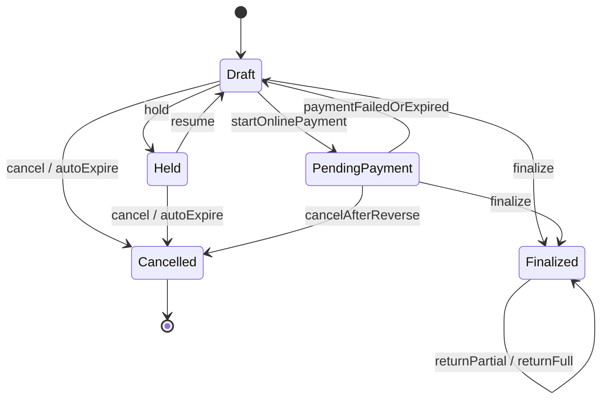
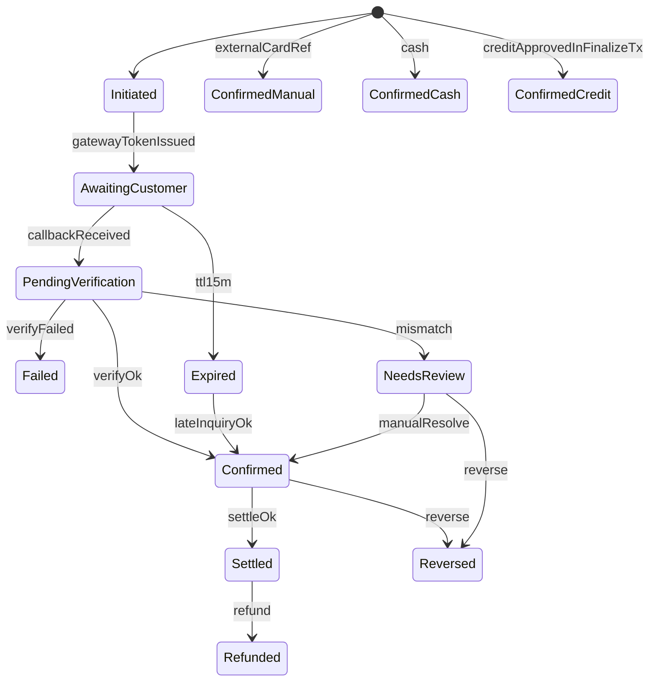
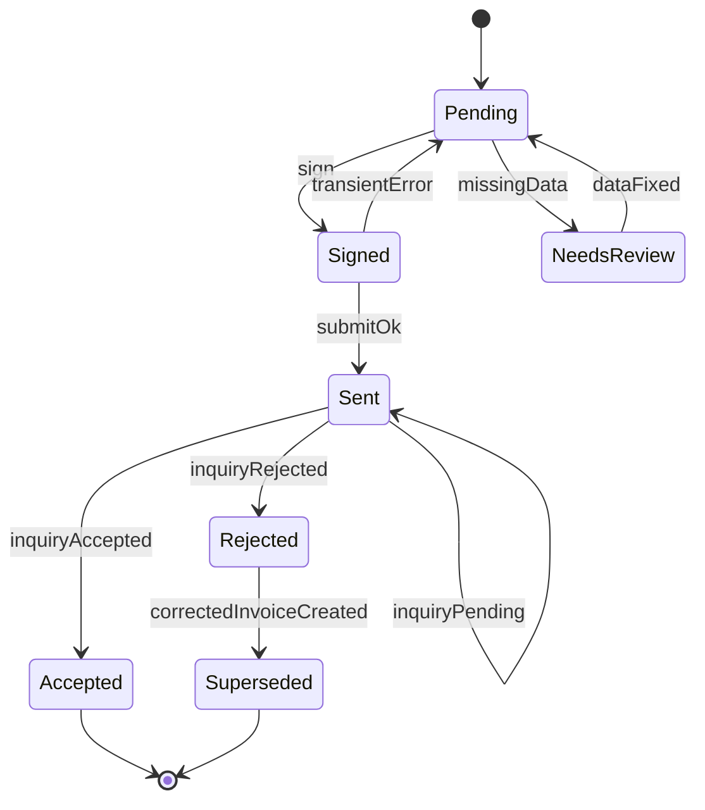

# D02 — مشخصات نیازمندی‌های نرم‌افزار (SRS)

> **قرارداد:** `[REQ]` الزام سند مرجع · `[ASM]` فرض · `[DEC]` تصمیم پیشنهادی · `[REC]` توصیه · `[OQ]` پرسش باز.
> اولویت‌ها: **P0** = MVP، **P1** = فاز ۲، **P2** = فاز ۳.
> روش وارسی (Verification Method): **T** تست خودکار · **I** بازرسی کد یا پیکربندی · **A** تحلیل یا محاسبه · **D** نمایش در UAT.
> شناسه تست‌ها (`AT-xxx`) فعلاً جانگهدار هستند و در **D10** به Test Case اجرایی تبدیل می‌شوند.

## فهرست

1. مقدمه و قواعد شناسه‌گذاری
2. واژه‌نامه
3. بازیگران و کاتالوگ مجوزها
4. قواعد کسب‌وکار سراسری (BR)
5. نیازمندی‌های عملکردی به تفکیک حوزه
6. ماشین‌های حالت (State Machines)
7. Use Caseهای تفصیلی (UC-01 تا UC-10)
8. نیازمندی‌های غیرعملکردی (NFR)
9. ماتریس ردیابی (Traceability)
10. فرضیات، تصمیم‌ها و پرسش‌های باز این سند

---

## 1. مقدمه و قواعد شناسه‌گذاری

### 1.1 هدف
این سند نیازمندی‌های D01 را به **الزامات قابل تست** تبدیل می‌کند. مبنای D03 (مدل دامنه)، D05 (داده)، D07 (API) و D10 (تست) است. هر نیازمندی این سند دارای این ویژگی‌هاست:
- یک شناسه پایدار دارد.
- اولویت دارد.
- روش وارسی دارد.
- دست‌کم یک معیار پذیرش (AC) دارد که قابل اندازه‌گیری است.

### 1.2 شناسه‌ها
| الگو | معنی | مثال |
|---|---|---|
| `XXX-nnn` | نیازمندی سند مرجع (بدون تغییر) | `SAL-007` |
| `XXX-nnn.m` | ریزنیازمندی مشتق‌شده از نیازمندی مرجع | `SAL-007.3` |
| `IAM-nnn`، `PAY-nnn`، `TAX-nnn`، `PRC-nnn` | حوزه‌هایی که سند مرجع شناسه مستقل نداده بود (مشتق از §3، §8، §13، SAL-006، INV-007) | `PAY-004` |
| `BR-nnn` | قاعده کسب‌وکار سراسری | `BR-010` |
| `NFR-XXX-nnn` | نیازمندی غیرعملکردی | `NFR-PERF-002` |
| `UC-nn` | Use Case | `UC-02` |
| `AT-nnn` | تست پذیرش (D10) | `AT-031` |
| `PRD-TAX-nnn` | از D01 §6.8؛ در این سند به `TAX-nnn` نگاشت می‌شود | — |

### 1.3 دامنه
همه قابلیت‌های **P0** در D01 §6. قابلیت‌های P1/P2 فقط وقتی آورده شده‌اند که مدل MVP باید از همین حالا برایشان جا باز کند. این موارد با برچسب «آماده‌سازی مدل» مشخص شده‌اند.

---

## 2. واژه‌نامه

| اصطلاح | تعریف |
|---|---|
| Tenant | یک کسب‌وکار مشترک پلتفرم (فروشگاه مستقل یا زنجیره) که مالک داده‌های خود است. |
| Branch / شعبه | واحد فیزیکی فروش در یک Tenant؛ دارای انبار، صندوق و شناسه حافظه مالیاتی. |
| Register / صندوق | نقطه فروش منطقی در شعبه؛ شیفت روی آن باز می‌شود. |
| Terminal / دستگاه | دستگاه فیزیکی (گوشی/تبلت/PC) ثبت‌شده که POS روی آن اجرا می‌شود؛ `DeviceId` دارد. |
| Shift / شیفت | بازه کاری یک صندوق‌دار روی یک صندوق با موجودی نقد اول و آخر. |
| Sale / فروش | فاکتور فروش؛ از Draft تا Finalized. |
| Finalize | عمل اتمی نهایی‌سازی فروش: شماره فاکتور، گردش انبار، سند حسابداری و Outbox. |
| SaleLineSnapshot | کپی تغییرناپذیر قیمت، نام، واحد، تخفیف و مالیات قلم در لحظه Finalize. |
| Idempotency-Key | کلید یکتای سمت کلاینت برای هر عمل غیرتکراری؛ تکرار آن همان نتیجه قبلی را برمی‌گرداند. |
| Stock Ledger | دفتر گردش کالا (append-only). موجودی از آن مشتق می‌شود. |
| StockBalance | Projection موجودی به ازای `(variant, warehouse)`؛ قابل بازسازی از Ledger. |
| WAC | میانگین موزون متحرک بهای تمام‌شده به ازای `(tenant, variant, warehouse)`. |
| JournalEntry / سند | سند حسابداری دوبل؛ Draft، Posted یا Reversed. |
| PostingRule | قاعده نسخه‌دار تبدیل رویداد کسب‌وکار به سطرهای سند. |
| GlobalCustomer | هویت سراسری مشتری در پلتفرم؛ مستقل از Tenant. |
| PublicCustomerCode | کد عمومی و تصادفی مشتری (مثلاً `CU-7P4K9X2Q`). شناسه است، **نه** مجوز. |
| TenantCustomerMembership | عضویت مشتری در یک Tenant؛ تنها شناسه‌ای که Sales نگه می‌دارد. |
| Customer QR | Token کوتاه‌عمر که مشتری نشان می‌دهد تا به فاکتور جاری وصل شود. |
| Store QR / QR پیشخوان | QR امضاشده فروشگاه برای عضویت مشتری. |
| Receipt Link | لینک امن و قابل ابطال دسترسی به یک فاکتور. |
| PaymentIntent | قصد پرداخت یک مبلغ مشخص برای یک فروش، با یک روش و یک PSP. |
| PSP | ارائه‌دهنده خدمات پرداخت (درگاه شاپرکی). |
| کارتخوان مستقل | دستگاه کارتخوان غیریکپارچه؛ صندوق‌دار شماره پیگیری را دستی وارد می‌کند. |
| TaxInvoice / صورتحساب الکترونیکی | صورتحسابی که برای سامانه مؤدیان ساخته، امضا و ارسال می‌شود. |
| شناسه حافظه مالیاتی | شناسه‌ای که سامانه مؤدیان به واحد صدور صورتحساب می‌دهد. |
| Outbox / Inbox | جداول تضمین انتشار و مصرف یک‌باره رویدادها. |
| NeedsReview | حالت ناسازگاری‌ای که خودکار حل نمی‌شود و باید یک انسان آن را بررسی کند. |

---

## 3. بازیگران و کاتالوگ مجوزها

### 3.1 بازیگران
| بازیگر | قلمرو هویت | توضیح |
|---|---|---|
| `TenantOwner`، `TenantAdmin`، `BranchManager`، `Cashier`، `WarehouseClerk`، `PurchasingOfficer`، `Accountant`، `Auditor`، `ReadOnlyAnalyst` | merchant | §3.2 سند مرجع |
| `PlatformSuperAdmin`، `PlatformSupport`، `CatalogModerator`، `BillingOperator` | merchant (Tenant = Platform) | §3.1؛ بدون دسترسی پیش‌فرض به داده Tenantها |
| `Customer` | customer | مشتری احرازشده |
| `Guest` | — | بدون حساب |
| `System:Worker` | service | Workerهای پس‌زمینه با Tenant Context صریح |
| External: PSP، SMS، Bale، Catalog Provider، سامانه مؤدیان | — | فقط از طریق Adapter |

### 3.2 کاتالوگ مجوزها (Permission Catalog)

هر مجوز روی یک **Scope** اعمال می‌شود: `Tenant` ⊃ `Branch` ⊃ `Warehouse|Register` و `OwnShift`. قاعده پیش‌فرض **Default Deny** است. ماتریس کامل نقش × مجوز در **D06** می‌آید. نقش‌ها فقط بسته‌ای از مجوزها هستند و منطق کسب‌وکار هرگز مستقیماً نام نقش را چک نمی‌کند.

| مجوز | شرح | Scope | نیاز به Approval؟ |
|---|---|---|---|
| `tenant.settings.manage` | تنظیمات Tenant، مالیات، شعب | Tenant | — |
| `iam.users.manage` | دعوت، غیرفعال‌سازی، تخصیص نقش | Tenant/Branch | — |
| `catalog.product.manage` | تعریف و ویرایش کالا | Tenant | — |
| `catalog.price.manage` | تغییر قیمت | Tenant/Branch | **بله** اگر تغییر گروهی یا بیش از آستانه (BR-041) |
| `inventory.receipt.create` | رسید خرید/ورود | Warehouse | — |
| `inventory.adjust` | تعدیل موجودی | Warehouse | **بله** بالاتر از آستانه ارزش (BR-033) |
| `inventory.transfer` | انتقال بین انبارها | Warehouse (مبدأ) | — |
| `inventory.count` | انبارگردانی | Warehouse | تأیید نتیجه: `inventory.adjust` |
| `pos.sell` | ایجاد و نهایی‌سازی فروش | Register + OwnShift | — |
| `pos.discount.apply` | تخفیف دستی | Register | **بله** بیش از سقف نقش (BR-021) |
| `pos.sale.cancel` | لغو فروش غیرنهایی | OwnShift | — |
| `sales.return.create` | ثبت برگشت | Branch | **بله** بیش از سقف مبلغ یا بعد از مهلت (BR-052) |
| `payments.refund` | بازپرداخت | Branch | **بله** (همیشه برای بازپرداخت آنلاین) |
| `sales.credit.sell` | فروش نسیه به مشتری دارای حساب اعتباری | Register | **بله** اگر از سقف اعتبار یا مهلت بگذرد (BR-082) |
| `credit.account.manage` | ایجاد حساب اعتباری، تعیین سقف و مهلت، مسدودسازی | Tenant/Branch | **بله** برای افزایش سقف بالاتر از آستانه (BR-081) |
| `receivables.collect` | دریافت وجه از مشتری بابت مانده نسیه | Branch | — |
| `receivables.writeoff` | سوخت/تعدیل مطالبات | Tenant | **بله** (همیشه) |
| `templates.receipt.manage` | ویرایش قالب و متن قانونی فاکتور در حد مجاز صنف | Tenant | — |
| `shift.manage` | باز/بستن شیفت خود | Register | — |
| `shift.supervise` | بستن شیفت دیگران، تأیید مغایرت | Branch | — |
| `accounting.journal.post` | ثبت سند دستی | Tenant | — |
| `accounting.period.close` | بستن دوره | Tenant | — |
| `accounting.read` | دفاتر و گزارش مالی | Tenant/Branch | — |
| `customers.lookup` | یافتن مشتری با کد/QR | Branch | — |
| `customers.pii.view` | دیدن شماره کامل مشتری عضو | Tenant | — (پیش‌فرض فقط Owner) |
| `tax.manage` | پروفایل مالیاتی، کلید، بازارسال | Tenant | — |
| `reports.view` | گزارش‌ها | Tenant/Branch | — |
| `audit.view` | مشاهده ممیزی | Tenant | — |
| `integrations.manage` | کلید API، PSP، Webhook | Tenant | — |
| `data.export` | Export داده (TEN-005، RPT-003)؛ شماره کامل مشتری فقط همراه `customers.pii.view` | Tenant | — (ممیزی + Alert DET-08 در D06) |
| `platform.support.jit` | دسترسی پشتیبانی زمان‌دار | Platform → Tenant | **بله**، با رضایت Tenant (IAM-008) |

---

## 4. قواعد کسب‌وکار سراسری (BR)

### 4.1 Tenancy و هویت
| ID | قاعده | مرجع | وارسی |
|---|---|---|---|
| BR-001 | Tenant فعال فقط از Session/Token سرور و Membership معتبر کاربر تعیین می‌شود. هر `tenantId` در Body، Query یا Header کلاینت **نادیده گرفته یا رد** می‌شود. | §8.1 | T |
| BR-002 | هر عملیات روی منبع Tenant-owned هم در Application (Policy) و هم در DB (RLS) محدود می‌شود. | §8.2 | T + I |
| BR-003 | دسترسی به منبعی که وجود دارد ولی متعلق به Tenant دیگر است، پاسخ **404** می‌گیرد (نه 403) تا وجود منبع افشا نشود. | §8.4 | T |
| BR-004 | توکن قلمرو `customer` در APIهای merchant و برعکس نامعتبر است (Audience جدا). | §15.1، D-03 | T |

### 4.2 پول، مالیات و گردکردن
| ID | قاعده | مرجع |
|---|---|---|
| BR-010 | همه مبالغ با نوع `Money{amount: int64, currency: "IRR"}` ذخیره می‌شوند و واحدشان **ریال صحیح** است. Float/Double در هیچ لایه‌ای مجاز نیست. | §11.2، D-07 |
| BR-011 | نمایش تومان = ریال ÷ ۱۰. این تبدیل فقط در لایه نمایش انجام می‌شود. ورودی کاربر به تومان قبل از ارسال به ریال تبدیل می‌شود، و چون ۱ تومان = ۱۰ ریال است، این تبدیل هیچ‌وقت گرد نمی‌شود. | §13 |
| BR-012 | مقدار (Quantity) از نوع `decimal(18,6)` است. دقت مجاز هر Unit جدا تعریف می‌شود (مثلاً «عدد»: ۰ رقم اعشار، «کیلوگرم»: ۳ رقم). | INV-005 |
| BR-013 | **ترتیب محاسبه هر قلم** `[DEC D-13]`: `gross = round(qty × unitPrice)` ← `lineDiscount` ← `allocatedInvoiceDiscount` ← `net = gross − lineDiscount − allocatedInvoiceDiscount` ← `tax = round(net × rate)` ← `lineTotal = net + tax`. گردکردن همیشه به **نزدیک‌ترین ریال، نیمه رو به بالا (half-up)** است. | ACC-005 |
| BR-014 | **تخفیف سطح فاکتور** به نسبت `net` پیش از تخفیف بین اقلام سرشکن می‌شود. باقیمانده گردکردن با روش **Largest Remainder** توزیع می‌شود تا جمع سهم‌ها دقیقاً برابر کل تخفیف شود. دلیل: سامانه مؤدیان مالیات را در سطح قلم می‌خواهد. | ACC-005، TAX |
| BR-015 | جمع فاکتور = Σ `lineTotal`. جمع فاکتور هرگز مستقیم از مبالغ گردنشده محاسبه نمی‌شود. | ACC-005 |
| BR-016 | حالت قیمت‌گذاری Tenant `[ASM A-10]`: `TaxExclusive` (پیش‌فرض) یا `TaxInclusive`. در حالت Inclusive: `net = round(lineGrossAfterDiscount ÷ (1 + rate))` و `tax = lineGrossAfterDiscount − net`. | §13 |
| BR-017 | نرخ مالیات **نسخه‌دار** است و `validFrom` دارد. فاکتور نرخ معتبر در لحظه Finalize را Snapshot می‌کند. تغییر نرخ هیچ فاکتور Finalized را عوض نمی‌کند. | ACC-005، §13 |
| BR-018 | مبلغ قابل پرداخت **فقط روی سرور** محاسبه می‌شود. هر مبلغی که کلاینت بفرستد، صرفاً برای مقایسه (`expectedTotal`) است. | §15.3 |

### 4.3 زمان و تقویم
| ID | قاعده |
|---|---|
| BR-020 | همه زمان‌ها `timestamptz` (UTC) هستند. `TenantTimeZone` (پیش‌فرض `Asia/Tehran`) فقط برای تعیین «روز کاری»، دوره مالی و نمایش به کار می‌رود. |
| BR-021 | **سقف تخفیف دستی** هر نقش قابل تنظیم است (پیش‌فرض: Cashier ۰٪، BranchManager ۱۰۰٪). تخفیف بیش از سقف، Approval لحظه‌ای مدیر را لازم دارد: مدیر روی همان دستگاه PIN/MFA وارد می‌کند یا از دستگاه خود تأیید می‌کند. |
| BR-022 | «تاریخ مؤثر» سند حسابداری و گردش انبار، تاریخ Finalize در منطقه زمانی Tenant است. Backdate فقط با مجوز ممکن است و فقط در دوره باز. |
| BR-023 | سال و دوره مالی بر اساس تقویم شمسی تعریف می‌شوند، ولی مرزهایشان به‌صورت بازه UTC ذخیره می‌شوند (مثلاً دوره «فروردین ۱۴۰۶» = `[2027-03-21T00:00+03:30, 2027-04-21T00:00+03:30)`). |

### 4.4 یکپارچگی و تکرار
| ID | قاعده |
|---|---|
| BR-030 | این عملیات **حتماً** `Idempotency-Key` می‌خواهند: Finalize، ایجاد PaymentIntent، ثبت پرداخت دستی، Return، Refund، ثبت رسید، تعدیل، انتقال، ثبت سند دستی و Import. |
| BR-031 | کلید Idempotency به ازای `(tenant_id, key)` یکتاست و دست‌کم **۷ روز** نگهداری می‌شود `[DEC D-14]`. تکرار با Payload یکسان (Hash یکسان) پاسخ ذخیره‌شده را با همان Status برمی‌گرداند. تکرار با Payload متفاوت `409 idempotency-key-reused` می‌گیرد. |
| BR-032 | هر StockMovement و JournalEntry یک `source_document_type + source_document_id + source_line` دارد که **Unique** است. ثبت دوباره از یک منبع در سطح DB غیرممکن است. |
| BR-033 | تعدیل موجودی با ارزش (`|Δqty| × WAC`) بیش از آستانه Tenant (پیش‌فرض: ۵۰٬۰۰۰٬۰۰۰ ریال `[ASM]`) Approval می‌خواهد. |
| BR-034 | به‌روزرسانی هر Aggregate قابل ویرایش (Sale Draft، Product، PriceList) با `expectedVersion`/ETag انجام می‌شود. ناهمخوانی نسخه `409 version-conflict` می‌گیرد. |
| BR-035 | فراخوانی سرویس خارجی (PSP، SMS، Bale، مؤدیان، Catalog) **هرگز** داخل تراکنش DB انجام نمی‌شود. |

### 4.5 موجودی
| ID | قاعده |
|---|---|
| BR-040 | Policy موجودی منفی سه سطح دارد: Tenant ← Branch ← Variant. پیش‌فرض `Forbid` است و مقادیر مجاز `Forbid | AllowWithWarning`. تغییر آن ممیزی می‌شود. |
| BR-041 | تغییر قیمت **گروهی** (بیش از ۲۰ Variant در یک عمل) یا تغییر بیش از ±۳۰٪ قیمت یک Variant، Approval می‌خواهد `[ASM]` (آستانه‌ها قابل تنظیم‌اند). |
| BR-042 | WAC هنگام هر ورود با بها (رسید خرید، برگشت از فروش به بهای اصلی) دوباره محاسبه می‌شود: `newWAC = round((onHand×WAC + qtyIn×unitCost) ÷ (onHand + qtyIn))`. خروج‌ها با WAC جاری ارزش‌گذاری می‌شوند و WAC را تغییر نمی‌دهند. |
| BR-043 | اگر موجودی پیش از ورود ≤ ۰ باشد (در حالت AllowWithWarning)، `newWAC = unitCost` ورودی است. اختلاف ارزش منفی قبلی به حساب «تعدیل بهای موجودی» ثبت می‌شود `[DEC D-15]`. حسابدار باید تأیید کند (OQ-05). |
| BR-044 | واحد پایه هر Variant ثابت است. تبدیل‌ها (کارتن = ۲۴ عدد) نسخه‌دارند. سند، ضریب تبدیل لحظه ثبت را Snapshot می‌کند. |

### 4.6 فروش و برگشت
| ID | قاعده |
|---|---|
| BR-050 | Finalize فقط وقتی مجاز است که صندوق‌دار **شیفت باز** روی همان Register داشته باشد. |
| BR-051 | فاکتور Finalized غیرقابل ویرایش است. اصلاح فقط با برگشت (کامل یا جزئی) و فاکتور جدید انجام می‌شود. |
| BR-052 | مهلت پیش‌فرض برگشت **۷ روز** است و برای Tenant قابل تنظیم است `[ASM]`. برگشت بعد از مهلت یا با مبلغ بیش از سقف نقش، Approval می‌خواهد. |
| BR-053 | مقدار قابل برگشت هر قلم = مقدار فروخته‌شده − Σ مقدار برگشت‌های قبلی آن قلم. این مقدار در DB با Constraint یا Lock کنترل می‌شود. |
| BR-054 | مبلغ برگشت هر قلم = سهم متناسب `lineTotal` (شامل تخفیف و مالیات سرشکن‌شده)، با همان روش گردکردن. برگشت کامل آخرین واحد باقیمانده دقیقاً مبلغ باقیمانده را برمی‌گرداند تا جمع برگشت‌ها از مبلغ اصلی بیشتر نشود. |
| BR-055 | روش پیش‌فرض بازپرداخت، **همان روش پرداخت اصلی** است. بازپرداخت نقدی برای فروشی که پرداختش کارتی/آنلاین بوده، Approval می‌خواهد. |
| BR-056 | شماره فاکتور به ازای `(tenant, branch, fiscalYear)` یک **دنباله بدون فاصله** است و داخل تراکنش Finalize با Lock ردیف شمارنده تخصیص می‌یابد `[DEC D-16]`. اگر تراکنش Rollback شود، شماره مصرف نمی‌شود. |

### 4.7 مشتری و حریم خصوصی
| ID | قاعده |
|---|---|
| BR-060 | شماره موبایل فقط پس از OTP «تأییدشده» حساب می‌شود. شماره تأییدنشده هرگز برای اتصال هویت به کار نمی‌رود. |
| BR-061 | Lookup با PublicCode یا QR فقط این را برمی‌گرداند: `{tenantCustomerId?, displayName (masked, e.g. "م*** ر***"), membershipStatus}`، آن هم **فقط** در Tenant درخواست‌کننده. اگر Membership نباشد، فقط «مشتری وجود دارد، عضو نیست» و یک گزینه برای دعوت به عضویت (نیازمند OTP یا اسکن QR توسط خود مشتری). |
| BR-062 | شماره کامل مشتری فقط به نقشی با `customers.pii.view` نشان داده می‌شود و هر نمایش ممیزی می‌شود. نمایش پیش‌فرض Masked است: `0912***4567`. |
| BR-063 | رضایت **عملیاتی** (دریافت فاکتور و اعلان تراکنش) و **بازاریابی** به ازای هر `(customer, tenant, channel)` جدا ذخیره می‌شوند. هر رکورد این فیلدها را دارد: `purpose, granted, version, source, timestamp, withdrawnAt`. |
| BR-064 | هیچ API یا گزارشی Merchant سابقه خرید، Membership یا شماره مشتری را در **Tenant دیگر** نشان نمی‌دهد. استثنایی ندارد. |

### 4.8 مالیات (سامانه مؤدیان)
| ID | قاعده |
|---|---|
| BR-070 | هر فاکتور Finalized یک `TaxInvoiceSubmission` در وضعیت `Pending` می‌سازد. این کار داخل همان تراکنش Finalize و فقط به‌صورت رکورد Outbox انجام می‌شود. ساخت، امضا و ارسال بعد از Commit است. |
| BR-071 | شکست یا قطعی سامانه مؤدیان **هرگز** مانع Finalize، تحویل کالا یا ارسال فاکتور دیجیتال نمی‌شود. |
| BR-072 | برگشت از فروش، صورتحساب اصلاحی/برگشتی متناظر می‌سازد. **ابطال** فقط طبق قواعد سامانه و فقط برای صورتحساب‌هایی ممکن است که سامانه اجازه می‌دهد (Verification Required). |
| BR-073 | داده‌های لازم صورتحساب (شناسه کالا/خدمت، نرخ مالیات، شناسه/کد اقتصادی خریدار در صورت لزوم، شناسه حافظه، الگو و نوع صورتحساب) در **Snapshot فاکتور** ذخیره می‌شوند تا ساخت دوباره صورتحساب به داده‌ای که بعداً تغییر کرده وابسته نباشد. |
| BR-074 | اگر سامانه صورتحساب را رد کند، صورتحساب به `Rejected` می‌رود با کد خطا. اصلاح داده و ارسال دوباره صورتحساب **جدید و مرتبط** می‌سازد و رکورد قبلی را بازنویسی نمی‌کند. |
| BR-075 | **مهلت ارسال قابل تنظیم است** (پاسخ کارفرما: «هر سه ماه ولی داینامیک»). `TaxSubmissionPolicy` نسخه‌دار در سطح **پلتفرم** (`validFrom`، `periodType: Monthly|Quarterly|Custom`، `deadlineOffsetDays` پس از پایان دوره، برای هر نوع مودی یا الگو) تعریف می‌شود. پیش‌فرض: دوره **سه‌ماهه** (فصل شمسی). Tenant نمی‌تواند مهلت را از Policy پلتفرم طولانی‌تر کند. | پاسخ کارفرما |
| BR-076 | سامانه صورتحساب را **به‌محض Finalize** ارسال می‌کند و منتظر پایان دوره نمی‌ماند. مهلت فقط مبنای هشدار و اولویت‌بندی است. هشدارها: ۵۰٪، ۸۰٪ و ۹۵٪ زمان باقیمانده تا مهلت برای هر صورتحساب `Pending`، `Rejected` یا `NeedsReview`. | — |

### 4.9 فروش نسیه، قالب فاکتور و نگهداری داده
| ID | قاعده |
|---|---|
| BR-080 | فروش نسیه فقط به مشتری‌ای مجاز است که (۱) Membership در همان Tenant دارد، (۲) **حساب اعتباری فعال** (`CustomerCreditAccount`) دارد، و (۳) هویت او برای اعتبار تکمیل شده است: نام کامل و کد ملی برای شخص حقیقی، یا شناسه ملی و کد اقتصادی برای حقوقی. این داده‌ها **داده Tenant** هستند، نه داده سراسری مشتری، و رمزنگاری می‌شوند. |
| BR-081 | هر حساب اعتباری `creditLimit` (ریال)، `paymentTermDays` (مهلت پرداخت هر فاکتور؛ پیش‌فرض ۳۰ روز `[ASM]`) و وضعیت (`Active|Suspended|Closed`) دارد. افزایش سقف بیش از آستانه Tenant Approval می‌خواهد. |
| BR-082 | در Finalize فروشی که بخش نسیه دارد، **داخل همان تراکنش** حساب اعتباری قفل (`FOR UPDATE`) و بررسی می‌شود: `outstanding + creditPortion ≤ creditLimit` و نبودِ فاکتور سررسیدگذشته (اگر Policy «مسدودی با سررسید» فعال باشد؛ پیش‌فرض فعال). نقض هر کدام ← `409 credit-limit-exceeded` یا `409 credit-overdue`، مگر با Approval لحظه‌ای مدیر (IAM-007). |
| BR-083 | مانده مشتری از **دفتر معین دریافتنی** (`ReceivableEntry`، append-only) مشتق می‌شود. `outstanding` در حساب اعتباری Projection هم‌تراکنش است و هر شب با دفتر و با حساب کنترل «حساب‌های دریافتنی تجاری» در دفترکل تطبیق داده می‌شود. |
| BR-084 | دریافت وجه از مشتری (Collection) با روش نقد، کارتخوان یا درگاه آنلاین (لینک پرداخت برای مشتری) انجام می‌شود و به فاکتورهای باز به ترتیب **قدیمی‌ترین سررسید (FIFO)** تخصیص می‌یابد، مگر کاربر دستی تخصیص دهد. پیش‌دریافت (اضافه پرداخت) مانده بستانکار می‌سازد که در فروش بعدی قابل مصرف است. |
| BR-085 | برگشت از فروش نسیه، اول از مانده بدهی **همان فاکتور** کم می‌کند. فقط اضافه آن (اگر بخشی از فاکتور نقد پرداخت شده بود) طبق BR-055 بازپرداخت می‌شود. |
| BR-086 | **قالب فاکتور و متن قانونی** (پاسخ کارفرما: «داینامیک و قابل تعریف برای هر صنف»): `ReceiptTemplate` نسخه‌دار در دو سطح: (۱) **قالب صنف** که پلتفرم تعریف می‌کند (متن قانونی، فیلدهای اجباری، مثلاً «شماره پروانه کسب» برای صنفی که لازم دارد)، و (۲) **سفارشی‌سازی Tenant** فقط روی بخش‌های مجاز (لوگو، امضا، متن آزاد پایین فاکتور). Tenant نمی‌تواند متن قانونی یا فیلد اجباری صنف را حذف کند. فاکتور نسخه قالب استفاده‌شده را Snapshot می‌کند. |
| BR-087 | **مدت نگهداری قابل تعریف است** (پاسخ کارفرما): `RetentionPolicy` نسخه‌دار به ازای **دسته داده** (اسناد مالی، فاکتور، گردش انبار، صورتحساب مالیاتی، ممیزی، داده CRM مشتری، لاگ فنی). پلتفرم برای هر دسته **حداقل** (کف قانونی، با تأیید حقوقی) و پیش‌فرض تعیین می‌کند. Tenant فقط می‌تواند مدت را **بیشتر** از کف کند. اجرای حذف یا ناشناس‌سازی با Job زمان‌بندی‌شده و ممیزی‌شده انجام می‌شود و برای داده‌ای که «Legal Hold» دارد متوقف می‌شود. |

---

## 5. نیازمندی‌های عملکردی

> ستون AC به معیارهای پذیرش زیر هر جدول یا به Use Case بخش 7 ارجاع می‌دهد.

### 5.1 Platform & Tenant (TEN)

| ID | نیازمندی | P | V | AC |
|---|---|---|---|---|
| TEN-001 | ثبت‌نام کسب‌وکار: مالک (با OTP و MFA)، نام تجاری، صنف، `TimeZone`، ارز `IRR`، حالت قیمت‌گذاری مالیات. | P0 | T | UC-10 |
| TEN-001.1 | پس از ثبت‌نام: شعبه اول، انبار اول، صندوق اول، شجره حساب پیش‌فرض صنف و دوره مالی جاری خودکار ساخته می‌شوند. | P0 | T | AT-001 |
| TEN-002 | Tenant می‌تواند چند شعبه داشته باشد. هر شعبه ≥۱ انبار و ≥۱ صندوق دارد و کاربران با Scope شعبه به آن دسترسی دارند. | P0 | T | AT-002 |
| TEN-002.1 | ثبت Terminal: دستگاه با کد جفت‌سازی یک‌بارمصرف (۱۰ دقیقه) که مدیر شعبه صادر می‌کند به یک شعبه متصل می‌شود و `DeviceId` می‌گیرد. دستگاه قابل ابطال است. | P0 | T | AT-003 |
| TEN-003 | اشتراک: Trial (مدت قابل تنظیم)، پلن با Entitlement سمت سرور (حداکثر شعبه، کاربر، صندوق). عبور از سقف در API با `403 entitlement-exceeded` رد می‌شود. | P0 | T | AT-004 |
| TEN-004 | تعلیق یا انقضا: Tenant **Read-Only** می‌شود (فروش، رسید و سند جدید ممنوع؛ خواندن، گزارش و Export مجاز). هیچ داده‌ای حذف نمی‌شود. ارسال صورتحساب‌های Pending به مؤدیان **ادامه می‌یابد** تا تعهد قانونی فروش‌های قبلی معطل نماند. | P0 | T | AT-005 |
| TEN-005 | Export کامل داده‌های اصلی (کالا، مشتریان عضو، فاکتورها، گردش انبار، اسناد) به CSV/JSON به‌صورت Job ناهمگام با لینک امن و منقضی‌شونده. هر Export ممیزی می‌شود. | P0 | T | AT-006 |
| TEN-005.1 | لغو اشتراک: داده هر دسته تا پایان مدت `RetentionPolicy` (BR-087) نگهداری و سپس حذف یا ناشناس می‌شود. تنظیم Policy (پلتفرم و Tenant) و Job اجرای آن در MVP هستند. | P0 | T | AT-007 |

### 5.2 Identity & Access (IAM)

| ID | نیازمندی | P | V | AC |
|---|---|---|---|---|
| IAM-001 | کاربر Merchant با دعوت ایمیل/پیامکی وارد می‌شود. یک شخص می‌تواند عضو چند Tenant باشد و پس از ورود Tenant فعال را انتخاب می‌کند. | P0 | T | AT-010 |
| IAM-002 | احراز هویت با OIDC (Authorization Code + PKCE) از طریق BFF. Session در HttpOnly Secure SameSite Cookie نگه داشته می‌شود و Token در JavaScript در دسترس نیست. | P0 | T+I | AT-011 |
| IAM-003 | MFA اجباری برای `TenantOwner`، `TenantAdmin`، `Accountant` و همه نقش‌های Platform. روش‌ها: TOTP (پیش‌فرض) و WebAuthn/Passkey (توصیه‌شده). OTP پیامکی **فقط** برای ورود صندوق‌دار و انباردار مجاز است. | P0 | T | AT-012 |
| IAM-004 | ورود سریع صندوق‌دار روی Terminal ثبت‌شده: پس از ورود کامل اولیه در روز، با PIN ۴ تا ۶ رقمی قفل و بازگشایی می‌شود. پس از ۵ خطا PIN قفل می‌شود. | P0 | T | AT-013 |
| IAM-005 | Session: عمر Access Token کوتاه (≤ ۱۰ دقیقه)، Refresh Rotation با تشخیص استفاده مجدد، Idle Timeout قابل تنظیم (پیش‌فرض POS: ۱۲ ساعت با قفل PIN پس از ۵ دقیقه؛ Admin: ۳۰ دقیقه)، «خروج از همه دستگاه‌ها» و فهرست Sessionها. | P0 | T | AT-014 |
| IAM-006 | مجوزدهی: Permission + Scope (بخش 3.2). هر Endpoint یک Policy صریح دارد و پیش‌فرض Deny است. | P0 | T+I | AT-015 |
| IAM-007 | Approval لحظه‌ای: برای عملیاتی که در 3.2 علامت دارند، مدیر روی همان دستگاه با PIN+MFA یا از دستگاه خود با Push/لینک تأیید می‌کند. تأییدکننده، درخواست‌کننده، دلیل و زمان ممیزی می‌شوند. درخواست‌کننده نمی‌تواند خودش تأیید کند. | P0 | T | AT-016 |
| IAM-008 | دسترسی پشتیبانی (JIT): Support درخواست دسترسی زمان‌دار (حداکثر ۴ ساعت) با دلیل می‌دهد. TenantOwner آن را تأیید می‌کند. در این مدت داده PII و مالی Masked است و همه اقدام‌ها با برچسب Support ممیزی می‌شوند. | P0 | T | AT-017 |
| IAM-009 | غیرفعال‌سازی کاربر بلافاصله همه Sessionهای او را باطل می‌کند (≤ ۶۰ ثانیه تا اثر کامل). | P0 | T | AT-018 |

### 5.3 Catalog & Merchandising (CAT)

| ID | نیازمندی | P | V | AC |
|---|---|---|---|---|
| CAT-001 | مدل کالا: `TenantProduct` (نام، برند، دسته، واحد پایه، شناسه کالا/خدمت مالیاتی، نرخ مالیات) ← `TenantVariant` (SKU، ویژگی‌ها، وضعیت) ← `TenantProductBarcode`. | P0 | T | AT-020 |
| CAT-002 | هر Variant صفر یا چند بارکد دارد، هر بارکد با `packagingUnit` (عدد/بسته/کارتن) و ضریب. تاریخچه افزودن و حذف بارکد نگهداری می‌شود. | P0 | T | AT-021 |
| CAT-002.1 | یک بارکد فعال در یک Tenant فقط به **یک** `(variant, packagingUnit)` اشاره می‌کند: Unique `(tenant_id, barcode) WHERE active`. | P0 | T | AT-022 |
| CAT-003 | اعتبارسنجی EAN-8، EAN-13، UPC-A و GTIN-14 با Check Digit. UPC-A به GTIN-13 نرمال می‌شود (پیشوند `0`). همه بارکدها به **GTIN-14 نرمال‌شده** ذخیره می‌شوند و فرم اصلی هم نگه داشته می‌شود. | P0 | T | AT-023 |
| CAT-003.1 | بارکد داخلی فروشگاه: کدهای با پیشوند محدوده داخلی GS1 (`02`، `20`–`29`) یا کد آزاد بدون Check Digit، فقط داخل همان Tenant معتبرند و هرگز به Global Catalog نمی‌روند. | P0 | T | AT-024 |
| CAT-004 | Resolve بارکد طبق UC-01. پاسخ شامل `candidates[]` است و هر کاندید این فیلدها را دارد: `source`, `confidence (0..1)`, `lastVerifiedAt`, `license`, `fields`. | P0 | T | UC-01 |
| CAT-004.1 | آستانه Confidence: کاندید با `confidence < 0.8` یا کاندیدهای متعارض (بیش از یک کاندید با اختلاف نام/برند) فقط پیشنهاد هستند و تأیید صریح کاربر را لازم دارند `[DEC D-17]`. حتی بالای آستانه هم ذخیره نهایی کالا یک عمل «تأیید» کاربر می‌خواهد. | P0 | T | AT-025 |
| CAT-005 | Global Catalog هیچ فیلد قیمت، بهای خرید، تأمین‌کننده، موجودی یا سود ندارد. هیچ داده Tenant بدون فرایند Moderation و بدون حذف فیلدهای خصوصی وارد آن نمی‌شود. | P0 | T+I | AT-026 |
| CAT-005.1 | پیشنهاد کالا به Global Catalog (اختیاری و با Opt-in Tenant): فقط نام، برند، بارکد عمومی (غیرداخلی)، دسته و تصویر مجاز برای `CatalogModerator` ارسال می‌شود. | P0 | T | AT-027 |
| CAT-006 | ثبت بارکدی که در Tenant وجود دارد، خطای `409 barcode-already-assigned` با پیوند به کالای موجود می‌دهد. Merge دو کالا: انتقال بارکدها و ارجاع‌ها به کالای مقصد، غیرفعال‌شدن کالای مبدأ (نه حذف) و ثبت ممیزی. Merge فقط وقتی ممکن است که دو کالا واحد پایه یکسان داشته باشند. | P0 | T | AT-028 |
| CAT-007 | Profile بارکد وزنی (هر Tenant ≥۰ Profile): `prefix`، `itemCodeLength`، `valueType (Weight|Price)`، `valueLength`، `decimals`، `hasInnerCheckDigit`. Decode بارکد وزنی، Variant و مقدار یا مبلغ را برمی‌گرداند. | P0 | T | AT-029 |
| CAT-007.1 | برچسب با مبلغ (Price-embedded): مقدار = `round(price ÷ unitPrice, 3)`. اختلاف گردکردن باعث نمی‌شود مبلغ قلم با مبلغ برچسب فرق کند، یعنی مبلغ برچسب مرجع است. | P0 | T | AT-030 |
| CAT-008 | Variant Matrix: تعریف Axisها (رنگ، سایز) و تولید Variantها از حاصل‌ضرب آن‌ها، با امکان غیرفعال‌کردن ترکیب‌ها. هر Variant SKU، بارکد، قیمت (اختیاری؛ پیش‌فرض قیمت محصول) و موجودی مستقل دارد. | P0 | T | AT-031 |
| CAT-009 | Price List: هر شعبه یک Price List فعال دارد (پیش‌فرض: Price List سراسری Tenant). قیمت هر Variant `validFrom` دارد. تغییر قیمت ممیزی می‌شود و BR-041 روی آن اعمال می‌شود. | P0 | T | AT-032 |
| CAT-010 | تخفیف: (الف) دستی خطی و سندی (درصد یا مبلغ) طبق BR-021؛ (ب) قاعده ساده خودکار: درصد روی کالا یا دسته در بازه زمانی. ترکیب چند قاعده خودکار در MVP: **فقط بیشترین تخفیف** اعمال می‌شود، نه جمع آن‌ها `[DEC D-18]`. | P0 | T | AT-033 |
| CAT-011 | جستجوی کالا در POS: با بارکد (دقیق)، SKU (دقیق)، و نام (پیشوندی، فارسی نرمال‌شده: یکسان‌سازی «ي/ی» و «ك/ک»، حذف اعراب و نیم‌فاصله). | P0 | T | AT-034 |

### 5.4 Inventory (INV)

| ID | نیازمندی | P | V | AC |
|---|---|---|---|---|
| INV-001 | موجودی فقط از `StockMovement` مشتق می‌شود. `StockBalance` در **همان تراکنش** هر Movement به‌روز می‌شود و یک Job شبانه آن را با Ledger مقایسه می‌کند. هر Drift هشدار می‌دهد و با فرمان مدیریتی قابل بازسازی است. | P0 | T | AT-040 |
| INV-002 | انواع سند: `GoodsReceipt`، `Adjustment` (با دلیل از فهرست: آسیب، انقضا، سرقت، خطای شمارش، سایر+توضیح)، `SaleIssue` (خودکار)، `SaleReturnReceipt` (خودکار)، `TransferOut/TransferIn`، `CountAdjustment`. هر Movement ارجاع به سند مبدأ دارد (BR-032). | P0 | T | AT-041 |
| INV-003 | Policy موجودی منفی طبق BR-040. در حالت `Forbid`، Finalize یا حواله‌ای که موجودی را منفی کند با `409 insufficient-stock` و فهرست اقلام کمبود رد می‌شود. | P0 | T | AT-042 |
| INV-004 | جلوگیری از Oversell: در Finalize، ردیف‌های `StockBalance` اقلام سبد به ترتیب `variant_id` قفل می‌شوند (`SELECT … FOR UPDATE`). کنترل موجودی بعد از Lock انجام می‌شود. | P0 | T | AT-043 (P0-2) |
| INV-004.1 | Reservation: فقط برای پرداخت آنلاین. یک `StockReservation` با TTL **۱۵ دقیقه** `[DEC D-19]` هنگام ساخت PaymentIntent ایجاد می‌شود و «قابل فروش» را کم می‌کند. Finalize آن را مصرف می‌کند و انقضا آن را آزاد می‌کند. | P0 | T | AT-044 |
| INV-005 | واحدها و تبدیل‌ها طبق BR-012 و BR-044. رسید با واحد کارتن ثبت می‌شود و Ledger به واحد پایه است. | P0 | T | AT-045 |
| INV-006 | WAC طبق BR-042 و BR-043. هر Movement خروجی `unitCost` (WAC لحظه) و `totalCost` را ذخیره می‌کند. | P0 | T+A | AT-046 |
| INV-008 | انتقال بین انبارها (MVP تک‌مرحله‌ای): یک تراکنش `TransferOut` از مبدأ و `TransferIn` به مقصد با همان WAC مبدأ ثبت می‌کند. مدل داده وضعیت `InTransit` را برای P1 پیش‌بینی کرده است. | P0 | T | AT-047 |
| INV-009 | انبارگردانی: ایجاد Count برای انبار (کامل یا بر اساس دسته)، ثبت شمارش با اسکن (چند شمارنده هم‌زمان)، نمایش اختلاف با موجودی سیستمی **در لحظه شروع Count** (Snapshot)، تأیید و ثبت `CountAdjustment`. فروش‌های حین شمارش در اختلاف لحاظ می‌شوند. | P0 | T | UC-09 |
| INV-010 | موجودی کم: هر Variant در هر انبار `reorderPoint` اختیاری دارد. گزارش و اعلان داخلی (درون‌برنامه‌ای) ارائه می‌شود. | P0 | T | AT-048 |

### 5.5 Procurement (PRC)

| ID | نیازمندی | P | V | AC |
|---|---|---|---|---|
| PRC-001 (INV-007) | تأمین‌کننده: نام، شناسه ملی یا کد اقتصادی (اختیاری)، تلفن، حساب طرف‌حساب در دفاتر. | P0 | T | AT-050 |
| PRC-002 | رسید خرید (`GoodsReceipt`): تأمین‌کننده، انبار، اقلام (اسکن)، مقدار، واحد، بهای واحد (ریال)، تخفیف و مالیات خرید (اختیاری). ثبت رسید، Movement ورودی، WAC جدید و سند «بدهکار موجودی و مالیات خرید / بستانکار حساب‌های پرداختنی تأمین‌کننده» را در یک تراکنش ثبت می‌کند. | P0 | T | UC-05 |
| PRC-003 | پرداخت به تأمین‌کننده (نقد یا بانک) با سند «بدهکار پرداختنی / بستانکار صندوق یا بانک». | P0 | T | AT-051 |
| PRC-004 | برگشت از خرید: خروج کالا با بهای WAC جاری و کاهش بدهی تأمین‌کننده به مبلغ توافقی. اختلاف به حساب «اختلاف بهای برگشت از خرید» می‌رود. | P0 | T | AT-052 |
| PRC-005 | سفارش خرید (PO) با گردش تأیید. | P1 | — | — |

### 5.6 POS & Sales (SAL)

| ID | نیازمندی | P | V | AC |
|---|---|---|---|---|
| SAL-001 | POS روی وب دسکتاپ، تبلت و موبایل: افزودن قلم با اسکن، جستجو یا انتخاب. تغییر مقدار و واحد، حذف قلم، تخفیف (BR-021)، انتخاب مشتری و پرداخت. | P0 | T+D | UC-02 |
| SAL-002 | اسکن با دوربین در PWA (HTTPS و مجوز کاربر) به‌صورت پیوسته. ورود دستی کد همیشه در دسترس است. Keyboard Wedge در هر صفحه POS بدون نیاز به فوکوس روی فیلد پذیرفته می‌شود. | P0 | T+D | AT-060 |
| SAL-002.1 | جلوگیری از اسکن دوباره ناخواسته: اسکن یک کد تکراری در کمتر از ۱٫۵ ثانیه نادیده گرفته می‌شود (قابل تنظیم). | P0 | T | AT-061 |
| SAL-003 | شناسایی مشتری در POS طبق UC-03 و BR-061. | P0 | T | UC-03 |
| SAL-004 | وضعیت‌های فروش طبق جدول گذار 6.1. | P0 | T | AT-062 |
| SAL-005 | Snapshot قلم در Finalize: `productName`, `variantAttributes`, `barcode`, `unit`, `unitFactor`, `unitPrice`, `discounts[]`, `taxCode`, `taxRate`, `taxableAmount`, `taxAmount`, `lineTotal`, `costAtSale (WAC)`. | P0 | T | AT-063 |
| SAL-005.1 | قیمت در سبد Draft «پیش‌نمایش» است. Finalize قیمت را **دوباره روی سرور** محاسبه می‌کند. اگر با `expectedTotal` کلاینت فرق کند، `409 price-changed` با جزئیات جدید برمی‌گردد و صندوق‌دار تأیید مجدد می‌کند. | P0 | T | AT-064 |
| SAL-006 | پرداخت‌ها طبق 5.7. یک فروش می‌تواند چند پرداخت داشته باشد. Finalize فقط وقتی مجاز است که Σ پرداخت‌های تأییدشده + بخش نسیه (که در همان تراکنش طبق BR-082 تأیید می‌شود) = جمع فاکتور. | P0 | T | AT-065 |
| SAL-006.1 | پرداخت نقد: «مبلغ دریافتی» و «باقیمانده» محاسبه و نمایش داده می‌شوند. فقط مبلغ خالص (جمع − باقیمانده) به صندوق شیفت اضافه می‌شود. | P0 | T | AT-066 |
| SAL-007 | Finalize اتمی و Idempotent طبق UC-02 و BR-030 تا BR-032 و BR-056. | P0 | T | AT-067 (P0-3) |
| SAL-008 | برگشت کامل یا جزئی طبق UC-04 و BR-051 تا BR-055. | P0 | T | UC-04 |
| SAL-009 | شیفت طبق UC-06. | P0 | T | UC-06 |
| SAL-010 | هر فروش و هر Movement این‌ها را دارد: `cashierUserId`, `branchId`, `registerId`, `shiftId`, `terminalDeviceId`, `channel (POS|Admin|API)`. | P0 | T | AT-068 |
| SAL-011 | Hold: سبد Draft قابل نگهداری با نام یا یادداشت است و می‌تواند بعداً روی همان شعبه، حتی روی صندوق دیگر، باز شود. Draft و Held بعد از **۲۴ ساعت** بی‌فعالیت خودکار `Cancelled` می‌شوند `[ASM]`. | P0 | T | AT-069 |
| SAL-012 | چاپ/نمایش فاکتور: PDF یا چاپ مرورگر (۸۰mm و A4) بر اساس `ReceiptTemplate` صنف و Tenant (BR-086). QR لینک فاکتور دیجیتال روی چاپ می‌آید. متن قانونی و فیلدهای اجباری از قالب صنف می‌آیند و قابل حذف نیستند. فاکتور نسیه مبلغ نسیه، سررسید و مانده حساب مشتری پس از این فاکتور را نشان می‌دهد. | P0 | T+D | AT-070 |
| SAL-013 | Offline: در قطعی، سبد Draft روی دستگاه نگهداری می‌شود و جستجوی Cache کار می‌کند. دکمه Finalize و پرداخت **غیرفعال** است و بنر وضعیت آفلاین دیده می‌شود. پس از اتصال، سبد با `clientDraftId` یکتا به سرور Sync می‌شود و تکراری نمی‌سازد. | P0 | T | AT-071 (P0-9) |

### 5.7 Payments (PAY)

| ID | نیازمندی | P | V | AC |
|---|---|---|---|---|
| PAY-001 | روش‌ها: `Cash`، `ExternalCardTerminal`، `OnlineGateway`، **`CustomerCredit` (نسیه — CRD)** و `StoreCredit` (مصرف مانده بستانکار مشتری — BR-084). چند روش در یک فروش مجاز است. | P0 | T | AT-080 |
| PAY-002 | **کارتخوان مستقل:** صندوق‌دار مبلغ را روی دستگاه بانک می‌زند، سپس در POS «شماره پیگیری/مرجع» (و اختیاری ۴ رقم آخر کارت و شماره ترمینال) را وارد می‌کند. پرداخت در وضعیت `ConfirmedManual` ثبت می‌شود. | P0 | T | AT-081 |
| PAY-002.1 | یکتایی شماره مرجع: `(tenant, terminalNo, referenceNo, date)` یکتاست. تکرار آن `409 duplicate-reference` می‌گیرد و فقط با Override مدیر (ممیزی‌شده) قابل عبور است. | P0 | T | AT-082 |
| PAY-002.2 | پرداخت‌های `ConfirmedManual` در گزارش «مغایرت کارتخوان» با فایل یا گزارش تسویه بانک قابل تطبیق‌اند. MVP: Import دستی CSV تسویه و تطبیق بر اساس مرجع و مبلغ. | P0 | T | AT-083 |
| PAY-003 | **درگاه آنلاین:** ساخت `PaymentIntent` (Idempotent) ← دریافت Token یا URL پرداخت از PSP ← نمایش QR یا لینک به مشتری (یا Redirect در Customer Portal) ← Callback ← **Verify سرور به سرور** ← `Confirmed`. | P0 | T | UC-08 |
| PAY-003.1 | Verify کنترل می‌کند: مبلغ = مبلغ Intent، شناسه سفارش = Intent، مرجع PSP قبلاً برای Intent دیگری ثبت نشده باشد، و وضعیت PSP موفق باشد. هر ناهمخوانی ← `NeedsReview`؛ اگر PSP از Reverse پشتیبانی کند، Reverse خودکار. | P0 | T | AT-084 (P0-5) |
| PAY-003.2 | Return URL یا Callback به‌تنهایی پرداخت را تأیید **نمی‌کند**. پرداخت فقط پس از Verify تأیید می‌شود. | P0 | T | AT-085 |
| PAY-003.3 | اگر PSP مرحله Settle جدا داشته باشد، Settle **پس از** Commit فروش انجام می‌شود. اگر Finalize ناممکن شود (مثلاً موجودی تمام شده)، Reverse یا Refund خودکار با وضعیت `NeedsReview` و اطلاع به مدیر. | P0 | T | AT-086 |
| PAY-003.4 | Timeout: Intentی که در **۱۵ دقیقه** Verify نشود `Expired` می‌شود و Reservation آزاد می‌شود. Job تطبیق، Intentهای Expired را یک بار دیگر از PSP استعلام می‌کند (Inquiry) تا پرداخت موفق دیررس گم نشود. | P0 | T | AT-087 |
| PAY-004 | `IPaymentGateway` Adapter با عملیات `CreatePayment`, `Verify`, `Settle?`, `Reverse?`, `Refund?`, `Inquiry?`. قابلیت‌های اختیاری هر PSP در `GatewayCapabilities` اعلام می‌شوند و UI بر اساس آن رفتار می‌کند. | P0 | I+T | AT-088 |
| PAY-005 | اعتبارنامه PSP (Merchant ID، Terminal ID، کلید) **به ازای Tenant** در Vault ذخیره می‌شود. نمایش آن پس از ثبت فقط Masked است. پلتفرم وجه نگه نمی‌دارد (D-12). | P0 | I+T | AT-089 |
| PAY-006 | Refund: برای `Cash` ثبت خروج نقد از شیفت جاری؛ برای `ExternalCardTerminal` ثبت مرجع برگشت دستی؛ برای `OnlineGateway` فراخوانی Refund از طریق PSP اگر پشتیبانی شود، وگرنه «بازپرداخت دستی» با مرجع. همه Refundها Idempotent و ممیزی‌شده‌اند. | P0 | T | UC-04 |
| PAY-007 | Webhook یا Callback PSP از Inbox عبور می‌کند (Dedup با مرجع PSP) و Rate Limit دارد. Payload بیش از ۶۴KB رد می‌شود. | P0 | T | AT-090 |

### 5.8 Accounting (ACC)

| ID | نیازمندی | P | V | AC |
|---|---|---|---|---|
| ACC-001 | شجره حساب سه‌سطحی (گروه، کل، معین) و تفصیلی (طرف‌حساب: مشتری، تأمین‌کننده، شعبه) پیش‌فرض بر اساس صنف. حساب‌های سیستمی (مثل موجودی، فروش، مالیات فروش، صندوق) حذف‌شدنی نیستند و فقط تغییر نام می‌پذیرند. | P0 | T | AT-100 |
| ACC-001.1 | سال مالی و دوره‌های ماهانه شمسی (BR-023). وضعیت دوره: `Open`، `Closed` و (P1) `Locked`. | P0 | T | AT-101 |
| ACC-002 | تراز: `Σ debit = Σ credit` برای هر سند، هم در `JournalEntry.Post()` و هم با **Deferred Constraint Trigger** در DB. هر سطر یا بدهکار است یا بستانکار و مبلغش > ۰ است. سند Posted ≥ ۲ سطر دارد. | P0 | T | AT-102 (P0-4) |
| ACC-003 | سند Posted قابل UPDATE یا DELETE نیست (Trigger DB + Domain). اصلاح فقط با سند معکوس (`Reversal`، با ارجاع) یا سند اصلاحی انجام می‌شود. | P0 | T | AT-103 |
| ACC-004 | Posting خودکار با `PostingRule` نسخه‌دار برای رویدادهای جدول 5.8.1. Mapping حساب‌ها برای Tenant قابل تنظیم است. | P0 | T | AT-104 |
| ACC-005 | قواعد محاسبه: BR-013 تا BR-017. | P0 | T | AT-105 |
| ACC-006 | سند فروش در همان تراکنش Finalize ساخته و Posted می‌شود (D-04). سند دستی و اصلاحی از UI با `accounting.journal.post` ثبت می‌شود. | P0 | T | AT-106 |
| ACC-007 | گزارش‌ها: دفتر روزنامه، دفتر کل و معین، گردش حساب تفصیلی، تراز آزمایشی (۲ و ۴ ستونی)، تراز صندوق و شیفت. همه گزارش‌ها فیلتر بازه شمسی دارند و خروجی Excel/PDF. | P0 | T+D | AT-107 |
| ACC-008 | ارز و تقویم طبق BR-010، BR-011، BR-020 و BR-023. | P0 | T | AT-108 |
| ACC-009 | بستن دوره: پس از بستن، ثبت سند با تاریخ مؤثر در آن دوره ممنوع است (هم سند خودکار و هم دستی). رویدادهای دیررس (مثلاً برگشت) به دوره باز جاری با «تاریخ مؤثر = امروز» می‌روند و به سند اصلی ارجاع می‌دهند. | P0 | T | AT-109 |

#### 5.8.1 جدول PostingRuleهای MVP (پیش‌فرض؛ نیاز تأیید حسابدار — OQ-05)

| رویداد | بدهکار | بستانکار |
|---|---|---|
| فروش (TaxExclusive) | صندوق/بانک/درگاه در راه (به ازای هر پرداخت) | فروش کالا (Σ net)؛ مالیات و عوارض فروش پرداختنی (Σ tax) |
| بهای تمام‌شده فروش | بهای تمام‌شده کالای فروش‌رفته (Σ qty×WAC) | موجودی کالا |
| تخفیف | — (فروش به خالص ثبت می‌شود) `[DEC D-20]`؛ گزارش تخفیف از Snapshot | — |
| برگشت از فروش | برگشت از فروش (net)؛ مالیات فروش پرداختنی (tax) | صندوق/بانک/پرداختنی به مشتری |
| برگشت بهای تمام‌شده | موجودی کالا (به **بهای Snapshot فروش اصلی**) | بهای تمام‌شده کالای فروش‌رفته |
| رسید خرید | موجودی کالا؛ مالیات خرید (اعتبار) | حساب پرداختنی تأمین‌کننده |
| تعدیل موجودی (کسری) | هزینه کسری و ضایعات موجودی | موجودی کالا |
| تعدیل موجودی (اضافه) | موجودی کالا | درآمد/اضافی انبار (یا تعدیل) |
| مغایرت صندوق (کسری) | کسری صندوق | صندوق |
| تسویه درگاه آنلاین | بانک | درگاه در راه (پس از تطبیق تسویه، P0 دستی) |
| فروش نسیه | حساب‌های دریافتنی تجاری (تفصیلی: مشتری) | فروش؛ مالیات فروش پرداختنی |
| دریافت از مشتری | صندوق/بانک/درگاه در راه | حساب‌های دریافتنی تجاری (مشتری) |
| برگشت از فروش نسیه | برگشت از فروش؛ مالیات فروش پرداختنی | حساب‌های دریافتنی تجاری (مشتری) |
| پیش‌دریافت/اضافه پرداخت | صندوق/بانک | پیش‌دریافت از مشتریان |
| سوخت مطالبات | هزینه مطالبات سوخت‌شده | حساب‌های دریافتنی تجاری (مشتری) |

### 5.9 Customer Identity & CRM (CUS)

| ID | نیازمندی | P | V | AC |
|---|---|---|---|---|
| CUS-001 | تأیید شماره با OTP پیامکی ۶ رقمی: اعتبار **۲ دقیقه**، حداکثر **۵** تلاش، فاصله ارسال مجدد ≥ ۶۰ ثانیه، حداکثر **۵** ارسال در ساعت و **۱۰** در روز برای هر شماره، به‌علاوه سقف به ازای IP و دستگاه `[REC]`. OTP به‌صورت Hash ذخیره می‌شود و یک‌بارمصرف است. | P0 | T | AT-120 |
| CUS-002 | `GlobalCustomerId` (UUID داخلی، هرگز نمایش داده نمی‌شود) و `PublicCustomerCode` = `CU-` + ۸ نویسه Crockford Base32 (~۴۰ بیت) از CSPRNG. Lookup با کد Rate Limit دارد: ۳۰ در دقیقه برای هر کاربر و دستگاه، و هشدار Enumeration پس از ۱۰ خطای پیاپی. | P0 | T | AT-121 |
| CUS-002.1 | مشتری می‌تواند کد عمومی خود را **باطل و تعویض** کند. کد قدیمی بلافاصله نامعتبر می‌شود. | P0 | T | AT-122 |
| CUS-003 | Membership با `TenantCustomerId` مستقل، تاریخ عضویت، منبع (QR پیشخوان، POS، Portal) و رضایت‌های همان Tenant. | P0 | T | AT-123 |
| CUS-004 | ایجاد Membership جدید برای مشتری موجود در POS فقط با **Proof of Possession** ممکن است: (الف) مشتری QR مشتری خود را نشان دهد (که فقط با ورود در Portal صادر می‌شود)، یا (ب) OTP به شماره او ارسال و توسط او اعلام شود. گفتن کد عمومی به‌تنهایی کافی نیست. | P0 | T | AT-124 |
| CUS-005 | QR مشتری: Token امضاشده با `aud=customer-link`، `sub=globalCustomerId (opaque)`، `jti`، `exp ≤ 120s`، یک‌بارمصرف. QR پیشخوان: URL HTTPS حاوی `StoreInviteToken` امضاشده با `tenantId`، `branchId`، `exp` (پیش‌فرض ۹۰ روز، قابل ابطال). QR فاکتور: Receipt Link (CUS-009). این سه هرگز به جای هم پذیرفته نمی‌شوند. | P0 | T | AT-125 |
| CUS-006 | اتصال فاکتور Draft یا Finalized به `TenantCustomerId` (Finalized فقط تا ۲۴ ساعت بعد و فقط یک بار، ممیزی‌شده). POS هرگز فاکتورهای Tenant دیگر را نشان نمی‌دهد. سابقه فاکتورهای همان Tenant فقط با `customers.lookup` و بدون شماره کامل دیده می‌شود. | P0 | T | AT-126 (P0-6) |
| CUS-007 | رضایت‌ها طبق BR-063. لغو در Portal، از طریق لینک لغو در پیام یا دستور در بله فوراً اعمال می‌شود (≤ ۶۰ ثانیه برای صف ارسال). | P0 | T | AT-127 |
| CUS-008 | Merge مشتری: فقط وقتی دو `GlobalCustomer` هر دو شماره‌ای دارند که مالک واحد با OTP روی هر دو اثبات کرده است. Membershipها ادغام می‌شوند و نگاشت قدیم→جدید برای ارجاع‌ها ثبت و ممیزی می‌شود. | P0 | T | AT-128 |
| CUS-009 | Receipt Link: `https://<domain>/r/<token>` با Token تصادفی ≥ ۱۲۸ بیت، اعتبار پیش‌فرض **۹۰ روز** `[ASM]`، قابل ابطال توسط Tenant و مشتری. نمایش: نام فروشگاه، اقلام، مبالغ، تاریخ و شماره فاکتور؛ **بدون** شماره مشتری. دسترسی‌ها ممیزی می‌شوند و Rate Limit دارند. | P0 | T | AT-129 |
| CUS-010 | Customer Portal: ورود OTP، کد و QR من، فروشگاه‌های من (لغو عضویت)، فاکتورهای من (فقط فاکتورهای متصل به Membershipهای خودش)، رضایت‌ها و کانال‌ها، اتصال یا قطع بله. | P0 | T+D | AT-130 |
| CUS-011 | Guest: فروش بدون مشتری مجاز است. ارسال فاکتور دیجیتال به Guest فقط با شماره‌ای که همان لحظه با OTP تأیید شود ممکن است، و این کار یک GlobalCustomer **بدون Membership** می‌سازد مگر مشتری عضویت را بپذیرد. | P0 | T | AT-131 |

### 5.10 Notifications & Bale (NOT)

| ID | نیازمندی | P | V | AC |
|---|---|---|---|---|
| NOT-001 | `NotificationGateway` با `INotificationChannel` (`ValidateRecipient`, `SendAsync`, `QueryStatusIfSupported`, `HandleCallback`). پیاده‌سازی‌های MVP: `SmsChannel` و `BaleBotChannel` (مشروط به Verification). | P0 | I+T | AT-140 |
| NOT-002 | ارسال فاکتور: پیام حاوی نام فروشگاه، مبلغ و Receipt Link است، **بدون** فهرست اقلام. | P0 | T | AT-141 |
| NOT-003 | بله: (الف) اتصال حساب با Deep Link `ble.ir/<bot>?start=<linkToken>` (linkToken یک‌بارمصرف و ۱۰ دقیقه‌ای صادرشده از Portal پس از ورود OTP)؛ (ب) پس از Start، `chatId` به `GlobalCustomer` متصل می‌شود؛ (ج) ارسال فقط به chatIdهای متصل. همه این‌ها پس از Verification در Sandbox. | P0 (مشروط) | T | AT-142 |
| NOT-004 | `chatId` هرگز از شماره حدس زده یا جستجو نمی‌شود. | P0 | I | AT-143 |
| NOT-005 | Retry با Backoff نمایی (۳۰ ثانیه، ۲ دقیقه، ۱۰ دقیقه، ۱ ساعت، ۶ ساعت)، حداکثر ۵ تلاش، سپس Dead Letter. کلید Idempotency ارسال `(notificationId, channel, attemptNo)` است. | P0 | T | AT-144 |
| NOT-006 | وضعیت‌ها: `Queued → Sending → Sent → Delivered | Failed | Undeliverable`. `Delivered` فقط با رسید Provider. | P0 | T | AT-145 |
| NOT-007 | پیام بازاریابی در MVP ارسال **نمی‌شود**، ولی مدل رضایت آن آماده است: هیچ مسیر کدی Notification با `purpose=Marketing` نمی‌سازد، حتی با رضایت ثبت‌شده. | P0 (مدل) | I+T | AT-148 |
| NOT-008 | انتخاب کانال: بر اساس رضایت عملیاتی و اولویت مشتری (پیش‌فرض: بله در صورت اتصال، وگرنه SMS). اگر بله ناموفق شود و رضایت SMS باشد، Fallback به SMS. | P0 | T | AT-146 (P0-7) |
| NOT-009 | Template: متن فارسی نسخه‌دار به ازای Tenant (فقط فیلدهای مجاز قابل ویرایش‌اند: نام فروشگاه و امضا). متن پیامک با الزامات خط خدماتی Provider سازگار است. | P0 | T | AT-147 |

### 5.11 Tax Compliance — سامانه مؤدیان (TAX)

> همه جزئیات قالب، الگو و API سامانه **Verification Required** هستند. نیازمندی‌ها رفتار سامانه ما را تعریف می‌کنند، نه قرارداد سامانه مؤدیان.

| ID | نیازمندی | P | V | AC |
|---|---|---|---|---|
| TAX-001 (PRD-TAX-001) | پروفایل مالیاتی Tenant: نوع شخص، شناسه ملی، کد اقتصادی، و به ازای هر شعبه یا واحد صدور، شناسه حافظه مالیاتی. فعال‌سازی ارسال فقط پس از تکمیل پروفایل و **تست اتصال** موفق ممکن است. | P0 | T | AT-160 |
| TAX-002 (PRD-TAX-007) | کلید: «تولید کلید» در HSM یا KMS ← دانلود CSR یا کلید عمومی ← مالک آن را در کارپوشه ثبت می‌کند ← شناسه حافظه را وارد می‌کند ← تست اتصال. کلید خصوصی قابل دانلود نیست. چرخش کلید: کلید جدید موازی ساخته می‌شود و کلید قدیمی پس از تأیید ثبت کلید جدید غیرفعال می‌شود. | P0 | T | AT-161 |
| TAX-003 (PRD-TAX-002) | هر Variant شناسه کالا/خدمت مالیاتی دارد (یا از Product ارث می‌برد). Finalize فاکتور **بدون** شناسه کالا برای Tenantی که ارسال فعال دارد مجاز است، ولی صورتحساب `NeedsReview` می‌شود و هشدار پیش از Finalize نمایش داده می‌شود `[DEC D-21]`. | P0 | T | AT-162 |
| TAX-004 (PRD-TAX-003) | ساخت صورتحساب از Snapshot فاکتور (BR-073) با انتخاب الگو و نوع بر اساس نوع خریدار (مصرف‌کننده نهایی بی‌نام یا خریدار دارای شناسه). اگر خریدار شناسه ملی یا اقتصادی بدهد، در فاکتور ثبت می‌شود (اختیاری در POS). | P0 | T | AT-163 |
| TAX-005 (PRD-TAX-004) | ارسال ناهمگام: Outbox ← `TaxSigningService` (امضا) ← Adapter ← استعلام وضعیت. وضعیت‌ها طبق جدول 6.4. Retry با Backoff. Rate Limit مطابق سامانه. | P0 | T | UC-07 |
| TAX-006 (PRD-TAX-005) | برگشت از فروش ← صورتحساب برگشتی یا اصلاحی متناظر (BR-072). | P0 | T | AT-164 |
| TAX-007 (PRD-TAX-006) | داشبورد: تعداد صورتحساب در هر وضعیت، قدیمی‌ترین Pending، Rejectedها با کد خطا و راهنمای اصلاح، و **زمان باقیمانده تا مهلت دوره** طبق `TaxSubmissionPolicy` (BR-075/BR-076). Platform Admin می‌تواند Policy را با `validFrom` آینده تغییر دهد. | P0 | T+D | AT-165 |
| TAX-009 | مدیریت `TaxSubmissionPolicy` در Platform Admin (نسخه‌دار، با ممیزی؛ تغییر روی صورتحساب‌هایی که دوره‌شان هنوز باز است اعمال می‌شود). | P0 | T | AT-167 |
| TAX-008 | ممیزی هر امضا: `tenantId`، `taxInvoiceId`، hash محتوا، شناسه کلید، زمان، عامل (Worker). سرویس امضا فقط محتوایی را امضا می‌کند که hash آن با صورتحساب ثبت‌شده در DB یکی باشد. | P0 | T | AT-166 |

### 5.12 Reports (RPT)

| ID | نیازمندی | P | V | AC |
|---|---|---|---|---|
| RPT-001 | فروش روزانه به تفکیک شعبه، صندوق، صندوق‌دار و کالا/دسته؛ تعداد فاکتور، مبلغ ناخالص، تخفیف، مالیات و خالص. | P0 | T | AT-170 |
| RPT-001.1 | موجودی لحظه‌ای و ارزش آن (Σ qty×WAC) به تفکیک انبار؛ موجودی کم؛ گردش یک کالا (کاردکس). | P0 | T | AT-171 |
| RPT-001.2 | برگشتی‌ها به تفکیک دلیل و صندوق‌دار. | P0 | T | AT-172 |
| RPT-001.3 | سود ناخالص = فروش خالص − Σ `costAtSale`، با توضیح مبنا («بر اساس میانگین موزون در لحظه فروش»). اقلامی که در لحظه فروش بهای صفر یا نامعتبر داشتند جدا علامت‌گذاری می‌شوند. | P0 | T | AT-173 |
| RPT-002 | گزارش‌ها از Read Model یا Replica خوانده می‌شوند. هیچ گزارشی تراکنش POS را قفل نمی‌کند. تأخیر داده گزارش ≤ ۶۰ ثانیه است و زمان آخرین به‌روزرسانی نمایش داده می‌شود. | P0 | T | AT-174 |
| RPT-003 | Export Excel/CSV برای همه گزارش‌ها، با ممیزی و محدودیت حجم (بیش از ۱۰۰٬۰۰۰ ردیف ← Job ناهمگام). | P0 | T | AT-175 |

### 5.13 Integrations (INT)

| ID | نیازمندی | P | V | AC |
|---|---|---|---|---|
| INT-001 | API عمومی `/api/v1` با OpenAPI 3.1. Integration Key به ازای Tenant با Scope (`catalog.read`, `inventory.read` در MVP)، انقضا، ابطال و Rate Limit. | P0 | T | AT-180 |
| INT-001.1 | Webhook خروجی امضاشده (HMAC، Timestamp، Replay Window ۵ دقیقه). | P1 | — | — |
| INT-002 | Adapterهای MVP: Open Food Facts (پس از تأیید ODbL)، PSPها (دو PSP اول — OQ-08)، SMS، Bale، سامانه مؤدیان. هر Adapter Timeout، Retry، Circuit Breaker، Bulkhead و Metric دارد. | P0 | T | AT-181 |

### 5.14 Audit (AUD)

| ID | نیازمندی | P | V | AC |
|---|---|---|---|---|
| AUD-001 | رویدادهای ممیزی: ورود و خروج، خطای ورود، تغییر نقش و مجوز، Approvalها، Finalize، Cancel، Return، Refund، تعدیل موجودی، تغییر قیمت، تغییر تنظیمات مالی و مالیاتی، ثبت و بستن سند و دوره، نمایش PII، Export، دسترسی Support، امضای مالیاتی، تغییر کلید یا اعتبارنامه. | P0 | T | AT-190 |
| AUD-001.1 | هر رکورد: `who (userId, role, impersonatedBy?)`, `what (action, resourceType, resourceId)`, `when`, `where (tenant, branch, device, ip)`, `why (reason?)`, `before/after` (فقط فیلدهای غیرحساس، یا Hash آن‌ها). | P0 | T | AT-191 |
| AUD-002 | ذخیره append-only با **زنجیره Hash** به ازای Tenant (`hash = H(prevHash ‖ record)`). Job روزانه تمامیت زنجیره را وارسی می‌کند و Hash سر زنجیره را در ذخیره‌ساز جدا (WORM یا Object Lock) ثبت می‌کند. | P0 | T | AT-192 |
| AUD-003 | ممیزی شامل OTP، Token، رمز، کلید، شماره کامل کارت یا محتوای کامل PII نیست. | P0 | T+I | AT-193 |

### 5.15 فروش نسیه و حساب‌های دریافتنی (CRD) — P0 به تصمیم کارفرما (SQ-01)

| ID | نیازمندی | P | V | AC |
|---|---|---|---|---|
| CRD-001 | ایجاد حساب اعتباری برای مشتری عضو: تکمیل هویت اعتباری (BR-080)، سقف، مهلت پرداخت و وضعیت. هر تغییر ممیزی می‌شود. | P0 | T | AT-300 |
| CRD-002 | فروش نسیه کامل یا جزئی (ترکیب با سایر روش‌ها) طبق BR-082. فاکتور و پیام فاکتور، سررسید را نشان می‌دهند. | P0 | T | UC-11 |
| CRD-003 | دفتر معین دریافتنی append-only: `Charge` (فروش نسیه)، `Collection` (دریافت)، `CreditNote` (برگشت)، `WriteOff`، `Adjustment`. هر ورودی Unique به سند مبدأ است (BR-032). | P0 | T | AT-301 |
| CRD-004 | دریافت از مشتری (Collection) با تخصیص FIFO یا دستی (BR-084)؛ رسید دریافت برای مشتری از کانال مجاز. | P0 | T | AT-302 |
| CRD-005 | لینک پرداخت آنلاین مانده برای مشتری: Receipt Link یا Portal، با `PaymentIntent` به مبلغ انتخابی ≤ مانده. پس از Verify، Collection خودکار ثبت می‌شود. | P0 | T | AT-303 |
| CRD-006 | گزارش‌ها: مانده مشتریان، **سنی مطالبات (Aging)** در بازه‌های ۰–۳۰، ۳۱–۶۰، ۶۱–۹۰ و بیش از ۹۰ روز، صورت‌حساب مشتری (Statement) به تفکیک بازه شمسی، و فاکتورهای سررسیدگذشته. | P0 | T | AT-304 |
| CRD-007 | یادآوری سررسید به مشتری (عملیاتی، با رضایت عملیاتی) X روز قبل و بعد از سررسید؛ قابل تنظیم و پیش‌فرض خاموش `[ASM]`. | P0 | T | AT-305 |
| CRD-008 | مسدودسازی خودکار حساب وقتی سررسید از N روز (Tenant) بگذرد؛ رفع مسدودی با `credit.account.manage`. | P0 | T | AT-306 |
| CRD-009 | مشتری در Portal مانده، فاکتورهای باز و سررسیدها را **فقط برای همان فروشگاه** می‌بیند و می‌تواند آنلاین پرداخت کند. | P0 | T | AT-307 |
| CRD-010 | سوخت مطالبات (WriteOff) با Approval و سند «هزینه مطالبات مشکوک‌الوصول / دریافتنی». | P0 | T | AT-308 |
| CRD-011 | صورتحساب مالیاتی فروش نسیه با «روش تسویه» نسیه یا ترکیبی طبق الگوی سامانه (Verification Required). | P0 | T | AT-309 |
| CRD-012 | اقساط و چک (دریافت چک، وصول و برگشت چک). | P1 | — | — |

---

## 6. ماشین‌های حالت

### 6.1 Sale (SAL-004) — جدول گذار قطعی

| از | رویداد/فرمان | به | Guard (همه باید برقرار باشند) | اثر |
|---|---|---|---|---|
| — | `CreateSale` | Draft | شیفت باز، `pos.sell` | `clientDraftId` یکتا |
| Draft | `AddLine/UpdateLine/RemoveLine/ApplyDiscount/AttachCustomer` | Draft | `expectedVersion` | version++ |
| Draft | `Hold` | Held | — | — |
| Held | `Resume` | Draft | همان شعبه، شیفت باز کاربر جاری | انتقال به Register جدید |
| Draft | `StartOnlinePayment` | PendingPayment | ≥۱ قلم؛ مبلغ باقیمانده > ۰ | PaymentIntent + StockReservation؛ **ویرایش اقلام قفل می‌شود** |
| PendingPayment | `PaymentFailed/Expired` | Draft | — | آزادسازی Reservation |
| Draft، PendingPayment | `Finalize` | Finalized | Σ Confirmed + بخش نسیه مجاز (BR-082) = total؛ موجودی (پس از Lock)؛ دوره مالی باز؛ Idempotency | شماره فاکتور، Snapshot، Movements، Journal، Outbox (`SaleFinalized`، `TaxInvoiceRequested`، `ReceiptDeliveryRequested`) |
| Draft، Held | `Cancel` | Cancelled | بدون پرداخت Confirmed (در غیر این صورت ابتدا Refund یا Void پرداخت‌ها) | Audit |
| Draft، Held | `AutoExpire` (۲۴h) | Cancelled | بدون پرداخت Confirmed | — |
| PendingPayment | `Cancel` | Cancelled | Intent در وضعیت نهایی ناموفق یا Reverse موفق | — |
| Finalized | `ReturnPartial/ReturnFull` | Finalized | BR-052 تا BR-055 | `returnStatus ∈ {None, Partial, Full}` به‌روز می‌شود؛ سند SaleReturn جدا |

**تصمیم `[DEC D-22]`:** «Refunded» در §4.4 سند مرجع یک وضعیت جدا نیست. Sale پس از Finalize همیشه Finalized می‌ماند و وضعیت برگشت با `returnStatus` و موجودیت جدا `SaleReturn` نشان داده می‌شود. دلیل: فاکتور Finalized سند قانونی و مالی تغییرناپذیر است و برگشت سند مستقل خودش را دارد. UI برچسب «برگشت کامل» را برای `returnStatus=Full` نشان می‌دهد.

**گذارهای ممنوع (تست منفی):** Finalized → Draft یا Cancelled؛ Cancelled → هر وضعیتی؛ Finalize دوباره (Idempotent: همان نتیجه، نه گذار جدید)؛ تغییر اقلام در PendingPayment.

### 6.2 Payment

- `Confirmed`، `ConfirmedManual` و `ConfirmedCash` در Guard Finalize «تأییدشده» حساب می‌شوند.
- `Expired → Confirmed` (پرداخت موفق دیررس): اگر Sale هنوز قابل Finalize باشد (موجودی و دوره)، Finalize خودکار با Idempotency-Key مشتق از Intent انجام می‌شود. وگرنه Reverse یا Refund و `NeedsReview`.
- PSPی که مرحله Settle ندارد: `Confirmed` همان حالت نهایی است.

### 6.3 JournalEntry

| از | به | شرط |
|---|---|---|
| — | Draft | فقط سند دستی |
| Draft | Posted | تراز، دوره باز، `accounting.journal.post` |
| — | Posted | سند خودکار (مستقیم در تراکنش) |
| Posted | Reversed | ثبت سند معکوس Posted مرتبط؛ سند اصلی تغییر نمی‌کند جز فیلد `reversedBy` (تنها استثنای UPDATE که Trigger اجازه می‌دهد) |
| Draft | Deleted | فقط سند دستی Draft، با ممیزی |

### 6.4 TaxInvoiceSubmission

### 6.5 Notification

`Queued → Sending → Sent → Delivered | Failed` و `Sending → Retrying → Sending` (حداکثر ۵ بار)، سپس `DeadLettered`. اگر Channel اول شکست بخورد، با NOT-008 یک Notification جدید روی Channel دوم (Fallback) با ارجاع ساخته می‌شود.

### 6.6 Shift

`Open → Closing → Closed`. در `Closing` فروش جدید ممنوع است و فقط ثبت شمارش نقد مجاز است. در `Closed`، اگر مغایرت بیش از آستانه باشد، `shift.supervise` باید آن را تأیید کند. یک Register حداکثر یک شیفت Open دارد (Unique Partial Index).

---

## 7. Use Caseهای تفصیلی

> قالب هر Use Case: بازیگر · پیش‌شرط · محرک · جریان اصلی · جریان‌های جایگزین و خطا · قواعد · موجودیت‌ها · API (نام موقت؛ قرارداد قطعی در D07) · رویدادها · مجوز · معیار پذیرش (Given/When/Then).

### UC-01 — تعریف کالا با اسکن بارکد
- **بازیگر:** WarehouseClerk، BranchManager، TenantAdmin · **مجوز:** `catalog.product.manage`
- **پیش‌شرط:** کاربر وارد شده و Scope شعبه دارد.
- **محرک:** اسکن بارکد در صفحه «تعریف کالا» یا اسکن کد ناشناخته در رسید یا POS (گزینه «تعریف کالا»).

**جریان اصلی**
1. کلاینت کد را به `POST /api/v1/catalog/barcodes/resolve` می‌فرستد.
2. سرور کد را اعتبارسنجی می‌کند (CAT-003)، نوع آن را تشخیص می‌دهد (GTIN استاندارد / داخلی / وزنی طبق CAT-007) و آن را نرمال می‌کند.
3. جستجو در `TenantProductBarcode`. اگر پیدا شود ← پاسخ `known` با کالای Tenant (پایان؛ UI به صفحه کالا می‌رود).
4. جستجو در `GlobalBarcode`.
5. اگر کد GTIN عمومی باشد و در Global نباشد یا اعتبارش منقضی شده باشد ← فراخوانی زنجیره Provider (Timeout هر Provider ۲ ثانیه، کل ۴ ثانیه) با Negative Cache ۲۴ ساعته برای «پیدا نشد».
6. ادغام کاندیدها، محاسبه Confidence و نمایش `candidates[]` با منبع، License و تاریخ.
7. کاربر یک کاندید را انتخاب و فیلدها را ویرایش می‌کند، یا «ورود دستی» را انتخاب می‌کند.
8. کاربر قیمت فروش، واحد، دسته، شناسه کالا/خدمت مالیاتی، نرخ مالیات و (اختیاری) موجودی اولیه با بها را وارد می‌کند.
9. `POST /api/v1/products` (Idempotent) کالای Tenant، Variant و بارکد را می‌سازد و پیوند `catalogProductId` (اگر از Global آمده باشد) را ثبت می‌کند. اگر موجودی اولیه وارد شده باشد، یک `Adjustment(OpeningBalance)` با سند حسابداری «موجودی / سرمایه یا تعدیلات افتتاحیه» در همان تراکنش ثبت می‌شود.

**جریان‌های جایگزین و خطا**
- 2a. Check Digit نامعتبر ← `422 invalid-barcode` و پیشنهاد اسکن دوباره یا ثبت به‌عنوان «کد داخلی» (فقط با تأیید صریح).
- 3a. کد در Tenant هست ولی کاربر از مسیر «تعریف کالای جدید» آمده ← `409 barcode-already-assigned` و پیشنهاد «باز کردن کالا» یا «Merge» (CAT-006).
- 5a. Provider در دسترس نیست یا Circuit باز است ← بدون خطا برای کاربر، با برچسب «منبع بیرونی در دسترس نیست»؛ ادامه با کاندیدهای موجود یا ورود دستی.
- 6a. کاندیدها متعارض‌اند ← همه نمایش داده می‌شوند، هیچ‌کدام پیش‌انتخاب نمی‌شود، و تأیید صریح لازم است (CAT-004.1).
- 6b. تصویر Provider: فقط URL و متادیتا نگه داشته می‌شود. دانلود تصویر از طریق Worker با کنترل SSRF، MIME و حجم (≤ ۲MB) انجام می‌شود و فقط اگر License اجازه دهد.
- 9a. Idempotency-Key تکراری ← همان کالا برگردانده می‌شود.

**قواعد:** CAT-002.1، CAT-004.1، CAT-005، BR-012. **موجودیت‌ها:** TenantProduct، TenantVariant، TenantProductBarcode، CatalogProduct، GlobalBarcode، CatalogSourceRecord. **رویدادها:** `ProductCreated`، `BarcodeAssigned`، `CatalogLookupMissed` (برای اندازه‌گیری KPI-07).

**AC**
- Given کدی با Check Digit نادرست، When resolve، Then `422` و هیچ فراخوانی Provider انجام نشود. (AT-200)
- Given کاندیدی با `confidence=0.6`، When کاربر بدون عمل «تأیید» ذخیره را صدا بزند، Then `422 confirmation-required`. (AT-201)
- Given Tenant A کالایی با قیمت ۱۰۰٬۰۰۰ ریال برای بارکد X دارد، When Tenant B همان بارکد را resolve کند، Then پاسخ هیچ قیمت، موجودی یا شناسه‌ای از Tenant A نداشته باشد. (AT-202 / P0-8)
- Given همه Providerها Down هستند، When resolve، Then پاسخ در ≤ ۵ ثانیه با `candidates=[]` و `degraded=true` برگردد. (AT-203)

### UC-02 — فروش با موبایل، Finalize و ارسال فاکتور
- **بازیگر:** Cashier · **مجوز:** `pos.sell` (+ `pos.discount.apply` در صورت نیاز)
- **پیش‌شرط:** Terminal ثبت‌شده، شیفت باز (BR-050)، Tenant فعال (TEN-004).

**جریان اصلی**
1. `POST /api/v1/pos/sales` با `clientDraftId` یک Sale Draft می‌سازد.
2. اسکن اقلام ← `POST /sales/{id}/lines` (یا دسته‌ای). سرور Variant را پیدا و قیمت را از Price List شعبه محاسبه می‌کند و جمع پیش‌نمایش برمی‌گرداند. بارکد وزنی Decode می‌شود (CAT-007).
3. (اختیاری) شناسایی مشتری: UC-03 مرحله POS.
4. (اختیاری) تخفیف طبق BR-021.
5. انتخاب روش پرداخت:
   - نقد ← `POST /sales/{id}/payments {method: Cash, tendered}` ← `ConfirmedCash`.
   - کارتخوان مستقل ← `POST /sales/{id}/payments {method: ExternalCardTerminal, referenceNo, terminalNo?, last4?}` ← `ConfirmedManual` (PAY-002).
   - آنلاین ← UC-08.
6. وقتی Σ Confirmed = total، کلاینت `POST /sales/{id}/finalize` با `Idempotency-Key`، `expectedVersion` و `expectedTotal` را صدا می‌زند.
7. سرور (قبل از تراکنش): Idempotency را بررسی می‌کند و از Payments وضعیت نهایی پرداخت‌ها را می‌گیرد.
8. سرور (یک تراکنش): `SET LOCAL app.tenant_id` ← بررسی version ← محاسبه مجدد قیمت، تخفیف و مالیات (BR-013 تا BR-018) ← Lock موجودی (INV-004) ← کنترل موجودی ← تخصیص شماره فاکتور (BR-056) ← Snapshot (SAL-005) ← Movements با WAC ← Journal فروش و بهای تمام‌شده (5.8.1) ← افزودن نقد به شیفت ← Outbox (`SaleFinalized`، `TaxInvoiceRequested`، `ReceiptDeliveryRequested` اگر مشتری یا شماره و رضایت باشد) ← IdempotencyRecord ← COMMIT.
9. پاسخ `200` با شماره فاکتور، Receipt Link و جمع. UI صفحه موفقیت (چاپ / ارسال / فروش بعدی) را نشان می‌دهد.
10. پس از Commit، Worker: ارسال فاکتور (UC-02 بخش اعلان، NOT-008) و ساخت و ارسال صورتحساب مالیاتی (UC-07).

**جریان‌های جایگزین و خطا**
- 2a. بارکد ناشناخته ← «کالا یافت نشد» با گزینه‌های «تعریف سریع» (UC-01، اگر کاربر مجوز دارد) و «جستجوی نام».
- 6a. شبکه قطع می‌شود و پاسخ Finalize نمی‌رسد ← UI وضعیت «در انتظار تأیید» نشان می‌دهد (هرگز «موفق») و با **همان** Idempotency-Key تلاش مجدد می‌کند (Backoff) ← نتیجه اصلی برمی‌گردد.
- 7a. پرداختی هنوز Pending است ← `409 payment-not-confirmed`.
- 8a. `version-conflict` (مثلاً دستگاه دیگر سبد را تغییر داده) ← `409` با آخرین وضعیت سبد.
- 8b. `price-changed` ← `409` با قیمت‌های جدید؛ صندوق‌دار تأیید و دوباره Finalize می‌کند (کلید جدید چون Payload تغییر کرده؛ پرداخت‌ها، اگر مبلغ تغییر کرد، اصلاح می‌شوند).
- 8c. `insufficient-stock` ← `409` با اقلام کمبود؛ تراکنش Rollback؛ پرداخت‌ها Confirmed می‌مانند تا صندوق‌دار سبد را اصلاح یا پرداخت را Void/Refund کند.
- 8d. دوره مالی بسته (تاریخ امروز در دوره بسته — حالت غیرعادی) ← `409 period-closed` و هشدار به حسابدار.
- 10a. ارسال پیام یا صورتحساب شکست می‌خورد ← فروش **دست‌نخورده** می‌ماند (BR-071، NOT-005).

**AC**
- Given ۱۰۰ درخواست هم‌زمان Finalize با یک Idempotency-Key، Then دقیقاً ۱ فاکتور، ۱ مجموعه Movement و ۱ سند وجود داشته باشد و همه پاسخ‌ها شماره فاکتور یکسان داشته باشند. (AT-210 / P0-3)
- Given دو صندوق که آخرین واحد کالا را هم‌زمان Finalize می‌کنند و Policy `Forbid` است، Then یکی موفق شود و دیگری `insufficient-stock` بگیرد. (AT-211 / P0-2)
- Given SMS Provider Down است، When Finalize، Then `200` برگردد و Notification در `Retrying` باشد. (AT-212 / P0-7)
- Given هر فاکتور Finalized، Then سند Posted مرتبط متوازن باشد و Σ Movementهای فروش = Σ اقلام. (AT-213)
- Given فاکتور Finalized، When قیمت کالا تغییر کند، Then نمایش فاکتور همان مبالغ اصلی را نشان دهد. (AT-214)

### UC-03 — عضویت مشتری با QR پیشخوان، اتصال بله و شناسایی در POS
- **بازیگر:** Customer، Cashier · **مجوز:** Customer (خود)، `customers.lookup`

**جریان اصلی — عضویت**
1. مشتری QR پیشخوان را اسکن می‌کند ← `https://<domain>/join/<StoreInviteToken>`.
2. سرور امضا، انقضا و ابطال Token را بررسی و نام فروشگاه را نمایش می‌دهد (هیچ داده دیگری نه).
3. مشتری شماره را وارد می‌کند ← OTP (CUS-001) ← تأیید.
4. اگر GlobalCustomer با این شماره تأییدشده وجود دارد ← ورود. وگرنه ← ساخت GlobalCustomer + PublicCode.
5. نمایش رضایت‌ها: «دریافت فاکتور و اعلان تراکنش از این فروشگاه» (پیش‌فرض روشن، قابل خاموش‌کردن) و «پیام تبلیغاتی» (پیش‌فرض خاموش). ثبت ConsentRecordها.
6. ساخت Membership (CUS-003).
7. (اختیاری) «اتصال بله» ← Deep Link با linkToken (NOT-003) ← بات `start` ← ثبت `BaleAccountLink` ← پیام تأیید در بله.
8. نمایش «کد من» و دکمه «QR من».

**جریان اصلی — شناسایی در POS**
1. مشتری در Portal دکمه «QR من» را می‌زند ← Token ۱۲۰ ثانیه‌ای (CUS-005).
2. صندوق‌دار QR را اسکن می‌کند ← `POST /api/v1/customers/identify {qrToken}`.
3. سرور امضا، `aud`، `exp` و `jti` (یک‌بارمصرف) را بررسی می‌کند. اگر Membership در این Tenant باشد ← `{tenantCustomerId, maskedName}`. اگر نباشد ← «عضو نیست» و دکمه «عضویت با رضایت مشتری»: چون مشتری با QR مالکیت را ثابت کرده، صفحه رضایت روی **گوشی مشتری** باز می‌شود (Push به Portal) و پس از تأیید او Membership ساخته می‌شود.
4. جایگزین: مشتری کد عمومی را می‌گوید ← Lookup (BR-061) ← اگر عضو است، اتصال به فاکتور مجاز است. اگر عضو نیست، OTP لازم است (CUS-004).

**خطاها:** Token منقضی یا تکراری ← `401 qr-expired` و درخواست QR جدید. QR متعلق به Tenant یا Audience دیگر ← `401 invalid-qr` بدون هیچ جزئیات اضافه. Rate Limit ← `429`.

**AC**
- Given QR مشتری که یک بار استفاده شده، When اسکن دوباره، Then `401`. (AT-220)
- Given کد عمومی مشتری‌ای که در Tenant B عضو است ولی در Tenant A نه، When صندوق‌دار A Lookup کند، Then فقط «عضو نیست» برگردد، بدون نام، شماره یا هیچ اطلاعاتی از B. (AT-221 / P0-6)
- Given QR پیشخوان Tenant A که `tenantId` آن دستکاری شده، Then امضا نامعتبر و `400`. (AT-222)
- Given مشتری رضایت فاکتور را لغو کرده، When Finalize، Then هیچ Notification عملیاتی برای او Queue نشود. (AT-223)

### UC-04 — برگشت از فروش و بازپرداخت
- **بازیگر:** Cashier، BranchManager · **مجوز:** `sales.return.create`، `payments.refund` (+ Approval طبق BR-052 و BR-055)

**جریان اصلی**
1. جستجوی فاکتور با شماره، QR فاکتور یا اسکن Receipt Link (محدود به Tenant جاری).
2. نمایش اقلام با «مقدار قابل برگشت» (BR-053).
3. انتخاب اقلام و مقدار، دلیل (فهرست) و وضعیت کالا: `Resellable` ← انبار فروش؛ `Damaged` ← انبار یا مکان «قرنطینه/ضایعات» (MVP: Movement به انبار منطقی «برگشتی معیوب» در همان شعبه).
4. محاسبه مبلغ برگشت (BR-054) و نمایش آن.
5. انتخاب روش بازپرداخت (BR-055) و در صورت نیاز Approval (IAM-007).
6. `POST /api/v1/sales/{saleId}/returns` (Idempotent) در یک تراکنش: SaleReturn و خطوط، کنترل مقدار با Lock خطوط فاکتور اصلی، Movement ورود با **بهای Snapshot فروش اصلی** (و به‌روزرسانی WAC طبق BR-042)، سند برگشت (5.8.1)، رکورد Refund و Outbox (`SaleReturned`، `TaxCreditNoteRequested`، `ReturnReceiptDeliveryRequested`).
7. Refund (پس از Commit): نقد ← کاهش نقد شیفت (در همان تراکنش)؛ کارتخوان ← ثبت مرجع برگشت دستی؛ آنلاین ← Worker، `Refund` از PSP (اگر پشتیبانی شود) با وضعیت قابل پیگیری.

**خطاها:** مقدار بیش از قابل برگشت ← `422 exceeds-returnable-quantity`. مهلت گذشته بدون Approval ← `403 approval-required` (با `approvalRequestId`). Refund آنلاین ناموفق ← `Refund.NeedsReview` و اعلان به مدیر؛ برگشت کالا و سند ثبت‌شده می‌مانند و بدهی به مشتری در حساب «پرداختنی به مشتریان» تا تسویه می‌ماند.

**AC**
- Given فاکتوری با ۳ واحد و یک برگشت ۲ واحدی قبلی، When برگشت ۲ واحد، Then `422`. (AT-230)
- Given دو برگشت هم‌زمان برای آخرین واحد، Then فقط یکی موفق شود. (AT-231)
- Given فاکتور با تخفیف سندی، When برگشت همه اقلام در چند مرحله، Then Σ مبالغ برگشتی = جمع فاکتور، نه بیشتر. (AT-232)
- Given برگشت، Then سند معکوس متوازن باشد و بهای برگشتی = `costAtSale` همان اقلام. (AT-233)

### UC-05 — رسید خرید
- **بازیگر:** WarehouseClerk، PurchasingOfficer · **مجوز:** `inventory.receipt.create`

**جریان اصلی:** انتخاب تأمین‌کننده و انبار ← اسکن یا جستجوی اقلام (کد ناشناخته ← UC-01) ← مقدار، واحد (کارتن/عدد) و بهای واحد ← (اختیاری) تخفیف و مالیات خرید و شماره فاکتور تأمین‌کننده ← پیش‌نمایش جمع و WAC جدید هر قلم ← ثبت `POST /api/v1/inventory/receipts` (Idempotent) ← در یک تراکنش: Movementها، WAC، StockBalance و سند (PRC-002).

**خطاها:** بهای واحد صفر ← هشدار و تأیید صریح (ممکن است هدیه یا جایزه باشد). واحد بدون تبدیل تعریف‌شده ← `422`. تکرار شماره فاکتور تأمین‌کننده برای همان تأمین‌کننده ← هشدار `duplicate-supplier-invoice` (نه خطا) با تأیید.

**AC:** Given موجودی ۱۰ عدد با WAC ۱۰۰ و رسید ۱۰ عدد با بها ۲۰۰، Then WAC = ۱۵۰ و سند: موجودی ۲٬۰۰۰ بدهکار / پرداختنی ۲٬۰۰۰ بستانکار. (AT-240)

### UC-06 — باز و بستن شیفت و مغایرت صندوق
- **بازیگر:** Cashier، BranchManager · **مجوز:** `shift.manage`، `shift.supervise`

**جریان:** باز کردن: انتخاب Register ← ورود موجودی نقد اولیه (یا تأیید مبلغ پیشنهادی = نقد تحویلی شیفت قبل) ← `Open`. حین شیفت: «ورود/خروج نقد» با دلیل (مثلاً واریز به بانک) با سند. بستن: `Closing` ← شمارش نقد (اختیاری بر اساس اسکناس) ← سیستم «نقد مورد انتظار» = افتتاحیه + فروش نقد − بازپرداخت نقد ± ورود/خروج را نمایش می‌دهد ← مغایرت ← اگر |مغایرت| > آستانه (پیش‌فرض ۵۰۰٬۰۰۰ ریال `[ASM]`)، دلیل و تأیید `shift.supervise` لازم است ← `Closed` ← سند مغایرت (5.8.1). گزارش شیفت شامل تفکیک روش‌های پرداخت است.

**قاعده Blind Close `[REC]`:** صندوق‌دار قبل از ثبت شمارش «نقد مورد انتظار» را نمی‌بیند (قابل تنظیم).

**AC:** Given شیفتی با افتتاحیه ۱٬۰۰۰٬۰۰۰، فروش نقد ۵٬۰۰۰٬۰۰۰ و بازپرداخت ۲۰۰٬۰۰۰، When شمارش ۵٬۷۰۰٬۰۰۰، Then مغایرت = −۱۰۰٬۰۰۰ و سند «کسری صندوق» ثبت شود. (AT-250). Given Register با شیفت Open، When باز کردن شیفت دوم، Then `409`. (AT-251)

### UC-07 — صدور و ارسال صورتحساب به سامانه مؤدیان
- **بازیگر:** System:Worker؛ Accountant یا TenantAdmin برای رسیدگی · **مجوز:** `tax.manage` برای رسیدگی

**جریان اصلی**
1. Worker رویداد `TaxInvoiceRequested` را از Outbox مصرف می‌کند (Inbox Dedup).
2. ساخت `TaxInvoice` از Snapshot فاکتور (BR-073)؛ تعیین الگو و نوع؛ تخصیص شماره صورتحساب داخلی و شماره منحصربه‌فرد مالیاتی طبق قواعد سامانه (Verification Required).
3. اعتبارسنجی داده (شناسه کالا، جمع‌ها، شناسه حافظه). در صورت نقص ← `NeedsReview` (پایان؛ هشدار داشبورد).
4. محاسبه hash محتوا و ثبت آن ← درخواست امضا به `TaxSigningService` (فقط با شناسه صورتحساب؛ سرویس محتوا را خودش از DB می‌خواند و hash را تطبیق می‌دهد — TAX-008) ← `Signed`.
5. ارسال از طریق Adapter ← `Sent` با شناسه پیگیری.
6. استعلام وضعیت دوره‌ای (Backoff) ← `Accepted` یا `Rejected`.
7. رویداد `TaxInvoiceAccepted/Rejected` ← Reporting و داشبورد.

**خطاها:** خطای شبکه یا 5xx ← بازگشت به `Pending` با Retry. خطای اعتبارسنجی سامانه ← `Rejected` با کد. کلید منقضی یا باطل ← توقف ارسال همان Tenant، هشدار فوری و `NeedsReview` برای صف. Tenant معلق ← ارسال ادامه می‌یابد (TEN-004).

**AC**
- Given سامانه مؤدیان Down است، When ۱۰۰ فروش Finalize شود، Then همه موفق باشند و ۱۰۰ صورتحساب در `Pending` بمانند و پس از بازگشت سامانه ارسال شوند. (AT-260)
- Given صورتحسابی `Sent` است، When Worker دو بار پیام را مصرف کند، Then فقط یک ارسال انجام شود. (AT-261)
- Given درخواست امضا با hash متفاوت از DB، Then سرویس امضا رد کند و Alert امنیتی ثبت شود. (AT-262)
- Given برگشت جزئی از فاکتوری که `Accepted` است، Then صورتحساب برگشتی مرتبط با مبالغ دقیق BR-054 ساخته شود. (AT-263)

### UC-08 — پرداخت با درگاه آنلاین
- **بازیگر:** Cashier، Customer · **مجوز:** `pos.sell`

**جریان اصلی**
1. صندوق‌دار «پرداخت آنلاین» را انتخاب می‌کند ← `POST /api/v1/payments/intents {saleId, amount?}` (Idempotent؛ مبلغ پیش‌فرض = باقیمانده).
2. سرور: Sale ← `PendingPayment`؛ StockReservation (INV-004.1)؛ Intent ← `Initiated` ← فراخوانی `CreatePayment` PSP (خارج از تراکنش) ← `AwaitingCustomer` با URL یا Token.
3. POS QR پرداخت را نمایش می‌دهد (یا ارسال لینک با SMS به مشتری شناسایی‌شده).
4. مشتری روی گوشی خود پرداخت می‌کند ← PSP Callback به `POST /api/v1/payments/callback/{gateway}` ← Inbox ← `PendingVerification`.
5. `Verify` سرور به سرور (PAY-003.1) ← `Confirmed`.
6. POS با Polling یا SSE وضعیت را می‌بیند ← Finalize (UC-02 مرحله 6؛ می‌تواند خودکار باشد).
7. پس از Commit ← `Settle` در صورت نیاز (PAY-003.3).

**خطاها:** PSP در ساخت پرداخت خطا بدهد ← Intent `Failed`، Sale ← `Draft`، آزادسازی Reservation. مشتری انصراف دهد ← `Failed`. Timeout ← `Expired` + Inquiry (PAY-003.4). Callback جعلی ← Verify شکست می‌خورد ← `Failed` یا `NeedsReview` و Alert. Callback تکراری ← Inbox Dedup. مبلغ Verify ≠ Intent ← `NeedsReview` + Reverse.

**AC**
- Given Callback با مرجع PSPی که Verify ناموفق دارد، Then هیچ پرداخت Confirmed و هیچ فاکتور Finalized ساخته نشود. (AT-270 / P0-5)
- Given ۵ Callback یکسان، Then یک Verify و یک انتقال وضعیت. (AT-271)
- Given Intent Expired و Inquiry دیررس موفق، Then یا فروش Finalize شود یا Reverse و NeedsReview، و هرگز پول بدون فاکتور یا Refund رها نشود. (AT-272)

### UC-09 — انبارگردانی و تعدیل
- **بازیگر:** WarehouseClerk (شمارش)، BranchManager (تأیید) · **مجوز:** `inventory.count`، `inventory.adjust`

**جریان:** ایجاد Count (انبار، دامنه: همه یا دسته‌ها؛ حالت: Blind یا با نمایش موجودی) ← Snapshot موجودی سیستمی هر Variant در لحظه شروع ← شمارش با اسکن (هر اسکن +۱ یا ورود مقدار؛ چند کاربر هم‌زمان با جمع خودکار) ← پایان شمارش ← محاسبه اختلاف = شمارش − (Snapshot + Σ Movementهای بعد از Snapshot تا لحظه پایان). این کار فروش حین شمارش را جبران می‌کند ← نمایش اختلاف‌ها و ارزش (WAC) ← تأیید (BR-033) ← `CountAdjustment` و سند در یک تراکنش.

**AC:** Given Snapshot = ۱۰، فروش ۲ واحد حین شمارش و شمارش فیزیکی ۸، Then اختلاف = ۰. (AT-280)

### UC-10 — ثبت‌نام و راه‌اندازی Tenant
- **بازیگر:** TenantOwner

**جریان:** ورود شماره و OTP ← ساخت حساب Merchant و فعال‌سازی MFA (TOTP) ← فرم کسب‌وکار (TEN-001) ← انتخاب پلن یا Trial ← ساخت خودکار (TEN-001.1) ← ویزارد: شعبه، انبار و صندوق ← (اختیاری) پروفایل مالیاتی و کلید (TAX-001/002) ← (اختیاری) اعتبارنامه PSP (PAY-005) ← دعوت کارکنان ← (اختیاری) Import کالا (P1؛ MVP: ورود با اسکن).

**AC:** Given Owner بدون فعال‌سازی MFA، When دسترسی به تنظیمات مالی، Then `403 mfa-required`. (AT-290)

### UC-11 — فروش نسیه و دریافت از مشتری
- **بازیگر:** Cashier، BranchManager، Accountant · **مجوز:** `sales.credit.sell`، `receivables.collect`، `credit.account.manage`
- **پیش‌شرط:** مشتری شناسایی و عضو است (UC-03) و حساب اعتباری `Active` دارد (CRD-001).

**جریان اصلی — فروش**
1. پس از شناسایی مشتری، POS «اعتبار قابل استفاده» (`creditLimit − outstanding`) و وضعیت سررسید را نشان می‌دهد. مبلغ مانده را نشان نمی‌دهد مگر کاربر `customers.pii.view` یا `accounting.read` داشته باشد `[DEC D-25]`.
2. صندوق‌دار روش «نسیه» را برای همه یا بخشی از مبلغ انتخاب می‌کند.
3. Finalize (UC-02) در همان تراکنش: Lock حساب اعتباری ← BR-082 ← `ReceivableEntry(Charge, dueDate = today + paymentTermDays)` ← به‌روزرسانی `outstanding` ← سند (5.8.1).
4. فاکتور و پیام فاکتور سررسید و مبلغ نسیه را دارند.

**جریان اصلی — دریافت**
1. جستجوی مشتری ← نمایش فاکتورهای باز ← ورود مبلغ و روش ← تخصیص (FIFO یا دستی) ← `POST /api/v1/receivables/collections` (Idempotent) ← در یک تراکنش: ReceivableEntry(Collection)، تخصیص‌ها، نقد شیفت (اگر نقد) و سند.
2. یا: مشتری از لینک یا Portal آنلاین پرداخت می‌کند (CRD-005).

**خطاها:** سقف کافی نیست ← `409 credit-limit-exceeded` با «اعتبار قابل استفاده» و گزینه Approval مدیر. فاکتور سررسیدگذشته ← `409 credit-overdue`. حساب Suspended ← `409 credit-account-suspended`. دو Finalize هم‌زمان برای یک مشتری ← Lock حساب، فقط مجموع مجاز موفق می‌شود.

**AC**
- Given سقف ۱۰٬۰۰۰٬۰۰۰ و مانده ۸٬۰۰۰٬۰۰۰، When دو فروش نسیه هم‌زمان ۱٬۵۰۰٬۰۰۰، Then یکی موفق و دیگری `credit-limit-exceeded`. (AT-310)
- Given دریافت ۳٬۰۰۰٬۰۰۰ برای دو فاکتور باز ۲٬۰۰۰٬۰۰۰ (قدیمی) و ۲٬۰۰۰٬۰۰۰، Then فاکتور اول تسویه و فاکتور دوم ۱٬۰۰۰٬۰۰۰ مانده داشته باشد. (AT-311)
- Given پایان روز، Then Σ مانده دفتر معین = مانده حساب کنترل دریافتنی در دفترکل. (AT-312)
- Given مشتری با حساب در Tenant A، When در Portal فروشگاه B را ببیند، Then هیچ اطلاعاتی از اعتبار یا مانده A نمایش داده نشود. (AT-313)

---

## 8. نیازمندی‌های غیرعملکردی (NFR)

### 8.1 امنیت (SEC)
| ID | نیازمندی | V |
|---|---|---|
| NFR-SEC-001 | هدف طراحی **OWASP ASVS 5.0 Level 2**. Mapping کنترل‌ها در D06. | A |
| NFR-SEC-002 | پوشش OWASP API Security Top 10 (2023). برای هر Endpoint تست خودکار BOLA، BOPLA و Mass Assignment از روی OpenAPI تولید می‌شود. | T |
| NFR-SEC-003 | هر جدول Tenant-owned `ENABLE` و `FORCE ROW LEVEL SECURITY` دارد. Fitness Test در CI با کوئری روی Catalog PostgreSQL، جدول بدون Policy را رد می‌کند. | T |
| NFR-SEC-004 | TLS 1.2+ (ترجیحاً 1.3) برای همه ارتباطات خارجی و داخلی بین Containerها. HSTS فعال است. | I |
| NFR-SEC-005 | رمزنگاری در حالت سکون: دیسک DB و Backup؛ و رمزنگاری سطح فیلد (Envelope Encryption با KMS) برای شماره موبایل مشتری، اعتبارنامه PSP و داده حساس مالیاتی. برای جستجوی شماره، Blind Index (HMAC) نگهداری می‌شود. | I+T |
| NFR-SEC-006 | Secrets فقط در Vault یا KMS. اسکن Secret در CI؛ Commit حاوی Secret Build را می‌شکند. | T |
| NFR-SEC-007 | Rate Limit به ازای کاربر، Tenant، IP و Endpoint، با سقف‌های ویژه برای OTP، Lookup مشتری، Login و Callback. | T |
| NFR-SEC-008 | CSP سخت‌گیرانه (بدون `unsafe-inline` برای Script)، Secure Headers، CORS Allowlist و CSRF Token برای Cookie Session. | T |
| NFR-SEC-009 | SAST، SCA، Container Scan و SBOM در هر Build. آسیب‌پذیری Critical یا High بدون استثنای ثبت‌شده، انتشار را مسدود می‌کند. | T |
| NFR-SEC-010 | کلید امضای مالیاتی غیرقابل استخراج است (D-11). عملیات امضا فقط با هویت سرویس `TaxSigningService` (mTLS) ممکن است. | I+T |

### 8.2 حریم خصوصی (PRIV)
| ID | نیازمندی |
|---|---|
| NFR-PRIV-001 | Data Inventory: هر فیلد PII هدف، مبنای قانونی/رضایت، مدت نگهداری و نقش‌های مجاز دارد (D05/D06). |
| NFR-PRIV-002 | لاگ‌های Application و Access هیچ PII کامل، OTP، Token یا مرجع کامل پرداخت ندارند. Scrubber خودکار در Logger وجود دارد و تست می‌شود. |
| NFR-PRIV-003 | مشتری می‌تواند Export داده خود را بگیرد و درخواست حذف حساب دهد. حذف = ناشناس‌سازی هویت + حفظ فاکتورهای Tenantها طبق الزام نگهداری اسناد (SQ-04). |
| NFR-PRIV-004 | هیچ داده عملیاتی به سرویس خارج از کشور یا سرویس AI بیرونی ارسال نمی‌شود (A-02). |

### 8.3 کارایی (PERF) — اهداف قابل بازنگری §17.2
| ID | سنجه | هدف | شرایط |
|---|---|---|---|
| NFR-PERF-001 | Resolve بارکد (یافت در Tenant/Global) | p95 < 300ms | سمت سرور، بار هدف |
| NFR-PERF-002 | `FinalizeSale` | p95 < 2s، p99 < 4s | سبد ≤ ۵۰ قلم، بدون تأخیر PSP |
| NFR-PERF-003 | افزودن قلم به سبد | p95 < 250ms | — |
| NFR-PERF-004 | جستجوی نام کالا | p95 < 400ms | کاتالوگ Tenant ≤ ۵۰٬۰۰۰ Variant |
| NFR-PERF-005 | بارگذاری اولیه POS (بعد از Cache) | < 2s روی گوشی میان‌رده و 4G | Lighthouse/RUM |
| NFR-PERF-006 | تأخیر Read Model گزارش | ≤ 60s | — |
| NFR-PERF-007 | زمان تا ارسال اولین تلاش Notification بعد از Finalize | p95 < 10s | — |

### 8.4 ظرفیت و مقیاس (CAP)
| ID | نیازمندی |
|---|---|
| NFR-CAP-001 | مدل بار پایه (§17.1): ۱۰۰ Tenant × ۳ شعبه × ۲ صندوق؛ Peak فرض‌شده ۱ فروش در ۴۵ ثانیه به ازای صندوق؛ ۱۵ قلم به ازای فروش `[ASM]` ← ≈ ۱۳ Finalize در ثانیه در Peak کل سامانه و ≈ ۲۰۰ نوشتن Movement در ثانیه. Load Test با ۳ برابر این مقدار. |
| NFR-CAP-002 | سناریوهای رشد ۱٬۰۰۰ و ۱۰٬۰۰۰ Tenant بدون تغییر معماری؛ با Partitioning جداول Ledger، Movement و Audit بر اساس زمان، و Read Replica (D05/D11). |
| NFR-CAP-003 | هیچ عملیات تعاملی Full Scan روی جداول Tenant ندارد. ایندکس‌ها با `tenant_id` شروع می‌شوند (D05). |

### 8.5 دسترس‌پذیری، تداوم و بازیابی (AVL)
| ID | نیازمندی |
|---|---|
| NFR-AVL-001 | هدف ۹۹٫۹٪ ماهانه برای API فروش (بلوغ Production؛ وابسته به بودجه HA). |
| NFR-AVL-002 | RPO ≤ ۱۵ دقیقه (PITR با WAL Archiving)؛ RTO ≤ ۴ ساعت؛ هر دو مشروط به تأیید هزینه DR (D11). |
| NFR-AVL-003 | Restore Drill ماهانه در محیط جدا با آزمون سازگاری: تراز اسناد، Ledger در برابر Balance و زنجیره Audit (P0-10). |
| NFR-AVL-004 | از کار افتادن هر سرویس خارجی (PSP، SMS، Bale، مؤدیان، Catalog) فروش نقد و کارتخوان را متوقف نمی‌کند (Degraded Mode). |

### 8.6 مشاهده‌پذیری (OBS)
| ID | نیازمندی |
|---|---|
| NFR-OBS-001 | OpenTelemetry Trace از کلاینت تا DB با `traceId` در پاسخ خطا (`problem+json`). |
| NFR-OBS-002 | Metricهای کسب‌وکار: Finalize/دقیقه، نرخ خطای Finalize به تفکیک کد، صف Outbox، سن قدیمی‌ترین پیام، صف مؤدیان در هر وضعیت، نرخ تحویل Notification و Hit Rate کاتالوگ. |
| NFR-OBS-003 | Alertها (§17.3): Duplicate Payment Ref، Journal Imbalance (باید هرگز رخ ندهد)، Projection Drift، Outbox Backlog > ۵ دقیقه، خطای RLS Policy، Backup ناموفق، Tax Rejected Spike، نرخ غیرعادی امضای مالیاتی و Enumeration مشتری. |

### 8.7 کاربردپذیری و بومی‌سازی (UX/I18N)
| ID | نیازمندی |
|---|---|
| NFR-UX-001 | RTL کامل؛ کدها، بارکدها، شماره‌ها و مبالغ با `dir="ltr"` یا Bidi Isolation. اعداد به‌صورت پیش‌فرض با ارقام فارسی نمایش داده می‌شوند (قابل تنظیم) ولی ورودی هر دو نوع رقم را می‌پذیرد. |
| NFR-UX-002 | WCAG 2.2 AA در حد قابل اجرا. اهداف لمسی ≥ ۴۴×۴۴ پیکسل در POS. |
| NFR-UX-003 | تقویم شمسی در همه نمایش‌ها و فیلترها. مبالغ با جداکننده هزارگان و واحد صریح (ریال/تومان طبق تنظیم کاربر). |
| NFR-UX-004 | همه پیام‌های خطا فارسی و قابل اقدام هستند و `traceId` قابل کپی دارند. |
| NFR-UX-005 | مرورگرهای هدف: دو نسخه اخیر Chrome (Android/Desktop) و Safari (iOS)، و Edge (PQ-02). |

### 8.8 نگهداشت‌پذیری و انطباق (MNT/CMP)
| ID | نیازمندی |
|---|---|
| NFR-MNT-001 | قواعد وابستگی ماژول‌ها با Architecture Test در CI (Summary §الف-۳). |
| NFR-MNT-002 | Migrationهای DB رو به جلو و سازگار با نسخه قبل (Expand/Contract) هستند و برنامه Rollback دارند. |
| NFR-MNT-003 | پوشش تست Domain ماژول‌های Sales، Inventory، Accounting و Payments ≥ ۹۰٪ خطوط و ۱۰۰٪ Invariantهای فهرست D03. |
| NFR-CMP-001 | نگهداری داده طبق `RetentionPolicy` قابل تعریف (BR-087). پیش‌فرض اولیه پلتفرم برای اسناد مالی و فاکتور ۱۰ سال، تا تأیید حقوقی کف قانونی. بایگانی سرد (Object Storage با Lifecycle) برای داده قدیمی‌تر از دو سال مالی بسته. |
| NFR-CMP-002 | داده و Backup فقط در زیرساخت داخل ایران (A-02). |

---

## 9. ماتریس ردیابی (Traceability)

| REQ | Use Case | Aggregate / موجودیت (D03) | API (موقت، D07) | رویداد | تست |
|---|---|---|---|---|---|
| TEN-001..003 | UC-10 | Tenant، Subscription، Branch | `POST /tenants`، `POST /branches`، `POST /terminals/pair` | `TenantRegistered` | AT-001..004، AT-290 |
| TEN-004/005 | — | Tenant | `GET /tenants/me`، `POST /exports` | `TenantSuspended` | AT-005/006 |
| IAM-001..009 | UC-10 | MerchantUser، RoleAssignment، ApprovalRequest، SupportAccessGrant | `/auth/*` (BFF)، `/users`، `/approvals` | `PermissionChanged` | AT-010..018 |
| CAT-001..011 | UC-01 | TenantProduct، CatalogProduct، PriceList، DiscountRule | `POST /catalog/barcodes/resolve`، `/products`، `/price-lists` | `ProductCreated`، `PriceChanged` | AT-020..034، AT-200..203 |
| INV-001..010 | UC-05، UC-09 | StockLedger، StockBalance، StockReservation، InventoryCount | `/inventory/receipts`، `/adjustments`، `/transfers`، `/counts`، `/balances` | `StockMoved` | AT-040..048، AT-240، AT-280 |
| PRC-001..004 | UC-05 | Supplier، GoodsReceipt | `/suppliers`، `/inventory/receipts` | `GoodsReceived` | AT-050..052 |
| SAL-001..013 | UC-02، UC-04، UC-06 | Sale، SaleReturn، Shift، InvoiceSequence | `/pos/sales`، `/sales/{id}/lines`، `/sales/{id}/finalize`، `/sales/{id}/returns`، `/shifts` | `SaleFinalized`، `SaleReturned`، `ShiftClosed` | AT-060..071، AT-210..214، AT-230..233، AT-250/251 |
| PAY-001..007 | UC-02، UC-08، UC-04 | Payment، PaymentIntent، Refund | `/sales/{id}/payments`، `/payments/intents`، `/payments/callback/{gw}`، `/refunds` | `PaymentConfirmed` | AT-080..090، AT-270..272 |
| ACC-001..009 | UC-02، UC-04، UC-05، UC-06 | JournalEntry، Account، FiscalPeriod، PostingRule | `/accounting/journals`، `/journals/{id}/post`، `/periods/{id}/close` | `JournalPosted`، `PeriodClosed` | AT-100..109 |
| CUS-001..011 | UC-03 | GlobalCustomer، TenantCustomerMembership، ConsentRecord، CustomerQrCredential، ReceiptAccessGrant | `/customers/register`، `/customers/phone/verify`، `/customers/qr/issue`، `/customers/identify`، `/customer-memberships/link`، `/r/{token}` | `CustomerVerified`، `MembershipLinked`، `ConsentChanged` | AT-120..131، AT-220..223 |
| NOT-001..009 | UC-02، UC-03 | Notification، NotificationAttempt، BaleAccountLink | `/receipts/{invoiceId}/delivery`، `/integrations/bale/webhook` | `NotificationDelivered/Failed` | AT-140..147 |
| TAX-001..008 | UC-07، UC-10 | TaxProfile، TaxInvoiceSubmission، SigningKey | `/tax/profile`، `/tax/keys`، `/tax/invoices`، `/tax/invoices/{id}/retry` | `TaxInvoiceAccepted/Rejected` | AT-160..166، AT-260..263 |
| CRD-001..012 | UC-11 | CustomerCreditAccount، ReceivableEntry، Collection | `/credit-accounts`، `/receivables/collections`، `/receivables/aging`، `/customers/{id}/statement` | `CreditCharged`، `CollectionRecorded` | AT-300..313 |
| BR-075/076، BR-086/087 | UC-07 | TaxSubmissionPolicy، ReceiptTemplate، RetentionPolicy | `/platform/tax-policies`، `/templates/receipt`، `/platform/retention-policies` | — | AT-007، AT-070، AT-165/167 |
| RPT-001..003 | — | Read Models | `/reports/*` | — | AT-170..175 |
| INT-001/002 | — | ApiClient | `/integrations/keys` | — | AT-180/181 |
| AUD-001..003 | همه | AuditRecord | `/audit` | — | AT-190..193 |

**پوشش سناریوهای P0 سند مرجع (§19.2):**

| P0 | تست |
|---|---|
| P0-1 نشت Cross-Tenant | AT-202، NFR-SEC-002/003، Attack Matrix در D10 |
| P0-2 آخرین واحد هم‌زمان | AT-211 |
| P0-3 ۱۰۰ بار Checkout یکسان | AT-210 |
| P0-4 تراز اسناد | AT-102، AT-213 |
| P0-5 Callback جعلی/تکراری | AT-270، AT-271 |
| P0-6 کد عمومی بدون OTP | AT-221 |
| P0-7 قطع SMS/بله | AT-212 |
| P0-8 خطای Provider کاتالوگ | AT-202 |
| P0-9 PWA آفلاین | AT-071 |
| P0-10 Restore | NFR-AVL-003 |
| **جدید:** قطعی مؤدیان | AT-260 |

---

## 10. فرضیات، تصمیم‌ها و پرسش‌های باز این سند

### 10.1 فرضیات جدید
| ID | فرض |
|---|---|
| A-11 | مهلت برگشت پیش‌فرض ۷ روز (BR-052). |
| A-12 | Draft و Held پس از ۲۴ ساعت لغو خودکار (SAL-011). |
| A-13 | آستانه‌های Approval: تعدیل ۵۰ میلیون ریال، تغییر قیمت ±۳۰٪ یا >۲۰ Variant، مغایرت صندوق ۵۰۰ هزار ریال. همه قابل تنظیم‌اند. |
| A-14 | اعتبار Receipt Link ۹۰ روز. |
| A-15 | مدل بار NFR-CAP-001 (۱ فروش در ۴۵ ثانیه، ۱۵ قلم). |
| A-16 | ~~هشدار ۲۴ ساعته~~ جایگزین شد: هشدار بر اساس `TaxSubmissionPolicy` (BR-075/076). |
| A-21 | مهلت پرداخت پیش‌فرض نسیه ۳۰ روز؛ یادآوری سررسید پیش‌فرض خاموش. |
| A-17 | MVP بدون Import انبوه کالا (فقط اسکن و ورود دستی). |
| A-18 | Customer Portal همان PWA مشتری است؛ اپ Native در MVP نیست. |
| A-19 | چند شعبه می‌توانند یک Price List سراسری مشترک داشته باشند. |
| A-20 | چاپ فاکتور با چاپ مرورگر یا PDF (بدون ESC/POS خام در MVP). |

### 10.2 تصمیم‌های جدید
| ID | تصمیم | بخش |
|---|---|---|
| D-13 | ترتیب محاسبه قلم و گردکردن half-up به ریال | BR-013 |
| D-14 | نگهداری Idempotency ≥ ۷ روز | BR-031 |
| D-15 | رفتار WAC پس از موجودی منفی | BR-043 |
| D-16 | شماره فاکتور بدون فاصله به ازای شعبه و سال مالی | BR-056 |
| D-17 | آستانه Confidence ۰٫۸ و تأیید اجباری | CAT-004.1 |
| D-18 | فقط بیشترین تخفیف خودکار | CAT-010 |
| D-19 | Reservation فقط برای پرداخت آنلاین، TTL ۱۵ دقیقه | INV-004.1 |
| D-20 | ثبت فروش به خالص (بدون حساب تخفیف جدا) | 5.8.1 |
| D-21 | فاکتور بدون شناسه کالای مالیاتی Finalize می‌شود ولی صورتحساب NeedsReview | TAX-003 |
| D-22 | Refunded وضعیت Sale نیست؛ `returnStatus` + SaleReturn | 6.1 |
| D-23 | پاسخ 404 برای منبع Tenant دیگر | BR-003 |
| D-24 | Blind Close شیفت (قابل تنظیم) | UC-06 |
| D-25 | ماژول جدید `Receivables` (Schema `ar`) مالک حساب اعتباری و دفتر معین دریافتنی؛ کنترل سقف داخل تراکنش Finalize | 5.15، UC-11 |
| D-26 | سه Policy نسخه‌دار در سطح پلتفرم با سفارشی‌سازی محدود Tenant: `TaxSubmissionPolicy`، `ReceiptTemplate` (به ازای صنف)، `RetentionPolicy` (به ازای دسته داده) | BR-075، BR-086، BR-087 |

### 10.3 پرسش‌های باز
| ID | پرسش | Default | Owner | مهلت |
|---|---|---|---|---|
| OQ-05 | تأیید WAC، BR-043 و جدول 5.8.1 توسط حسابدار رسمی | همین سند | مالی | قبل از D05 |
| OQ-08 | دو PSP اول | — | بازرگانی | قبل از D07 |
| OQ-09 | Import کلید مالیاتی موجود | کلید تازه | Tax | قبل از D06 |
| SQ-01 | ~~نسیه در MVP؟~~ | **پاسخ: بله** ← بخش 5.15، UC-11 | — | بسته |
| SQ-02 | آیا «تخفیف» باید در دفاتر حساب جدا داشته باشد (برخلاف D-20)؟ | خیر | حسابدار | قبل از D05 |
| SQ-03 | ~~متن قانونی فاکتور~~ | **پاسخ: داینامیک، به ازای صنف** ← BR-086. محتوای اولیه قالب هر صنف همچنان تأیید مشاور می‌خواهد. | مشاور مالیاتی | قبل از Gate F |
| SQ-04 | ~~مدت نگهداری~~ | **پاسخ: قابل تعریف** ← BR-087. مقدار کف هر دسته با حقوقی. | حقوقی | قبل از Gate F |
| SQ-05 | ~~مهلت ارسال مؤدیان~~ | **پاسخ: سه‌ماهه، قابل تنظیم** ← BR-075/076 | — | بسته |
| SQ-06 | آیا فاکتور بدون شناسه کالای مالیاتی باید **مسدود** شود (به جای D-21)؟ | خیر (هشدار) | مشاور مالیاتی | قبل از D03 |
