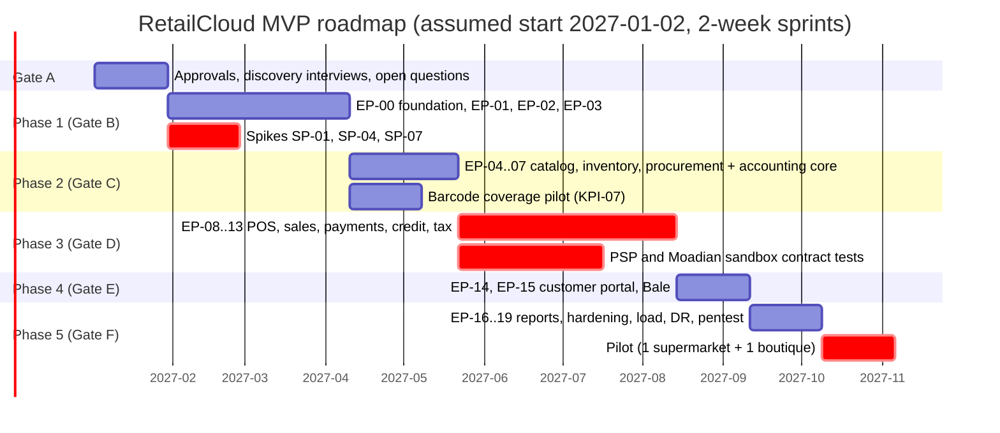

# D12 — Backlog، Roadmap و مدیریت ریسک

## 0. خلاصه

| مورد | مقدار |
|---|---|
| Backlog | **۱۰۷ آیتم** (۹۹ Story + ۸ Spike) در **۲۰ Epic**؛ **۷۱۸ Story Point** |
| پوشش | **۱۳۹/۱۳۹** نیازمندی P0 و **۴۱/۴۱** نیازمندی غیرعملکردی دست‌کم یک Story دارند. هر تست ارجاع‌داده‌شده در کاتالوگ D10 وجود دارد. وابستگی‌ها بدون حلقه‌اند و هیچ Story به Story فاز بعدی وابسته نیست. |
| منبع | [`tools/build_backlog.py`](tools/build_backlog.py) ← [`D12-backlog.csv`](D12-backlog.csv) (قابل Import در Jira، YouTrack یا GitLab) و [`D12-backlog-table.md`](D12-backlog-table.md) |
| مدت برآوردی تا پایلوت | حدود **۴۴ هفته** (بازه ۳۶ تا ۵۶ هفته) با تیم فرضی §2؛ **وابسته به مسیر بحرانی بیرونی** (§4) |

```bash
python3 docs/00-product/tools/build_backlog.py   # تولید CSV و جدول + بررسی پوشش، وابستگی و تست‌ها
```

> بررسی خودکار هنگام ساخت این Backlog **هفت وابستگی معکوس** پیدا کرد. مثلاً رسید خرید در فاز ۲ به هسته حسابداری فاز ۳ وابسته بود، و فروش نسیه در فاز ۳ به هویت مشتری فاز ۴. این Storyها به فاز زودتر منتقل شدند (`PHASE_OVERRIDE` در Generator) `[DEC D-90]`. یعنی **هسته حسابداری در فاز ۲** و **هویت حداقلی مشتری و پیامک در فاز ۳** ساخته می‌شوند.

---

## 0.1 پیشرفت پیاده‌سازی

**خلاصه‌ی خودکار** (درصد هر فاز و Epic، کارهای بعدی، موارد منتظر کارفرما): [`D12-progress.md`](D12-progress.md). این بخش شواهد هر آیتم است. ستون Sprint، Sprintی است که آیتم واقعاً در آن تمام شد.

| Sprint | آیتم | وضعیت | شاهد |
|---|---|---|---|
| 1 | US-001 Monorepo، Pipeline، Architecture Tests | ✅ Done | `src/backend`، `.github/workflows/ci.yml` (موقت؛ D-80 و AQ-04)، ۶ تست معماری (با اثبات شکست روی تخلف عمدی) |
| 1 | US-002 BuildingBlocks: Money، Quantity، TaxRate، Ids، Result، Clock (+ Gtin، PublicCustomerCode) | ✅ Done | ۳۹ تست Unit و Property (FsCheck، تا ۲٬۰۰۰ مورد تصادفی به ازای هر Property) |
| 1 | SP-07 EF Core + Npgsql با تراکنش مشترک و RLS | ✅ Done — تأیید شد | ۷ تست Integration؛ D04 §5.3 |
| 1–3 | US-007 محیط Dev (Compose) | 🟡 بخشی | `src/backend/dev/compose.yaml` (نحو معتبر؛ اجرا نشده). Mirrorها و Staging منتظر زیرساخت‌اند (X-07) |
| 1 | SP-01 Keycloak | ✅ Done — ۱۸/۱۸ بررسی | ADR-003 «نتیجه Spike SP-01»؛ `src/backend/dev/keycloak/`؛ Job `identity` در CI. ورود مشتری بیرون از Keycloak: **Accepted** (ADR-003 §6). بررسی C8b (وجود `sub` در Token) بعد از کشف باگ در E2E اضافه شد |
| 3 (برنامه) | SP-04 مؤدیان | ⏳ باز | به دسترسی Sandbox وابسته است (X-01) |
| 1 | US-003 UnitOfWork + Guard + حالت بدون Tenant | ✅ Done | `ExecuteWithoutTenantAsync` برای جست‌وجوی هویت پیش از انتخاب Tenant |
| 1 | US-021 ورود از طریق BFF | ✅ Done (یک پیگیری) | **API:** `Hosts/RetailCloud.Api` + `BuildingBlocks.Api` (JWT: aud، iss، انقضا، امضا؛ نگاشت کاربر؛ انتخاب Tenant فقط با عضویت؛ 404 یکسان)، Schema `iam` (T80–T84)، ۷ تست API. **BFF:** `src/web/apps/merchant-admin` (Next.js 15؛ Code + PKCE S256 + state + nonce؛ Token فقط سمت سرور؛ Cookie `HttpOnly`/`SameSite=Lax` و `__Host-` در Production؛ CSRF با Origin + Double-submit؛ Refresh با چرخش؛ CSP با nonce). **E2E:** `e2e/run-e2e.sh`، ۱۷/۱۷ بررسی مرورگری روی Keycloak + API + BFF واقعی، Job `web-e2e` در CI؛ Mutation (حذف CSRF) ۳ بررسی را قرمز کرد. E2E یک باگ واقعی پیدا کرد: Realm-as-code Scope `basic` را نداشت و Token بدون `sub` بود (اصلاح شد). **پیگیری انجام شد (Sprint 2):** Session Store روی Valkey با رمزنگاری AES-256-GCM، کلید Hash‌شده و قفل Refresh بین Instanceها؛ E2E E20–E21 |
| 1 | US-022 MFA اجباری برای نقش‌های حساس + Step-up | ✅ Done | Keycloak: Flow سطح احراز (`acr=pwd|mfa`، TOTP یا کلید عبور، ثبت خودکار TOTP)، `mfa-checks.js` با ۱۰ بررسی. API: `MfaPolicy` (IAM-003، ABAC-05)، `403 mfa-required` و `step-up-required`، نقش‌ها در `iam.tenant_membership.roles` (T85–T86)، ۱۰ تست API (Mutation: ۲ قرمز). BFF: Step-up، چرخش Session، انتخاب Tenant پس از MFA. E2E: ۲۴/۲۴. ADR-003 «پیاده‌سازی MFA» |
| 1 | US-006 Idempotency + problem+json | ✅ Done | `core.idempotency_record` (T87–T90، Oracle O-4 برای رکورد InProgress پس از Commit)، `MapIdempotentPost` + `PostgresIdempotencyStore` (ادعای کلید داخل همان تراکنش، انتظار محدود ۵ ثانیه ← `409 in-progress`)، `ProblemDefaults` (کد و traceId برای همه خطاها، بدون Stack Trace حتی در Development؛ SEC-T-016). ۱۰ تست؛ ۱۲ درخواست هم‌زمان با یک کلید دقیقاً یک بار اجرا شد؛ Mutation (اجرای Handler پیش از Claim) ۴ تست را قرمز کرد. **پیگیری:** وقتی Operationهای BR-030 ساخته شوند، یک تست Contract بررسی کند که هر Operation با `idem=True` در D07 با `MapIdempotentPost` Map شده باشد. پاک‌سازی رکوردهای قدیمی: انجام شد در US-005 (`MessagingRetention`) |
| 1 | US-005 Outbox/Inbox + Relay در Workers | ✅ Done | `core.outbox`، `core.inbox`، `outbox_due_tenants`، `outbox_stats` (T91–T96؛ Fitness Rule 5 عمومی‌تر شد)، `PostgresOutbox`، `OutboxRelay` (SKIP LOCKED، Inbox، Backoff، Dead-letter)، `MessagingRetention` (پیگیری US-006 هم انجام شد)، Host جدید `RetailCloud.Workers` با LISTEN/NOTIFY و Gaugeهای D11، Alert `RCOutboxDeadLetter`، قاعده معماری R10. ۱۰ تست Integration با نقش‌های واقعی؛ Mutation: ۲ قرمز. ADR-013 اصلاح شد (یک Outbox مشترک) |
| 1 | US-011 ثبت‌نام و راه‌اندازی خودکار Tenant | ✅ Done | `POST /tenants` (کاربر تازه بدون Provisioning قبلی، MFA لازم، شناسه Tenant از Identity + Idempotency-Key مشتق می‌شود ← کلیک دوباره یک فروشگاه)، شعبه B1 و صندوق R1 هم‌زمان؛ عضویت TenantOwner، انبار W1، شجره حساب (۲۸ حساب، ۲۰ نقش D-30/D-59) و ۱۲ دوره سال جاری شمسی از رویداد `platform.tenant-registered` در Workers (ماژول‌های جدید Inventory و Accounting). `GET /tenants/me/setup` برای ویزارد. تست‌ها: ۱۰ واحد/Property (تقویم شمسی ۱۳۵۰–۱۵۰۰)، ۵ Integration، E2E N01–N05 (ثبت‌نام کاربر تازه با ثبت TOTP تا فروشگاه آماده)؛ Mutation: ۲ مورد، هر دو قرمز. **منتظر کارفرما:** بازبینی شجره حساب توسط حسابدار (X-04) |
| 1 | US-025 دعوت کاربر با نقش و Scope + Default Deny | ✅ Done | `iam.role_assignment` (نقش × Tenant/Branch/Warehouse/Register، تغییرناپذیر، «آخرین مالک حذف نمی‌شود»)، `iam.invitation` (لینک یک‌بار مصرف ۷ روزه، فقط Hash)، T97–T101. ماتریس D06 §6.2 در کد با تست هم‌خوانی سند (Mutation گرفته شد)، `AccessPolicy` با ضد افزایش دسترسی. **Default Deny واقعی:** هر Endpoint Policy صریح دارد و تستی همه Endpointها را با `x-permission` در D07 مقایسه می‌کند (`D07-operations.json`). API: roles، users، invitations، accept، role-assignments، branches. پنل: صفحه کاربران و دعوت، صفحه پذیرش. تست‌ها: ۸ واحد، ۸ Integration، E2E I01–I06 (مالک دعوت می‌کند ← صندوق‌دار می‌پیوندد ← دسترسی مدیریتی ندارد ← لینک دوباره کار نمی‌کند). **باز:** ارسال پیامکی یا ایمیلی دعوت (X-03)؛ ابطال دعوت؛ نقش سفارشی |
| 1 | US-012 شعب و صندوق‌های بیشتر | ✅ Done | `POST /branches` (شعبه + صندوق R1 در یک تراکنش؛ انبار `W-<code>` از رویداد `platform.branch-created` در Inventory)، `POST /branches/{id}/registers`، کد یکتا (`409 duplicate-code`)، فقط `tenant.settings.manage`؛ مدیر شعبه فقط شعبه خودش را می‌بیند. صفحه شعب در پنل. تست‌ها: ۳ Integration (AT-002)، E2E B01–B02. در کنار آن یک تست ناپایدار E2E اصلاح شد (جست‌وجوی `eyJ` در متن رمزشده گاهی تصادفی مثبت می‌شد) |
| 1 | US-013 ثبت دستگاه POS با کد جفت‌سازی | ✅ Done | کد ۸ نویسه‌ای Crockford، ۱۰ دقیقه، یک‌بار مصرف (فقط Hash)؛ دستگاه Secret می‌گیرد که BFF در Cookie `HttpOnly` یک‌ساله نگه می‌دارد و API از هدر `X-RC-Device` ترمینال را می‌شناسد (`/me.terminal`)؛ ابطال فوری؛ مدیر شعبه فقط شعبه خودش. فیلتر `RequireTerminal` برای ABAC-04 آماده فروش است. **مجوز جدید `terminals.manage`** (Owner و Admin کل فروشگاه، BranchManager شعبه خود): تناقض TEN-002.1 («مدیر شعبه صادر می‌کند») با D07 (`tenant.settings.manage`) را برطرف کرد؛ D02 و D06 و D07 هم‌زمان اصلاح شدند و تست هم‌خوانی سند آن را تضمین می‌کند. **Rate Limit** (پیشنهاد تحلیل): ۱۰ تلاش در ۱۰ دقیقه برای جفت‌سازی و پذیرش دعوت ← `429`. T102–T104، ۵ Integration، E2E T01–T04 |
| 1 | US-026 تأیید لحظه‌ای مدیر | ✅ Done | `iam.approval_request` (قید SoD-01 در DB: تأییدکننده ≠ درخواست‌کننده؛ فقط گذارهای مجاز، واقعیت‌ها تغییرناپذیر؛ T105–T107)؛ `IApprovals` (درخواست، تصمیم، مصرف یک‌باره با Binding دقیق action+resource+scope+value، ۵ دقیقه، D-61)؛ نقش‌های «دارای سقف» از جدول D06 با تست هم‌خوانی (صندوق‌دار هرگز تخفیف تأیید نمی‌کند؛ سوخت مطالبات فقط مالک)؛ `listApprovals`، `getApproval`، `decideApproval` با MFA تازه؛ صفحه «درخواست‌های تأیید» در پنل. تست‌ها: ۲ واحد، ۴ Integration، E2E A01–A02. **باز:** مسیر PIN روی همان دستگاه (US-023)؛ مصرف‌کننده‌های واقعی (تخفیف، برگشت، …) با ماژول‌های فروش. **باگ واقعی پیدا شد:** ترتیب Outbox بر پایه UUIDv7 در یک میلی‌ثانیه تضمین نمی‌شد؛ ستون `seq` اضافه شد |
| 1 | US-023 قفل صندوق با PIN | ✅ Done | `iam.user_pin` (فقط Argon2id با پارامترهای AUTH-08؛ T108–T109)، `PinHasher` (PHC، نمک تصادفی، مقایسه زمان‌ثابت)، `PUT /me/pin` (فقط تا ۱۰ دقیقه پس از ورود کامل)، `POST /me/pin/verify` (فقط Terminal ثبت‌شده؛ قفل ردیف تا حدس‌های هم‌زمان بیش از ۵ تلاش نگیرند؛ ۵ خطا = قفل، باز شدن فقط با PIN جدید پس از ورود کامل)؛ BFF: قفل دستی و خودکار پس از ۵ دقیقه بیکاری روی Terminal (IAM-005)، API در حالت قفل `423`، با قفل شدن PIN خود Session هم پایان می‌یابد. **مسیر تأیید روی همان دستگاه (F-14) کامل شد:** مدیر با `approverId` و PIN خودش روی Terminal همان شعبه تأیید می‌کند. تست‌ها: ۵ Integration (Mutation حذف قفل ردیف گرفته شد)، E2E P01–P04. **تصمیم برای کارفرما:** F-14 روی همان دستگاه «PIN و MFA مدیر» گفته است؛ پیاده‌سازی PIN + Terminal ثبت‌شده (چیزی که مدیر می‌داند + دستگاهی که فروشگاه دارد) است. اگر MFA هم لازم است، در US-024 اضافه می‌شود |
| 1 | US-024 Sessionها و خروج از همه دستگاه‌ها | ✅ Done | **فهرست Session (IAM-005):** BFF برای هر شخص (issuer+sub) یک فهرست در Valkey نگه می‌دارد که فقط «کلید ذخیره» هش‌شده Sessionها را دارد، نه شناسه Cookie؛ مرورگر فقط یک Handle مشتق از آن هش می‌بیند. صفحه «دستگاه‌های واردشده»: برچسب درشت دستگاه (مرورگر · سیستم‌عامل، بدون IP)، زمان ورود و آخرین استفاده، MFA، «همین دستگاه». **خروج یک دستگاه دیگر** و **خروج از همه دستگاه‌ها** (همین دستگاه هم): Session در BFF حذف و Refresh Token آن نزد کیکلاک باطل می‌شود؛ کیکلاک ۲۶ با این ابطال کل Session کاربر را می‌بندد (با Admin API بررسی شد)، پس دستگاه ابطال‌شده بدون رمز دوباره وارد نمی‌شود (E2E D02). **غیرفعال‌سازی کاربر (IAM-009، AT-018):** `updateUser` پیاده‌سازی شد: عضویت همین فروشگاه معلق می‌شود و نقش‌ها برای فعال‌سازی دوباره می‌مانند؛ درخواست بعدی کاربر به این فروشگاه رد می‌شود (Cache عضویت همین نمونه فوراً پاک می‌شود، بقیه نمونه‌ها ≤ ۳۰ ثانیه). فقط کسی که قدرت همه نقش‌های آن کاربر را دارد؛ کسی خودش را غیرفعال نمی‌کند (`cannot-disable-self`)؛ پایگاه داده نمی‌گذارد فروشگاه بدون **مالک فعال** بماند (`RC010`، حالا مالک معلق هم شمرده نمی‌شود). غیرفعال‌سازی در فروشگاه فقط‌خواندنی مجاز است (کاهش دسترسی)، فعال‌سازی دوباره نه. **باگ‌های رفع‌شده:** فهرست کاربران `Suspended` پایگاه داده را به جای `Disabled` قرارداد برمی‌گرداند؛ `User` در D07 نسخه نداشت ولی `UserUpdate` آن را می‌خواست. تست‌ها: SQL T165–T167، API AT-018 و مرز قدرت مدیر شعبه (Mutation گرفته شد)، E2E D01–D05 با سه مرورگر. **باز:** تنظیم Idle Timeout به ازای فروشگاه، و ابطال Session‌های Keycloak کاربری که از **همه** فروشگاه‌هایش غیرفعال شده (فعلاً فقط دسترسی API قطع می‌شود)
| 1 | US-031 زنجیره ممیزی | ✅ Done | `audit.audit_record` با ستون‌های «چه کسی و از کجا» (نقش‌ها، شعبه، Terminal، IP، Impersonation؛ داخل Hash)، Trigger زنجیره و `audit.chain_anchor` فقط‌درج؛ `IAuditLog` در همان Transaction عملیات (رکورد ممیزی بدون عملیات یا عملیات بدون رکورد ممکن نیست)؛ `AuditSanitizer` (حذف PIN، OTP، Token، رمز، کارت، موبایل و ایمیل با نام کلید یا شکل مقدار)؛ ممیزی همه عملیات حساس موجود (ثبت فروشگاه، شعبه، صندوق، کد جفت‌سازی، Terminal، دعوت، نقش، PIN، قفل، تأیید)؛ وارسی روزانه در Workers با Anchor و متریک `rc_audit_chain_broken_total` (D11 RB-22). IP فقط از Proxy مورد اعتماد (`Network:TrustedProxies`) پذیرفته می‌شود. تست‌ها: ۴ واحد، ۲ Integration (AT-190..193، هم‌زمانی ۱۰ درخواست بی‌شکاف)، T70–T74. **باز:** نگه‌داری Head در MinIO Object Lock (D11) با زیرساخت
| 1 | US-032 جستجوی ممیزی | ✅ Done | `GET /audit` فقط با `audit.view` (مالک، مدیر سیستم، ممیز): جدیدترین اول، صفحه‌بندی Keyset روی `seq` با Cursor مبهم، فیلتر زمان، رویداد (دقیق یا پیشوند مثل `iam.`)، کاربر و منبع؛ `%` و `_` در فیلتر حرف عادی‌اند. RLS سابقه فروشگاه دیگر را برنمی‌گرداند. پاسخ همه فیلدهای AUD-001.1 (نقش‌ها، Terminal، IP، جزئیات پاک‌شده) را دارد. BFF فقط فیلترهای قرارداد را عبور می‌دهد؛ صفحه «سابقه ممیزی» در پنل. تست‌ها: ۳ Integration (فیلترها، صفحه‌بندی بی‌هم‌پوشانی، ۴۰۳ صندوق‌دار، ۴۰۰ ورودی بد، جداسازی Tenant؛ Mutation حذف Escape گرفته شد)، E2E U01–U02. **باز:** Export سابقه (US-016) و نمایش نام کاربر به جای شناسه
| 1 | US-004 Migration Runner | ✅ Done | `RetailCloud.Migrator` و `sql/migrations.json` (`[DEC D-96]`، D05 §11.1): گام‌های مرتب به ازای ماژول، تاریخچه در Schema هر ماژول با Checksum، هر گام با ثبتش در یک تراکنش، `lock_timeout` با تلاش دوباره، Advisory Lock، توقف با تغییر گام اجراشده یا گام ناشناخته یا ترتیب خراب، Fitness پس از اجرا. اجرا با Login **غیر Superuser**. **باگ واقعی پیدا شد:** واگذاری مالکیت تابع به `rc_tenant_directory` فقط با Superuser کار می‌کرد؛ حالا `CREATE` موقت در همان تراکنش داده و پس گرفته می‌شود و Fitness قاعده ۶ ماندنش را می‌گیرد. CI (`check-migrations.sh`): Schema ساخته Migrator با DDL مرجع **یکسان** (۱۶۲۵ خط `pg_dump`)، اجرای دوم بی‌اثر. تست‌ها: ۸ Integration (از جمله اجرای هم‌زمان ۳ Migrator؛ Mutationهای حذف Lock و حذف تراکنش گرفته شد)، تست معماری R11 (Api و Workers Schema را تغییر نمی‌دهند). **باز:** اجرای روی Snapshot ناشناس‌شده Staging و تست Rolling N-1 (D05 §11.4) با زیرساخت Staging (X-07)
| 1 | US-014 پلن و Entitlement | ✅ Done | `platform.plan` (سراسری؛ پیش‌فرض‌ها: آزمایشی ۱۴ روز با ۲ شعبه، ۴ صندوق، ۵ کاربر؛ پایه ۱/۲/۳؛ حرفه‌ای ۵/۱۵/۲۵؛ سازمانی نامحدود — **اعداد تأیید کارفرما 2026-11-23**) و `platform.subscription` (با ثبت فروشگاه، آزمایشی شروع می‌شود؛ App فقط می‌خواند). سقف در DB اعمال می‌شود (`[DEC D-97]`): Trigger با قفل به ازای Tenant، کد سراسری `RC030` ← `403 entitlement-exceeded` با `resource` و `limit`. دعوت همکار از قبل صندلی‌ها را می‌شمارد (عضو فعال + دعوت باز) و پذیرش دعوت هم سقف دارد. `GET /tenants/me` پلن، پایان دوره آزمایشی و سقف‌ها را دارد؛ صفحه اصلی و پیام D09 در پنل. **دو باگ واقعی پیدا شد:** (۱) `RC013` از قبل معنای «دوره مالی بسته» داشت و نگاشت سراسری آن را «سقف پلن» نشان می‌داد؛ کدهای RC حالا فهرست دارند و نگاشت سراسری فقط برای RC030+ است. (۲) خطای DB در مسیر EF Core داخل `DbUpdateException` پیچیده می‌شد و از نگاشت جا می‌ماند. تست‌ها: SQL T110–T121، ۴ Integration API (AT-004، هم‌زمانی ۶ درخواست)، تست قطعی قفل (Mutation حذف قفل ۳ از ۳ گرفته شد)، تست نگاشت کد، E2E L01 و B03. **باز:** تغییر پلن توسط اپراتور (US-171) و صورتحساب اشتراک (P1)
| 1 | US-015 فقط‌خواندنی | ✅ Done | `[DEC D-98]`: فروشگاه معلق، بسته یا با دوره آزمایشی تمام‌شده همه‌چیز را می‌خواند، ولی هر نوشتن با `403 tenant-read-only` (همراه `reason`) رد می‌شود، جز ۱۰ عملیات `x-allowed-when-read-only` در D07: انتخاب فروشگاه، باز کردن صندوق با PIN، لغو دستگاه، حذف نقش، Export، دریافت نسیه (پنل و پرتال مشتری)، تلاش دوباره صورتحساب مؤدیان، تصمیم دسترسی پشتیبانی و خروجی داده مشتری. پذیرش دعوت هم بررسی می‌شود (Tenant از Token می‌آید، نه از Header). Workers و صف مؤدیان ادامه می‌دهند. هیچ داده‌ای حذف نمی‌شود. **حفره بسته شد:** App روی `platform.tenant` مجوز UPDATE کامل داشت و می‌توانست `status` را تغییر دهد؛ حالا فقط ستون‌های `TenantUpdate`. پنل: بنر فقط‌خواندنی و پیام D09. تست‌ها: SQL T122–T128، ۲ Integration (AT-005)، هم‌خوانی نشانه‌ها با D07؛ ۳ Mutation گرفته شد؛ E2E R01. **باز:** تغییر وضعیت توسط اپراتور (`platformChangeTenantStatus`، US-171)
| 1 | US-016 خروجی کامل داده | ✅ Done | `createExport` (۲۰۲، فقط با `data.export` و MFA کمتر از ۱۵ دقیقه، یک خروجی هم‌زمان در هر فروشگاه ← `409 export-in-progress`؛ در حالت فقط‌خواندنی هم مجاز) و `getExport` (لینک Presigned پنج‌دقیقه‌ای که در هر درخواست تازه صادر و ممیزی می‌شود؛ پس از ۲۴ ساعت «منقضی»). `platform.export_job` (فقط Workers وضعیت را تغییر می‌دهد؛ کلید فایل فقط زیر `tenants/<همان فروشگاه>/`). Workers: ZIP از CSVهای ۷ دسته به‌اضافه `manifest.json` زیر RLS خود فروشگاه، کلید تصادفی ۲۵۶بیتی، خنثی‌سازی فرمول در سلول‌ها (AB-18)، بدون داده رمزشده تماس مشتری؛ خطا ← `Failed` (بدون تکرار بی‌پایان)؛ حذف ساعتی فایل‌های منقضی؛ DET-08 با متریک و Alert `RCExportLarge` (RB-23). `IObjectStorage` با پیاده‌سازی S3 برای MinIO (AWSSDK.S3 4.0.104.11، Apache-2.0). پنل: صفحه «خروجی داده‌ها». تست‌ها: SQL T129–T132، ۵ Integration (Worker، شامل جداسازی فروشگاه و تزریق فرمول) + ۶ واحد CSV + امضای لینک S3، ۴ Integration API (AT-006)، E2E X01. **آزمون ذخیره‌سازی واقعی (تأیید کارفرما 2026-11-23):** ۳ تست Integration روی S3 واقعی (ساخت Bucket، دانلود با لینک، نام فایل، حذف؛ Export واقعی تا ZIP)، در CI و این محیط روی moto 5.2.5 (Image رسمی MinIO دیگر در Docker Hub نیست)؛ بررسی سخت‌گیرانه امضا و انقضای لینک (`RC_TEST_S3_STRICT=1`) فقط روی MinIO واقعی ممکن است و به Staging می‌رود؛ E2E X02 دانلود ZIP از لینک پنج‌دقیقه‌ای. **باز:** (۱) آزمون روی Staging؛ (۲) شماره کامل مشتری پس از ماژول CID (فعلاً `not-yet-supported`)؛ (۳) اطلاع DET-08 به مالک فروشگاه پس از کانال اعلان
| 1 | US-010 تست امنیتی تولیدی | ✅ Done | `GeneratedSecurityTests` از `D07-operations.json` (که حالا `scope`، `pathParams`، `bodyProps` و `idempotent` دارد) برای **هر** Endpoint پیاده‌شده، پس Endpoint جدید از روز اول پوشش دارد: SEC-T-012 ماتریس نقش (هر نقش سیستمی × هر Operation، مطابق D06 §6.2 از `AccessPolicy`)؛ SEC-T-010 شناسه فروشگاه دیگر در هر پارامتر مسیر ← 404؛ SEC-T-011 مدیر شعبه ۱ روی شعبه ۲ ← 403/404؛ SEC-T-013 فیلد تعریف‌نشده در بدنه ← `400 validation` با نام فیلد و `unknown-field`. پارامتر یا Operation جدیدی که Fixture ندارد، تست را با پیام روشن می‌شکند. **حفره بسته شد:** API فیلدهای ناشناخته را بی‌صدا نادیده می‌گرفت (راهکار TM-013 در D06 پیاده نشده بود)؛ حالا `UnmappedMemberHandling.Disallow` و خطای بدنه همیشه problem+json است (پیش‌تر خارج از Development بدنه خالی بود). Mutationهای حذف رد فیلد ناشناخته و حذف بررسی Scope شعبه گرفته شد. **باز:** SEC-T-014 (فیلدهای حساس در پاسخ) وقتی فیلد حساسی در پاسخ‌ها باشد (بهای خرید، شماره مشتری)
| 1 | US-027 دسترسی JIT پشتیبانی | ✅ Done | **سمت فروشگاه کامل:** `iam.support_access_request` با قواعد DB (حداکثر ۴ ساعت؛ فقط گذارهای مجاز با کد `RC015`؛ واقعیت‌ها تغییرناپذیر؛ تصمیم و پایان فقط با کسی که در همان فروشگاه TenantOwner است — SoD-05 حتی اگر کد اشتباه کند؛ پنجره دقیقاً برابر مدت درخواستی از لحظه تأیید؛ سابقه حذف‌شدنی نیست). `listSupportAccessRequests`، `decideSupportAccess` و **`revokeSupportAccess` (افزوده به D07، راهکار AB-17)**؛ تصمیم و پایان فقط مالک (`403 owner-only` حتی برای TenantAdmin) با MFA تازه؛ درخواست تصمیم‌نگرفته پس از ۲۴ ساعت منقضی؛ همه ممیزی؛ در حالت فقط‌خواندنی هم مجاز. پنل: صفحه «دسترسی پشتیبانی». تست‌ها: SQL T133–T139، ۳ Integration (AT-017)، پوشش خودکار در تست‌های امنیتی تولیدی، E2E S01–S02. **سمت پلتفرم (با Realm پلتفرم US-172):** `platformRequestSupportAccess` (سیاست `platform-support`: نقش `PlatformSupport` و MFA؛ PlatformSuperAdmin و توکن فروشگاه رد می‌شوند؛ دلیل ۱۰–۵۰۰ نویسه، ۱۵–۲۴۰ دقیقه؛ فروشگاه ناموجود ۴۰۴؛ ممیزی در خود فروشگاه با actor_kind=Support). `platformSupportListSales` (افزوده به D07): فقط در مدت Grant تأییدشده‌ی مالک برای **همان** اپراتور (وگرنه `403 support-access-required`؛ Pending، اپراتور دیگر و پایان زودهنگام مالک هم رد)؛ نمای فقط‌خواندنی ۵۰ فروش اخیر بدون داده مشتری، شماره پیگیری و ارقام کارت؛ هر مشاهده ممیزی Support می‌شود. آزمون AT-017 کل چرخه (درخواست، رد نقش و Realm، تأیید مالک، دید Masked، اپراتور دیگر، ممیزی، پایان زودهنگام). باقی‌مانده: اطلاع درخواست به فروشگاه (DET-09)، نماهای پشتیبانی دیگر (کالا، شیفت) به‌اندازه‌ی نیاز، کنسول پلتفرم (US-171)، و آزمون Masking روی فروشِ دارای پرداخت. |
| 2 | US-041 کالا، Variant و بارکد | ✅ Done | ماژول جدید Merchandising (`merch`): `createProduct` (Idempotent، تأیید صریح کاربر CAT-004.1)، `getProduct`، `listProducts` (جستجوی نام نرمال‌شده فارسی: ي/ك عربی، ارقام فارسی و عربی، نیم‌فاصله؛ SKU؛ بارکد اسکن‌شده؛ صفحه‌بندی Keyset)، `updateProduct` (نسخه‌دار، `409 version-conflict`)، `addVariant`، `addBarcode`، `removeBarcode`. بارکد با `packagingUnit` و ضریب (کارتن ۲۴تایی)؛ یک مالک فعال برای هر بارکد (`409 barcode-already-assigned` با شناسه کالای دارنده)؛ تاریخچه در DB حفظ می‌شود (فقط غیرفعال‌سازی؛ `RC016`؛ بدون حذف). **باگ پیدا شد:** Variant دوم با Axis تکراری ۵۰۰ می‌داد (قید DI-081)؛ حالا `409 duplicate-code`. فیلدهای داستان‌های بعد (دسته، قیمت، موجودی افتتاحیه، Matrix، کاتالوگ عمومی) صریحاً `not-yet-supported`. پنل: صفحه «کالاها». تست‌ها: SQL T140–T146، ۵ Integration (AT-020..022، Mutation پیش‌بررسی بارکد گرفته شد)، پوشش خودکار در تست‌های امنیتی تولیدی، E2E C01–C02
| 2 | US-042 اعتبارسنجی بارکد | ✅ Done | Check Digit برای EAN-8، UPC-A، EAN-13 و GTIN-14 (نوع دامنه `Gtin` موجود، با ارقام فارسی از Barcode Scanner)؛ ذخیره GTIN-14 و نگه‌داری فرم اصلی (AT-023)؛ اسکن UPC-A و EAN-13 یک کالا را پیدا می‌کند؛ کد نادرست `422 invalid-barcode`. کدهای محدوده داخلی GS1 (۰۲، ۲۰–۲۹) و کد آزاد فروشگاه `isInternal` (AT-024)؛ ارسال‌نکردن به کاتالوگ عمومی با US-044
| 2 | US-046 جستجوی سریع کالا | ✅ Done | `listProducts?q=`: SKU یا بارکد اسکن‌شده در همان جعبه **دقیق** تطبیق می‌خورد؛ در غیر این صورت تا ۵ واژه، هر کدام **ابتدای یک کلمه** از نام نرمال‌شده، به هر ترتیب («پاستو شیر» ← «شیرِ کم‌چرب پاستوریزه»؛ «چرب» وسط کلمه پیدا نمی‌شود). نرمال‌سازی فارسی حالا **اعراب** (فتحه، کسره، تنوین، تشدید، الف خنجری) را هم حذف می‌کند (CAT-011) و فقط یک نرمال‌ساز وجود دارد: همان تابع پایگاه داده که کلید ذخیره‌شده را می‌سازد. کاراکترهای `%` و `_` لفظی‌اند. کالای Merge‌شده برگردانده نمی‌شود. ایندکس `pg_trgm` GIN روی نام نرمال‌شده (D05)؛ EXPLAIN نشان می‌دهد شرط `'%واژه%'` از آن استفاده می‌کند. تست‌ها: SQL T164، API AT-034 (Mutation گرفته شد). **باز:** اندازه‌گیری p95 زیر بار هدف با ۵۰ هزار کالا (US-19x)
| 2 | US-045 بارکد وزنی | ✅ Done | **Profile (CAT-007):** `merch.weighted_barcode_profile` (پیشوند ۱ تا ۳ رقمی که با ۲ شروع می‌شود؛ پیشوند + طول کد کالا + طول مقدار (+۱ برای رقم کنترل قیمت) = ۱۲ رقم داده EAN-13؛ مبلغ بدون اعشار به ریال) و `merch.weighted_barcode_settings` (Version مجموعه). DI-084 در DB: Trigger `weighted_prefix_disjoint` با قفل Advisory پیشوند مساوی یا پیشوندی که پیشوند دیگری را شروع کند رد می‌کند (`RC022`؛ T168–T171). `GET/PUT /weighted-barcode-profiles` (کل مجموعه با `expectedVersion`؛ حداکثر ۱۰؛ خطای فیلدبه‌فیلد؛ هم‌پوشانی 400؛ Version کهنه 409؛ ممیزی `catalog.weighted-profiles.set`). **Decode:** `WeightedBarcodes` (رقم کنترل بیرونی و رقم کنترل قیمت ۴ و ۵ رقمی طبق جدول‌های GS1؛ ارقام فارسی). کد کالا همان «کد داخلی» Variant است (PLU ترازو). `POST /catalog/barcodes/resolve` اول برچسب وزنی را Decode می‌کند و بعد GTIN-14 یا کد داخلی را جستجو می‌کند؛ رقم کنترل اشتباه 422 `invalid-barcode` (هرگز حدس زده نمی‌شود). در حالت فقط‌خواندنی مجاز است؛ سقف ۱۲۰ در دقیقه برای هر کاربر. منابع سراسری و Provider با US-043 می‌آیند (فعلاً `candidates` خالی). **CAT-007.1:** `PriceLabelLine` مقدار را `round(مبلغ ÷ قیمت واحد، ۳)` و مبلغ قلم را خود مبلغ برچسب می‌گذارد (آزمون واحد)؛ اتصال به قیمت شعبه با US-052. **UI:** صفحه «بارکد وزنی» (تعریف، حذف، آزمایش برچسب) و گزینه «کد داخلی» در تعریف کالا. **آزمون‌ها:** ۱۹ آزمون واحد (Mutation حذف بررسی رقم کنترل قیمت گرفته شد)، `AT029_...` و آزمون اعتبارسنجی در `CatalogTests`، E2E W01–W03. |
| 2 | US-043 پیشنهاد مشخصات کالا از کاتالوگ عمومی و Provider | ✅ Done (Provider خاموش تا X-06) | **DB (CAT-005):** Schema سراسری `catalog`: `catalog_product`، `global_barcode` (فقط GTIN عمومی؛ کد داخلی و محدود هرگز)، `catalog_source_record` (Cache پاسخ Provider فقط با فیلدهای توصیفی)؛ نقش برنامه فقط می‌خواند (نوشتن کاتالوگ کار Moderation است، T244–T246)؛ **قاعده Fitness ۸**: هیچ ستون tenant، قیمت، بها، تأمین‌کننده، موجودی یا سود در `catalog` (AT-026، با Self-test). **Resolve (CAT-004، UC-01):** کد عمومی ناشناس در فروشگاه ← کاندیدها از کاتالوگ عمومی (اطمینان ۰٫۹۵) و Provider (حداکثر ۰٫۷)، هر کدام با منبع، اطمینان، `lastVerifiedAt`، مجوز و انتساب؛ `conflictsWith` برای نام یا برند متفاوت؛ `preselect` فقط برای یک کاندید بی‌رقیب ≥ ۰٫۸ (CAT-004.1، D-17)؛ Provider بیرون از تراکنش و با بودجه ۴ ثانیه، خطا ← `degraded=true` (AT-203)؛ کد نامعتبر هیچ Providerی را صدا نمی‌زند (AT-200)؛ پاسخ Provider ۳۰ روز Cache می‌شود؛ هیچ داده‌ای از فروشگاه دیگر برنمی‌گردد (AT-202). **Provider Open Food Facts (ADR-007):** آداپتر آماده و خاموش (`Catalog:OpenFoodFacts:Enabled`) تا بررسی مجوز ODbL (X-06)؛ نشانی ثابت از تنظیمات و فقط کد عددی (SEC-T-040)، متن به‌عنوان داده (حذف تگ، کاراکترهای کنترلی و Bidi، سقف طول؛ SEC-T-041)، تصویر فقط https روی میزبان تصویر Provider و هرگز Fetch سمت سرور. **ذخیره (CAT-004.1، AT-201):** `createProduct` با `catalogProductId` (پیوند به محصول عمومی) و `confirmation.confirmed=false` ← ۴۲۲ `confirmation-required`. **پنل:** دکمه «پیشنهاد مشخصات» در تعریف کالا با منبع، درصد اطمینان، انتساب و تعارض؛ پرکردن فرم و تیک «بررسی کردم» برای ذخیره؛ E2E CG01–CG02. **آزمون‌ها:** ۱۷ واحد (پاک‌سازی، تصویر، اطمینان، تعارض)، ۳ آداپتر با سرور جعلی، ۴ API (AT-025/200/201/202/203). باقی‌مانده: روشن کردن Open Food Facts و اندازه‌گیری پوشش (SP-02، X-06)، رویداد `CatalogLookupMissed` (KPI-07)، Merge و پیشنهاد به کاتالوگ (US-044) و صف Moderation (US-047). |
| 2 | US-044 ادغام کالای تکراری و پیشنهاد به کاتالوگ عمومی | ✅ Done | **ادغام (CAT-006، AT-028):** `mergeProduct` (Idempotent؛ `catalog.product.manage`): کالای مسیر (تکراری) در `targetProductId` ادغام می‌شود؛ فقط با واحد پایه یکسان (`409 base-unit-mismatch`)، هر Variant تکراری با Variant هم‌محور مقصد جفت می‌شود (`409 merge-variant-mismatch`)، و تکراری نباید موجودی یا رزرو داشته باشد (`409 merge-source-has-stock`؛ موجودی فقط با انتقال یا تعدیل جابه‌جا می‌شود). بارکدهای فعال تکراری بازنشسته و روی مقصد دوباره ثبت می‌شوند (سابقه‌ی بارکد دست نمی‌خورد، RC016)؛ Variantهای تکراری غیرفعال و خود کالا `Merged` با ارجاع به مقصد می‌شود، نه حذف؛ کالای Merged در جستجو نمی‌آید و بارکدش کالای مقصد را Resolve می‌کند؛ ممیزی `catalog.product.merged` با بارکدهای منتقل‌شده و دلیل. **پیشنهاد به کاتالوگ عمومی (CAT-005.1، AT-027):** `suggestToGlobalCatalog` با رضایت صریح هر بار (`consent: true`)؛ فقط نام، برند، دسته و بارکدهای عمومی (GS1 غیرمحدود؛ کد داخلی و وزنی هرگز) در `catalog.catalog_suggestion` برای ناظر (US-047) ثبت می‌شود؛ نه قیمت و موجودی و نه هویت فروشگاه (فقط اثر یک‌طرفه برای شمارش یک‌باره)؛ پیشنهاد دوباره همان کد تکرار نمی‌شود؛ `422 no-public-barcode`. **DB:** جدول `catalog_suggestion` (قاعده Fitness ۸ برقرار؛ T251–T252)؛ فروشگاه فقط درج می‌کند. **پنل:** «ادغام در کالای دیگر» (با SKU مقصد و دلیل) و «پیشنهاد به کاتالوگ عمومی» (تیک رضایت) کنار هر کالا؛ E2E MG01–MG02. **آزمون‌ها:** ۳ آزمون API (ادغام و Resolve و ممیزی؛ واحد، موجودی، نسخه؛ پیشنهاد و رضایت و حذف داده خصوصی). باقی‌مانده: صف Moderation (US-047). |
| 2 | US-047 صف Moderation پیشنهادهای کاتالوگ عمومی | ✅ Done (API؛ صفحه در کنسول پلتفرم) | **دسترسی:** سیاست جدید `platform-catalog`: فقط نقش `CatalogModerator` در Realm پلتفرم با MFA (D06 §6.2)؛ PlatformSupport، PlatformSuperAdmin و توکن فروشگاه راه ندارند. **صف (CAT-005.1):** `platformListCatalogSuggestions` پیشنهادهای در انتظار را از قدیم به جدید (Cursor) نشان می‌دهد، با شمار فروشگاه‌هایی که همان بارکد را فرستاده‌اند و آنچه کاتالوگ عمومی برای آن بارکد دارد؛ هرگز نشانی از فروشگاه فرستنده یا قیمت. **تصمیم (CAT-005، DI-093):** `platformDecideCatalogSuggestion` با دلیل اجباری: «انتشار» فقط نام، برند و دسته را (با اصلاح ناظر) به کاتالوگ عمومی می‌برد — کالای تازه با بارکد عمومی‌اش یا همان کالایی که بارکد را دارد، با تأیید دوباره — و همه‌ی پیشنهادهای در انتظار همان بارکد را با یک تصمیم می‌بندد؛ «رد» فقط همان پیشنهاد را. تصمیم یک‌بار است (۴۰۹ `already-decided`). **DB:** ستون‌های تصمیم روی `catalog.catalog_suggestion` (زمان، ناظر، دلیل، کالای منتشرشده) با CHECKها و Trigger `catalog.suggestion_guard` (RC035: یک‌بار تصمیم، محتوای فرستاده‌شده تغییرناپذیر). نوشتن در کاتالوگ فقط از تابع SECURITY DEFINER `catalog.decide_suggestion` (مالک rc_migrator)؛ نقش برنامه هنوز مستقیم در کاتالوگ نمی‌نویسد (T244). **تست:** ۴ آزمون API (انتشار و دیده شدن برای فروشگاه سوم، بازتأیید بارکد منتشرشده، رد با دلیل، فقط ناظر با MFA)، T255–T258 SQL. **باز:** صفحه‌ی ناظر در کنسول پلتفرم (US-171) و ممیزی سراسری اقدام اپراتور (فعلاً ردیف تصمیم و لاگ ۶۱۰۲). |
| 2 | US-052 قیمت نسخه‌دار با validFrom و تأیید تغییرات بزرگ | ✅ Done | **Price List (CAT-009):** هر Tenant یک فهرست پیش‌فرض دارد (`is_default`؛ یکتا در DB؛ T172) که در اولین استفاده ساخته می‌شود؛ تا آمدن فهرست مخصوص شعبه، همه شعب از آن می‌فروشند و تغییرش مجوز `catalog.price.manage` در سطح کل فروشگاه می‌خواهد (مدیر شعبه 403). **نسخه‌ها:** هر قیمت از `validFrom` تا نسخه زمان‌بندی‌شده بعدی معتبر است؛ نسخه جاری همان لحظه بسته می‌شود؛ نسخه‌ای که هنوز شروع نشده در جا اصلاح می‌شود. تاریخچه در DB دست‌نخوردنی است: Trigger `price_history` (`RC023`) هر تغییری جز «بستن نسخه در آینده» یا «اصلاح نسخه شروع‌نشده» را رد می‌کند؛ حذف Grant ندارد (T173–T177). `validFrom` در گذشته پذیرفته نمی‌شود (تا ۱۵ دقیقه قبل به «اکنون» منتقل می‌شود تا تکرار پس از تأیید کار کند). **BR-041:** بیش از ۲۰ Variant در یک عمل (`bulk`) یا تغییر بیش از ±۳۰٪ (`change-limit`؛ دقیقاً ۳۰٪ آزاد است) پاسخ 403 `approval-required` می‌گیرد؛ درخواست تأیید جدا ذخیره می‌شود، به همین تغییر دقیق گره می‌خورد (فهرست، validFrom، تک‌تک قیمت‌ها؛ D-61)، تأییدکننده نمی‌تواند خود درخواست‌دهنده باشد و با `X-Approval-Id` یک بار مصرف می‌شود؛ تکرار پیش از تصمیم به همان درخواست اشاره می‌کند. آستانه‌ها: `Catalog:PriceBulkLimit` و `Catalog:PriceChangePercent` [ASM]. **نمایش:** `unitPrice` روی Variant و در Resolve بارکد؛ برچسب وزنی حالا `quantity` و `amount` می‌گیرد (CAT-007.1: مبلغ برچسب مرجع است؛ AT-030). `GET /price-lists/{id}/prices` تاریخچه یک Variant یا آخرین تغییرات کل فهرست (بازبینی AB-06). ممیزی `catalog.prices.set` با قیمت قبلی و جدید. Idempotency حالا پاسخ 204 را هم ذخیره و تکرار می‌کند. **UI:** قیمت و فرم «ثبت قیمت» در صفحه کالاها با پیام انتظار تأیید. **آزمون‌ها:** ۸ آزمون واحد BR-041، `PriceTests` (AT-032، BR-041 با تأیید مالک، bulk و مدیر شعبه، AT-030)، Mutation حذف شرط تأیید گرفته شد، E2E Q01–Q03. |
| 2 | US-061 دفتر گردش موجودی، StockBalance هم‌تراکنش، موجودی منفی و WAC | ✅ Done | **Ledger (INV-001/002):** `IStockLedger.PostAsync` تنها راه تغییر موجودی است: ثبت منبع در `posted_source` (BR-032؛ تکرار = `AlreadyPosted`)، ساخت و قفل ردیف‌های `stock_balance` به ترتیب Variant (INV-004)، افزودن Movement و به‌روزرسانی Balance در همان تراکنش؛ ردِ هر سند زیر Savepoint چیزی باقی نمی‌گذارد. **WAC (BR-042/043، INV-006):** `StockMath`؛ ورودِ بهادار میانگین را دوباره حساب می‌کند (نیمه رو به بالا تا ریال؛ اگر موجودی ≤ ۰ بوده، بهای ورودی)، هر خروج با WAC لحظه ارزش‌گذاری می‌شود؛ ارزش موجودی = جمع `total_cost` حرکت‌ها (DB: علامت ارزش با علامت مقدار؛ T179). **Policy (BR-040، INV-003):** `inv.negative_stock_policy` در سطح فروشگاه، شعبه یا کالا (خاص‌ترین برنده، پیش‌فرض Forbid)؛ در Forbid سند با فهرست همه کمبودها رد می‌شود، در AllowWithWarning هشدار `negative-stock-allowed`؛ CHECK قبلی DI-031 پشتوانه است. `PUT /inventory/negative-stock-policies` (ممیزی). **واحد (INV-005، BR-044):** مقدار و واحد سند و ضریب همان لحظه کنار مقدار پایه ذخیره می‌شود (DB: `qty_base = entered_qty × unit_factor`؛ T178). **API:** `GET /warehouses`، `GET /inventory/balances` (بها و ارزش فقط با `reports.view`؛ TM-014)، `GET /inventory/movements` (کاردکس)، موجودی افتتاحیه در `createProduct` (حرکت OpeningBalance؛ مجوز رسید در همان انبار). **Workers:** سرویس شبانه Partitionهای سه ماه آینده را می‌سازد (`inv.ensure_movement_partitions`، فقط Worker؛ T181–T182) و همه Oracleها را اجرا می‌کند (`rc_oracle_findings_total`؛ O-2 حالا ارزش را هم مقایسه می‌کند)؛ فرمان `RetailCloud.Workers rebuild-stock <tenant>` Balanceها را از Ledger بازسازی می‌کند. **آزمون‌ها:** ۸ آزمون واحد (Property: Replay = Balance)، ۷ آزمون یکپارچه Ledger (AT-040/041/042/045/046، ۲۰ خروج هم‌زمان روی ۱۰ واحد، Oracle و بازسازی)، ۴ آزمون API؛ Mutation حذف `FOR UPDATE` با آزمون هم‌زمانی گرفته شد. باقی‌مانده: سند حسابداری موجودی افتتاحیه و تعدیل بهای BR-043 (با US-071/US-063). |
| 2 | US-051 ماتریس رنگ × سایز | ✅ Done | **CAT-008:** `tenant_product.axes` (رنگ، سایز، مدل)؛ در DB هر Variant کالای ماتریسی دقیقاً همان محورها را با مقدار غیرخالی دارد و محورهای کالایی که Variant دارد عوض نمی‌شود (Triggerهای `variant_axes` و `product_axes_fixed`، `RC024`؛ T183–T187). `createProduct` با `axes` هر Variant را بررسی می‌کند؛ `addVariant` ترکیب جاافتاده را بعداً می‌افزاید و ترکیب ناقص را رد می‌کند. `PATCH /products/{id}/variants/{variantId}` ترکیب را غیرفعال یا فعال می‌کند (Version روی کالا، ممیزی)؛ بارکد Variant یا کالای غیرفعال در Resolve پیدا نمی‌شود و قیمت نمی‌گیرد؛ موجودی و تاریخچه‌اش می‌ماند. هر Variant SKU، بارکد، قیمت و موجودی مستقل دارد: `unitPrice` هنگام تعریف، قیمت اولیه فهرست پیش‌فرض می‌شود (قیمت اولیه «تغییر» نیست، پس بدون تأیید BR-041). **UI:** سازنده ماتریس در صفحه کالاها (رنگ‌ها و سایزها، جدول برای حذف ترکیب‌ها، SKU خودکار `پایه-رنگ-سایز`، قیمت مشترک اختیاری) و دکمه غیرفعال/فعال. **آزمون‌ها:** `AT031_...` در `CatalogTests`، E2E M01–M02. |
| 2 | US-053 تخفیف دستی (سقف نقش) و قاعده خودکار (بیشترین تخفیف) | ✅ Done (یک پیگیری) | **قاعده خودکار (CAT-010):** `merch.discount_rule` (درصد روی کالا در بازه زمانی، برای همه شعب یا شعب مشخص)؛ قاعده فقط پایان می‌یابد و هرگز ویرایش یا حذف نمی‌شود (Trigger `discount_rule_history`، `RC025`؛ T188–T191). `GET/POST /discount-rules` و `DELETE /discount-rules/{id}` (پایان، ممیزی)؛ قاعده سراسری مجوز سراسری می‌خواهد و قاعده شعبه، مجوز در همان شعب (مدیر شعبه فقط برای شعبه خودش). **D-18:** `DiscountPolicy.Best` از قاعده‌های معتبر در آن لحظه و آن شعبه فقط بزرگ‌ترین را برمی‌گرداند (نه جمع). Resolve بارکد حالا `tenantProduct.discount` را برای همان شعبه نشان می‌دهد. **سقف تخفیف دستی (BR-021):** `merch.manual_discount_cap` و `GET/PUT /discount-caps` (پیش‌فرض صندوق‌دار ۰، مدیران ۱۰۰٪؛ ممیزی)؛ `DiscountPolicy.CapOf` بیشترین سقف نقش‌هایی از فرد را که در همان صندوق `pos.discount.apply` دارند حساب می‌کند و تخفیف مبلغی به درصدِ گردشده رو به بالا تبدیل می‌شود (هیچ‌وقت کمتر شمرده نمی‌شود). **پیگیری:** خود `applyDiscount` (تخفیف روی فاکتور و Approval لحظه‌ای مدیر برای بیش از سقف) با فاکتور POS (EP-07) فعال می‌شود؛ منطق تصمیم و سقف‌ها آماده است. Category با درخت دسته‌بندی. **UI:** صفحه «تخفیف‌ها» (قاعده با SKU، پایان، سقف صندوق‌دار و مدیر شعبه). **آزمون‌ها:** ۸ آزمون واحد، `DiscountTests` (AT-033، محدوده مدیر شعبه، SEC-T-101 سقف‌ها)، E2E K01–K02. |
| 2 | US-063 تعدیل موجودی با دلیل و Approval بالای آستانه | ✅ Done | **API:** `postAdjustment` (Idempotent؛ دلیل از فهرست INV-002: آسیب، انقضا، سرقت، خطای شمارش، سایر؛ «سایر» توضیح اجباری دارد؛ هر ردیف یک Variant با تغییر علامت‌دار در واحد پایه، ۱ تا ۲۰۰ ردیف) و `listAdjustments` (فقط انبارهایی که کاربر در شعبه‌شان `reports.view` دارد؛ کشف AB-05). **یک تراکنش:** گردش‌های AdjustmentIn/Out از `IStockLedger` (ارزش هر ردیف = WAC همان لحظه زیر قفل Balance؛ کمبود ← ۴۰۹ `insufficient-stock` با فهرست کمبودها)، سپس Approval، سپس سند حسابداری `InventoryAdjustmentRule` v1 (D02 §5.8.1: کسری انبار/موجودی کالا و موجودی کالا/اضافی انبار؛ هر دو طرف در یک سند) و در پایان سرآیند `inv.stock_adjustment` و ممیزی. نبود نگاشت نقش حساب ← ۴۲۲ `account-role-unmapped`؛ نبود دوره باز ← ۴۲۲ `no-open-period`. **BR-033 / SEC-T-104:** ارزش = Σ |Δqty| × WAC = کسری + اضافی (خالص نمی‌شوند). بیش از آستانه (پیش‌فرض ۵۰٬۰۰۰٬۰۰۰ ریال `[ASM]`، فعلاً `Inventory:AdjustmentApprovalThreshold`) ← ۴۰۳ `approval-required` با ارزش و آستانه. Approval به همین تعدیل (انبار، دلیل، همه ردیف‌ها) و همین ارزش گره می‌خورد (D-61). درخواست‌کننده نمی‌تواند تأیید کند (SoD)؛ مدیر دیگر همان شعبه یا مالک تأیید می‌کند. اگر رد شود، گردش‌ها هم برمی‌گردند. **DB:** `inv.stock_adjustment` فقط افزودنی است: «سایر» بدون توضیح، تعدیل ارزش‌دار بدون سند و ارزش ≠ کسری + اضافی رد می‌شوند (T193–T196). **پنل:** صفحه «تعدیل موجودی» با چند ردیف، پیام «تأیید لازم است» و ثبت دوباره پس از تأیید، و فهرست تعدیل‌های اخیر با ارزش؛ E2E J01–J03. **آزمون‌ها:** ۳ آزمون API (ارزش و سند، SEC-T-104، ردها بدون اثر) و ۵ آزمون واحد؛ Mutation (آستانه، جهت ارزش، بررسی Variant، مجوز انبار) گرفته شد. باقی‌مانده: آستانه به‌عنوان تنظیم فروشگاه؛ سند موجودی افتتاحیه (با US-071). |
| 2 | US-071 تأمین‌کننده و رسید خرید با WAC و سند در یک تراکنش | ✅ Done | **تأمین‌کننده (PRC-001):** `createSupplier` (نام، شناسه ملی ۱۰ یا ۱۱ رقمی و یکتا در فروشگاه، کد اقتصادی، تلفن؛ فقط با مجوز رسید در سطح کل فروشگاه) و `listSuppliers` با «بدهی ما» که از دفتر خوانده می‌شود (مانده بستانکار حساب‌های پرداختنی با تفصیلی همان تأمین‌کننده؛ `IJournals.DetailBalancesAsync`). **رسید (PRC-002، UC-05):** `postGoodsReceipt` (Idempotent): مقدار و واحد فاکتور (واحد پایه یا واحد بسته‌بندی بارکدهای کالا با ضریب همان لحظه؛ واحد ناشناخته ← ۴۲۲ `unknown-unit`)، بهای واحد، تخفیف و مالیات خرید هر ردیف. بهای ردیف = مقدار × بها (نیمه رو به بالا) − تخفیف. در یک تراکنش: گردش‌های GoodsReceipt با WAC جدید (پاسخ `newWac` هر ردیف)، سند `GoodsReceiptRule` v1 («موجودی کالا + مالیات خرید / پرداختنی» با تفصیلی Supplier؛ DI-043)، سرآیند و ردیف‌های `inv.goods_receipt(_line)` و ممیزی. بهای صفر (هدیه یا جایزه) و شماره فاکتور تکراری همان تأمین‌کننده ← ۴۲۲ `confirmation-required` با فهرست هشدارها؛ با `confirmedWarnings` ثبت می‌شود. `listGoodsReceipts` با `reports.view` هر انبار. تاریخ عطف گذشته فعلاً پشتیبانی نمی‌شود (OQ-05). **موجودی افتتاحیه:** حالا سند «موجودی کالا / تراز افتتاحیه» (`OpeningStockRule`) در همان تراکنش ایجاد کالا ثبت می‌شود. **DB:** جمع رسید = بهای خالص + مالیات؛ رسید ارزش‌دار بدون سند و بهای ردیف ناسازگار رد می‌شوند؛ رسید فقط افزودنی است؛ شناسه ملی تکراری رد می‌شود (T197–T201). **عملیات:** فرمان `RetailCloud.Workers setup-accounting <tenant> [industry]` شجره حساب، نگاشت و دوره‌ها را برای فروشگاهی که ندارد می‌سازد (Idempotent). **پنل:** صفحه «رسید خرید» (تأمین‌کنندگان و بدهی، فرم چندردیفه با کارتن، تخفیف و مالیات، تأیید هشدارها، رسیدهای اخیر)؛ E2E G01–G03. **آزمون‌ها:** ۵ آزمون API (AT-240، کارتن و مالیات، هشدارها، مجوزها، سند افتتاحیه) و ۱۱ آزمون واحد؛ Mutation (تأیید هشدار، مجوز سطح فروشگاه، واحد، تخفیف) گرفته شد. باقی‌مانده: پرداخت به تأمین‌کننده (PRC-003) و برگشت از خرید (PRC-004). |
| 2 | US-064 انتقال بین انبارها | ✅ Done | **API:** `postTransfer` (Idempotent؛ مجوز `inventory.transfer` در **هر دو** انبار مبدأ و مقصد؛ ۱ تا ۲۰۰ ردیف در واحد پایه، هر Variant یک بار؛ مبدأ ≠ مقصد) و `listTransfers` (انتقال‌هایی که کاربر در شعبه مبدأ یا مقصد `reports.view` دارد). **INV-008 (تک‌مرحله‌ای MVP):** در یک تراکنش `TransferOut` از مبدأ با WAC آن (زیر قفل Balance؛ کمبود ← ۴۰۹ `insufficient-stock`) و `TransferIn` به مقصد با **همان ارزش** که میانگین مقصد را دوباره حساب می‌کند (BR-043)؛ چیزی در جابه‌جایی کم یا زیاد نمی‌شود. هر دو انبار در یک حساب «موجودی کالا» هستند، پس سندی لازم نیست. **DB:** `inv.stock_transfer` فقط افزودنی، مبدأ ≠ مقصد، وضعیت `InTransit` برای انتقال دومرحله‌ای P1 پیش‌بینی شده (T219–T220). **پنل:** صفحه «انتقال بین انبارها» و فهرست انتقال‌های اخیر؛ E2E F01. **آزمون‌ها:** ۲ آزمون API (AT-047 با میانگین‌گیری دوباره در مقصد: (۹۰٬۰۰۰ + ۳×۶۰٬۰۰۰) ÷ ۴ = ۶۷٬۵۰۰، Replay، کاردکس؛ کمبود، اعتبارسنجی و مجوز دو انبار) و ۱ آزمون واحد؛ Mutation (ارزش ورودی، مجوز مقصد) گرفته شد. باقی‌مانده: انتقال دومرحله‌ای InTransit (P1). |
| 2 | US-066 موجودی کم و هشدار | ✅ Done | **INV-010:** `inv.reorder_point` (اختیاری، به ازای Variant و انبار، در واحد پایه) و `setReorderPoint` (مجوز `inventory.receipt.create` در همان انبار؛ null حذف؛ ممیزی). «کم» یعنی قابل فروش (موجودی − رزرو) **برابر یا کمتر** از نقطه سفارش؛ کالایی که هنوز وارد نشده اما نقطه سفارش دارد هم کم است. **گزارش:** `listStockBalances` حالا `reorderPoint` و `belowReorderPoint` واقعی دارد و فیلتر `belowReorderPoint=true` کار می‌کند (با نام و SKU کالا). **هشدار (DE-INV-002):** وقتی ثبتی در Ledger کالایی را از بالای نقطه سفارش به آن یا پایین‌تر می‌برد، `inventory.stock-below-reorder` v1 در همان تراکنش در Outbox نوشته می‌شود؛ تا وقتی کم بماند دوباره اعلام نمی‌شود. اعلان درون‌برنامه‌ای امروز صفحه «موجودی کم» است؛ Inbox اعلان داخلی که این رویداد را مصرف کند در EP-10 می‌آید. **DB:** T221–T222. **پنل:** صفحه «موجودی کم» (فهرست و تعیین نقطه سفارش)؛ E2E H01. **آزمون‌ها:** ۱ آزمون API (AT-048 با چهار گذار و شمارش رویداد در Outbox، مجوز، حذف)، ۹ آزمون واحد؛ Mutation (هر بار اعلام، کمتر به‌جای کمتر یا برابر) گرفته شد. |
| 2 | US-062 قفل مرتب و رزرو ۱۵ دقیقه‌ای برای پرداخت آنلاین | ✅ Done | **INV-004 (AT-043):** همه ثبت‌ها و حالا رزروها و انقضا Balanceها را به ترتیب (variant, warehouse) قفل می‌کنند؛ ۲۰ رزرو هم‌زمان روی ۱۰ واحد ← دقیقاً ۱۰ موفق (Mutation حذف قفل گرفته شد). **INV-004.1 / D-19 (AT-044):** `inv.stock_reservation` و `IStockLedger.ReserveAsync` (فقط اگر در «قابل فروش» جا شود، هرچه Policy موجودی منفی باشد؛ کمبودها فهرست می‌شوند؛ هر منبع یک رزرو فعال) که `reserved` را بالا می‌برد تا هیچ فروش دیگری آن را نبرد؛ `EndReservationsAsync` با پایان `Consumed`، `Released` یا `Expired` آن را برمی‌گرداند. **Finalize** رزروهای همان فاکتور را مصرف و بعد کالا را زیر قفل خارج می‌کند. **انقضا:** `inv.expire_reservations()` (همه فروشگاه‌ها با RLS به ازای هر Tenant، قفل مرتب پیش از به‌روزرسانی) که سرویس `ReservationExpiryService` در Workers هر دقیقه اجرا می‌کند. **Oracle O-6:** `reserved` هر Balance = جمع رزروهای فعال. **DB:** رزرو فقط یک بار بسته می‌شود و مقدارش تغییر نمی‌کند (`RC029`؛ T223–T225)؛ کدهای RC026–RC029 در فهرست `01_core.sql` ثبت شد (RC029 آخرین کد محلی است). **آزمون‌ها:** ۳ آزمون Ledger (AT-044، AT-043، انقضا با نقش Worker و O-6) و ۱ آزمون API (Finalize رزرو فاکتور خودش را مصرف می‌کند و فروش دیگر آن را نمی‌برد)؛ Mutation (قفل، بررسی موجودی، مصرف در Finalize) گرفته شد. **E2E تکرارپذیر:** پاک‌سازی E2E حالا قاعده‌ها و سقف‌های تخفیف، فهرست قیمت و پروفایل‌های بارکد وزنی را هم پاک می‌کند و K02 منتظر پاسخ ذخیره سقف‌ها می‌ماند (پیش‌تر اجرای دوم روی همان DB شکست می‌خورد). باقی‌مانده: ساخت رزرو هنگام شروع پرداخت آنلاین و گذار PendingPayment با US-102. |
| 2 | US-065 انبارگردانی با Snapshot و چند شمارنده هم‌زمان (حتی بدون شبکه) | ✅ Done | **API:** `createCount` (Idempotent؛ `inventory.count` در انبار؛ یک انبارگردانی باز در هر انبار؛ «کور» به‌طور پیش‌فرض؛ دامنه دسته‌ها با درخت دسته‌بندی)، `listCounts`، `getCount`، `addCountEntries` (هر Batch با `clientBatchId` خودش؛ ارسال دوباره همان Batch از دستگاه آفلاین چیزی اضافه نمی‌کند؛ مقدار منفی اسکن اشتباه را اصلاح می‌کند؛ شمارش چند نفر جمع می‌شود)، `closeCount` و `getCountResult` و `confirmCount`. **AT-280:** در شروع، موجودی همه کالاهای انبار ثبت می‌شود (Snapshot)؛ در **بستن**، موجودی سیستم هر سطر **زیر قفل Balanceها به ترتیب ثبت‌ها** خوانده می‌شود، پس اختلاف = شمارش − موجودی هنگام بستن = شمارش − (Snapshot + گردش‌های بعد از آن) بدون پنجره زمانی‌ای که گردشی را جا بیندازد یا دو بار بشمارد؛ فروش بعد از بستن اثری ندارد چون تأیید فقط اختلاف را ثبت می‌کند. در دامنه «همه»، کالای شمرده‌نشده یعنی صفر یافت شده. **تأیید (SoD-03، BR-033):** با `inventory.adjust`؛ اگر تأییدکننده خودش شمرده باشد (`sod-03`) یا ارزش اختلاف از آستانه بیشتر باشد (`value-threshold`) تأیید مدیر دیگر لازم است؛ اصلاح‌ها با همان خط لوله تعدیل (US-063، حالا تابع مشترک `PostAdjustment`) به‌صورت `CountAdjustment` با WAC و سند کسری/اضافی ثبت و در فهرست تعدیل‌ها دیده می‌شوند؛ بدون اختلاف، تأیید بدون اصلاح. در شمارش کور، تا باز است موجودی سیستم فقط به کسی که تأیید می‌کند نشان داده می‌شود (۴۰۳ `count-blind`). **DB:** وضعیت فقط Open → Closed → Confirmed، Snapshot و شمارش‌ها فقط وقتی باز است نوشته می‌شوند و تغییر نمی‌کنند (`RC032`، کد سراسری؛ T229–T232). **پنل:** صفحه «انبارگردانی» (شروع، ثبت شمارش با صف محلی که بدون شبکه می‌ماند و با برقراری اتصال ارسال می‌شود، پایان، اختلاف‌ها و ارزش، تأیید با درخواست تأیید مدیر)؛ E2E O01. **آزمون‌ها:** ۲ آزمون API (AT-280 با دو شمارنده، Batch تکراری، اصلاح اسکن و فروش حین شمارش؛ SoD-03 با تأیید مالک، `CountAdjustment` و سند)، ۸ آزمون واحد؛ Mutation (خواندن موجودی در بستن، SoD-03) گرفته شد. |
| 2 | US-072 پرداخت به تأمین‌کننده و برگشت از خرید | ✅ Done | **پرداخت (PRC-003، AT-051):** `paySupplier` (Idempotent؛ `accounting.journal.post` در سطح فروشگاه، یعنی حسابدار یا مالک): نقد یا بانک (بانک با شماره حواله یا چک)، سند `SupplierPaymentRule` v1 «پرداختنی (تفصیلی تأمین‌کننده) / صندوق یا بانک» و سند `inv.supplier_payment` در یک تراکنش؛ پاسخ مانده بدهی پس از پرداخت را دارد. پرداخت بیش از بدهی (پیش‌پرداخت) ← ۴۲۲ `confirmation-required` با هشدار `exceeds-balance`؛ با `confirmedWarnings` ثبت می‌شود. پرداخت نقد از کشوی صندوق (`registerShiftId`) فعلاً رد می‌شود (`not-yet-supported`؛ پیگیری EP-08). **برگشت از خرید (PRC-004، AT-052):** `postPurchaseReturn` (Idempotent؛ `inventory.receipt.create` در همان انبار): اقلام به واحد پایه با گردش PurchaseReturn و بهای WAC همان لحظه زیر قفل موجودی خارج می‌شوند (کمبود ← ۴۰۹ `insufficient-stock` و هیچ چیز ثبت نمی‌شود)؛ سند `PurchaseReturnRule` v1: «پرداختنی (تفصیلی تأمین‌کننده) به مبلغ توافقی / موجودی کالا به بهای WAC»، اختلاف به حساب جدید **۵۱۰۷ اختلاف بهای برگشت از خرید** (نقش `PurchaseReturnVariance`؛ بستانکار اگر توافقی بیشتر باشد، بدهکار اگر کمتر). برگشت بیش از بدهی هم تأیید `exceeds-balance` می‌خواهد. `listPurchaseReturns` با `reports.view` هر انبار. **DB:** `inv.supplier_payment`، `inv.purchase_return(_line)` فقط‌افزودنی؛ مبلغ پرداخت مثبت، برگشت ارزش‌دار بی‌سند رد می‌شود (T233–T236)؛ نقش جدید در CHECK `acc.account_role` و شجره حساب (فروشگاه‌های موجود با `setup-accounting` حساب تازه را می‌گیرند). **پنل:** صفحه «پرداخت و برگشت از خرید» (بدهی هر تأمین‌کننده، فرم پرداخت نقد یا بانک، فرم برگشت چندردیفه با مبلغ توافقی، تأیید پرداخت یا برگشت بیش از بدهی، برگشت‌های اخیر)؛ E2E Y01–Y03. **آزمون‌ها:** ۴ آزمون API (AT-051، AT-052، مجوزها و صندوق، شعبه)، ۳ آزمون واحد قواعد سند و هشدار. باقی‌مانده: برگرداندن مالیات خرید در برگشت، پرداخت نقد از کشوی صندوق (پیگیری EP-08) و صورت‌حساب تأمین‌کننده. |
| 2 | US-084 سبد آفلاین و Sync بی‌تکرار | ✅ Done | **API (SAL-013، DI-010):** `createSale` حالا `lines` اختیاری می‌گیرد: سبدِ ساخته‌شده در قطعی همراه اقلامش در همان تراکنش ساخت سبد و با قیمت امروز سرور افزوده می‌شود؛ ارسال دوباره‌ی همان `clientDraftId` همان سبد را (۲۰۰) برمی‌گرداند و هیچ قلمی دوباره اضافه نمی‌شود؛ قلمی که فروشگاه نمی‌تواند بفروشد (بارکد ناشناس، بی‌قیمت) کنار گذاشته و در `rejectedLines` (شماره و کد خطا) با هشدار `offline-lines-rejected` گزارش می‌شود، نه اینکه کل Sync شکست بخورد؛ ممیزی `pos.sale.synced-offline`. منطق افزودن قلم برای `addSaleLine` و Sync یک تابع مشترک شد. **صندوق (PWA):** بنر بنفش آفلاین (D09)؛ اسکن در قطعی به سبدِ نگه‌داشته روی دستگاه می‌رود با نام و قیمت تقریبی از Cache کالاها (فقط نام و قیمت؛ نه داده مشتری و نه Token، SEC-T-004)؛ پرداخت، صدور فاکتور، نگه‌داشتن و لغو در قطعی نمایش داده نمی‌شوند؛ با برقراری اتصال سبد یک‌بار Sync و قیمت سرور جایگزین می‌شود، سبدِ نیمه‌کاره‌ی پیش از قطعی خودکار «نگه‌داشته» می‌شود و اقلام ردشده نام برده می‌شوند. **آزمون‌ها:** AT-071 (Sync با جمع‌شدن قلم تکراری، قلم ناشناس گزارش‌شده، ارسال دوباره بدون تکرار، سقف ۳۰۰ قلم)؛ E2E OF01–OF02 با قطع واقعی شبکه‌ی مرورگر. باقی‌مانده: Service Worker تا خود صفحه هم بدون شبکه باز شود (فعلاً صفحه‌ی باز ادامه می‌دهد). |
| 3 | US-081 شیفت و Blind Close | ✅ Done (API) | ماژول جدید Sales: `openShift`، `getShift`، `recordCashMovement`، `closeShift` (هر سه نوشتنی Idempotent و فقط روی Terminal ثبت‌شده همان شعبه، ABAC-04) و `approveShiftVariance` (`shift.supervise`، MFA تازه). DB: یک شیفت باز در هر صندوق (DI-008)، شعبه از خود صندوق، واقعیت‌ها و شمارش تغییرناپذیر (`RC017`)، ورود و خروج نقد فقط در شیفت باز و Append-only، **نقد مورد انتظار در خود DB** (افتتاحیه + فروش نقدی نهایی + ورود − خروج) تا صندوق‌دار نتواند آن را تعیین کند، مغایرت = شمارش − انتظار، SoD-01 (صندوق‌دار مغایرت خودش را تأیید نمی‌کند). Blind Close: نقد مورد انتظار تا پیش از شمارش نشان داده نمی‌شود (D-24). شیفت فقط برای صندوق‌دار خودش و سرپرست همان شعبه دیده می‌شود. مغایرت بیش از آستانه منتظر سرپرست؛ **آستانه پیش‌فرض ۵۰۰٬۰۰۰ ریال `[ASM]` (`Sales:VarianceApprovalThreshold`) — نیاز به تأیید کارفرما**. رویداد `sales.shift-closed` برای سند حسابداری. تست‌ها: SQL T147–T153، ۳ Integration (AT-250 با فروش نقد ۵٬۰۰۰٬۰۰۰ و مغایرت −۱۰۰٬۰۰۰؛ AT-251؛ Mutation نمایش زودهنگام نقد مورد انتظار گرفته شد)، پوشش خودکار امنیتی. **باز:** صفحه شیفت در POS همراه داستان صفحه فروش (فهرست صندوق‌ها و شیفت جاری دستگاه در D07 نیست)
| 3 | US-082 سبد فروش: اسکن با بارکدخوان، دوربین یا ورود دستی، تغییر مقدار و واحد | ✅ Done | **API:** `getPosContext` (شعبه دستگاه، صندوق‌ها و شیفت جاری هر صندوق)، `createSale` (فقط روی دستگاه ثبت‌شده همان شعبه و روی شیفت باز خود صندوق‌دار، BR-050؛ تکرار همان `clientDraftId` همان سبد را برمی‌گرداند و `clientDraftId` کاربر دیگر ← ۴۰۹، DI-010)، `getSale`، `addSaleLine`، `updateSaleLine` و `removeSaleLine` (با `expectedVersion`، BR-034؛ حذف قلم ممیزی می‌شود، D-44). **SAL-010 / AT-068:** هر سبد صندوق‌دار، شعبه، صندوق، شیفت، دستگاه و کانال (`POS`) را دارد. **قیمت فقط روی سرور (BR-013..BR-018):** قیمت فهرست پیش‌فرض برای واحد (قیمت پایه × ضریب)، بزرگ‌ترین قاعده تخفیف همان لحظه و شعبه (D-18)، نرخ مالیات کالا و حالت قیمت‌گذاری فروشگاه (بدون مالیات: مالیات روی خالص؛ با مالیات: خالص = گرد(مبلغ ÷ (۱+نرخ)))؛ هر گام نیمه رو به بالا تا ریال، جمع سبد = جمع سطرها (BR-015). **اسکن:** بارکد کارتن یک کارتن می‌فروشد (BR-044)؛ اسکن دوباره همان کالا و واحد به همان سطر اضافه می‌شود؛ برچسب ترازو (وزنی یا قیمتی، CAT-007) سطر جدا با مقدار ثابت می‌سازد که تغییرش ← ۴۰۹ `weighted-line`. کد ناشناخته ← ۴۰۴ `barcode-not-found`، کالای بی‌قیمت ← ۴۲۲ `price-missing`. **هم‌زمانی:** هر تغییر سبد را قفل می‌کند؛ آزمون مستقیم قفل (تغییر دوم منتظر اولی می‌ماند و آن را می‌بیند) و ۱۲ اسکن هم‌زمان. **DB:** سطر واحد، ضریب، برچسب، مبلغ ناخالص و منبع تخفیف را دارد؛ تخفیف ≤ مبلغ، تخفیف قاعده‌ای با شناسه قاعده؛ سطرهای سبد غیر Draft تغییر نمی‌کنند (`RC026`)؛ قالب `clientDraftId` و کانال (T202–T206). **صفحه «صندوق فروش»:** باز کردن شیفت، خواندن بارکدخوان بدون فوکوس روی فیلد (Keyboard Wedge، SAL-002)، نادیده گرفتن اسکن تکراری زیر ۱٫۵ ثانیه (AT-061، سمت کلاینت)، ورود دستی، دوربین با `BarcodeDetector` در مرورگرهایی که دارند (SP-06 هنوز باز است)، تغییر مقدار و واحد، حذف و جمع؛ سبد باز با `clientDraftId` نگه‌داشته‌شده پس از بارگذاری دوباره برمی‌گردد. E2E V01–V04. **آزمون‌ها:** ۶ آزمون API، ۶ آزمون واحد (یکی Property: جمع سطر = خالص + مالیات و حداکثر نیم ریال فاصله)، فیکسچر سبد در آزمون‌های امنیتی تولیدی؛ Mutation (ادغام اسکن، مالکیت سبد، تخفیف، فرمول با مالیات، قفل) گرفته شد. باقی‌مانده: پرداخت و نهایی‌سازی (US-101، US-091)، تخفیف دستی روی سبد (`applyDiscount`)، نگه‌داشتن سبد (US-083)، و نتیجه Spike دوربین (SP-06). |
| 3 | US-101 پرداخت نقد (با باقیمانده) و کارتخوان مستقل (با شماره پیگیری یکتا) | ✅ Done | **ماژول تازه Payments** (`Payments.Application/Infrastructure`، Schema `pay` طبق D03/D05، گام Migration `pay/0001_baseline`). **API:** `recordTender` (Idempotent؛ فقط صندوق‌دار همان سبد روی دستگاه شعبه و شیفت باز). **نقد (SAL-006.1):** مبلغ اعمال‌شده و «دریافتی»؛ باقیمانده به مشتری = دریافتی − مبلغ؛ فقط مبلغ اعمال‌شده به فاکتور و صندوق شیفت حساب می‌شود. **کارتخوان مستقل (PAY-002):** شماره پیگیری اجباری، شماره پایانه و ۴ رقم آخر اختیاری، وضعیت `ConfirmedManual`. **PAY-002.1 / AB-14:** (فروشگاه، پایانه، شماره پیگیری، روز محلی فروشگاه) در DB یکتاست؛ تکرار ← ۴۰۹ `duplicate-reference` با درخواست تأیید؛ مدیر (`shift.supervise`، نه درخواست‌کننده) تأیید می‌کند و همان پرداخت با `approvalId` ثبت و ممیزی می‌شود (`payments.reference.override`)؛ تأیید فقط به همان فاکتور، پایانه، شماره، روز و مبلغ گره می‌خورد. **چند روش در یک فاکتور (PAY-001):** جمع پرداخت‌ها هرگز از جمع فاکتور بیشتر نمی‌شود (API ← ۴۰۹ `amount-exceeds-remaining`؛ DB ← `RC027`)؛ پرداخت فقط روی فاکتور باز. پس از اولین پرداخت اقلام فاکتور ثابت‌اند (API ← ۴۰۹ `sale-has-payments`؛ DB ← `RC026`) جز Snapshot و بها که Finalize می‌نویسد. نسیه و مانده بستانکار با EP-12. **DB:** T207–T214. **پنل:** بخش «پرداخت» در صفحه صندوق (نقد با پیش‌نمایش باقیمانده به مشتری، کارتخوان، تأیید مدیر برای شماره تکراری، فهرست پرداخت‌ها و مانده)؛ E2E V05–V06. **آزمون‌ها:** ۲ آزمون API (AT-080/AT-066 و AT-082)، ۹ آزمون واحد؛ Mutation (سقف مبلغ، ثابت ماندن اقلام، مصرف تأیید، یکتایی DB) گرفته شد. باقی‌مانده: نهایی‌سازی و افزودن نقد به صندوق شیفت (US-091)، باطل کردن پرداخت پیش از نهایی‌سازی، گزارش «پرداخت دستی بدون تطبیق» و Import تسویه (US-105). |
| 3 | US-105 Import فایل تسویه کارتخوان و تطبیق با پرداخت‌ها | ✅ Done (کارتخوان؛ درگاه با US-102) | **API (PAY-002.2، AB-14، AT-083):** `importSettlement` (Idempotent؛ `accounting.journal.post`؛ هم‌زمان، CSV به‌صورت متن تا ۱ مگابایت و ۵۰۰۰ سطر)، `listSettlementImports`، `getSettlementImport`، `listUnreconciledPayments` (`accounting.read`). **فایل:** سطر اول نام ستون‌ها به انگلیسی یا فارسی (مرجع، تاریخ و مبلغ لازم؛ پایانه و کارمزد اختیاری)، جداکننده کاما، نقطه‌ویرگول یا Tab، رقم فارسی و جداکننده‌ی هزارگان، تاریخ میلادی یا شمسی؛ یک سطر خراب ← هیچ چیز وارد نمی‌شود (۴۰۰ `invalid-settlement-file` با شماره سطر و ستون)؛ همان فایل دوباره (SHA-256) ← ۴۰۹ `already-imported`. **تطبیق:** هر سطر فقط با یک پرداخت `ConfirmedManual` باطل‌نشده با همان مرجع، همان پایانه اگر هر دو داشته باشند، روز کاری حداکثر یک روز فاصله و همان مبلغ، روی فاکتور نهایی‌شده؛ بقیه با علت می‌مانند: `AmountMismatch`، `NotFound`، `Ambiguous`، `AlreadySettled`، `DuplicateInFile`، `Unfinalized` (فاکتور هنوز نهایی نشده؛ بعداً دوباره وارد شود). Importهای یک فروشگاه پشت سر هم اجرا می‌شوند (Advisory Lock). **حسابداری (D08 J4، D-59):** یک سند برای همه‌ی سطرهای تطبیق‌شده: بانک (مبلغ − کارمزد) و کارمزد بانکی بدهکار، وجوه کارتخوان در راه بستانکار (قاعده‌ی `CardSettlementRule` نسخه ۱). **DB:** `pay.settlement_import` و `pay.settlement_line` (فقط درج؛ هر پرداخت فقط یک بار تسویه می‌شود `ux_settlement_payment`؛ یک فایل فقط یک بار)؛ T259–T263. **گزارش «پرداخت دستی بدون تطبیق»:** پرداخت‌های کارتخوانِ فاکتورهای نهایی که هیچ فایلی تسویه نکرده، به تفکیک صندوق‌دار (پیش‌فرض ۳۰ روز اخیر به وقت فروشگاه، حداکثر ۹۲ روز). **پنل:** صفحه‌ی «تسویه کارتخوان» (ورود فایل، نتیجه‌ی هر سطر، گزارش بدون تطبیق، فهرست فایل‌ها)؛ E2E CS01–CS03. **آزمون‌ها:** ۲ آزمون API (AT-083 و دسترسی/فایل خراب)، ۱۲ آزمون واحد (خواندن فایل، تطبیق، J4). باقی‌مانده: تسویه‌ی درگاه آنلاین (US-102)، قالب اختصاصی فایل هر بانک (RQ-16) و تطبیق دستی سطرهای مبهم. |
| 3 | US-083 نگه‌داشتن سبد، ادامه بعدی و لغو خودکار Draftهای قدیمی | ✅ Done | **API:** `holdSale` (یادداشت/نام تا ۱۰۰ نویسه؛ فقط سبد Draft غیرخالی بدون پرداخت فعال)، `listHeldSales` (سبدهای نگه‌داشته شعبه همین دستگاه)، `resumeSale` (صندوق‌دار با شیفت باز روی یکی از صندوق‌های **همان شعبه**؛ سبد به صندوق، شیفت، صندوق‌دار و دستگاه او منتقل می‌شود؛ ممیزی) و `cancelSale` (دلیل اجباری؛ صندوق‌دار خود سبد یا سرپرست شعبه؛ بدون پرداخت فعال؛ ممیزی). **D02 §6.1 در DB:** فقط گذارهای جدول وضعیت فروش مجازند و سبد با پرداخت فعال نگه‌داشته یا لغو نمی‌شود (`RC031`، اولین کد سراسری تازه؛ T226–T228)؛ لغو زمان و دلیل دارد. **SAL-011 [ASM ۲۴ ساعت]:** `sales.expire_idle_carts()` سبدهای Draft و Held بی‌فعالیت را در همه فروشگاه‌ها با دلیل «auto-expired after inactivity» لغو می‌کند، مگر پرداخت فعال داشته باشند (آن‌ها منتظر تصمیم انسان می‌مانند)؛ Workers هر دقیقه همراه انقضای رزرو اجرا می‌کند (OR6–OR8). **پنل:** «نگه‌داشتن سبد» با نام، فهرست سبدهای نگه‌داشته با «ادامه»، «لغو سبد» با دلیل؛ E2E V09–V10. **آزمون‌ها:** ۲ آزمون API (AT-069 با ادامه روی صندوق دیگر و لغو خودکار؛ لغو با دلیل، سرپرست، مانع پرداخت فعال)؛ Mutation (مالکیت شیفت در ادامه، مالکیت در لغو) گرفته شد. |
| 3 | US-091 نهایی‌سازی اتمی فروش: قیمت سرور، شماره فاکتور، گردش، سند و Outbox، Retry امن | ✅ Done | **API:** `finalizeSale` (Idempotent با `expectedVersion` و `expectedTotal`). **یک تراکنش (UC-02 مرحله ۸):** قفل فاکتور و بررسی نسخه ← فقط صندوق‌دار خود فاکتور روی دستگاه شعبه و شیفت باز (BR-050) ← **قیمت دوباره روی سرور** برای هر سطر (همان منطق افزودن قلم؛ برچسب قیمتی مبلغش را نگه می‌دارد) و مقایسه سطر به سطر و جمع با آنچه صندوق‌دار تأیید کرده (۴۰۹ `price-changed` با سطرهای تغییرکرده و جمع تازه، SAL-005.1) ← جمع پرداخت‌های تأییدشده = جمع فاکتور (۴۰۹ `payment-incomplete`) ← خروج کالا از انبار قابل فروش شعبه با WAC زیر قفل Balance (۴۰۹ `insufficient-stock`، AT-211) ← شماره فاکتور بی‌فاصله `B1-1405-000124` از ردیف قفل‌شده (شعبه، سال مالی شمسی) که با Rollback برمی‌گردد (BR-056) ← Snapshot و `cost_at_sale` هر سطر (SAL-005) ← سند فروش (`SaleRule` v1: صندوق و «وجوه کارتخوان در راه» بدهکار، فروش به خالص و مالیات فروش بستانکار، D-20) و سند بهای تمام‌شده (`SaleCostRule` v1) ← `sales.sale-finalized` در Outbox ← ممیزی. نقد فاکتور نهایی خودکار در نقد مورد انتظار شیفت می‌آید (فقط مبلغ اعمال‌شده). **قیمت در اولین پرداخت:** چون پرداخت فاکتور را ثابت می‌کند، اولین `recordTender` سبد را دوباره قیمت می‌زند و اگر تغییر کرده باشد سطرها را به‌روز و ۴۰۹ `price-changed` برمی‌گرداند تا صندوق‌دار جمع تازه را تأیید کند. **پنل:** دکمه «نهایی‌سازی و صدور فاکتور» (تا پاسخ سرور «در انتظار تأیید»، Retry با همان کلید پس از قطع پاسخ، UC-02 6a)، شماره فاکتور و «فروش بعدی»؛ E2E V07. **آزمون‌ها:** ۴ آزمون API (AT-213 با سندها، Snapshot، نقد شیفت و AT-214؛ AT-210 با ۲۰ Finalize هم‌زمان با یک کلید ← یک فاکتور، یک گردش، دو سند؛ AT-211 آخرین واحد از دو صندوق؛ SAL-005.1 در پرداخت و در Finalize)، ۷ آزمون واحد؛ Mutation (پرداخت ناقص، مقایسه سطر، سند بها، قیمت در اولین پرداخت، دنباله شماره) گرفته شد. **پیگیری انجام‌شده — باطل کردن پرداخت:** `voidTender` (مجوز `pos.sale.cancel`، دلیل اجباری، ممیزی `sales.tender.voided`)؛ پرداخت حذف نمی‌شود و `Voided` می‌شود، از جمع فاکتور، نقد شیفت و سند فروش کنار می‌رود و وقتی پرداخت فعالی نماند اقلام دوباره قابل ویرایش‌اند؛ شماره پیگیری کارت باطل‌شده آزاد نمی‌شود (AB-14). DB: فقط یک بار و فقط پیش از نهایی‌سازی (`RC028`؛ T215–T218). E2E V08. باقی‌مانده: `TaxInvoiceRequested` و ارسال فاکتور دیجیتال (EP-08/09)، چاپ رسید. |
| 3 | US-111 هسته حسابداری | ✅ Done | `listAccounts`، `createAccount`، `setAccountMappings`، `listPeriods`، `listJournals` (فیلتر بازه و منبع، صفحه‌بندی Keyset)، `createJournalDraft`، `postJournal`، `reverseJournal` (همه نوشتنی‌های سند Idempotent). تراز دوطرفه: هم در دامنه (`JournalRules`: هر سطر یک‌طرفه و مثبت، ≥۲ سطر، Σ بدهکار = Σ بستانکار) و هم Deferred Trigger در DB (AT-102)؛ سند قطعی تغییرناپذیر و اصلاح فقط با سند معکوس، تاریخ‌خورده امروز در دوره باز (ACC-003، ACC-009)؛ دوره بسته `409 period-closed`؛ حساب نیازمند تفصیلی بدون تفصیلی رد؛ حساب سیستمی فقط تغییرنام (`RC018`). **PostingRule نسخه‌دار (ACC-004):** اولین قاعده «مغایرت صندوق» v1 — مصرف‌کننده `sales.shift-closed` در Workers کسری را بدهکار «کسری صندوق» / بستانکار «صندوق» (و اضافه را برعکس) با Mapping نقش فروشگاه ثبت می‌کند؛ یک‌بار برای هر شیفت (DI-044). **باگ پیدا شد:** ثبت خودکار در Workers با `42501` رد می‌شد (قفل `FOR SHARE` دوره به مجوز UPDATE نیاز دارد)؛ تابع نگهبان سند حالا SECURITY DEFINER با RLS اجباری است. قرارداد: `postJournal` بدنه ندارد و `reverseJournal` فقط `reason` (سند نسخه ندارد؛ انتقال وضعیت یک‌طرفه است). تست‌ها: SQL T154–T156، ۳ واحد، ۳ Integration API (AT-100..104)، تست ثبت خودکار با Redelivery، پوشش خودکار امنیتی. **باز:** بستن دوره و گزارش‌ها (ACC-007، ACC-009)، Mapping به ازای شعبه، سندهای فروش/برگشت/خرید با ماژول‌های خودشان
| 3 | US-112 سند دستی: پیش‌نویس، ثبت قطعی، معکوس و حذف پیش‌نویس | ✅ Done | **API:** `createJournalDraft`، `postJournal` و `reverseJournal` از US-111؛ حالا `deleteJournalDraft` (`DELETE /accounting/journals/{id}`، `accounting.journal.post`): فقط سند دستی Draft با ردیف‌هایش حذف می‌شود و ممیزی `accounting.journal.draft-deleted` شرح، تعداد ردیف و جمع را نگه می‌دارد (D02 §6.3)؛ سند قطعی ← ۴۰۹ `journal-not-draft` (اصلاح فقط با سند معکوس، ACC-003). ثبت قطعی حالا سند را پیش از بررسی وضعیت قفل می‌کند تا با حذف هم‌زمان مسابقه ندهد. **پنل (ACC-006):** صفحه «اسناد حسابداری»: فرم سند دستی چندردیفه با حساب‌های قابل ثبت، تفصیلی تأمین‌کننده برای حساب‌های نیازمند تفصیلی، جمع بدهکار و بستانکار و اختلاف هنگام نوشتن؛ فهرست اسناد اخیر (دستی و خودکار، وضعیت، ردیف‌ها) با «ثبت قطعی» و «حذف پیش‌نویس» برای پیش‌نویس و «سند معکوس» با دلیل برای سند قطعی؛ E2E Z01–Z04. **آزمون‌ها:** آزمون API حذف پیش‌نویس (۲۰۴، دوباره ۴۰۴، سند قطعی ۴۰۹، رکورد ممیزی) و پوشش خودکار امنیتی مسیر تازه. باقی‌مانده: تأیید شخص دوم برای سند دستی بالاتر از آستانه (SoD-04، پیش‌فرض خاموش؛ با US-034)، ویرایش پیش‌نویس (فعلاً حذف و ساخت دوباره) و تفصیلی مشتری در فرم. |
| 3 | US-113 بستن دوره مالی و رویدادهای دیررس | ✅ Done | **API (ACC-009، D-45، AB-19):** `closePeriod` (Idempotent؛ `accounting.period.close`، یعنی حسابدار یا مالک؛ بدنه `expectedVersion`): فقط دوره‌ای که تمام شده (`409 period-not-ended`؛ فروش امروز باید دوره باز داشته باشد)، به ترتیب (`409 earlier-period-open`) و بدون پیش‌نویسِ تاریخ‌خورده در آن (`409 period-has-drafts` با تعداد) بسته می‌شود؛ دوره پیش از بررسی قفل می‌شود (ثبت‌ها FOR SHARE می‌گیرند)؛ رویداد `accounting.period-closed` v1 (DE-ACC-003) در Outbox و ممیزی `accounting.period.closed`. `listPeriods` حالا `closedAt`، `closedBy` و `version` دارد. **پس از بستن:** هیچ سندی، حتی پیش‌نویس دستی، در دوره بسته تاریخ نمی‌خورد (`409 period-closed`)؛ سند خودکارِ رویداد دیررس با تاریخ امروز در دوره باز ثبت می‌شود، منبعش را نگه می‌دارد و شرحش «دیررس؛ رویداد <تاریخ> در دوره بسته» می‌گیرد. **DB:** `acc.fiscal_period` با `closed_at`، `closed_by`، `version`؛ نگهبان `acc.period_guard` فقط Open → Closed → Locked، بازگشایی و تغییر بازه ممنوع (RC033 سراسری؛ T237–T239). **پنل:** بخش «دوره‌های مالی» در صفحه اسناد حسابداری با «بستن دوره» و پیام هر رد؛ E2E Z05–Z06. **آزمون‌ها:** AT-109 (ترتیب، پایان، پیش‌نویس، نسخه، یک‌بار، حسابدار، رویداد Outbox) و سند دیررس. **یافته:** دوره‌های سال مالی بعد هیچ‌جا ساخته نمی‌شوند؛ از ۱ فروردین ۱۴۰۶ فروش بی‌دوره می‌ماند (کار باز با اولویت بالا). |
| 3 | پیگیری US-113: ساخت خودکار دوره‌های سال مالی بعد | ✅ Done | **یافته‌ی US-113:** دوره‌ها فقط برای سال ثبت‌نام ساخته می‌شدند؛ از ۱ فروردین ۱۴۰۶ (۲۰۲۷-۰۳-۲۱) هیچ فروشی دوره باز نداشت. **Workers:** کار شبانه‌ی `FiscalYearRollover` برای هر فروشگاهی که حسابداری‌اش راه افتاده (دوره دارد) دوازده دوره‌ی سال جاری و سال بعد را با منطقه زمانی خود فروشگاه می‌سازد (Idempotent، نقش rc_worker، فهرست فروشگاه‌ها با `core.list_tenant_ids()`)؛ فروشگاه بی‌حسابداری به مصرف‌کننده‌ی راه‌اندازی سپرده می‌شود؛ فروشگاهی که دوره‌هایش با تقویم نمی‌خواند (مثلاً منطقه زمانی عوض شده) دست نمی‌خورد و با لاگ Critical (رویداد 5205) گزارش می‌شود. ساخت دوره‌ها حالا یک تابع مشترک (`FiscalPeriods.EnsureYearAsync`) است که مصرف‌کننده‌ی راه‌اندازی هم از آن استفاده می‌کند. **آزمون‌ها:** در ۱۵ اسفند ۱۴۰۵ دوازده دوره‌ی ۱۴۰۶ ساخته می‌شود و ۱ فروردین دوره باز دارد، اجرای دوباره چیزی نمی‌سازد، فروشگاه بی‌حسابداری دست نمی‌خورد، فروشگاه ناسازگار گزارش می‌شود. |
| 3 | US-172 قالب فاکتور صنف (نسخه‌دار، پلتفرم) و بخش‌های مجاز فروشگاه | ✅ Done | **پلتفرم (BR-086، D-32):** جدول سراسری `platform.receipt_template_industry` (متن قانونی، فیلدهای قفل از فهرست مشخص، دلیل، اپراتور؛ فقط‌افزودنی؛ نسخه ۱ هر صنف با متن پیش‌نویس تا متن مشاور مالیاتی X-05). `platformListIndustries` و `platformUpdateIndustry` (نسخه بعدی را منتشر می‌کند؛ نسخه کهنه ← ۴۰۹؛ فیلد ناشناخته یا باز کردن فیلدهای همیشگیِ نام فروشنده، شماره، تاریخ، اقلام و جمع ← ۴۰۰). **احراز هویت پلتفرم (D06 §6.2، TM-071):** طرح JWT جدای `platform` با Issuer و Audience خودش (`Auth:Platform`)؛ سیاست `platform-admin`: نقش `PlatformSuperAdmin` در `realm_access` و MFA. توکن فروشگاه روی API پلتفرم و توکن پلتفرم روی API فروشگاه ۴۰۱ می‌گیرند. **فروشگاه (DI-085):** `getReceiptTemplate` (نسخه صنف مثل `supermarket@1`، متن قانونی، فیلدهای قفل، بخش‌های خود فروشگاه) و `updateReceiptTemplate` (`templates.receipt.manage`): فقط متن پایین و امضا، با نسخه؛ بدنه‌ای که متن قانونی یا فیلد قفل بفرستد به نام رد می‌شود؛ لوگو فعلاً `not-yet-supported`؛ ممیزی. **DB:** T240–T243 (نسخه ۱، تغییرناپذیری نسخه، فیلد مجاز، صنف فقط با Migration). **پنل:** صفحه «قالب فاکتور» (متن ثابت صنف، فیلدهای اجباری، فرم پایین و امضا، پیش‌نمایش)؛ E2E RT01–RT02. **آزمون‌ها:** ۳ آزمون API (انتشار و دیدن نسخه، مرزهای Realm و نقش و MFA، بخش‌های مجاز) و Mutation (حذف شرط نقش) گرفته شد. باقی‌مانده: کنسول پلتفرم و ممیزی سراسری اقدام‌های اپراتور (US-171)، لوگو و Snapshot نسخه قالب روی فاکتور هنگام چاپ (US-092)، متن قانونی نهایی (X-05). |
| 3 | US-092 چاپ فاکتور با قالب صنف و لینک فاکتور دیجیتال | 🟡 بخشی (تصویر QR) | **Snapshot قالب (BR-086):** هنگام Finalize نسخه قالب صنف (`supermarket@N`) و متن پایین و امضای فروشگاه روی فاکتور ثبت می‌شود؛ یک‌بار نوشته می‌شود و شمارش چاپ فقط بالا می‌رود (`sales.sale_receipt_guard`، RC034؛ T249–T250)؛ تغییر بعدی قالب فاکتورهای قبلی را عوض نمی‌کند. **چاپ (SAL-012):** `printReceipt` (`pos.sell` در صندوق؛ فقط فاکتور صادرشده، وگرنه `409 sale-not-finalized`): ۸۰ میلی‌متر یا A4؛ هر چاپ شمرده و ممیزی می‌شود و از دومی «رونوشت (نسخه n)» می‌خورد؛ متن قانونی و فیلدهای قفل از همان نسخه‌ی قالب. **لینک فاکتور (CUS-009، AB-12):** هر چاپ یک Token تصادفی ۱۲۸ بیتی می‌سازد که فقط SHA-256 آن نگه داشته می‌شود (۹۰ روز)؛ `revokeReceiptLinks` همه را باطل می‌کند؛ `getPublicReceipt` (`/r/{token}`) بدون ورود و بدون هیچ داده مشتری، با Rate Limit ۳۰ در دقیقه برای هر نشانی و ممیزی هر مشاهده؛ لینک ناشناس، منقضی و باطل همه ۴۰۴ یکسان. یافتن فروشگاهِ لینک بدون Context با تابع `sales.receipt_link_target` (الگوی دعوت، نقش rc_tenant_directory با ستون‌های مجاز Fitness). **پنل:** پیوندهای «چاپ ۸۰ میلی‌متری» و «چاپ A4» پس از صدور فاکتور، صفحه‌ی چاپ با `@page` و صفحه‌ی عمومی فاکتور دیجیتال؛ E2E PR01–PR02. **آزمون‌ها:** AT-070 (Snapshot پس از تغییر قالب، رونوشت، لینک عمومی، لینک حدسی، ممیزی، ابطال)، SQL T247–T250. **باقی‌مانده:** تصویر QR روی چاپ: افزودن کتابخانه‌ی `qrcode` به وابستگی‌ها نیاز به اجازه‌ی شما دارد (فعلاً نشانی لینک به‌صورت متن چاپ می‌شود)؛ لوگو؛ نمایش نسیه (EP-12). |
| 3 | US-151 سرویس ارسال اعلان (موتور) | ✅ Done (موتور؛ کانال واقعی باز) | ماژول جدید Notifications و طرح‌واره `notif` (`75_notif.sql`). اعلان در همان تراکنش تولیدکننده صف می‌شود (`rc_app` فقط INSERT؛ فقط Workers ارسال می‌کند)؛ گیرنده «ارجاع» است نه شماره تلفن (DI-064). **NOT-007:** هدف فقط Receipt/DueReminder/Internal — مسیر Marketing هم در کد و هم با CHECK پایگاه داده بسته است. **NOT-005:** ارسال خارج از تراکنش با کلید Idempotency به شکل `notificationId:channel:attemptNo`؛ تلاش مجدد پس از ۳۰ ثانیه، ۲ دقیقه، ۱۰ دقیقه و ۱ ساعت، و پس از تلاش پنجم DeadLettered (DI-131)؛ خطای دائمی = Undeliverable؛ پیام گیرکرده در Sending (مرگ Worker) پس از ۱۰ دقیقه دوباره تلاش می‌شود. **NOT-006:** ماشین حالت با Trigger (`RC019`)؛ Delivered فقط با رسید ارائه‌دهنده و `delivered_at` (DI-130). صف تکراری برای یک منبع یک اعلان می‌سازد. قالب‌های نسخه‌دار فارسی فقط با فیلدهای اعلام‌شده رندر می‌شوند (رسید بدون اقلام، NOT-002). متریک `rc_notification_attempts_total`. کانال توسعه `DevSmsChannel` فقط با `Notifications:DevChannel=true`. تست‌ها: SQL T157–T163، ۳ واحد، ۶ Integration (ارسال، Backoff تا DeadLetter، خطای دائمی، بدون کانال، Idempotency صف، بازیابی Sending). **باز:** آداپتورهای واقعی پیامک و بله و Webhook رسید (X-03، NOT-003)، قالب‌های هر فروشگاه (NOT-009)، تولیدکننده‌ها (رسید فروش با US-09x، یادآور سررسید با اعتبار) |
| 6 | US-162 کلید اتصال شریک (Integration Key) و API خواندن کاتالوگ و موجودی | ✅ Done | **کلید (INT-001، AT-180):** `platform.integration_key` (پیشوند عمومی ۱۰ نویسه‌ای، فقط SHA-256 راز، Scopeهای `catalog.read` و `inventory.read`، انقضای اجباری حداکثر یک سال، ابطال با کاربر و زمان، آخرین استفاده؛ RLS). `createIntegrationKey` کلید کامل `rck_<prefix>_<secret>` را **فقط یک بار** برمی‌گرداند؛ `listIntegrationKeys` هرگز راز ندارد؛ `revokeIntegrationKey` بلافاصله کلید را می‌بندد. ساخت و ابطال با `integrations.manage` و MFA کمتر از ۱۵ دقیقه (ABAC-05) و ممیزی (بدون راز). **Partner API:** گروه `/api/v1/partner` بدون JWT (TM-071): فقط سرآیند `X-Api-Key`؛ کلید با تابع SECURITY DEFINER `platform.integration_key_target` (فقط کلید فعال و منقضی‌نشده) و مقایسه‌ی زمان‌ثابت یافته می‌شود؛ کلید ناشناخته، غلط، ابطال‌شده یا منقضی همه یک پاسخ ۴۰۱ `invalid-api-key` دارند؛ بدون Scope ۴۰۳ `scope-missing`. `partnerListProducts` (کالاهای همان فروشگاه) و `partnerListBalances` (فقط مقدار: موجود، رزرو، قابل فروش؛ **هرگز WAC یا ارزش**). Rate Limit ۱۲۰ درخواست در دقیقه به ازای هر کلید. **UI:** صفحه‌ی `/integrations` (ساخت با نام، دسترسی و مدت؛ نمایش یک‌باره و کپی؛ فهرست با پیشوند، وضعیت و آخرین استفاده؛ ابطال با تأیید). **تست:** ۵ آزمون API (یک‌بار نمایش، جداسازی فروشگاه، Scope، کلید غلط/ابطال/انقضا، اعتبارسنجی، Step-up، ممیزی بدون راز، Rate Limit)، آزمون امنیتی تولیدی (Fixture `keyId`)، T253–T254 SQL، E2E IK01–IK03. **باز:** Webhook و Scopeهای نوشتنی (INT-002) و نمایش کلیدها در کنسول پلتفرم. |

## 1. رویکرد تحویل

- **Vertical Slice:** هر Story از UI تا DB، با Migration، تست، OpenAPI، Policy امنیتی و Metric تحویل می‌شود (DoD، §6).
- **Sprint دوهفته‌ای.** Demo و Review در پایان هر Sprint. **Gate** در پایان هر فاز (D10 §11).
- **Spikeها پیش از Storyهای وابسته** اجرا می‌شوند و خروجی‌شان ADR یا به‌روزرسانی سند است (Timebox: SP برآوردشده).
- **«ساختن ستون فقرات اول»:** UoW، RLS، Outbox، Idempotency و Audit (EP-00 و EP-03) پیش از هر قابلیت کسب‌وکاری، چون همه Invariantهای P0 روی آن‌ها بنا شده‌اند.
- **Feature Flag** برای قابلیت‌های وابسته به Verification بیرونی (بله، Provider کاتالوگ، PSP دوم).

---

## 2. فرض تیم و ظرفیت `[ASM A-35]`

| نقش | تعداد | توضیح |
|---|---|---|
| Backend (.NET) | ۳ | یکی با تجربه حسابداری و ERP |
| Frontend (React/Next.js) | ۲ | یکی با تجربه PWA و RTL |
| QA Automation | ۱ | Testcontainers، Playwright، k6 |
| DevOps/SRE | ۱ | K8s، Postgres HA، OpenBao |
| UX/UI | ۰٫۵ | — |
| Security | ۰٫۳ | Review، Threat Model، ASVS |
| PM / Product Owner | ۱ | + مشاور مالیاتی و حسابدار (بیرونی، پاره‌وقت) |

**Velocity فرضی:** Sprint ۱ و ۲: ۲۵ SP؛ از Sprint ۳: **۴۰ SP**. پس از ۳ Sprint با داده واقعی بازبینی می‌شود (RQ-01).

---

## 3. Epicها و فازها

| Epic | عنوان | فاز (Gate) | SP | نیازمندی‌های اصلی |
|---|---|---|---|---|
| EP-00 | زیرساخت توسعه، BuildingBlocks، DevOps | 1 (B) | 79 | NFR-MNT، NFR-SEC-003/006/009، NFR-OBS |
| EP-01 | Tenant، شعب، صندوق، دستگاه | 1 (B) | 29 | TEN-001..005 |
| EP-02 | هویت و دسترسی | 1 (B) | 49 | IAM-001..009 |
| EP-03 | ممیزی زنجیره‌ای | 1 (B) | 8 | AUD-001..003 |
| EP-04 | کاتالوگ و Resolve بارکد | 2 (C) | 42 | CAT-001..007، CAT-011 |
| EP-05 | Variant، قیمت، تخفیف | 2 (C) | 18 | CAT-008..010 |
| EP-06 | انبار و بهای تمام‌شده | 2 (C) | 40 | INV-001..010 |
| EP-07 | خرید و تأمین‌کننده | 2 (C) | 13 | PRC-001..004 |
| EP-08 | POS، شیفت، آفلاین | 3 (D) | 37 | SAL-001/002/009/010/011/013 |
| EP-09 | نهایی‌سازی، فاکتور، برگشت | 3 (D) | 36 | SAL-003..008، SAL-012 |
| EP-10 | پرداخت | 3 (D) | 45 | PAY-001..007 |
| EP-11 | حسابداری دوبل | **2** و 3 | 31 | ACC-001..009 |
| EP-12 | نسیه و دریافتنی | 3 (D) | 26 | CRD-001..011 |
| EP-13 | سامانه مؤدیان | 3 (D) | 44 | TAX-001..009 |
| EP-14 | هویت مشتری و پورتال | **3** و 4 | 45 | CUS-001..011 |
| EP-15 | اعلان، پیامک، بله | **3** و 4 | 29 | NOT-001..009 |
| EP-16 | گزارش و API شرکا | 5 (F) | 21 | RPT، INT |
| EP-17 | Platform Admin و Policyها | 3 تا 5 | 24 | BR-075/086/087 |
| EP-18 | سخت‌سازی امنیت و انطباق | 5 (F) | 45 | NFR-SEC، NFR-PRIV، NFR-UX |
| EP-19 | کارایی، DR، پایلوت | 5 (F) | 57 | NFR-PERF، NFR-AVL، NFR-CAP |

جمع به ازای فاز (پس از انتقال‌های D-90): **فاز ۱: ۱۶۵ · فاز ۲: ۱۲۶ · فاز ۳: ۲۴۰ · فاز ۴: ۵۳ · فاز ۵: ۱۳۴** (کل ۷۱۸).

> فهرست کامل Storyها (متن، نیازمندی، تست، SP، فاز و وابستگی) در [`D12-backlog-table.md`](D12-backlog-table.md) است.

---

## 4. Roadmap

### 4.1 زمان‌بندی (تاریخ شروع فرضی: ۱۲ دی ۱۴۰۵ = 2027-01-02 `[ASM A-36]`)



| فاز | Sprintها | هفته | خروجی |
|---|---|---|---|
| Gate A | — | ۴ | تأیید D01 تا D12؛ مصاحبه Discovery (PQ-01)؛ قراردادهای بیرونی آغاز شده |
| فاز ۱ | ۵ (۱۶۵ SP با Ramp-up) | ۱۰ | ستون فقرات، Tenancy، IAM، Audit، DevOps ← **Gate B** |
| فاز ۲ | ۳ (۱۲۶) | ۶ | کالا، بارکد، انبار، WAC، خرید، **هسته حسابداری** ← **Gate C** |
| فاز ۳ | ۶ (۲۴۰) | ۱۲ | POS کامل، پرداخت‌ها، نسیه، **مؤدیان**، هویت حداقلی مشتری، پیامک ← **Gate D** |
| فاز ۴ | ۲ (۵۳) | ۴ | پورتال مشتری، بله، Merge ← **Gate E** |
| فاز ۵ | ۲ + ۲ پایلوت (۱۳۴) | ۴ + ۴ | گزارش، سخت‌سازی، بار، DR، Pentest، پایلوت ← **Gate F** |
| **جمع** | **۲۰ Sprint** (۵ + ۳ + ۶ + ۲ + ۴) | **حدود ۴۴ هفته** (با ۴ هفته Gate A) | — |

**بازه عدم قطعیت:** خوش‌بینانه ۳۶ هفته (Velocity ۵۰، Sandboxها به‌موقع)؛ بدبینانه ۵۶ هفته (Velocity ۳۰ یا تأخیر Sandbox مؤدیان یا PSP). Freeze نوروز (D-81) روی Production اثر دارد، نه توسعه. پایلوت عمداً خارج از نوروز و هفته آخر فصل برنامه‌ریزی شده است.

### 4.2 مسیر بحرانی بیرونی (مالکیت کارفرما)

| # | وابستگی | لازم برای | مهلت پیشنهادی | ریسک |
|---|---|---|---|---|
| X-01 | دسترسی به **Sandbox سامانه مؤدیان** و مستندات جاری (SP-04) | US-131..135، Gate D | پایان Gate A | R-15 |
| X-02 | قرارداد و Sandbox **دو PSP اول** (OQ-08، SP-03) | US-102، Gate D | هفته ۱۲ | R-16 |
| X-03 | قرارداد **SMS Provider** با خط خدماتی و DLR | US-141، US-152، فاز ۳ | هفته ۱۶ | R-21 |
| X-04 | تأیید **حسابدار رسمی** بر WAC، PostingRuleها و نقش‌های حساب (OQ-05، SQ-02، D-59) | US-111، فاز ۲ | هفته ۱۲ | R-03 |
| X-05 | تأیید **مشاور مالیاتی** بر متن قانونی قالب‌ها، الگوهای صورتحساب و کف نگهداری (SQ-03/04/05) | US-133، US-172، US-173 | هفته ۲۰ | R-06 |
| X-06 | نظر **حقوقی** درباره ODbL، حریم خصوصی (PIA)، اطلاع‌رسانی نقض داده (SecQ-03/04) | US-043، Gate E | هفته ۲۴ | R-20 |
| X-07 | **زیرساخت داخلی** دو منطقه، Mirrorها و دامنه و TLS (AQ-01، OpsQ-01/03) | US-007، US-192 | هفته ۴ (Staging)، هفته ۲۸ (Prod/DR) | R-17 |
| X-08 | **فروشگاه‌های پایلوت** و دستگاه‌هایشان (TQ-04) | SP-06، US-194 | هفته ۸ (دستگاه)، هفته ۳۶ (پایلوت) | R-22 |
| X-09 | Sandbox و مستندات **بله** (SP-05) | US-154 | هفته ۳۰ | R-05 |
| X-10 | شرکت **Pentest** مستقل (TQ-03) | US-184 | هفته ۳۶ | — |

---

## 5. Risk Register

> امتیاز `L × I` (۱ تا ۵). Owner: نقش مسئول. وضعیت: `Open`، `Mitigating`، `Accepted`، `Closed`. ریسک‌های R-01 تا R-12 از §22 سند مرجع هستند و R-13 به بعد جدیدند.

| ID | ریسک | L | I | R | Owner | پیشگیری و کاهش | نشانه هشدار (Trigger) | وضعیت | ارجاع |
|---|---|---|---|---|---|---|---|---|---|
| R-01 | نشت داده بین فروشگاه‌ها | 3 | 5 | 15 | Security Architect | RLS FORCE + Scope + FK مرکب + ماتریس BOLA خودکار + Fitness | DET-01، شکست SEC-T-010 | Mitigating (T01–T07 PASS) | ADR-002، D06 TM-010 |
| R-02 | ثبت تکراری فروش یا پرداخت | 4 | 5 | 20 | Backend Lead | Idempotency دوسطحی + Unique Source + Inbox | O-4 ≠ ۰ | Mitigating (T13، T29، T35 PASS) | ADR-004 |
| R-03 | نادرستی سند یا بهای تمام‌شده | 3 | 5 | 15 | Backend Lead + حسابدار | Trigger تراز + PostingRule نسخه‌دار + Oracle + تأیید حسابدار (X-04) | O-5، O-13 ≠ ۰ | Mitigating (T30–T38 PASS) | ADR-005 |
| R-04 | پوشش ناکافی بارکد ایرانی | 4 | 3 | 12 | PM | Provider Chain + تأیید انسانی + Pilot پوشش | KPI-07 پایین | Open | ADR-007 |
| R-05 | محدودیت یا تغییر API بله | 3 | 3 | 9 | Backend Lead | Feature Flag + SMS پیش‌فرض + SP-05 | شکست Sandbox | Open | ADR-008 |
| R-06 | تغییر قوانین مالیاتی و الگوهای مؤدیان | 4 | 4 | 16 | PM + مشاور مالیاتی | Policy نسخه‌دار + Adapter جدا + بازبینی فصلی مستندات | ابلاغیه جدید | Open | BR-075، D-26 |
| R-07 | سوءاستفاده از شناسه عمومی مشتری | 3 | 4 | 12 | Security | کد ≠ مجوز؛ QR یک‌بارمصرف؛ Rate Limit | DET-03 | Mitigating | D06 AB-09/10 |
| R-08 | قطعی اینترنت فروشگاه | 4 | 3 | 12 | PM | Draft آفلاین + UX صادق + Hotspot؛ ارزیابی Provisional در پایلوت | شکایت پایلوت | Accepted (MVP) | ADR-006 |
| R-09 | پیچیدگی اضافه و فرسایش مرز ماژول‌ها | 3 | 3 | 9 | Architect | Architecture Tests + فهرست بسته tx-port | شکست R1–R9 | Mitigating | ADR-001 |
| R-10 | خرابی Provider یا PSP | 3 | 3 | 9 | SRE | Circuit Breaker + Degraded Mode + Inquiry | RB-10 | Mitigating | D11 |
| R-11 | اختلاف ریال و تومان و گردکردن | 2 | 4 | 8 | Backend Lead | Money VO + Property Tests + D-13 | Oracleها | Mitigating | ADR-009 |
| R-12 | هزینه رشد زیرساخت | 3 | 3 | 9 | CTO | Partition + Read Model + Retention + بازبینی ظرفیت ماهانه | DB > ۷۰٪ | Open | D05 §8 |
| R-13 | از دست رفتن داده یا عدم بازیابی | 2 | 5 | 10 | SRE | WAL پیوسته + DR Warm + Drill ماهانه | شکست DR-01 | Open | D11 §6 |
| R-14 | سوءاستفاده یا افشای کلید مالیاتی | 2 | 5 | 10 | Security | TSS ایزوله + KMS غیرقابل استخراج + DET-05/06 + RB-09 | Hash Mismatch | Mitigating (T60–T62 PASS) | ADR-011 |
| R-15 | تأخیر دسترسی به Sandbox یا تغییر API مؤدیان | 4 | 5 | **20** | PM (کارفرما) | X-01 زودهنگام؛ Fake مطابق مستندات؛ Adapter جدا | X-01 تا هفته ۴ محقق نشود | Open | D10 TQ-02 |
| R-16 | تأخیر قرارداد PSP | 3 | 4 | 12 | بازرگانی | X-02؛ MVP با نقد و کارتخوان قابل عرضه است | — | Open | ADR-012 |
| R-17 | محدودیت دسترسی به Registryها و ابزار خارجی (تحریم و فیلترینگ) | 4 | 3 | 12 | SRE | Mirror داخلی + قرنطینه + Air-gap Runbook (RB-20) | Mirror کهنه | Mitigating | ADR-010 |
| R-18 | کمبود مهارت عملیات (Keycloak، OpenBao، Patroni) | 3 | 4 | 12 | CTO | آموزش، Spikeها، Runbookها، پشتیبانی بیرونی | تأخیر US-007/009 | Open | D11 |
| R-19 | **بزرگ شدن دامنه MVP** (نسیه، مؤدیان مستقیم، چند PSP) | 4 | 4 | 16 | PM | Backlog قفل در Gate A؛ هر افزوده جدید با Change Request و اثر زمانی | Velocity کمتر از برنامه | Open | D-90 |
| R-20 | الزامات حقوقی حریم خصوصی، نگهداری و ODbL | 3 | 4 | 12 | حقوقی | X-05، X-06؛ Default امن (OFF فقط پیشنهاد) | — | Open | ADR-007، BR-087 |
| R-21 | تحویل‌پذیری پیامک (OTP و فاکتور) | 3 | 4 | 12 | بازرگانی + SRE | دو Provider؛ DLR؛ Fallback بله | نرخ تحویل پایین | Open | D-86 |
| R-22 | تنوع دستگاه‌ها و کیفیت اسکن دوربین | 3 | 3 | 9 | Frontend Lead | SP-06 روی دستگاه‌های واقعی؛ پشتیبانی بارکدخوان | شکست T1 در UAT | Open | D09 |

---

## 6. Definition of Ready و Definition of Done

### 6.1 Definition of Ready (پیش از ورود Story به Sprint)
- [ ] نیازمندی‌ها و تست‌های ارجاعی شناسه دارند (این Backlog) و AC روشن است.
- [ ] Operationهای D07 و صفحه D09 مرتبط مشخص‌اند.
- [ ] وابستگی‌ها Done یا در همان Sprint هستند. Spike مرتبط بسته شده است.
- [ ] پرسش باز مسدودکننده‌ای ندارد (یا Default ثبت‌شده دارد).
- [ ] برآورد تیم (SP) ثبت شده است.

### 6.2 Definition of Done — Story (از §19.3 سند مرجع + ابزارهای این بسته)
- [ ] کد + Unit و Property Test (Invariantهای D03 مرتبط) + Integration با Testcontainers.
- [ ] Migration رو به جلو و سازگار با N-1، با `Down` یا Runbook. **Fitness و `tests.sql` و Oracleها PASS.**
- [ ] OpenAPI در Generator به‌روز. **`check_contract.py` PASS.** Endpoint بدون مستند وجود ندارد.
- [ ] `x-permission` و `x-scope` صحیح. **ماتریس امنیتی تولیدشده PASS.**
- [ ] Idempotency برای عملیات پولی و موجودی. Audit برای عملیات `x-audited`.
- [ ] Metricها و Logهای ساختاریافته بدون PII. Alert در صورت نیاز با Runbook.
- [ ] پیام خطای فارسی برای کدهای جدید (D09 §10.1).
- [ ] RTL، دسترس‌پذیری (axe بدون Serious) و E2E Smoke برای جریان UI.
- [ ] Review کد (۲ نفر برای مالی و امنیتی) و Security Review برای `x-permission` جدید یا داده حساس.
- [ ] مستندات (سند D مرتبط) به‌روز، و `build_test_catalog.py` و `build_backlog.py` بدون خطا.
- [ ] CI سبز. بدون Secret در Git. بدون آسیب‌پذیری Critical یا High جدید.
- [ ] Demo با داده مصنوعی (بدون PII واقعی).

### 6.3 Definition of Done — Gate و Release
- همه Storyهای فاز Done؛ معیارهای خروج Gate در D10 §11.
- گزارش Gate: نتایج تست به تفکیک کاتالوگ، Oracleها، استثناها با Owner.
- برای Release تولید: Runbookهای جدید، Alertهای جدید، و تأیید دونفره (D11 §2.1).

---

## 7. حاکمیت Backlog

| موضوع | قاعده |
|---|---|
| منبع حقیقت | `tools/build_backlog.py`؛ پس از Import در ابزار مدیریت پروژه، ابزار منبع می‌شود و Generator فقط برای بررسی پوشش اجرا می‌شود `[DEC D-91]` |
| Change Request | هر قابلیت جدید: شناسه نیازمندی در D02 ← Story ← اثر زمانی ← تأیید PO و کارفرما `[DEC D-92]` |
| اولویت درون فاز | ستون فقرات و Invariant ← جریان اصلی ← خطاها ← گزارش و راحتی |
| بدهی فنی | ۱۵٪ ظرفیت هر Sprint `[DEC D-93]` |
| Spike | خروجی اجباری: ADR یا به‌روزرسانی سند + تصمیم Go/No-go `[DEC D-94]` |
| بازبینی برآورد | پس از Sprint ۳ و هر Gate؛ Roadmap با Velocity واقعی به‌روز می‌شود `[DEC D-95]` |

---

## 8. پرسش‌های باز

| ID | پرسش | Default |
|---|---|---|
| RQ-01 | ترکیب و اندازه واقعی تیم؟ (اثر مستقیم بر §4) | §2 |
| RQ-02 | تاریخ شروع پیاده‌سازی پس از Gate A؟ | ۱۲ دی ۱۴۰۵ |
| RQ-03 | ابزار مدیریت پروژه (Jira، YouTrack، GitLab Issues)؟ CSV با هر سه سازگار است. | — |
| RQ-04 | آیا Release داخلی (فقط Staging) در پایان هر فاز برای Demo به ذی‌نفعان کافی است، یا پایلوت زودهنگام با نقد و کارتخوان پس از Gate D مطلوب است؟ | Demo در Staging؛ پایلوت پس از Gate F |
| RQ-05 | آستانه‌ی اختلاف صندوق در بستن شیفت (US-081)؟ | ۵۰۰٬۰۰۰ ریال؛ بیشتر از آن تأیید مدیر |
| RQ-06 | زمان طراحی UI نهایی (D09) پیش از پایلوت؟ | صفحه‌های فعلی کاربردی و ساده؛ طراحی پیش از Gate F |
| RQ-07 | آستانه‌ی تأیید تغییر قیمت (US-052)؟ | بیش از ۲۰ قلم یا تغییر بیش از ±۳۰٪ |
| RQ-08 | واحد قیمت در برچسب ترازو (US-053)؟ | ریال |
| RQ-09 | معافیت قیمت اولیه‌ی کالای تازه از تأیید؟ | معاف |
| RQ-10 | آستانه‌ی تأیید اصلاح موجودی و اختلاف انبارگردانی (US-063/065)؟ | ۵۰ میلیون ریال |
| RQ-11 | ثبت رسید خرید با تاریخ گذشته (US-071)؟ | فعلاً پشتیبانی نمی‌شود (effectiveDate رد می‌شود)؛ با حسابدار (X-04) |
| RQ-12 | انتقال جدول‌های خرید به Schema جدا (proc)؟ | فعلاً در inv (رسید، پرداخت و برگشت) |
| RQ-13 | انقضای سبد خرید بی‌فعالیت (US-082/083)؟ | ۲۴ ساعت |
| RQ-14 | کالاهای شمرده‌نشده در انبارگردانی کامل (US-065)؟ | در دامنه‌ی «همه» صفر یافت‌شده حساب می‌شوند (اختلاف ثبت می‌شود) |
| RQ-15 | منظور از «داده مالی Masked» در دسترسی پشتیبانی (IAM-008)؟ | شماره پیگیری، ارقام کارت و اطلاعات بانکی پنهان؛ مبلغ‌ها دیده می‌شوند |
| RQ-16 | واحد مبلغ و قالب ستون‌های فایل تسویه بانک‌ها (US-105)؟ | ریال؛ ستون‌های مرجع، تاریخ (میلادی یا شمسی) و مبلغ، پایانه و کارمزد اختیاری؛ نمونه‌ی واقعی فایل بانک‌های پایلوت لازم است |
