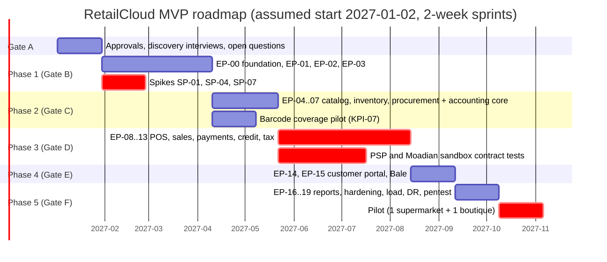

# D12 — Backlog، Roadmap و مدیریت ریسک

## 0. خلاصه

| مورد | مقدار |
|---|---|
| Backlog | **۱۰۷ آیتم** (۹۹ Story + ۸ Spike) در **۲۰ Epic**؛ **۷۱۸ Story Point** |
| پوشش | **۱۳۹/۱۳۹** نیازمندی P0 و **۴۱/۴۱** نیازمندی غیرعملکردی دست‌کم یک Story دارند. هر تست ارجاع‌داده‌شده در کاتالوگ D10 وجود دارد. وابستگی‌ها بدون حلقه‌اند و هیچ Story به Story فاز بعدی وابسته نیست. |
| منبع | [`tools/build_backlog.py`](tools/build_backlog.py) ← [`D12-backlog.csv`](D12-backlog.csv) (قابل Import در Jira، YouTrack یا GitLab) و [`D12-backlog-table.md`](D12-backlog-table.md) |
| مدت برآوردی تا پایلوت | حدود **۴۴ هفته** (بازه ۳۶ تا ۵۶ هفته) با تیم فرضی §2؛ **وابسته به مسیر بحرانی بیرونی** (§4) |

```bash
python3 docs/00-product/tools/build_backlog.py   # تولید CSV و جدول + بررسی پوشش، وابستگی و تست‌ها
```

> بررسی خودکار هنگام ساخت این Backlog **هفت وابستگی معکوس** پیدا کرد. مثلاً رسید خرید در فاز ۲ به هسته حسابداری فاز ۳ وابسته بود، و فروش نسیه در فاز ۳ به هویت مشتری فاز ۴. این Storyها به فاز زودتر منتقل شدند (`PHASE_OVERRIDE` در Generator) `[DEC D-90]`. یعنی **هسته حسابداری در فاز ۲** و **هویت حداقلی مشتری و پیامک در فاز ۳** ساخته می‌شوند.

---

## 0.1 پیشرفت پیاده‌سازی

| Sprint | آیتم | وضعیت | شاهد |
|---|---|---|---|
| 1 | US-001 Monorepo، Pipeline، Architecture Tests | ✅ Done | `src/backend`، `.github/workflows/ci.yml` (موقت؛ D-80 و AQ-04)، ۶ تست معماری (با اثبات شکست روی تخلف عمدی) |
| 1 | US-002 BuildingBlocks: Money، Quantity، TaxRate، Ids، Result، Clock (+ Gtin، PublicCustomerCode) | ✅ Done | ۳۹ تست Unit و Property (FsCheck، تا ۲٬۰۰۰ مورد تصادفی به ازای هر Property) |
| 1 | SP-07 EF Core + Npgsql با تراکنش مشترک و RLS | ✅ Done — تأیید شد | ۷ تست Integration؛ D04 §5.3 |
| 1 | US-007 محیط Dev (Compose) | 🟡 بخشی | `src/backend/dev/compose.yaml` (نحو معتبر؛ اجرا نشده). Mirrorها و Staging منتظر زیرساخت‌اند (X-07) |
| 1 | SP-01 Keycloak | ✅ Done — ۱۸/۱۸ بررسی | ADR-003 «نتیجه Spike SP-01»؛ `src/backend/dev/keycloak/`؛ Job `identity` در CI. ورود مشتری بیرون از Keycloak: **Accepted** (ADR-003 §6). بررسی C8b (وجود `sub` در Token) بعد از کشف باگ در E2E اضافه شد |
| 1 | SP-04 مؤدیان | ⏳ باز | به دسترسی Sandbox وابسته است (X-01) |
| 2 | US-003 UnitOfWork + Guard + حالت بدون Tenant | ✅ Done | `ExecuteWithoutTenantAsync` برای جست‌وجوی هویت پیش از انتخاب Tenant |
| 2 | US-021 ورود از طریق BFF | ✅ Done (یک پیگیری) | **API:** `Hosts/RetailCloud.Api` + `BuildingBlocks.Api` (JWT: aud، iss، انقضا، امضا؛ نگاشت کاربر؛ انتخاب Tenant فقط با عضویت؛ 404 یکسان)، Schema `iam` (T80–T84)، ۷ تست API. **BFF:** `src/web/apps/merchant-admin` (Next.js 15؛ Code + PKCE S256 + state + nonce؛ Token فقط سمت سرور؛ Cookie `HttpOnly`/`SameSite=Lax` و `__Host-` در Production؛ CSRF با Origin + Double-submit؛ Refresh با چرخش؛ CSP با nonce). **E2E:** `e2e/run-e2e.sh`، ۱۷/۱۷ بررسی مرورگری روی Keycloak + API + BFF واقعی، Job `web-e2e` در CI؛ Mutation (حذف CSRF) ۳ بررسی را قرمز کرد. E2E یک باگ واقعی پیدا کرد: Realm-as-code Scope `basic` را نداشت و Token بدون `sub` بود (اصلاح شد). **پیگیری:** Session Store فعلاً در حافظه است؛ نسخه‌ی Valkey (برای چند Instance) در Sprint بعد کنار US-022 |

## 1. رویکرد تحویل

- **Vertical Slice:** هر Story از UI تا DB، با Migration، تست، OpenAPI، Policy امنیتی و Metric تحویل می‌شود (DoD، §6).
- **Sprint دوهفته‌ای.** Demo و Review در پایان هر Sprint. **Gate** در پایان هر فاز (D10 §11).
- **Spikeها پیش از Storyهای وابسته** اجرا می‌شوند و خروجی‌شان ADR یا به‌روزرسانی سند است (Timebox: SP برآوردشده).
- **«ساختن ستون فقرات اول»:** UoW، RLS، Outbox، Idempotency و Audit (EP-00 و EP-03) پیش از هر قابلیت کسب‌وکاری، چون همه Invariantهای P0 روی آن‌ها بنا شده‌اند.
- **Feature Flag** برای قابلیت‌های وابسته به Verification بیرونی (بله، Provider کاتالوگ، PSP دوم).

---

## 2. فرض تیم و ظرفیت `[ASM A-35]`

| نقش | تعداد | توضیح |
|---|---|---|
| Backend (.NET) | ۳ | یکی با تجربه حسابداری و ERP |
| Frontend (React/Next.js) | ۲ | یکی با تجربه PWA و RTL |
| QA Automation | ۱ | Testcontainers، Playwright، k6 |
| DevOps/SRE | ۱ | K8s، Postgres HA، OpenBao |
| UX/UI | ۰٫۵ | — |
| Security | ۰٫۳ | Review، Threat Model، ASVS |
| PM / Product Owner | ۱ | + مشاور مالیاتی و حسابدار (بیرونی، پاره‌وقت) |

**Velocity فرضی:** Sprint ۱ و ۲: ۲۵ SP؛ از Sprint ۳: **۴۰ SP**. پس از ۳ Sprint با داده واقعی بازبینی می‌شود (RQ-01).

---

## 3. Epicها و فازها

| Epic | عنوان | فاز (Gate) | SP | نیازمندی‌های اصلی |
|---|---|---|---|---|
| EP-00 | زیرساخت توسعه، BuildingBlocks، DevOps | 1 (B) | 79 | NFR-MNT، NFR-SEC-003/006/009، NFR-OBS |
| EP-01 | Tenant، شعب، صندوق، دستگاه | 1 (B) | 29 | TEN-001..005 |
| EP-02 | هویت و دسترسی | 1 (B) | 49 | IAM-001..009 |
| EP-03 | ممیزی زنجیره‌ای | 1 (B) | 8 | AUD-001..003 |
| EP-04 | کاتالوگ و Resolve بارکد | 2 (C) | 42 | CAT-001..007، CAT-011 |
| EP-05 | Variant، قیمت، تخفیف | 2 (C) | 18 | CAT-008..010 |
| EP-06 | انبار و بهای تمام‌شده | 2 (C) | 40 | INV-001..010 |
| EP-07 | خرید و تأمین‌کننده | 2 (C) | 13 | PRC-001..004 |
| EP-08 | POS، شیفت، آفلاین | 3 (D) | 37 | SAL-001/002/009/010/011/013 |
| EP-09 | نهایی‌سازی، فاکتور، برگشت | 3 (D) | 36 | SAL-003..008، SAL-012 |
| EP-10 | پرداخت | 3 (D) | 45 | PAY-001..007 |
| EP-11 | حسابداری دوبل | **2** و 3 | 31 | ACC-001..009 |
| EP-12 | نسیه و دریافتنی | 3 (D) | 26 | CRD-001..011 |
| EP-13 | سامانه مؤدیان | 3 (D) | 44 | TAX-001..009 |
| EP-14 | هویت مشتری و پورتال | **3** و 4 | 45 | CUS-001..011 |
| EP-15 | اعلان، پیامک، بله | **3** و 4 | 29 | NOT-001..009 |
| EP-16 | گزارش و API شرکا | 5 (F) | 21 | RPT، INT |
| EP-17 | Platform Admin و Policyها | 3 تا 5 | 24 | BR-075/086/087 |
| EP-18 | سخت‌سازی امنیت و انطباق | 5 (F) | 45 | NFR-SEC، NFR-PRIV، NFR-UX |
| EP-19 | کارایی، DR، پایلوت | 5 (F) | 57 | NFR-PERF، NFR-AVL، NFR-CAP |

جمع به ازای فاز (پس از انتقال‌های D-90): **فاز ۱: ۱۶۵ · فاز ۲: ۱۲۶ · فاز ۳: ۲۴۰ · فاز ۴: ۵۳ · فاز ۵: ۱۳۴** (کل ۷۱۸).

> فهرست کامل Storyها (متن، نیازمندی، تست، SP، فاز و وابستگی) در [`D12-backlog-table.md`](D12-backlog-table.md) است.

---

## 4. Roadmap

### 4.1 زمان‌بندی (تاریخ شروع فرضی: ۱۲ دی ۱۴۰۵ = 2027-01-02 `[ASM A-36]`)



| فاز | Sprintها | هفته | خروجی |
|---|---|---|---|
| Gate A | — | ۴ | تأیید D01 تا D12؛ مصاحبه Discovery (PQ-01)؛ قراردادهای بیرونی آغاز شده |
| فاز ۱ | ۵ (۱۶۵ SP با Ramp-up) | ۱۰ | ستون فقرات، Tenancy، IAM، Audit، DevOps ← **Gate B** |
| فاز ۲ | ۳ (۱۲۶) | ۶ | کالا، بارکد، انبار، WAC، خرید، **هسته حسابداری** ← **Gate C** |
| فاز ۳ | ۶ (۲۴۰) | ۱۲ | POS کامل، پرداخت‌ها، نسیه، **مؤدیان**، هویت حداقلی مشتری، پیامک ← **Gate D** |
| فاز ۴ | ۲ (۵۳) | ۴ | پورتال مشتری، بله، Merge ← **Gate E** |
| فاز ۵ | ۲ + ۲ پایلوت (۱۳۴) | ۴ + ۴ | گزارش، سخت‌سازی، بار، DR، Pentest، پایلوت ← **Gate F** |
| **جمع** | **۲۰ Sprint** (۵ + ۳ + ۶ + ۲ + ۴) | **حدود ۴۴ هفته** (با ۴ هفته Gate A) | — |

**بازه عدم قطعیت:** خوش‌بینانه ۳۶ هفته (Velocity ۵۰، Sandboxها به‌موقع)؛ بدبینانه ۵۶ هفته (Velocity ۳۰ یا تأخیر Sandbox مؤدیان یا PSP). Freeze نوروز (D-81) روی Production اثر دارد، نه توسعه. پایلوت عمداً خارج از نوروز و هفته آخر فصل برنامه‌ریزی شده است.

### 4.2 مسیر بحرانی بیرونی (مالکیت کارفرما)

| # | وابستگی | لازم برای | مهلت پیشنهادی | ریسک |
|---|---|---|---|---|
| X-01 | دسترسی به **Sandbox سامانه مؤدیان** و مستندات جاری (SP-04) | US-131..135، Gate D | پایان Gate A | R-15 |
| X-02 | قرارداد و Sandbox **دو PSP اول** (OQ-08، SP-03) | US-102، Gate D | هفته ۱۲ | R-16 |
| X-03 | قرارداد **SMS Provider** با خط خدماتی و DLR | US-141، US-152، فاز ۳ | هفته ۱۶ | R-21 |
| X-04 | تأیید **حسابدار رسمی** بر WAC، PostingRuleها و نقش‌های حساب (OQ-05، SQ-02، D-59) | US-111، فاز ۲ | هفته ۱۲ | R-03 |
| X-05 | تأیید **مشاور مالیاتی** بر متن قانونی قالب‌ها، الگوهای صورتحساب و کف نگهداری (SQ-03/04/05) | US-133، US-172، US-173 | هفته ۲۰ | R-06 |
| X-06 | نظر **حقوقی** درباره ODbL، حریم خصوصی (PIA)، اطلاع‌رسانی نقض داده (SecQ-03/04) | US-043، Gate E | هفته ۲۴ | R-20 |
| X-07 | **زیرساخت داخلی** دو منطقه، Mirrorها و دامنه و TLS (AQ-01، OpsQ-01/03) | US-007، US-192 | هفته ۴ (Staging)، هفته ۲۸ (Prod/DR) | R-17 |
| X-08 | **فروشگاه‌های پایلوت** و دستگاه‌هایشان (TQ-04) | SP-06، US-194 | هفته ۸ (دستگاه)، هفته ۳۶ (پایلوت) | R-22 |
| X-09 | Sandbox و مستندات **بله** (SP-05) | US-154 | هفته ۳۰ | R-05 |
| X-10 | شرکت **Pentest** مستقل (TQ-03) | US-184 | هفته ۳۶ | — |

---

## 5. Risk Register

> امتیاز `L × I` (۱ تا ۵). Owner: نقش مسئول. وضعیت: `Open`، `Mitigating`، `Accepted`، `Closed`. ریسک‌های R-01 تا R-12 از §22 سند مرجع هستند و R-13 به بعد جدیدند.

| ID | ریسک | L | I | R | Owner | پیشگیری و کاهش | نشانه هشدار (Trigger) | وضعیت | ارجاع |
|---|---|---|---|---|---|---|---|---|---|
| R-01 | نشت داده بین فروشگاه‌ها | 3 | 5 | 15 | Security Architect | RLS FORCE + Scope + FK مرکب + ماتریس BOLA خودکار + Fitness | DET-01، شکست SEC-T-010 | Mitigating (T01–T07 PASS) | ADR-002، D06 TM-010 |
| R-02 | ثبت تکراری فروش یا پرداخت | 4 | 5 | 20 | Backend Lead | Idempotency دوسطحی + Unique Source + Inbox | O-4 ≠ ۰ | Mitigating (T13، T29، T35 PASS) | ADR-004 |
| R-03 | نادرستی سند یا بهای تمام‌شده | 3 | 5 | 15 | Backend Lead + حسابدار | Trigger تراز + PostingRule نسخه‌دار + Oracle + تأیید حسابدار (X-04) | O-5، O-13 ≠ ۰ | Mitigating (T30–T38 PASS) | ADR-005 |
| R-04 | پوشش ناکافی بارکد ایرانی | 4 | 3 | 12 | PM | Provider Chain + تأیید انسانی + Pilot پوشش | KPI-07 پایین | Open | ADR-007 |
| R-05 | محدودیت یا تغییر API بله | 3 | 3 | 9 | Backend Lead | Feature Flag + SMS پیش‌فرض + SP-05 | شکست Sandbox | Open | ADR-008 |
| R-06 | تغییر قوانین مالیاتی و الگوهای مؤدیان | 4 | 4 | 16 | PM + مشاور مالیاتی | Policy نسخه‌دار + Adapter جدا + بازبینی فصلی مستندات | ابلاغیه جدید | Open | BR-075، D-26 |
| R-07 | سوءاستفاده از شناسه عمومی مشتری | 3 | 4 | 12 | Security | کد ≠ مجوز؛ QR یک‌بارمصرف؛ Rate Limit | DET-03 | Mitigating | D06 AB-09/10 |
| R-08 | قطعی اینترنت فروشگاه | 4 | 3 | 12 | PM | Draft آفلاین + UX صادق + Hotspot؛ ارزیابی Provisional در پایلوت | شکایت پایلوت | Accepted (MVP) | ADR-006 |
| R-09 | پیچیدگی اضافه و فرسایش مرز ماژول‌ها | 3 | 3 | 9 | Architect | Architecture Tests + فهرست بسته tx-port | شکست R1–R9 | Mitigating | ADR-001 |
| R-10 | خرابی Provider یا PSP | 3 | 3 | 9 | SRE | Circuit Breaker + Degraded Mode + Inquiry | RB-10 | Mitigating | D11 |
| R-11 | اختلاف ریال و تومان و گردکردن | 2 | 4 | 8 | Backend Lead | Money VO + Property Tests + D-13 | Oracleها | Mitigating | ADR-009 |
| R-12 | هزینه رشد زیرساخت | 3 | 3 | 9 | CTO | Partition + Read Model + Retention + بازبینی ظرفیت ماهانه | DB > ۷۰٪ | Open | D05 §8 |
| R-13 | از دست رفتن داده یا عدم بازیابی | 2 | 5 | 10 | SRE | WAL پیوسته + DR Warm + Drill ماهانه | شکست DR-01 | Open | D11 §6 |
| R-14 | سوءاستفاده یا افشای کلید مالیاتی | 2 | 5 | 10 | Security | TSS ایزوله + KMS غیرقابل استخراج + DET-05/06 + RB-09 | Hash Mismatch | Mitigating (T60–T62 PASS) | ADR-011 |
| R-15 | تأخیر دسترسی به Sandbox یا تغییر API مؤدیان | 4 | 5 | **20** | PM (کارفرما) | X-01 زودهنگام؛ Fake مطابق مستندات؛ Adapter جدا | X-01 تا هفته ۴ محقق نشود | Open | D10 TQ-02 |
| R-16 | تأخیر قرارداد PSP | 3 | 4 | 12 | بازرگانی | X-02؛ MVP با نقد و کارتخوان قابل عرضه است | — | Open | ADR-012 |
| R-17 | محدودیت دسترسی به Registryها و ابزار خارجی (تحریم و فیلترینگ) | 4 | 3 | 12 | SRE | Mirror داخلی + قرنطینه + Air-gap Runbook (RB-20) | Mirror کهنه | Mitigating | ADR-010 |
| R-18 | کمبود مهارت عملیات (Keycloak، OpenBao، Patroni) | 3 | 4 | 12 | CTO | آموزش، Spikeها، Runbookها، پشتیبانی بیرونی | تأخیر US-007/009 | Open | D11 |
| R-19 | **بزرگ شدن دامنه MVP** (نسیه، مؤدیان مستقیم، چند PSP) | 4 | 4 | 16 | PM | Backlog قفل در Gate A؛ هر افزوده جدید با Change Request و اثر زمانی | Velocity کمتر از برنامه | Open | D-90 |
| R-20 | الزامات حقوقی حریم خصوصی، نگهداری و ODbL | 3 | 4 | 12 | حقوقی | X-05، X-06؛ Default امن (OFF فقط پیشنهاد) | — | Open | ADR-007، BR-087 |
| R-21 | تحویل‌پذیری پیامک (OTP و فاکتور) | 3 | 4 | 12 | بازرگانی + SRE | دو Provider؛ DLR؛ Fallback بله | نرخ تحویل پایین | Open | D-86 |
| R-22 | تنوع دستگاه‌ها و کیفیت اسکن دوربین | 3 | 3 | 9 | Frontend Lead | SP-06 روی دستگاه‌های واقعی؛ پشتیبانی بارکدخوان | شکست T1 در UAT | Open | D09 |

---

## 6. Definition of Ready و Definition of Done

### 6.1 Definition of Ready (پیش از ورود Story به Sprint)
- [ ] نیازمندی‌ها و تست‌های ارجاعی شناسه دارند (این Backlog) و AC روشن است.
- [ ] Operationهای D07 و صفحه D09 مرتبط مشخص‌اند.
- [ ] وابستگی‌ها Done یا در همان Sprint هستند. Spike مرتبط بسته شده است.
- [ ] پرسش باز مسدودکننده‌ای ندارد (یا Default ثبت‌شده دارد).
- [ ] برآورد تیم (SP) ثبت شده است.

### 6.2 Definition of Done — Story (از §19.3 سند مرجع + ابزارهای این بسته)
- [ ] کد + Unit و Property Test (Invariantهای D03 مرتبط) + Integration با Testcontainers.
- [ ] Migration رو به جلو و سازگار با N-1، با `Down` یا Runbook. **Fitness و `tests.sql` و Oracleها PASS.**
- [ ] OpenAPI در Generator به‌روز. **`check_contract.py` PASS.** Endpoint بدون مستند وجود ندارد.
- [ ] `x-permission` و `x-scope` صحیح. **ماتریس امنیتی تولیدشده PASS.**
- [ ] Idempotency برای عملیات پولی و موجودی. Audit برای عملیات `x-audited`.
- [ ] Metricها و Logهای ساختاریافته بدون PII. Alert در صورت نیاز با Runbook.
- [ ] پیام خطای فارسی برای کدهای جدید (D09 §10.1).
- [ ] RTL، دسترس‌پذیری (axe بدون Serious) و E2E Smoke برای جریان UI.
- [ ] Review کد (۲ نفر برای مالی و امنیتی) و Security Review برای `x-permission` جدید یا داده حساس.
- [ ] مستندات (سند D مرتبط) به‌روز، و `build_test_catalog.py` و `build_backlog.py` بدون خطا.
- [ ] CI سبز. بدون Secret در Git. بدون آسیب‌پذیری Critical یا High جدید.
- [ ] Demo با داده مصنوعی (بدون PII واقعی).

### 6.3 Definition of Done — Gate و Release
- همه Storyهای فاز Done؛ معیارهای خروج Gate در D10 §11.
- گزارش Gate: نتایج تست به تفکیک کاتالوگ، Oracleها، استثناها با Owner.
- برای Release تولید: Runbookهای جدید، Alertهای جدید، و تأیید دونفره (D11 §2.1).

---

## 7. حاکمیت Backlog

| موضوع | قاعده |
|---|---|
| منبع حقیقت | `tools/build_backlog.py`؛ پس از Import در ابزار مدیریت پروژه، ابزار منبع می‌شود و Generator فقط برای بررسی پوشش اجرا می‌شود `[DEC D-91]` |
| Change Request | هر قابلیت جدید: شناسه نیازمندی در D02 ← Story ← اثر زمانی ← تأیید PO و کارفرما `[DEC D-92]` |
| اولویت درون فاز | ستون فقرات و Invariant ← جریان اصلی ← خطاها ← گزارش و راحتی |
| بدهی فنی | ۱۵٪ ظرفیت هر Sprint `[DEC D-93]` |
| Spike | خروجی اجباری: ADR یا به‌روزرسانی سند + تصمیم Go/No-go `[DEC D-94]` |
| بازبینی برآورد | پس از Sprint ۳ و هر Gate؛ Roadmap با Velocity واقعی به‌روز می‌شود `[DEC D-95]` |

---

## 8. پرسش‌های باز

| ID | پرسش | Default |
|---|---|---|
| RQ-01 | ترکیب و اندازه واقعی تیم؟ (اثر مستقیم بر §4) | §2 |
| RQ-02 | تاریخ شروع پیاده‌سازی پس از Gate A؟ | ۱۲ دی ۱۴۰۵ |
| RQ-03 | ابزار مدیریت پروژه (Jira، YouTrack، GitLab Issues)؟ CSV با هر سه سازگار است. | — |
| RQ-04 | آیا Release داخلی (فقط Staging) در پایان هر فاز برای Demo به ذی‌نفعان کافی است، یا پایلوت زودهنگام با نقد و کارتخوان پس از Gate D مطلوب است؟ | Demo در Staging؛ پایلوت پس از Gate F |
