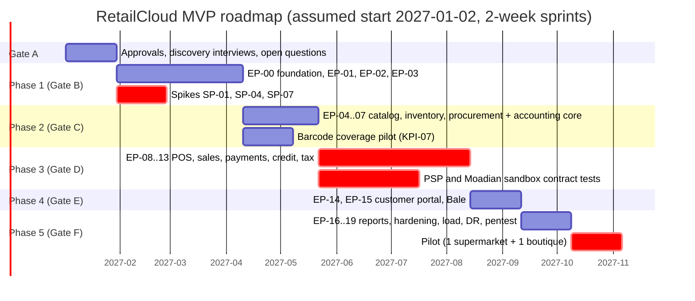

# D12 — Backlog، Roadmap و مدیریت ریسک

## 0. خلاصه

| مورد | مقدار |
|---|---|
| Backlog | **۱۰۷ آیتم** (۹۹ Story + ۸ Spike) در **۲۰ Epic**؛ **۷۱۸ Story Point** |
| پوشش | **۱۳۹/۱۳۹** نیازمندی P0 و **۴۱/۴۱** نیازمندی غیرعملکردی دست‌کم یک Story دارند. هر تست ارجاع‌داده‌شده در کاتالوگ D10 وجود دارد. وابستگی‌ها بدون حلقه‌اند و هیچ Story به Story فاز بعدی وابسته نیست. |
| منبع | [`tools/build_backlog.py`](tools/build_backlog.py) ← [`D12-backlog.csv`](D12-backlog.csv) (قابل Import در Jira، YouTrack یا GitLab) و [`D12-backlog-table.md`](D12-backlog-table.md) |
| مدت برآوردی تا پایلوت | حدود **۴۴ هفته** (بازه ۳۶ تا ۵۶ هفته) با تیم فرضی §2؛ **وابسته به مسیر بحرانی بیرونی** (§4) |

```bash
python3 docs/00-product/tools/build_backlog.py   # تولید CSV و جدول + بررسی پوشش، وابستگی و تست‌ها
```

> بررسی خودکار هنگام ساخت این Backlog **هفت وابستگی معکوس** پیدا کرد. مثلاً رسید خرید در فاز ۲ به هسته حسابداری فاز ۳ وابسته بود، و فروش نسیه در فاز ۳ به هویت مشتری فاز ۴. این Storyها به فاز زودتر منتقل شدند (`PHASE_OVERRIDE` در Generator) `[DEC D-90]`. یعنی **هسته حسابداری در فاز ۲** و **هویت حداقلی مشتری و پیامک در فاز ۳** ساخته می‌شوند.

---

## 0.1 پیشرفت پیاده‌سازی

**خلاصه‌ی خودکار** (درصد هر فاز و Epic، کارهای بعدی، موارد منتظر کارفرما): [`D12-progress.md`](D12-progress.md). این بخش شواهد هر آیتم است. ستون Sprint، Sprintی است که آیتم واقعاً در آن تمام شد.

| Sprint | آیتم | وضعیت | شاهد |
|---|---|---|---|
| 1 | US-001 Monorepo، Pipeline، Architecture Tests | ✅ Done | `src/backend`، `.github/workflows/ci.yml` (موقت؛ D-80 و AQ-04)، ۶ تست معماری (با اثبات شکست روی تخلف عمدی) |
| 1 | US-002 BuildingBlocks: Money، Quantity، TaxRate، Ids، Result، Clock (+ Gtin، PublicCustomerCode) | ✅ Done | ۳۹ تست Unit و Property (FsCheck، تا ۲٬۰۰۰ مورد تصادفی به ازای هر Property) |
| 1 | SP-07 EF Core + Npgsql با تراکنش مشترک و RLS | ✅ Done — تأیید شد | ۷ تست Integration؛ D04 §5.3 |
| 1–3 | US-007 محیط Dev (Compose) | 🟡 بخشی | `src/backend/dev/compose.yaml` (نحو معتبر؛ اجرا نشده). Mirrorها و Staging منتظر زیرساخت‌اند (X-07) |
| 1 | SP-01 Keycloak | ✅ Done — ۱۸/۱۸ بررسی | ADR-003 «نتیجه Spike SP-01»؛ `src/backend/dev/keycloak/`؛ Job `identity` در CI. ورود مشتری بیرون از Keycloak: **Accepted** (ADR-003 §6). بررسی C8b (وجود `sub` در Token) بعد از کشف باگ در E2E اضافه شد |
| 3 (برنامه) | SP-04 مؤدیان | ⏳ باز | به دسترسی Sandbox وابسته است (X-01) |
| 1 | US-003 UnitOfWork + Guard + حالت بدون Tenant | ✅ Done | `ExecuteWithoutTenantAsync` برای جست‌وجوی هویت پیش از انتخاب Tenant |
| 1 | US-021 ورود از طریق BFF | ✅ Done (یک پیگیری) | **API:** `Hosts/RetailCloud.Api` + `BuildingBlocks.Api` (JWT: aud، iss، انقضا، امضا؛ نگاشت کاربر؛ انتخاب Tenant فقط با عضویت؛ 404 یکسان)، Schema `iam` (T80–T84)، ۷ تست API. **BFF:** `src/web/apps/merchant-admin` (Next.js 15؛ Code + PKCE S256 + state + nonce؛ Token فقط سمت سرور؛ Cookie `HttpOnly`/`SameSite=Lax` و `__Host-` در Production؛ CSRF با Origin + Double-submit؛ Refresh با چرخش؛ CSP با nonce). **E2E:** `e2e/run-e2e.sh`، ۱۷/۱۷ بررسی مرورگری روی Keycloak + API + BFF واقعی، Job `web-e2e` در CI؛ Mutation (حذف CSRF) ۳ بررسی را قرمز کرد. E2E یک باگ واقعی پیدا کرد: Realm-as-code Scope `basic` را نداشت و Token بدون `sub` بود (اصلاح شد). **پیگیری انجام شد (Sprint 2):** Session Store روی Valkey با رمزنگاری AES-256-GCM، کلید Hash‌شده و قفل Refresh بین Instanceها؛ E2E E20–E21 |
| 1 | US-022 MFA اجباری برای نقش‌های حساس + Step-up | ✅ Done | Keycloak: Flow سطح احراز (`acr=pwd|mfa`، TOTP یا کلید عبور، ثبت خودکار TOTP)، `mfa-checks.js` با ۱۰ بررسی. API: `MfaPolicy` (IAM-003، ABAC-05)، `403 mfa-required` و `step-up-required`، نقش‌ها در `iam.tenant_membership.roles` (T85–T86)، ۱۰ تست API (Mutation: ۲ قرمز). BFF: Step-up، چرخش Session، انتخاب Tenant پس از MFA. E2E: ۲۴/۲۴. ADR-003 «پیاده‌سازی MFA» |
| 1 | US-006 Idempotency + problem+json | ✅ Done | `core.idempotency_record` (T87–T90، Oracle O-4 برای رکورد InProgress پس از Commit)، `MapIdempotentPost` + `PostgresIdempotencyStore` (ادعای کلید داخل همان تراکنش، انتظار محدود ۵ ثانیه ← `409 in-progress`)، `ProblemDefaults` (کد و traceId برای همه خطاها، بدون Stack Trace حتی در Development؛ SEC-T-016). ۱۰ تست؛ ۱۲ درخواست هم‌زمان با یک کلید دقیقاً یک بار اجرا شد؛ Mutation (اجرای Handler پیش از Claim) ۴ تست را قرمز کرد. **پیگیری:** وقتی Operationهای BR-030 ساخته شوند، یک تست Contract بررسی کند که هر Operation با `idem=True` در D07 با `MapIdempotentPost` Map شده باشد. پاک‌سازی رکوردهای قدیمی: انجام شد در US-005 (`MessagingRetention`) |
| 1 | US-005 Outbox/Inbox + Relay در Workers | ✅ Done | `core.outbox`، `core.inbox`، `outbox_due_tenants`، `outbox_stats` (T91–T96؛ Fitness Rule 5 عمومی‌تر شد)، `PostgresOutbox`، `OutboxRelay` (SKIP LOCKED، Inbox، Backoff، Dead-letter)، `MessagingRetention` (پیگیری US-006 هم انجام شد)، Host جدید `RetailCloud.Workers` با LISTEN/NOTIFY و Gaugeهای D11، Alert `RCOutboxDeadLetter`، قاعده معماری R10. ۱۰ تست Integration با نقش‌های واقعی؛ Mutation: ۲ قرمز. ADR-013 اصلاح شد (یک Outbox مشترک) |
| 1 | US-011 ثبت‌نام و راه‌اندازی خودکار Tenant | ✅ Done | `POST /tenants` (کاربر تازه بدون Provisioning قبلی، MFA لازم، شناسه Tenant از Identity + Idempotency-Key مشتق می‌شود ← کلیک دوباره یک فروشگاه)، شعبه B1 و صندوق R1 هم‌زمان؛ عضویت TenantOwner، انبار W1، شجره حساب (۲۸ حساب، ۲۰ نقش D-30/D-59) و ۱۲ دوره سال جاری شمسی از رویداد `platform.tenant-registered` در Workers (ماژول‌های جدید Inventory و Accounting). `GET /tenants/me/setup` برای ویزارد. تست‌ها: ۱۰ واحد/Property (تقویم شمسی ۱۳۵۰–۱۵۰۰)، ۵ Integration، E2E N01–N05 (ثبت‌نام کاربر تازه با ثبت TOTP تا فروشگاه آماده)؛ Mutation: ۲ مورد، هر دو قرمز. **منتظر کارفرما:** بازبینی شجره حساب توسط حسابدار (X-04) |
| 1 | US-025 دعوت کاربر با نقش و Scope + Default Deny | ✅ Done | `iam.role_assignment` (نقش × Tenant/Branch/Warehouse/Register، تغییرناپذیر، «آخرین مالک حذف نمی‌شود»)، `iam.invitation` (لینک یک‌بار مصرف ۷ روزه، فقط Hash)، T97–T101. ماتریس D06 §6.2 در کد با تست هم‌خوانی سند (Mutation گرفته شد)، `AccessPolicy` با ضد افزایش دسترسی. **Default Deny واقعی:** هر Endpoint Policy صریح دارد و تستی همه Endpointها را با `x-permission` در D07 مقایسه می‌کند (`D07-operations.json`). API: roles، users، invitations، accept، role-assignments، branches. پنل: صفحه کاربران و دعوت، صفحه پذیرش. تست‌ها: ۸ واحد، ۸ Integration، E2E I01–I06 (مالک دعوت می‌کند ← صندوق‌دار می‌پیوندد ← دسترسی مدیریتی ندارد ← لینک دوباره کار نمی‌کند). **باز:** ارسال پیامکی یا ایمیلی دعوت (X-03)؛ ابطال دعوت؛ نقش سفارشی |
| 1 | US-012 شعب و صندوق‌های بیشتر | ✅ Done | `POST /branches` (شعبه + صندوق R1 در یک تراکنش؛ انبار `W-<code>` از رویداد `platform.branch-created` در Inventory)، `POST /branches/{id}/registers`، کد یکتا (`409 duplicate-code`)، فقط `tenant.settings.manage`؛ مدیر شعبه فقط شعبه خودش را می‌بیند. صفحه شعب در پنل. تست‌ها: ۳ Integration (AT-002)، E2E B01–B02. در کنار آن یک تست ناپایدار E2E اصلاح شد (جست‌وجوی `eyJ` در متن رمزشده گاهی تصادفی مثبت می‌شد) |
| 1 | US-013 ثبت دستگاه POS با کد جفت‌سازی | ✅ Done | کد ۸ نویسه‌ای Crockford، ۱۰ دقیقه، یک‌بار مصرف (فقط Hash)؛ دستگاه Secret می‌گیرد که BFF در Cookie `HttpOnly` یک‌ساله نگه می‌دارد و API از هدر `X-RC-Device` ترمینال را می‌شناسد (`/me.terminal`)؛ ابطال فوری؛ مدیر شعبه فقط شعبه خودش. فیلتر `RequireTerminal` برای ABAC-04 آماده فروش است. **مجوز جدید `terminals.manage`** (Owner و Admin کل فروشگاه، BranchManager شعبه خود): تناقض TEN-002.1 («مدیر شعبه صادر می‌کند») با D07 (`tenant.settings.manage`) را برطرف کرد؛ D02 و D06 و D07 هم‌زمان اصلاح شدند و تست هم‌خوانی سند آن را تضمین می‌کند. **Rate Limit** (پیشنهاد تحلیل): ۱۰ تلاش در ۱۰ دقیقه برای جفت‌سازی و پذیرش دعوت ← `429`. T102–T104، ۵ Integration، E2E T01–T04 |
| 1 | US-026 تأیید لحظه‌ای مدیر | ✅ Done | `iam.approval_request` (قید SoD-01 در DB: تأییدکننده ≠ درخواست‌کننده؛ فقط گذارهای مجاز، واقعیت‌ها تغییرناپذیر؛ T105–T107)؛ `IApprovals` (درخواست، تصمیم، مصرف یک‌باره با Binding دقیق action+resource+scope+value، ۵ دقیقه، D-61)؛ نقش‌های «دارای سقف» از جدول D06 با تست هم‌خوانی (صندوق‌دار هرگز تخفیف تأیید نمی‌کند؛ سوخت مطالبات فقط مالک)؛ `listApprovals`، `getApproval`، `decideApproval` با MFA تازه؛ صفحه «درخواست‌های تأیید» در پنل. تست‌ها: ۲ واحد، ۴ Integration، E2E A01–A02. **باز:** مسیر PIN روی همان دستگاه (US-023)؛ مصرف‌کننده‌های واقعی (تخفیف، برگشت، …) با ماژول‌های فروش. **باگ واقعی پیدا شد:** ترتیب Outbox بر پایه UUIDv7 در یک میلی‌ثانیه تضمین نمی‌شد؛ ستون `seq` اضافه شد |
| 1 | US-023 قفل صندوق با PIN | ✅ Done | `iam.user_pin` (فقط Argon2id با پارامترهای AUTH-08؛ T108–T109)، `PinHasher` (PHC، نمک تصادفی، مقایسه زمان‌ثابت)، `PUT /me/pin` (فقط تا ۱۰ دقیقه پس از ورود کامل)، `POST /me/pin/verify` (فقط Terminal ثبت‌شده؛ قفل ردیف تا حدس‌های هم‌زمان بیش از ۵ تلاش نگیرند؛ ۵ خطا = قفل، باز شدن فقط با PIN جدید پس از ورود کامل)؛ BFF: قفل دستی و خودکار پس از ۵ دقیقه بیکاری روی Terminal (IAM-005)، API در حالت قفل `423`، با قفل شدن PIN خود Session هم پایان می‌یابد. **مسیر تأیید روی همان دستگاه (F-14) کامل شد:** مدیر با `approverId` و PIN خودش روی Terminal همان شعبه تأیید می‌کند. تست‌ها: ۵ Integration (Mutation حذف قفل ردیف گرفته شد)، E2E P01–P04. **تصمیم برای کارفرما:** F-14 روی همان دستگاه «PIN و MFA مدیر» گفته است؛ پیاده‌سازی PIN + Terminal ثبت‌شده (چیزی که مدیر می‌داند + دستگاهی که فروشگاه دارد) است. اگر MFA هم لازم است، در US-024 اضافه می‌شود |
| 1 | US-031 زنجیره ممیزی | ✅ Done | `audit.audit_record` با ستون‌های «چه کسی و از کجا» (نقش‌ها، شعبه، Terminal، IP، Impersonation؛ داخل Hash)، Trigger زنجیره و `audit.chain_anchor` فقط‌درج؛ `IAuditLog` در همان Transaction عملیات (رکورد ممیزی بدون عملیات یا عملیات بدون رکورد ممکن نیست)؛ `AuditSanitizer` (حذف PIN، OTP، Token، رمز، کارت، موبایل و ایمیل با نام کلید یا شکل مقدار)؛ ممیزی همه عملیات حساس موجود (ثبت فروشگاه، شعبه، صندوق، کد جفت‌سازی، Terminal، دعوت، نقش، PIN، قفل، تأیید)؛ وارسی روزانه در Workers با Anchor و متریک `rc_audit_chain_broken_total` (D11 RB-22). IP فقط از Proxy مورد اعتماد (`Network:TrustedProxies`) پذیرفته می‌شود. تست‌ها: ۴ واحد، ۲ Integration (AT-190..193، هم‌زمانی ۱۰ درخواست بی‌شکاف)، T70–T74. **باز:** نگه‌داری Head در MinIO Object Lock (D11) با زیرساخت
| 1 | US-032 جستجوی ممیزی | ✅ Done | `GET /audit` فقط با `audit.view` (مالک، مدیر سیستم، ممیز): جدیدترین اول، صفحه‌بندی Keyset روی `seq` با Cursor مبهم، فیلتر زمان، رویداد (دقیق یا پیشوند مثل `iam.`)، کاربر و منبع؛ `%` و `_` در فیلتر حرف عادی‌اند. RLS سابقه فروشگاه دیگر را برنمی‌گرداند. پاسخ همه فیلدهای AUD-001.1 (نقش‌ها، Terminal، IP، جزئیات پاک‌شده) را دارد. BFF فقط فیلترهای قرارداد را عبور می‌دهد؛ صفحه «سابقه ممیزی» در پنل. تست‌ها: ۳ Integration (فیلترها، صفحه‌بندی بی‌هم‌پوشانی، ۴۰۳ صندوق‌دار، ۴۰۰ ورودی بد، جداسازی Tenant؛ Mutation حذف Escape گرفته شد)، E2E U01–U02. **باز:** Export سابقه (US-016) و نمایش نام کاربر به جای شناسه
| 1 | US-004 Migration Runner | ✅ Done | `RetailCloud.Migrator` و `sql/migrations.json` (`[DEC D-96]`، D05 §11.1): گام‌های مرتب به ازای ماژول، تاریخچه در Schema هر ماژول با Checksum، هر گام با ثبتش در یک تراکنش، `lock_timeout` با تلاش دوباره، Advisory Lock، توقف با تغییر گام اجراشده یا گام ناشناخته یا ترتیب خراب، Fitness پس از اجرا. اجرا با Login **غیر Superuser**. **باگ واقعی پیدا شد:** واگذاری مالکیت تابع به `rc_tenant_directory` فقط با Superuser کار می‌کرد؛ حالا `CREATE` موقت در همان تراکنش داده و پس گرفته می‌شود و Fitness قاعده ۶ ماندنش را می‌گیرد. CI (`check-migrations.sh`): Schema ساخته Migrator با DDL مرجع **یکسان** (۱۶۲۵ خط `pg_dump`)، اجرای دوم بی‌اثر. تست‌ها: ۸ Integration (از جمله اجرای هم‌زمان ۳ Migrator؛ Mutationهای حذف Lock و حذف تراکنش گرفته شد)، تست معماری R11 (Api و Workers Schema را تغییر نمی‌دهند). **باز:** اجرای روی Snapshot ناشناس‌شده Staging و تست Rolling N-1 (D05 §11.4) با زیرساخت Staging (X-07)
| 1 | US-014 پلن و Entitlement | ✅ Done | `platform.plan` (سراسری؛ پیش‌فرض‌ها: آزمایشی ۱۴ روز با ۲ شعبه، ۴ صندوق، ۵ کاربر؛ پایه ۱/۲/۳؛ حرفه‌ای ۵/۱۵/۲۵؛ سازمانی نامحدود — **اعداد تأیید کارفرما 2026-11-23**) و `platform.subscription` (با ثبت فروشگاه، آزمایشی شروع می‌شود؛ App فقط می‌خواند). سقف در DB اعمال می‌شود (`[DEC D-97]`): Trigger با قفل به ازای Tenant، کد سراسری `RC030` ← `403 entitlement-exceeded` با `resource` و `limit`. دعوت همکار از قبل صندلی‌ها را می‌شمارد (عضو فعال + دعوت باز) و پذیرش دعوت هم سقف دارد. `GET /tenants/me` پلن، پایان دوره آزمایشی و سقف‌ها را دارد؛ صفحه اصلی و پیام D09 در پنل. **دو باگ واقعی پیدا شد:** (۱) `RC013` از قبل معنای «دوره مالی بسته» داشت و نگاشت سراسری آن را «سقف پلن» نشان می‌داد؛ کدهای RC حالا فهرست دارند و نگاشت سراسری فقط برای RC030+ است. (۲) خطای DB در مسیر EF Core داخل `DbUpdateException` پیچیده می‌شد و از نگاشت جا می‌ماند. تست‌ها: SQL T110–T121، ۴ Integration API (AT-004، هم‌زمانی ۶ درخواست)، تست قطعی قفل (Mutation حذف قفل ۳ از ۳ گرفته شد)، تست نگاشت کد، E2E L01 و B03. **باز:** تغییر پلن توسط اپراتور (US-171) و صورتحساب اشتراک (P1)
| 1 | US-015 فقط‌خواندنی | ✅ Done | `[DEC D-98]`: فروشگاه معلق، بسته یا با دوره آزمایشی تمام‌شده همه‌چیز را می‌خواند، ولی هر نوشتن با `403 tenant-read-only` (همراه `reason`) رد می‌شود، جز ۱۰ عملیات `x-allowed-when-read-only` در D07: انتخاب فروشگاه، باز کردن صندوق با PIN، لغو دستگاه، حذف نقش، Export، دریافت نسیه (پنل و پرتال مشتری)، تلاش دوباره صورتحساب مؤدیان، تصمیم دسترسی پشتیبانی و خروجی داده مشتری. پذیرش دعوت هم بررسی می‌شود (Tenant از Token می‌آید، نه از Header). Workers و صف مؤدیان ادامه می‌دهند. هیچ داده‌ای حذف نمی‌شود. **حفره بسته شد:** App روی `platform.tenant` مجوز UPDATE کامل داشت و می‌توانست `status` را تغییر دهد؛ حالا فقط ستون‌های `TenantUpdate`. پنل: بنر فقط‌خواندنی و پیام D09. تست‌ها: SQL T122–T128، ۲ Integration (AT-005)، هم‌خوانی نشانه‌ها با D07؛ ۳ Mutation گرفته شد؛ E2E R01. **باز:** تغییر وضعیت توسط اپراتور (`platformChangeTenantStatus`، US-171)
| 1 | US-016 خروجی کامل داده | ✅ Done | `createExport` (۲۰۲، فقط با `data.export` و MFA کمتر از ۱۵ دقیقه، یک خروجی هم‌زمان در هر فروشگاه ← `409 export-in-progress`؛ در حالت فقط‌خواندنی هم مجاز) و `getExport` (لینک Presigned پنج‌دقیقه‌ای که در هر درخواست تازه صادر و ممیزی می‌شود؛ پس از ۲۴ ساعت «منقضی»). `platform.export_job` (فقط Workers وضعیت را تغییر می‌دهد؛ کلید فایل فقط زیر `tenants/<همان فروشگاه>/`). Workers: ZIP از CSVهای ۷ دسته به‌اضافه `manifest.json` زیر RLS خود فروشگاه، کلید تصادفی ۲۵۶بیتی، خنثی‌سازی فرمول در سلول‌ها (AB-18)، بدون داده رمزشده تماس مشتری؛ خطا ← `Failed` (بدون تکرار بی‌پایان)؛ حذف ساعتی فایل‌های منقضی؛ DET-08 با متریک و Alert `RCExportLarge` (RB-23). `IObjectStorage` با پیاده‌سازی S3 برای MinIO (AWSSDK.S3 4.0.104.11، Apache-2.0). پنل: صفحه «خروجی داده‌ها». تست‌ها: SQL T129–T132، ۵ Integration (Worker، شامل جداسازی فروشگاه و تزریق فرمول) + ۶ واحد CSV + امضای لینک S3، ۴ Integration API (AT-006)، E2E X01. **آزمون ذخیره‌سازی واقعی (تأیید کارفرما 2026-11-23):** ۳ تست Integration روی S3 واقعی (ساخت Bucket، دانلود با لینک، نام فایل، حذف؛ Export واقعی تا ZIP)، در CI و این محیط روی moto 5.2.5 (Image رسمی MinIO دیگر در Docker Hub نیست)؛ بررسی سخت‌گیرانه امضا و انقضای لینک (`RC_TEST_S3_STRICT=1`) فقط روی MinIO واقعی ممکن است و به Staging می‌رود؛ E2E X02 دانلود ZIP از لینک پنج‌دقیقه‌ای. **باز:** (۱) آزمون روی Staging؛ (۲) شماره کامل مشتری پس از ماژول CID (فعلاً `not-yet-supported`)؛ (۳) اطلاع DET-08 به مالک فروشگاه پس از کانال اعلان
| 1 | US-010 تست امنیتی تولیدی | ✅ Done | `GeneratedSecurityTests` از `D07-operations.json` (که حالا `scope`، `pathParams`، `bodyProps` و `idempotent` دارد) برای **هر** Endpoint پیاده‌شده، پس Endpoint جدید از روز اول پوشش دارد: SEC-T-012 ماتریس نقش (هر نقش سیستمی × هر Operation، مطابق D06 §6.2 از `AccessPolicy`)؛ SEC-T-010 شناسه فروشگاه دیگر در هر پارامتر مسیر ← 404؛ SEC-T-011 مدیر شعبه ۱ روی شعبه ۲ ← 403/404؛ SEC-T-013 فیلد تعریف‌نشده در بدنه ← `400 validation` با نام فیلد و `unknown-field`. پارامتر یا Operation جدیدی که Fixture ندارد، تست را با پیام روشن می‌شکند. **حفره بسته شد:** API فیلدهای ناشناخته را بی‌صدا نادیده می‌گرفت (راهکار TM-013 در D06 پیاده نشده بود)؛ حالا `UnmappedMemberHandling.Disallow` و خطای بدنه همیشه problem+json است (پیش‌تر خارج از Development بدنه خالی بود). Mutationهای حذف رد فیلد ناشناخته و حذف بررسی Scope شعبه گرفته شد. **باز:** SEC-T-014 (فیلدهای حساس در پاسخ) وقتی فیلد حساسی در پاسخ‌ها باشد (بهای خرید، شماره مشتری)
| 1 | US-027 دسترسی JIT پشتیبانی | 🟡 بخشی | **سمت فروشگاه کامل:** `iam.support_access_request` با قواعد DB (حداکثر ۴ ساعت؛ فقط گذارهای مجاز با کد `RC015`؛ واقعیت‌ها تغییرناپذیر؛ تصمیم و پایان فقط با کسی که در همان فروشگاه TenantOwner است — SoD-05 حتی اگر کد اشتباه کند؛ پنجره دقیقاً برابر مدت درخواستی از لحظه تأیید؛ سابقه حذف‌شدنی نیست). `listSupportAccessRequests`، `decideSupportAccess` و **`revokeSupportAccess` (افزوده به D07، راهکار AB-17)**؛ تصمیم و پایان فقط مالک (`403 owner-only` حتی برای TenantAdmin) با MFA تازه؛ درخواست تصمیم‌نگرفته پس از ۲۴ ساعت منقضی؛ همه ممیزی؛ در حالت فقط‌خواندنی هم مجاز. پنل: صفحه «دسترسی پشتیبانی». تست‌ها: SQL T133–T139، ۳ Integration (AT-017)، پوشش خودکار در تست‌های امنیتی تولیدی، E2E S01–S02. **باز (US-171):** ثبت درخواست توسط Support و استفاده از دسترسی با Masking داده PII و مالی و برچسب Support در ممیزی؛ این‌ها هویت و Realm پلتفرم را لازم دارند که هنوز وجود ندارد. اطلاع DET-09 به فروشگاه هم همان‌جا
| 2 | US-041 کالا، Variant و بارکد | ✅ Done | ماژول جدید Merchandising (`merch`): `createProduct` (Idempotent، تأیید صریح کاربر CAT-004.1)، `getProduct`، `listProducts` (جستجوی نام نرمال‌شده فارسی: ي/ك عربی، ارقام فارسی و عربی، نیم‌فاصله؛ SKU؛ بارکد اسکن‌شده؛ صفحه‌بندی Keyset)، `updateProduct` (نسخه‌دار، `409 version-conflict`)، `addVariant`، `addBarcode`، `removeBarcode`. بارکد با `packagingUnit` و ضریب (کارتن ۲۴تایی)؛ یک مالک فعال برای هر بارکد (`409 barcode-already-assigned` با شناسه کالای دارنده)؛ تاریخچه در DB حفظ می‌شود (فقط غیرفعال‌سازی؛ `RC016`؛ بدون حذف). **باگ پیدا شد:** Variant دوم با Axis تکراری ۵۰۰ می‌داد (قید DI-081)؛ حالا `409 duplicate-code`. فیلدهای داستان‌های بعد (دسته، قیمت، موجودی افتتاحیه، Matrix، کاتالوگ عمومی) صریحاً `not-yet-supported`. پنل: صفحه «کالاها». تست‌ها: SQL T140–T146، ۵ Integration (AT-020..022، Mutation پیش‌بررسی بارکد گرفته شد)، پوشش خودکار در تست‌های امنیتی تولیدی، E2E C01–C02
| 2 | US-042 اعتبارسنجی بارکد | ✅ Done | Check Digit برای EAN-8، UPC-A، EAN-13 و GTIN-14 (نوع دامنه `Gtin` موجود، با ارقام فارسی از Barcode Scanner)؛ ذخیره GTIN-14 و نگه‌داری فرم اصلی (AT-023)؛ اسکن UPC-A و EAN-13 یک کالا را پیدا می‌کند؛ کد نادرست `422 invalid-barcode`. کدهای محدوده داخلی GS1 (۰۲، ۲۰–۲۹) و کد آزاد فروشگاه `isInternal` (AT-024)؛ ارسال‌نکردن به کاتالوگ عمومی با US-044
| 3 | US-081 شیفت و Blind Close | ✅ Done (API) | ماژول جدید Sales: `openShift`، `getShift`، `recordCashMovement`، `closeShift` (هر سه نوشتنی Idempotent و فقط روی Terminal ثبت‌شده همان شعبه، ABAC-04) و `approveShiftVariance` (`shift.supervise`، MFA تازه). DB: یک شیفت باز در هر صندوق (DI-008)، شعبه از خود صندوق، واقعیت‌ها و شمارش تغییرناپذیر (`RC017`)، ورود و خروج نقد فقط در شیفت باز و Append-only، **نقد مورد انتظار در خود DB** (افتتاحیه + فروش نقدی نهایی + ورود − خروج) تا صندوق‌دار نتواند آن را تعیین کند، مغایرت = شمارش − انتظار، SoD-01 (صندوق‌دار مغایرت خودش را تأیید نمی‌کند). Blind Close: نقد مورد انتظار تا پیش از شمارش نشان داده نمی‌شود (D-24). شیفت فقط برای صندوق‌دار خودش و سرپرست همان شعبه دیده می‌شود. مغایرت بیش از آستانه منتظر سرپرست؛ **آستانه پیش‌فرض ۵۰۰٬۰۰۰ ریال `[ASM]` (`Sales:VarianceApprovalThreshold`) — نیاز به تأیید کارفرما**. رویداد `sales.shift-closed` برای سند حسابداری. تست‌ها: SQL T147–T153، ۳ Integration (AT-250 با فروش نقد ۵٬۰۰۰٬۰۰۰ و مغایرت −۱۰۰٬۰۰۰؛ AT-251؛ Mutation نمایش زودهنگام نقد مورد انتظار گرفته شد)، پوشش خودکار امنیتی. **باز:** صفحه شیفت در POS همراه داستان صفحه فروش (فهرست صندوق‌ها و شیفت جاری دستگاه در D07 نیست)
| 3 | US-111 هسته حسابداری | ✅ Done | `listAccounts`، `createAccount`، `setAccountMappings`، `listPeriods`، `listJournals` (فیلتر بازه و منبع، صفحه‌بندی Keyset)، `createJournalDraft`، `postJournal`، `reverseJournal` (همه نوشتنی‌های سند Idempotent). تراز دوطرفه: هم در دامنه (`JournalRules`: هر سطر یک‌طرفه و مثبت، ≥۲ سطر، Σ بدهکار = Σ بستانکار) و هم Deferred Trigger در DB (AT-102)؛ سند قطعی تغییرناپذیر و اصلاح فقط با سند معکوس، تاریخ‌خورده امروز در دوره باز (ACC-003، ACC-009)؛ دوره بسته `409 period-closed`؛ حساب نیازمند تفصیلی بدون تفصیلی رد؛ حساب سیستمی فقط تغییرنام (`RC018`). **PostingRule نسخه‌دار (ACC-004):** اولین قاعده «مغایرت صندوق» v1 — مصرف‌کننده `sales.shift-closed` در Workers کسری را بدهکار «کسری صندوق» / بستانکار «صندوق» (و اضافه را برعکس) با Mapping نقش فروشگاه ثبت می‌کند؛ یک‌بار برای هر شیفت (DI-044). **باگ پیدا شد:** ثبت خودکار در Workers با `42501` رد می‌شد (قفل `FOR SHARE` دوره به مجوز UPDATE نیاز دارد)؛ تابع نگهبان سند حالا SECURITY DEFINER با RLS اجباری است. قرارداد: `postJournal` بدنه ندارد و `reverseJournal` فقط `reason` (سند نسخه ندارد؛ انتقال وضعیت یک‌طرفه است). تست‌ها: SQL T154–T156، ۳ واحد، ۳ Integration API (AT-100..104)، تست ثبت خودکار با Redelivery، پوشش خودکار امنیتی. **باز:** بستن دوره و گزارش‌ها (ACC-007، ACC-009)، Mapping به ازای شعبه، سندهای فروش/برگشت/خرید با ماژول‌های خودشان
| 3 | US-151 سرویس ارسال اعلان (موتور) | ✅ Done (موتور؛ کانال واقعی باز) | ماژول جدید Notifications و طرح‌واره `notif` (`75_notif.sql`). اعلان در همان تراکنش تولیدکننده صف می‌شود (`rc_app` فقط INSERT؛ فقط Workers ارسال می‌کند)؛ گیرنده «ارجاع» است نه شماره تلفن (DI-064). **NOT-007:** هدف فقط Receipt/DueReminder/Internal — مسیر Marketing هم در کد و هم با CHECK پایگاه داده بسته است. **NOT-005:** ارسال خارج از تراکنش با کلید Idempotency به شکل `notificationId:channel:attemptNo`؛ تلاش مجدد پس از ۳۰ ثانیه، ۲ دقیقه، ۱۰ دقیقه و ۱ ساعت، و پس از تلاش پنجم DeadLettered (DI-131)؛ خطای دائمی = Undeliverable؛ پیام گیرکرده در Sending (مرگ Worker) پس از ۱۰ دقیقه دوباره تلاش می‌شود. **NOT-006:** ماشین حالت با Trigger (`RC019`)؛ Delivered فقط با رسید ارائه‌دهنده و `delivered_at` (DI-130). صف تکراری برای یک منبع یک اعلان می‌سازد. قالب‌های نسخه‌دار فارسی فقط با فیلدهای اعلام‌شده رندر می‌شوند (رسید بدون اقلام، NOT-002). متریک `rc_notification_attempts_total`. کانال توسعه `DevSmsChannel` فقط با `Notifications:DevChannel=true`. تست‌ها: SQL T157–T163، ۳ واحد، ۶ Integration (ارسال، Backoff تا DeadLetter، خطای دائمی، بدون کانال، Idempotency صف، بازیابی Sending). **باز:** آداپتورهای واقعی پیامک و بله و Webhook رسید (X-03، NOT-003)، قالب‌های هر فروشگاه (NOT-009)، تولیدکننده‌ها (رسید فروش با US-09x، یادآور سررسید با اعتبار) |

## 1. رویکرد تحویل

- **Vertical Slice:** هر Story از UI تا DB، با Migration، تست، OpenAPI، Policy امنیتی و Metric تحویل می‌شود (DoD، §6).
- **Sprint دوهفته‌ای.** Demo و Review در پایان هر Sprint. **Gate** در پایان هر فاز (D10 §11).
- **Spikeها پیش از Storyهای وابسته** اجرا می‌شوند و خروجی‌شان ADR یا به‌روزرسانی سند است (Timebox: SP برآوردشده).
- **«ساختن ستون فقرات اول»:** UoW، RLS، Outbox، Idempotency و Audit (EP-00 و EP-03) پیش از هر قابلیت کسب‌وکاری، چون همه Invariantهای P0 روی آن‌ها بنا شده‌اند.
- **Feature Flag** برای قابلیت‌های وابسته به Verification بیرونی (بله، Provider کاتالوگ، PSP دوم).

---

## 2. فرض تیم و ظرفیت `[ASM A-35]`

| نقش | تعداد | توضیح |
|---|---|---|
| Backend (.NET) | ۳ | یکی با تجربه حسابداری و ERP |
| Frontend (React/Next.js) | ۲ | یکی با تجربه PWA و RTL |
| QA Automation | ۱ | Testcontainers، Playwright، k6 |
| DevOps/SRE | ۱ | K8s، Postgres HA، OpenBao |
| UX/UI | ۰٫۵ | — |
| Security | ۰٫۳ | Review، Threat Model، ASVS |
| PM / Product Owner | ۱ | + مشاور مالیاتی و حسابدار (بیرونی، پاره‌وقت) |

**Velocity فرضی:** Sprint ۱ و ۲: ۲۵ SP؛ از Sprint ۳: **۴۰ SP**. پس از ۳ Sprint با داده واقعی بازبینی می‌شود (RQ-01).

---

## 3. Epicها و فازها

| Epic | عنوان | فاز (Gate) | SP | نیازمندی‌های اصلی |
|---|---|---|---|---|
| EP-00 | زیرساخت توسعه، BuildingBlocks، DevOps | 1 (B) | 79 | NFR-MNT، NFR-SEC-003/006/009، NFR-OBS |
| EP-01 | Tenant، شعب، صندوق، دستگاه | 1 (B) | 29 | TEN-001..005 |
| EP-02 | هویت و دسترسی | 1 (B) | 49 | IAM-001..009 |
| EP-03 | ممیزی زنجیره‌ای | 1 (B) | 8 | AUD-001..003 |
| EP-04 | کاتالوگ و Resolve بارکد | 2 (C) | 42 | CAT-001..007، CAT-011 |
| EP-05 | Variant، قیمت، تخفیف | 2 (C) | 18 | CAT-008..010 |
| EP-06 | انبار و بهای تمام‌شده | 2 (C) | 40 | INV-001..010 |
| EP-07 | خرید و تأمین‌کننده | 2 (C) | 13 | PRC-001..004 |
| EP-08 | POS، شیفت، آفلاین | 3 (D) | 37 | SAL-001/002/009/010/011/013 |
| EP-09 | نهایی‌سازی، فاکتور، برگشت | 3 (D) | 36 | SAL-003..008، SAL-012 |
| EP-10 | پرداخت | 3 (D) | 45 | PAY-001..007 |
| EP-11 | حسابداری دوبل | **2** و 3 | 31 | ACC-001..009 |
| EP-12 | نسیه و دریافتنی | 3 (D) | 26 | CRD-001..011 |
| EP-13 | سامانه مؤدیان | 3 (D) | 44 | TAX-001..009 |
| EP-14 | هویت مشتری و پورتال | **3** و 4 | 45 | CUS-001..011 |
| EP-15 | اعلان، پیامک، بله | **3** و 4 | 29 | NOT-001..009 |
| EP-16 | گزارش و API شرکا | 5 (F) | 21 | RPT، INT |
| EP-17 | Platform Admin و Policyها | 3 تا 5 | 24 | BR-075/086/087 |
| EP-18 | سخت‌سازی امنیت و انطباق | 5 (F) | 45 | NFR-SEC، NFR-PRIV، NFR-UX |
| EP-19 | کارایی، DR، پایلوت | 5 (F) | 57 | NFR-PERF، NFR-AVL، NFR-CAP |

جمع به ازای فاز (پس از انتقال‌های D-90): **فاز ۱: ۱۶۵ · فاز ۲: ۱۲۶ · فاز ۳: ۲۴۰ · فاز ۴: ۵۳ · فاز ۵: ۱۳۴** (کل ۷۱۸).

> فهرست کامل Storyها (متن، نیازمندی، تست، SP، فاز و وابستگی) در [`D12-backlog-table.md`](D12-backlog-table.md) است.

---

## 4. Roadmap

### 4.1 زمان‌بندی (تاریخ شروع فرضی: ۱۲ دی ۱۴۰۵ = 2027-01-02 `[ASM A-36]`)



| فاز | Sprintها | هفته | خروجی |
|---|---|---|---|
| Gate A | — | ۴ | تأیید D01 تا D12؛ مصاحبه Discovery (PQ-01)؛ قراردادهای بیرونی آغاز شده |
| فاز ۱ | ۵ (۱۶۵ SP با Ramp-up) | ۱۰ | ستون فقرات، Tenancy، IAM، Audit، DevOps ← **Gate B** |
| فاز ۲ | ۳ (۱۲۶) | ۶ | کالا، بارکد، انبار، WAC، خرید، **هسته حسابداری** ← **Gate C** |
| فاز ۳ | ۶ (۲۴۰) | ۱۲ | POS کامل، پرداخت‌ها، نسیه، **مؤدیان**، هویت حداقلی مشتری، پیامک ← **Gate D** |
| فاز ۴ | ۲ (۵۳) | ۴ | پورتال مشتری، بله، Merge ← **Gate E** |
| فاز ۵ | ۲ + ۲ پایلوت (۱۳۴) | ۴ + ۴ | گزارش، سخت‌سازی، بار، DR، Pentest، پایلوت ← **Gate F** |
| **جمع** | **۲۰ Sprint** (۵ + ۳ + ۶ + ۲ + ۴) | **حدود ۴۴ هفته** (با ۴ هفته Gate A) | — |

**بازه عدم قطعیت:** خوش‌بینانه ۳۶ هفته (Velocity ۵۰، Sandboxها به‌موقع)؛ بدبینانه ۵۶ هفته (Velocity ۳۰ یا تأخیر Sandbox مؤدیان یا PSP). Freeze نوروز (D-81) روی Production اثر دارد، نه توسعه. پایلوت عمداً خارج از نوروز و هفته آخر فصل برنامه‌ریزی شده است.

### 4.2 مسیر بحرانی بیرونی (مالکیت کارفرما)

| # | وابستگی | لازم برای | مهلت پیشنهادی | ریسک |
|---|---|---|---|---|
| X-01 | دسترسی به **Sandbox سامانه مؤدیان** و مستندات جاری (SP-04) | US-131..135، Gate D | پایان Gate A | R-15 |
| X-02 | قرارداد و Sandbox **دو PSP اول** (OQ-08، SP-03) | US-102، Gate D | هفته ۱۲ | R-16 |
| X-03 | قرارداد **SMS Provider** با خط خدماتی و DLR | US-141، US-152، فاز ۳ | هفته ۱۶ | R-21 |
| X-04 | تأیید **حسابدار رسمی** بر WAC، PostingRuleها و نقش‌های حساب (OQ-05، SQ-02، D-59) | US-111، فاز ۲ | هفته ۱۲ | R-03 |
| X-05 | تأیید **مشاور مالیاتی** بر متن قانونی قالب‌ها، الگوهای صورتحساب و کف نگهداری (SQ-03/04/05) | US-133، US-172، US-173 | هفته ۲۰ | R-06 |
| X-06 | نظر **حقوقی** درباره ODbL، حریم خصوصی (PIA)، اطلاع‌رسانی نقض داده (SecQ-03/04) | US-043، Gate E | هفته ۲۴ | R-20 |
| X-07 | **زیرساخت داخلی** دو منطقه، Mirrorها و دامنه و TLS (AQ-01، OpsQ-01/03) | US-007، US-192 | هفته ۴ (Staging)، هفته ۲۸ (Prod/DR) | R-17 |
| X-08 | **فروشگاه‌های پایلوت** و دستگاه‌هایشان (TQ-04) | SP-06، US-194 | هفته ۸ (دستگاه)، هفته ۳۶ (پایلوت) | R-22 |
| X-09 | Sandbox و مستندات **بله** (SP-05) | US-154 | هفته ۳۰ | R-05 |
| X-10 | شرکت **Pentest** مستقل (TQ-03) | US-184 | هفته ۳۶ | — |

---

## 5. Risk Register

> امتیاز `L × I` (۱ تا ۵). Owner: نقش مسئول. وضعیت: `Open`، `Mitigating`، `Accepted`، `Closed`. ریسک‌های R-01 تا R-12 از §22 سند مرجع هستند و R-13 به بعد جدیدند.

| ID | ریسک | L | I | R | Owner | پیشگیری و کاهش | نشانه هشدار (Trigger) | وضعیت | ارجاع |
|---|---|---|---|---|---|---|---|---|---|
| R-01 | نشت داده بین فروشگاه‌ها | 3 | 5 | 15 | Security Architect | RLS FORCE + Scope + FK مرکب + ماتریس BOLA خودکار + Fitness | DET-01، شکست SEC-T-010 | Mitigating (T01–T07 PASS) | ADR-002، D06 TM-010 |
| R-02 | ثبت تکراری فروش یا پرداخت | 4 | 5 | 20 | Backend Lead | Idempotency دوسطحی + Unique Source + Inbox | O-4 ≠ ۰ | Mitigating (T13، T29، T35 PASS) | ADR-004 |
| R-03 | نادرستی سند یا بهای تمام‌شده | 3 | 5 | 15 | Backend Lead + حسابدار | Trigger تراز + PostingRule نسخه‌دار + Oracle + تأیید حسابدار (X-04) | O-5، O-13 ≠ ۰ | Mitigating (T30–T38 PASS) | ADR-005 |
| R-04 | پوشش ناکافی بارکد ایرانی | 4 | 3 | 12 | PM | Provider Chain + تأیید انسانی + Pilot پوشش | KPI-07 پایین | Open | ADR-007 |
| R-05 | محدودیت یا تغییر API بله | 3 | 3 | 9 | Backend Lead | Feature Flag + SMS پیش‌فرض + SP-05 | شکست Sandbox | Open | ADR-008 |
| R-06 | تغییر قوانین مالیاتی و الگوهای مؤدیان | 4 | 4 | 16 | PM + مشاور مالیاتی | Policy نسخه‌دار + Adapter جدا + بازبینی فصلی مستندات | ابلاغیه جدید | Open | BR-075، D-26 |
| R-07 | سوءاستفاده از شناسه عمومی مشتری | 3 | 4 | 12 | Security | کد ≠ مجوز؛ QR یک‌بارمصرف؛ Rate Limit | DET-03 | Mitigating | D06 AB-09/10 |
| R-08 | قطعی اینترنت فروشگاه | 4 | 3 | 12 | PM | Draft آفلاین + UX صادق + Hotspot؛ ارزیابی Provisional در پایلوت | شکایت پایلوت | Accepted (MVP) | ADR-006 |
| R-09 | پیچیدگی اضافه و فرسایش مرز ماژول‌ها | 3 | 3 | 9 | Architect | Architecture Tests + فهرست بسته tx-port | شکست R1–R9 | Mitigating | ADR-001 |
| R-10 | خرابی Provider یا PSP | 3 | 3 | 9 | SRE | Circuit Breaker + Degraded Mode + Inquiry | RB-10 | Mitigating | D11 |
| R-11 | اختلاف ریال و تومان و گردکردن | 2 | 4 | 8 | Backend Lead | Money VO + Property Tests + D-13 | Oracleها | Mitigating | ADR-009 |
| R-12 | هزینه رشد زیرساخت | 3 | 3 | 9 | CTO | Partition + Read Model + Retention + بازبینی ظرفیت ماهانه | DB > ۷۰٪ | Open | D05 §8 |
| R-13 | از دست رفتن داده یا عدم بازیابی | 2 | 5 | 10 | SRE | WAL پیوسته + DR Warm + Drill ماهانه | شکست DR-01 | Open | D11 §6 |
| R-14 | سوءاستفاده یا افشای کلید مالیاتی | 2 | 5 | 10 | Security | TSS ایزوله + KMS غیرقابل استخراج + DET-05/06 + RB-09 | Hash Mismatch | Mitigating (T60–T62 PASS) | ADR-011 |
| R-15 | تأخیر دسترسی به Sandbox یا تغییر API مؤدیان | 4 | 5 | **20** | PM (کارفرما) | X-01 زودهنگام؛ Fake مطابق مستندات؛ Adapter جدا | X-01 تا هفته ۴ محقق نشود | Open | D10 TQ-02 |
| R-16 | تأخیر قرارداد PSP | 3 | 4 | 12 | بازرگانی | X-02؛ MVP با نقد و کارتخوان قابل عرضه است | — | Open | ADR-012 |
| R-17 | محدودیت دسترسی به Registryها و ابزار خارجی (تحریم و فیلترینگ) | 4 | 3 | 12 | SRE | Mirror داخلی + قرنطینه + Air-gap Runbook (RB-20) | Mirror کهنه | Mitigating | ADR-010 |
| R-18 | کمبود مهارت عملیات (Keycloak، OpenBao، Patroni) | 3 | 4 | 12 | CTO | آموزش، Spikeها، Runbookها، پشتیبانی بیرونی | تأخیر US-007/009 | Open | D11 |
| R-19 | **بزرگ شدن دامنه MVP** (نسیه، مؤدیان مستقیم، چند PSP) | 4 | 4 | 16 | PM | Backlog قفل در Gate A؛ هر افزوده جدید با Change Request و اثر زمانی | Velocity کمتر از برنامه | Open | D-90 |
| R-20 | الزامات حقوقی حریم خصوصی، نگهداری و ODbL | 3 | 4 | 12 | حقوقی | X-05، X-06؛ Default امن (OFF فقط پیشنهاد) | — | Open | ADR-007، BR-087 |
| R-21 | تحویل‌پذیری پیامک (OTP و فاکتور) | 3 | 4 | 12 | بازرگانی + SRE | دو Provider؛ DLR؛ Fallback بله | نرخ تحویل پایین | Open | D-86 |
| R-22 | تنوع دستگاه‌ها و کیفیت اسکن دوربین | 3 | 3 | 9 | Frontend Lead | SP-06 روی دستگاه‌های واقعی؛ پشتیبانی بارکدخوان | شکست T1 در UAT | Open | D09 |

---

## 6. Definition of Ready و Definition of Done

### 6.1 Definition of Ready (پیش از ورود Story به Sprint)
- [ ] نیازمندی‌ها و تست‌های ارجاعی شناسه دارند (این Backlog) و AC روشن است.
- [ ] Operationهای D07 و صفحه D09 مرتبط مشخص‌اند.
- [ ] وابستگی‌ها Done یا در همان Sprint هستند. Spike مرتبط بسته شده است.
- [ ] پرسش باز مسدودکننده‌ای ندارد (یا Default ثبت‌شده دارد).
- [ ] برآورد تیم (SP) ثبت شده است.

### 6.2 Definition of Done — Story (از §19.3 سند مرجع + ابزارهای این بسته)
- [ ] کد + Unit و Property Test (Invariantهای D03 مرتبط) + Integration با Testcontainers.
- [ ] Migration رو به جلو و سازگار با N-1، با `Down` یا Runbook. **Fitness و `tests.sql` و Oracleها PASS.**
- [ ] OpenAPI در Generator به‌روز. **`check_contract.py` PASS.** Endpoint بدون مستند وجود ندارد.
- [ ] `x-permission` و `x-scope` صحیح. **ماتریس امنیتی تولیدشده PASS.**
- [ ] Idempotency برای عملیات پولی و موجودی. Audit برای عملیات `x-audited`.
- [ ] Metricها و Logهای ساختاریافته بدون PII. Alert در صورت نیاز با Runbook.
- [ ] پیام خطای فارسی برای کدهای جدید (D09 §10.1).
- [ ] RTL، دسترس‌پذیری (axe بدون Serious) و E2E Smoke برای جریان UI.
- [ ] Review کد (۲ نفر برای مالی و امنیتی) و Security Review برای `x-permission` جدید یا داده حساس.
- [ ] مستندات (سند D مرتبط) به‌روز، و `build_test_catalog.py` و `build_backlog.py` بدون خطا.
- [ ] CI سبز. بدون Secret در Git. بدون آسیب‌پذیری Critical یا High جدید.
- [ ] Demo با داده مصنوعی (بدون PII واقعی).

### 6.3 Definition of Done — Gate و Release
- همه Storyهای فاز Done؛ معیارهای خروج Gate در D10 §11.
- گزارش Gate: نتایج تست به تفکیک کاتالوگ، Oracleها، استثناها با Owner.
- برای Release تولید: Runbookهای جدید، Alertهای جدید، و تأیید دونفره (D11 §2.1).

---

## 7. حاکمیت Backlog

| موضوع | قاعده |
|---|---|
| منبع حقیقت | `tools/build_backlog.py`؛ پس از Import در ابزار مدیریت پروژه، ابزار منبع می‌شود و Generator فقط برای بررسی پوشش اجرا می‌شود `[DEC D-91]` |
| Change Request | هر قابلیت جدید: شناسه نیازمندی در D02 ← Story ← اثر زمانی ← تأیید PO و کارفرما `[DEC D-92]` |
| اولویت درون فاز | ستون فقرات و Invariant ← جریان اصلی ← خطاها ← گزارش و راحتی |
| بدهی فنی | ۱۵٪ ظرفیت هر Sprint `[DEC D-93]` |
| Spike | خروجی اجباری: ADR یا به‌روزرسانی سند + تصمیم Go/No-go `[DEC D-94]` |
| بازبینی برآورد | پس از Sprint ۳ و هر Gate؛ Roadmap با Velocity واقعی به‌روز می‌شود `[DEC D-95]` |

---

## 8. پرسش‌های باز

| ID | پرسش | Default |
|---|---|---|
| RQ-01 | ترکیب و اندازه واقعی تیم؟ (اثر مستقیم بر §4) | §2 |
| RQ-02 | تاریخ شروع پیاده‌سازی پس از Gate A؟ | ۱۲ دی ۱۴۰۵ |
| RQ-03 | ابزار مدیریت پروژه (Jira، YouTrack، GitLab Issues)؟ CSV با هر سه سازگار است. | — |
| RQ-04 | آیا Release داخلی (فقط Staging) در پایان هر فاز برای Demo به ذی‌نفعان کافی است، یا پایلوت زودهنگام با نقد و کارتخوان پس از Gate D مطلوب است؟ | Demo در Staging؛ پایلوت پس از Gate F |
