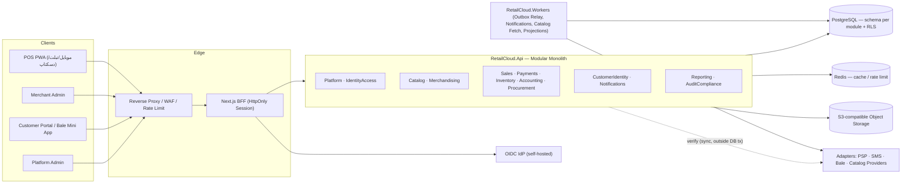
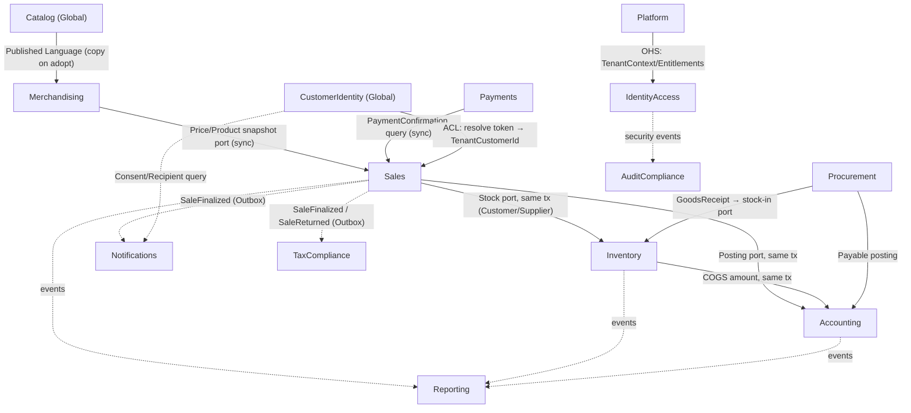
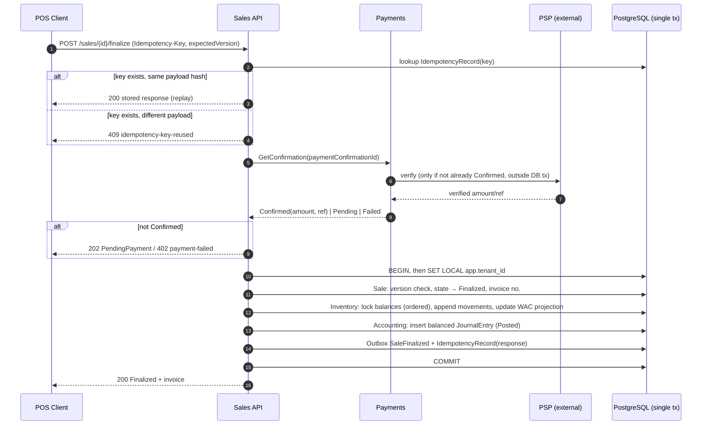

# خلاصه تصمیم معماری RetailCloud

> این سند «نخستین پاسخ مورد انتظار» طبق `CLAUDE_START_HERE_FA.md` و بخش 25.2 سند مرجع است:
> (الف) خلاصه تصمیم معماری، (ب) Bounded Contextها و مرز مالکیت داده، (ج) ۱۰ ریسک اصلی و کنترل‌ها، (د) برنامه تولید D01–D12.
>
> **قرارداد برچسب‌ها:** `[REQ]` الزام سند مرجع · `[ASM]` فرض · `[DEC]` تصمیم پیشنهادی (تا تأیید کارفرما Draft است) · `[REC]` توصیه · `[OQ]` پرسش باز.

---

## 0. Assumptions & Decisions Log (نسخه اولیه)

| ID | نوع | شرح | مبنا / ارجاع | Owner | وضعیت |
|---|---|---|---|---|---|
| A-01 | DEC | بک‌اند **.NET (LTS جاری) + EF Core**؛ فرانت TypeScript/Next.js طبق §7. | §7، پاسخ کارفرما 2026-11-22 | CTO کارفرما | **Confirmed** |
| A-02 | DEC | استقرار Production **داخل ایران** (دیتاسنتر/ابر داخلی). هیچ وابستگی حیاتی به SaaS خارجی (IdP، Email، Monitoring ابری، CDN خارجی) مجاز نیست؛ داده مشتری از کشور خارج نمی‌شود. | §13، پاسخ کارفرما 2026-11-22 | حقوقی + CTO | **Confirmed** |
| A-03 | ASM | MVP فقط ارز `IRR` دارد؛ چندارزی در مدل پشتیبانی می‌شود ولی UI آن در MVP نیست. | ACC-008، §13 | مالی | باز |
| A-04 | DEC | **ارسال صورتحساب الکترونیکی به سامانه مؤدیان در MVP است** (P0). از طریق `TaxAuthority` Adapter مستقل و ناهمگام (Outbox)، جدا از فاکتور دیجیتال مشتری. **مسیر: اتصال مستقیم با کلید هر مودی (D-11).** قالب‌های صورتحساب نیاز به Verification و تأیید مشاور مالیاتی دارد. | §13، پاسخ کارفرما 2026-11-22 | مشاور مالیاتی + Architect | **Confirmed** |
| A-05 | DEC | پرداخت MVP: نقد + **کارتخوان مستقل با ورود دستی شماره پیگیری/مرجع** + **یک درگاه آنلاین (PSP)**. نام PSP هنوز انتخاب نشده (OQ-07). | SAL-006، پاسخ کارفرما 2026-11-22 | مالی/بازرگانی | **Confirmed** |
| A-06 | ASM | حجم آغازین §17.1 (۱۰۰ Tenant) برای طراحی کافی است؛ معماری تا ۱۰٬۰۰۰ Tenant بدون بازنویسی مقیاس می‌گیرد. | §17.1 | PM | باز |
| D-01 | DEC | **Modular Monolith** با یک Deployable اصلی (`RetailCloud.Api`) و یک Deployable جدا برای `RetailCloud.Workers`. | §6.1، ADR-001 | Architect | Proposed |
| D-02 | DEC | **یک پایگاه PostgreSQL، یک Schema به ازای هر Bounded Context**؛ جداول Tenant-owned با `tenant_id` + `FORCE RLS`. | §8.2، ADR-002 | Architect/DBA | Proposed |
| D-03 | DEC | دو قلمرو هویتی جدا: `merchant` و `customer` با Audience، Client و سیاست Session مستقل. | §8.3، §15.1، ADR-003 | Security | Proposed |
| D-04 | DEC | `FinalizeSale` یک **تراکنش DB واحد** است که Sale، StockMovement، JournalEntry، IdempotencyRecord و OutboxMessage را می‌نویسد. فراخوانی خارجی داخل تراکنش ممنوع است. | SAL-007، §11.1، ADR-004 | Architect | Proposed |
| D-05 | DEC | بهای تمام‌شده: **Moving Weighted Average** به ازای `(tenant, variant, warehouse)`؛ FIFO به‌عنوان گزینه بعدی در مدل پیش‌بینی می‌شود. هر دو روش با استاندارد حسابداری شماره ۸ ایران سازگارند؛ LIFO پشتیبانی نمی‌شود. روش هر Tenant ثابت و تغییر آن فقط در ابتدای سال مالی با ثبت دلیل. | INV-006، ADR-005 | مالی | Proposed — نیاز تأیید حسابدار رسمی (OQ-05) |
| D-06 | DEC | آفلاین MVP: فقط **Offline Draft Basket**؛ Finalize بدون سرور ممنوع است. | §12.2، ADR-006 | PM | Proposed |
| D-07 | DEC | پول: `Money(amount: long, currency)` بر حسب **ریال** (IRR بدون Minor Unit). تومان فقط برای نمایش است. Float/Double ممنوع. | §11.2، §13، ADR-009 | Architect | Proposed |
| D-08 | DEC | زمان: ذخیره `timestamptz` (UTC)؛ «روز کاری» و دوره مالی بر اساس `TenantTimeZone`. تاریخ شمسی فقط در UI و گزارش است. | §13، ADR-009 | Architect | Proposed |
| D-09 | DEC | IdP: **Self-hosted OIDC** (Keycloak یا OpenIddict) — الزام ناشی از A-02. انتخاب بین این دو پس از Spike. | A-02، ADR-003 | Security | Proposed |
| D-10 | DEC | ارتباط بین ماژول‌ها: (۱) Application Port هم‌زمان در همان UoW برای مسیرهای Atomic، (۲) Integration Event از طریق Outbox برای بقیه. دسترسی مستقیم به جدول ماژول دیگر ممنوع است و با Architecture Test کنترل می‌شود. | §6.4 | Architect | Proposed |
| D-11 | DEC | **اتصال مستقیم به سامانه مؤدیان؛ کلید خصوصی هر Tenant در سامانه ما.** جفت‌کلید در **KMS/HSM داخلی** تولید می‌شود و کلید خصوصی هرگز به‌صورت خام از آن خارج نمی‌شود. فقط CSR/کلید عمومی به Tenant داده می‌شود تا در کارپوشه خود ثبت کند و شناسه حافظه مالیاتی بگیرد. امضا در یک `TaxSigningService` ایزوله با Audit هر امضا انجام می‌شود (کدام Tenant، کدام صورتحساب، چه کسی، چه زمانی). دسترسی Support به کلیدها صفر است. چرخش و ابطال کلید با خروج/تعلیق Tenant. Import کلیدی که Tenant از قبل دارد فقط از مسیر Wrap‌شده و ممیزی‌شده ممکن است. | A-04، پاسخ کارفرما 2026-11-22 | Security + Tax | **Confirmed (مسیر)** — جزئیات فنی: Verification Required |
| D-12 | DEC | **پرداخت: چند PSP رایج ایران از طریق یک `IPaymentGateway` Adapter.** هر Tenant با **قرارداد و ترمینال پذیرندگی خودش** به PSP وصل می‌شود و وجه مستقیم به حساب خود فروشگاه تسویه می‌شود. **پلتفرم وجهی نگه نمی‌دارد** تا به مجوز پرداخت‌یاری نیاز نباشد. اعتبارنامه PSP هر Tenant در Vault است. MVP با ۲ Adapter شروع می‌شود و بقیه با همان قرارداد اضافه می‌شوند. | A-05، پاسخ کارفرما 2026-11-22 | Architect + مالی | **Confirmed** — انتخاب دو PSP اول: OQ-08 |

---

## (الف) خلاصه تصمیم معماری

### الف-۱. تصویر یک‌صفحه‌ای



**توضیح:** همه کلاینت‌ها از یک BFF عبور می‌کنند. Token در مرورگر نگهداری نمی‌شود و Session از نوع HttpOnly Cookie است. هسته یک فرایند واحد است با ماژول‌هایی که مرزشان در کد و در DB (Schema) اعمال می‌شود. هر کار ناهمگام یا هر فراخوانی Providerی که مستقیماً در مسیر کاربر نیست، از طریق Outbox به Workers می‌رود. تنها فراخوانی خارجی هم‌زمان، `verify` پرداخت است. این فراخوانی **قبل** از تراکنش Finalize و بیرون از آن انجام می‌شود.

### الف-۲. تصمیم‌های کلیدی و Trade-off

| # | تصمیم | چرا | Trade-off / Failure Mode | جایگزین محتمل |
|---|---|---|---|---|
| 1 | Modular Monolith (D-01) | Invariantهای فروش/انبار/حسابداری با یک تراکنش ACID ساده و قابل تست تضمین می‌شوند. هزینه عملیاتی کم است. | ریسک «گِل‌شدن» مرزها؛ کنترل: Architecture Tests، Schema ownership، Contracts جدا. Scale افقی کل فرایند به‌جای ماژول. | Microservices فقط با معیار §23 (اول Notifications و Catalog Discovery). |
| 2 | Shared DB + RLS (D-02) | هزینه پایین برای SMB؛ دفاع در عمق (App AuthZ + DB). | خطای تنظیم Context در Connection Pool = نشت داده؛ کنترل: `SET LOCAL` فقط در تراکنش، تست منفی خودکار برای همه جداول. «Noisy neighbour»؛ کنترل: Rate Limit و Index بر `tenant_id`. | DB اختصاصی برای Enterprise (همان کد، Connection String متفاوت). |
| 3 | دو قلمرو هویت (D-03) | کاربر فروشگاه و مشتری نهایی تهدید، چرخه عمر و MFA متفاوت دارند؛ Token یکی نباید در دیگری معتبر باشد. | پیچیدگی پیکربندی IdP؛ یک شخص ممکن است هم فروشنده و هم مشتری باشد (دو حساب جدا — آگاهانه). | یک Realm با Audience جدا (ریسک اشتباه Scope بالاتر). |
| 4 | Finalize اتمی تک‌تراکنشی (D-04) | تضمین «یک فاکتور، یک کاهش موجودی، یک سند» (P0 #3). | قفل ردیف موجودی در Peak؛ کنترل: قفل فقط روی `stock_balance` ردیف‌های همان سبد با ترتیب ثابت (جلوگیری از Deadlock)، تراکنش کوتاه. | Saga با Reservation (پیچیده‌تر؛ فقط پس از جداسازی سرویس). |
| 5 | Ledger-first Inventory | موجودی قابل ممیزی و قابل بازسازی (INV-001). | Projection ممکن است Drift کند؛ کنترل: Projection در **همان تراکنش** به‌روزرسانی شود + Job مقایسه شبانه + Alert. | Event Sourcing کامل (Overengineering برای MVP). |
| 6 | Offline فقط Draft (D-06) | جلوگیری از فروش بیش از موجودی و سند جعلی بدون سرور. | در قطعی اینترنت فروش متوقف می‌شود؛ کنترل: UX روشن، پشتیبانی از Hotspot، ثبت دستی فاکتور کاغذی و ورود بعدی به‌عنوان «فروش با تاریخ مؤثر» با مجوز مدیر (P1). | Provisional Offline Transaction (فاز بعد، §12.2). |
| 7 | IdP Self-hosted (D-09) | ریسک دسترسی/تحریم سرویس‌های خارجی و الزامات محل نگهداری داده. | مسئولیت Patch و HA با ما. | IdP ابری اگر A-02 رد شود. |
| 8 | Adapter برای همه Integrationها | هیچ قابلیت بله/PSP/Catalog تأییدنشده‌ای در Domain نشت نمی‌کند. | لایه اضافه؛ قابل قبول. | — |

### الف-۳. قواعد لایه‌بندی (خلاصه؛ جزئیات در D04)

```text
Api ──► Application ──► Domain
 │           │
 └──► Infrastructure ──► Application (implements Ports), Domain
Contracts  ◄── referenced by other modules (only this!)
```

- `Domain` هیچ Package به جز `BuildingBlocks.Domain` (Money، Result، Ids، Clock abstraction) ندارد.
- ماژول A فقط به `B.Contracts` (DTO، Integration Events، Port Interfaces) ارجاع دارد؛ ارجاع به `B.Domain` یا `B.Infrastructure` **Build را می‌شکند** (NetArchTest/ArchUnitNET در CI).
- `DbContext` هر ماژول فقط Schema خود را Map می‌کند. Migration هر ماژول جداست.
- Fitness Functions اولیه: (1) قانون وابستگی بالا، (2) هر جدول Tenant-owned دارای Policy RLS (کوئری روی `pg_policies`)، (3) هیچ Endpoint بدون `[Authorize(Policy=…)]` یا `AllowAnonymous` صریح‌مستند.

---

## (ب) Bounded Contextها و مرز مالکیت داده

### ب-۱. جدول Contextها

| # | Context | نوع | Schema | Aggregates اصلی | داده تحت مالکیت | Tenant-scoped؟ | رویدادهای منتشرشده (نمونه) | نیازمندی‌ها |
|---|---|---|---|---|---|---|---|---|
| 1 | Platform | Generic | `platform` | Tenant, Subscription, Branch, Terminal | Tenant، پلن، Entitlement، شعبه، صندوق، دستگاه | Tenant root | `TenantRegistered`, `SubscriptionChanged`, `BranchCreated` | TEN-001..005 |
| 2 | IdentityAccess | Generic | `iam` | MerchantUser, RoleAssignment, SupportAccessGrant | کاربر فروشگاه، Role/Permission/Scope، JIT Access | بله (کاربر می‌تواند عضو چند Tenant باشد) | `UserInvited`, `PermissionChanged` | §3، §8.3–8.4 |
| 3 | CustomerIdentity | **Core** | `cid` | GlobalCustomer, TenantMembership, Consent, QrCredential | هویت سراسری، شماره تأییدشده (رمزنگاری‌شده)، PublicCode، رضایت، BaleLink | **Global** + Membership Tenant-scoped | `CustomerVerified`, `MembershipLinked`, `ConsentChanged` | CUS-001..008 |
| 4 | Catalog | Supporting | `catalog` | CatalogProduct, GlobalBarcode, ProviderRecord | کاتالوگ عمومی، منبع، License، Moderation | **Global** (بدون قیمت/موجودی) | `CatalogProductPublished` | CAT-003..006، §10 |
| 5 | Merchandising | Core | `merch` | TenantProduct(+Variants, Barcodes), PriceList, DiscountRule | کالای فروشگاه، بارکد فروشگاه، قیمت، تخفیف، Weighted-barcode Profile | بله | `ProductCreated`, `PriceChanged` | CAT-001,002,007,008 |
| 6 | Inventory | **Core** | `inv` | StockLedger (Movement), StockBalance, Transfer, Count, CostState | گردش، موجودی Projection، WAC، انبارگردانی | بله | `StockAdjusted`, `TransferShipped` | INV-001..006 |
| 7 | Procurement | Supporting | `proc` | Supplier, PurchaseOrder, GoodsReceipt, PurchaseInvoice | تأمین‌کننده و اسناد خرید | بله | `GoodsReceived` | INV-007 |
| 8 | Sales | **Core** | `sales` | Sale, SaleReturn, Shift, InvoiceSequence | فاکتور، Snapshot اقلام، برگشت، شیفت، شماره فاکتور، Idempotency | بله | `SaleFinalized`, `SaleReturned`, `ShiftClosed` | SAL-001..010 |
| 9 | Payments | Core | `pay` | PaymentIntent, ProviderTransaction, Refund | قصد پرداخت، مرجع PSP، Refund، Reconciliation | بله | `PaymentConfirmed`, `PaymentFailed`, `RefundCompleted` | SAL-006، §8.5 |
| 10 | Accounting | **Core** | `acc` | JournalEntry, Account, FiscalPeriod, PostingRule | شجره حساب، سند، دوره، Mapping | بله | `JournalPosted`, `PeriodClosed` | ACC-001..008 |
| 11 | Notifications | Generic | `notif` | Notification, Template, ChannelPreference | پیام، تلاش ارسال، وضعیت Provider، Template | بله (Recipient از CID) | `NotificationDelivered/Failed` | NOT-001..007 |
| 12 | Reporting | Supporting | `rpt` | — (Read Models) | Projectionهای گزارشی (قابل بازسازی؛ هیچ داده اصلی) | بله | — | RPT-001 |
| 13 | AuditCompliance | Generic | `audit` | AuditRecord (append-only, hash-chained) | ممیزی امنیتی و کسب‌وکار، Retention، Export | بله + Platform | — | AUD-001,002، TEN-005 |
| 14 | **TaxCompliance** (جدید — A-04) | Supporting | `tax` | TaxInvoiceSubmission, TaxProfile | پروفایل مالیاتی Tenant (شناسه ملی/کد اقتصادی، شناسه حافظه مالیاتی)، صورتحساب الکترونیکی ارسالی، وضعیت و پاسخ سامانه، ابطال/اصلاحیه | بله | `TaxInvoiceAccepted`, `TaxInvoiceRejected` | §13، INT-002 |

**زیرساخت مشترک (Context نیست):** `BuildingBlocks` شامل `OutboxMessage`، `InboxMessage`، `IdempotencyRecord` (هر ماژول جدول خودش را در Schema خودش دارد؛ Relay مشترک)، `TenantContext`، `Money`، `Clock`.

### ب-۲. قواعد مالکیت داده (Testable)

1. **یک نویسنده:** هر جدول دقیقاً یک ماژول مالک دارد و فقط همان ماژول در آن `INSERT/UPDATE/DELETE` می‌کند. **کنترل:** DB Role جدا برای هر ماژول در Production اختیاری (P1)؛ در MVP Architecture Test روی Mapping و Code Review.
2. **خواندن بین ماژول‌ها:** فقط از طریق Port در `Contracts` (مثلاً `IInventoryAvailability.Check(...)`) یا Read Model خود ماژول مصرف‌کننده. Join SQL بین Schemaها فقط در `Reporting` و فقط روی Read Model.
3. **Snapshot به‌جای Reference زنده:** Sales قیمت، نام، نرخ مالیات و Unit را در `SaleLineSnapshot` کپی می‌کند (SAL-005). Merchandising از Catalog **کپی مجاز** می‌سازد، نه ارجاع زنده (CAT-005).
4. **داده Global هرگز داده Tenant نمی‌گیرد:** Catalog و CustomerIdentity جدول‌هایی با ستون قیمت/موجودی/سابقه خرید ندارند. **کنترل:** تست Schema که نام‌های ممنوع را بررسی می‌کند + Review در Moderation.
5. **پل Global↔Tenant فقط از طریق Membership:** Sales هرگز `GlobalCustomerId` را نگه نمی‌دارد؛ فقط `TenantCustomerId`. تبدیل QR/PublicCode به `TenantCustomerId` در یک ACL داخل CustomerIdentity انجام می‌شود که فقط وجود/عدم‌وجود و Membership همان Tenant را برمی‌گرداند.
6. **Foreign Key بین Contextها:** وجود ندارد (فقط شناسه). FK داخل Context همیشه مرکب با `tenant_id` است: `FOREIGN KEY (tenant_id, sale_id) REFERENCES sales.sale (tenant_id, id)` تا ارتباط Cross-Tenant در سطح DB غیرممکن باشد.

### ب-۳. Context Map



**توضیح:** خطوط پیوسته ارتباط هم‌زمان درون‌فرایندی هستند. خطوط «same tx» در یک تراکنش DB اجرا می‌شوند. خطوط نقطه‌چین رویدادهای Outbox با تحویل at-least-once هستند و مصرف‌کننده Idempotent است (Inbox). همه ماژول‌ها رویداد ممیزی را از طریق یک Port مشترک به `AuditCompliance` می‌نویسند (برای خوانایی رسم نشده است).

### ب-۴. مرز تراکنشی Finalize (پیش‌نمایش D08)



---

## (ج) ده ریسک اصلی و کنترل‌ها

هر کنترل یک تست خودکار یا شاهد قابل ممیزی دارد. شناسه‌ها به §22 (R-xx) و §19.2 (P0-n) ارجاع می‌دهند.

| # | ریسک | احتمال/اثر | کنترل‌های پیشگیرانه | کنترل کشف/واکنش | تست پذیرش |
|---|---|---|---|---|---|
| 1 | **نشت داده بین Tenantها** (R-01) | M / **Critical** | TenantId فقط از Session سرور؛ `FORCE RLS` روی همه جداول Tenant-owned؛ App Role بدون `BYPASSRLS`؛ `SET LOCAL` درون تراکنش؛ FK مرکب با `tenant_id`؛ Cache Key با پیشوند Tenant؛ Job/Export با Tenant Context صریح. | Fitness test «جدول بدون Policy»؛ Alert روی خطای Policy؛ Audit دسترسی Support. | P0-1؛ مجموعه Attack Matrix §8.4 برای هر Endpoint (تولید خودکار از OpenAPI). |
| 2 | **ثبت تکراری فروش/پرداخت** در Retry (R-02) | **H** / H | `Idempotency-Key` + Unique `(tenant_id, key)`؛ Hash Payload؛ State Machine با `expectedVersion`؛ Unique `(tenant_id, source_event_id)` روی StockMovement و JournalEntry؛ Inbox برای Callback. | Alert «Duplicate Payment Ref»؛ گزارش Reconciliation روزانه با PSP. | P0-3 (۱۰۰ درخواست موازی هم‌کلید → ۱ فاکتور)، P0-5. |
| 3 | **سند مالی نامتوازن یا بهای تمام‌شده غلط** (R-03) | M / H | Domain Invariant در `JournalEntry.Post()`؛ Deferred Constraint Trigger در DB برای تراز؛ Posted غیرقابل UPDATE (Trigger)؛ WAC در همان تراکنش؛ PostingRule نسخه‌دار. | Job شبانه: Σ بدهکار = Σ بستانکار هر سند و Ledger موجودی = حساب موجودی. | P0-4؛ Property-based test روی Money/Discount/Tax. |
| 4 | **فروش بیش از موجودی هم‌زمان** (INV-004) | H / M | `SELECT … FOR UPDATE` روی ردیف‌های `stock_balance` با ترتیب `variant_id` ثابت؛ CHECK `on_hand >= 0` وقتی Policy منع منفی فعال است. | Metric Lock Wait / Deadlock. | P0-2 (دو صندوق، آخرین واحد). |
| 5 | **سوءاستفاده از کد عمومی/QR مشتری** (R-07) | M / H | PublicCode ≠ Auth؛ Lookup فقط «وجود + Membership همین Tenant» برمی‌گرداند؛ QR مشتری JWT/opaque ۶۰ ثانیه‌ای با `aud=tenant`، `jti` یک‌بارمصرف؛ Rate Limit به ازای کاربر و دستگاه. | Alert Enumeration (نرخ Lookup ناموفق). | P0-6؛ تست QR Replay و QR Tenant دیگر. |
| 6 | **جعل/تکرار Callback پرداخت** (§8.5) | M / H | تأیید فقط با Verify سرور-به-سرور؛ تطبیق مبلغ/ارز/مرجع؛ Return URL فقط UI؛ Inbox Dedup. | Reconciliation و صف `NeedsReview`. | P0-5. |
| 7 | **پوشش ناکافی/مجوز داده بارکد** (R-04) | **H** / M | Provider Chain؛ تأیید انسانی اجباری زیر آستانه Confidence؛ ثبت `license/attribution/expires_at`؛ عدم Republish بدون مجوز. | Metric نرخ Hit به ازای منبع؛ **Pilot پوشش با ۲۰۰–۵۰۰ بارکد واقعی** قبل از Gate C. | تست: Provider Down → ورود دستی بدون خطا. |
| 8 | **API بله ناپایدار یا متفاوت با فرض** (R-05) | M / M | Adapter؛ هیچ رفتار محصول قبل از تست Sandbox متعهد نمی‌شود؛ Fallback به SMS با رضایت؛ Delivery هرگز در تراکنش فروش نیست. | Dead Letter + داشبورد وضعیت Provider. | P0-7. |
| 9 | **الزامات مالیاتی/قانونی و سامانه مؤدیان در MVP** (R-06) | **H** / **H** | Tax Policy Versioned؛ `TaxAuthority` Adapter ناهمگام از طریق Outbox با وضعیت‌های `Pending/Sent/Accepted/Rejected/NeedsReview`؛ فروش هرگز منتظر پاسخ مؤدیان نمی‌ماند؛ ابطال/اصلاح صورتحساب طبق قواعد سامانه؛ «فاکتور دیجیتال مشتری ≠ صورتحساب رسمی»؛ داده لازم (شناسه کالا/خدمت، شناسه ملی/کد اقتصادی خریدار در صورت لزوم، شماره منحصربه‌فرد مالیاتی) در Snapshot فاکتور؛ کلیدهای امضا در Vault/HSM. | داشبورد صف ارسال، Alert برای Rejected و تأخیر بیش از مهلت قانونی؛ Review حقوقی در Gate A و F. | تست Contract با Sandbox سامانه/شرکت معتمد؛ تست تغییر نرخ فقط روی فاکتورهای جدید؛ تست قطعی سامانه ← فروش ادامه، صف بازارسال. |
| 9b | **افشا یا سوءاستفاده از کلید امضای مالیاتی Tenant** (D-11، جدید) | L / **Critical** | کلید غیرقابل‌استخراج در HSM/KMS؛ `TaxSigningService` ایزوله با mTLS و Role مستقل؛ امضا فقط برای صورتحسابی که از فاکتور Finalized همان Tenant ساخته شده (Binding با Hash محتوا)؛ عدم دسترسی Support/Platform Admin؛ Backup کلید رمزنگاری‌شده با Split Knowledge. | Audit هر امضا و Alert نرخ غیرعادی؛ رویه ابطال و چرخش فوری کلید. | تست: درخواست امضا با TenantId دیگر رد شود؛ تلاش Export کلید شکست بخورد؛ Restore کلید در Drill. |
| 10 | **Erosion مرز ماژول‌ها و پیچیدگی** (R-09) | H / M | Architecture Tests در CI؛ Contracts کوچک؛ ممنوعیت SharedKernel بزرگ؛ ADR برای هر استثنا. | گزارش وابستگی در هر Release. | Fitness Functions §الف-۳. |

ریسک‌های پایش‌شده خارج از Top 10: R-08 (آفلاین)، R-10 (خرابی Provider)، R-11 (ریال/تومان)، R-12 (هزینه زیرساخت)، و **R-13 جدید: از دست رفتن داده/عدم بازیابی** (کنترل: PITR + Restore Drill ماهانه، P0-10). همه در D12 در Risk Register کامل می‌آیند.

---

## (د) برنامه تولید D01–D12

| مرحله | سند | مسیر | وابسته به | محتوای کلیدی | معیار «Done» سند |
|---|---|---|---|---|---|
| 1 | **D01** Vision-PRD-MVP | `docs/00-product/` | این سند | Persona، Scope، KPI، Non-goals | همه IDهای P0 در جدول Scope؛ KPIها با روش اندازه‌گیری. |
| 2 | **D02** SRS | `docs/00-product/` | D01 | نیازمندی‌های شماره‌دار، Use Case کامل (جریان اصلی/خطا/قوانین/AC)، NFR | هر REQ دارای AC قابل تست؛ Traceability Matrix اولیه. |
| 3 | **D03** DDD Context Map | `docs/02-domain-model/` | D02 | Aggregate، Invariant، Domain Event، State Machine فروش/پرداخت/سند | هر Invariant به یک REQ و یک تست نگاشت شود. |
| 4 | **D04** Architecture C4 + ADR-001..010 | `docs/01-architecture/`، `docs/08-decisions-adr/` | D03 | C4 L1–L3، قواعد وابستگی، ADRها | ADRها با Trade-off/Failure/Alternative. |
| 5 | **D05** Database ERD & Migrations | `docs/05-data/` | D03، D04 | ERD هر Schema، Constraint، Index، RLS، Partitioning، Retention | SQL نمونه قابل اجرا روی PostgreSQL؛ ERD هم‌خوان با D03. |
| 6 | **D06** Security Threat Model | `docs/03-security/` | D04، D05 | STRIDE هر Container، Abuse Case، ASVS 5.0 L2 Mapping، Permission Matrix | هر کنترل به تست D10 ارجاع دارد. |
| — | **بازبینی سازگاری D01–D06** | — | — | Cross-check مدل/Permission/Use Case | فهرست تناقض = خالی یا ثبت‌شده. |
| 7 | **D07** API-OpenAPI.yaml | `docs/04-api/` | D02–D06 | همه Endpointهای MVP، Problem Details، Idempotency، Security Scheme | `redocly lint` / `spectral` بدون خطا. |
| 8 | **D08** Flows BPMN/Sequence | `docs/02-domain-model/` | D03، D07 | ثبت کالا، فروش، پرداخت، برگشت، QR، بله، Posting | Mermaid قابل Render. |
| 9 | **D09** UX Wireframe Spec | `docs/06-ux/` | D02، D08 | صفحات Merchant/POS/Customer، حالت‌های Error/Empty/Offline، RTL | هر صفحه به Use Case و Permission نگاشت شود. |
| 10 | **D10** Test Plan & Acceptance | `docs/09-testing/` | D02–D09 | Matrix لایه تست، P0 Scenarios، Load Model | هر P0 دارای Test Case اجرایی. |
| 11 | **D11** DevOps Runbook & SLO | `docs/07-operations/` | D04، D06 | CI/CD امن، Observability، Backup/DR، Secrets، Rollback | RPO/RTO با هزینه؛ Runbook حوادث اصلی. |
| 12 | **D12** Backlog & Roadmap | `docs/00-product/` | همه | Epic/Story، وابستگی، Gate A–F، برآورد، Risk Register، DoD | Story‌ها قابل تبدیل مستقیم به Task. |
| 13 | Gap Analysis + Implementation Readiness Checklist | `docs/01-architecture/` | همه | بر اساس §26 | — |

**روش تحویل:** هر سند به‌صورت یک Commit جدا روی Branch پروژه می‌آید. بعد از D06 یک نقطه بازبینی با کارفرما پیشنهاد می‌شود تا مدل پیش از نوشتن API و UX قفل شود.

---

## پرسش‌های باز (غیرمسدودکننده — با Default ادامه می‌دهم)

هیچ‌یک از این پرسش‌ها کار طراحی را متوقف نمی‌کند. تا پاسخ برسد، Default ستون آخر اعمال می‌شود.

| ID | پرسش | اثر بر معماری | Default فعلی | مهلت تصمیم |
|---|---|---|---|---|
| OQ-01 | ~~محل استقرار~~ | — | **پاسخ: داخل ایران** (A-02) | بسته |
| OQ-02 | ~~مؤدیان در MVP؟~~ | — | **پاسخ: بله، در MVP** (A-04) | بسته |
| OQ-03 | ~~مدل پرداخت~~ | — | **پاسخ: یک درگاه آنلاین + کارتخوان مستقل با ورود دستی مرجع** (A-05) | بسته |
| OQ-04 | ~~.NET~~ | — | **پاسخ: تأیید شد** (A-01) | بسته |
| OQ-05 | تأیید WAC توسط حسابدار رسمی کارفرما (WAC و FIFO هر دو با استاندارد ۸ سازگارند) | Inventory/Accounting | WAC | قبل از D05 |
| OQ-06 | ~~مسیر اتصال مؤدیان~~ | — | **پاسخ: مستقیم؛ کلید در سامانه ما** (D-11) | بسته |
| OQ-07 | ~~PSP~~ | — | **پاسخ: درگاه‌های رایج ایران** (D-12) | بسته |
| OQ-08 | دو PSP اول برای پیاده‌سازی MVP کدام‌اند؟ (پیشنهاد: دو PSP که بیشترین فروشگاه‌های پایلوت با آن قرارداد دارند) | ترتیب Adapterها | از پایلوت پرسیده شود | قبل از D07 |
| OQ-09 | آیا فروشگاه‌هایی که از قبل کلید و شناسه حافظه مالیاتی دارند باید کلید موجود را Import کنند، یا کلید تازه در سامانه ما ساخته و در کارپوشه جایگزین شود؟ | Onboarding، امنیت کلید | کلید تازه در HSM ما `[REC]` | قبل از D06 |

---

## Verification Required (پیش از تعهد محصول)

- **Bale:** قابلیت‌های Bot API (`sendMessage`، `setWebhook`، Deep Link)، Mini-App، احراز Webhook، Rate Limit و امکان ارسال پیام پیش از شروع تعامل کاربر. باید در Sandbox تست شود.
- **Open Food Facts:** شرایط ODbL برای Cache/Republish، Rate Limit و پوشش کالاهای ایرانی (در Pilot اندازه‌گیری شود).
- **GS1 Iran:** وجود API، قرارداد و هزینه.
- **PSPهای رایج (شاپرکی):** برای هر PSP مستند Verify، Callback، Settle/Reverse، Refund و فایل تسویه برای Reconciliation؛ شرایط قرارداد پذیرنده برای فروشگاه‌هایی که از یک پلتفرم SaaS استفاده می‌کنند.
- **کلید مؤدیان:** روش رسمی ثبت کلید عمومی در کارپوشه، الگوریتم و طول کلید، فرمت امضا/رمزنگاری و فرایند تعویض کلید.
- **سامانه مؤدیان (P0):** آخرین مستندات رسمی API، قالب‌ها و الگوهای صورتحساب، مهلت ارسال، قواعد ابطال/اصلاح/برگشت، Sandbox، الزامات کلید امضا و شرکت معتمد منتخب؛ با مشاور مالیاتی بررسی شود.
- **SMS Provider داخلی:** وضعیت Delivery Report و الزامات خط خدماتی/تبلیغاتی.
