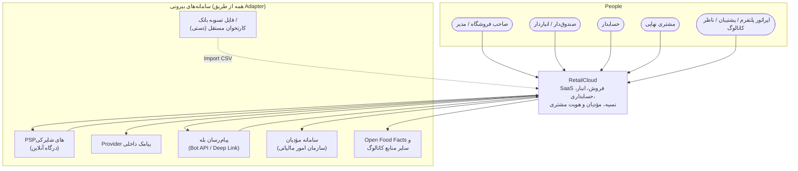
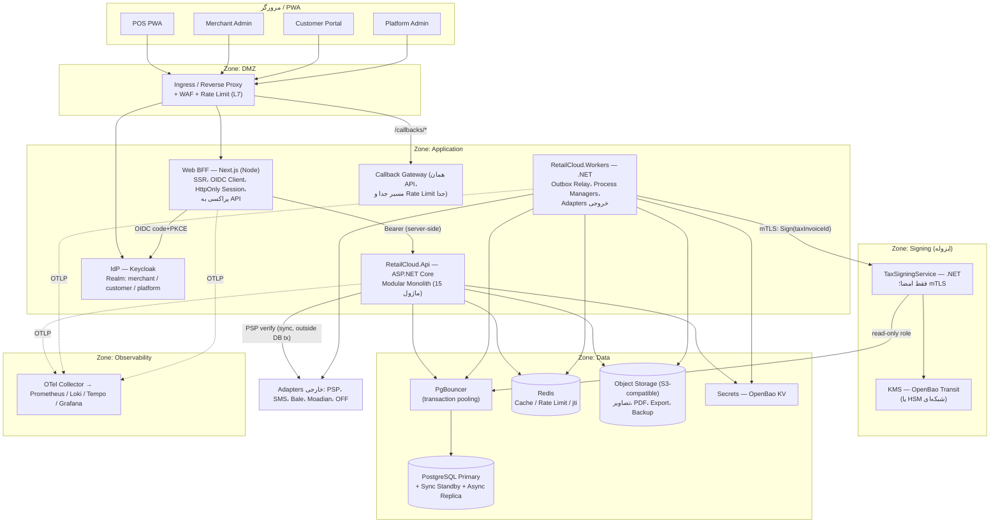
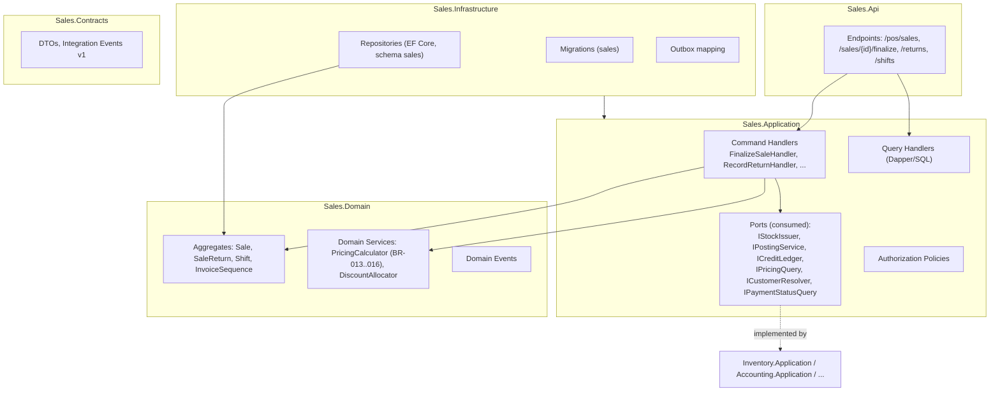

# D04 — معماری نرم‌افزار (C4) و Clean Architecture

> نمودارها با `flowchart` در Mermaid رسم شده‌اند، نه با نحو آزمایشی `C4Context`، تا در GitHub و ابزارهای رایج قابل Render باشند. سطح C4 هر نمودار در عنوانش آمده است.

---

## 1. محرک‌های معماری (Architecture Drivers)

به ترتیب اولویت. هنگام تعارض، مورد بالاتر برنده است.

| # | ویژگی کیفی | سناریوی سنجش‌پذیر | مرجع |
|---|---|---|---|
| Q1 | **جداسازی Tenant** | درخواستی با دستکاری هر شناسه، هیچ داده‌ای از Tenant دیگر برنمی‌گرداند. جدول بدون RLS Build را می‌شکند. | P0-1، NFR-SEC-003 |
| Q2 | **درستی مالی** | ۱۰۰ Finalize هم‌کلید ← ۱ فاکتور. هیچ سند نامتوازنی وجود ندارد. Ledger و Projection برابرند. | P0-3، P0-4، DI-040 |
| Q3 | **تداوم فروش** | قطعی هر سرویس خارجی فروش نقد و کارتخوان را متوقف نمی‌کند. | NFR-AVL-004 |
| Q4 | **امنیت داده مشتری و کلید مالیاتی** | کلید امضا قابل استخراج نیست. کد عمومی بدون OTP سابقه‌ای نشان نمی‌دهد. | D-11، P0-6 |
| Q5 | **کارایی صندوق** | Finalize p95 < 2s؛ افزودن قلم p95 < 250ms. | NFR-PERF |
| Q6 | **عملیات‌پذیری در ایران** | بدون وابستگی حیاتی به سرویس خارجی؛ Build و استقرار با Mirror داخلی. | A-02 |
| Q7 | **قابلیت تکامل** | افزودن PSP، کانال پیام یا صنف جدید بدون تغییر Core. جداسازی Notifications و Catalog بدون بازنویسی. | §1.3، §23 |
| Q8 | **هزینه** | MVP روی یک Cluster کوچک (حدود ۳ نود App و ۲ نود DB) اجرا می‌شود. | §6.1 |

**محدودیت‌ها (Constraints):**
- C1: استقرار در ایران (A-02).
- C2: .NET برای Backend (A-01).
- C3: PostgreSQL.
- C4: وب و PWA برای POS در MVP.
- C5: دسترسی ناپایدار به Registryها و Package Managerهای خارجی از داخل ایران (A-24).

---

## 2. C4 سطح ۱ — System Context



**توضیح:** RetailCloud تنها سیستمی است که کاربران مستقیم با آن کار می‌کنند. کارتخوان مستقل به سیستم وصل **نیست**؛ مرجع آن دستی وارد و بعداً با فایل تسویه تطبیق می‌شود (PAY-002). جهت فلش بیرونی‌ها نشان‌دهنده آغازگر ارتباط است: Callbackهای PSP و Webhook بله به سمت ما هستند.

---

## 3. C4 سطح ۲ — Container

### 3.1 نمودار



### 3.2 جدول Containerها

| Container | فناوری | مسئولیت | مقیاس‌پذیری | داده/حالت | ADR |
|---|---|---|---|---|---|
| POS / Merchant / Customer / Platform apps | Next.js + React + TypeScript، PWA (Service Worker) | UI؛ اسکن دوربین؛ Draft آفلاین (IndexedDB) | CDN داخلی یا Static | فقط Cache و Draft | ADR-006 |
| Web BFF | Next.js server (Node LTS) | OIDC Client، Session در Cookie HttpOnly (رمزنگاری‌شده، Session Store در Redis)، CSRF، پراکسی API با Token سمت سرور | افقی، Stateless (Session در Redis) | — | ADR-003 |
| Ingress / WAF | NGINX Ingress یا HAProxy + ModSecurity CRS | TLS Termination، WAF، Rate Limit L7، محدودیت حجم Body | افقی | — | ADR-010 |
| **RetailCloud.Api** | ASP.NET Core (نسخه LTS جاری)، EF Core + SQL دست‌نویس در مسیر داغ | همه Commandها و Queryهای تعاملی | افقی (Stateless) | — | ADR-001 |
| **RetailCloud.Workers** | .NET Worker Service | Outbox Relay، PMهای D03 §8، Adapterهای خروجی | افقی؛ رقابت روی صف با `SKIP LOCKED` | — | ADR-013 |
| Callback Gateway | همان Api با Endpoint Group جدا | Callback PSP و Webhook بله: اعتبارسنجی، Inbox، پاسخ سریع | با Api | Inbox | ADR-012 |
| **TaxSigningService** | .NET minimal API، Container جدا، Namespace و NetworkPolicy جدا | فقط `Sign(taxInvoiceId)`: محتوا را خودش می‌خواند، Hash را تطبیق می‌دهد و از KMS امضا می‌گیرد | ۲ نمونه | هیچ (Stateless) | ADR-011 |
| KMS | OpenBao Transit Engine (کلید `exportable=false`) یا HSM شبکه‌ای داخلی | تولید و نگهداری کلید و عملیات امضا | HA ۳ نود (Raft) | کلیدها | ADR-011 |
| IdP | Keycloak (نسخه پشتیبانی‌شده جاری) | احراز، MFA (TOTP و WebAuthn)، Session IdP، سه Realm | ۲+ نمونه، DB جدا | Postgres جدا | ADR-003 |
| PostgreSQL | PostgreSQL 17/18 + Patroni (HA) + pgBackRest (Backup/PITR) | داده اصلی، RLS | عمودی + Read Replica برای گزارش | همه | ADR-002، ADR-010 |
| PgBouncer | transaction pooling | Pool اتصال. با `SET LOCAL` سازگار است چون Context داخل تراکنش است | ۲ نمونه | — | ADR-002 |
| Redis | Redis/Valkey (Sentinel) | Cache کالا و قیمت، Rate Limit، `jti` مصرف‌شده QR، Session BFF | Sentinel | داده موقت (قابل بازسازی) | — |
| Object Storage | MinIO یا S3 داخلی | تصویر کالا، PDF فاکتور، Export، Backup، Audit Head (Object Lock) | — | — | ADR-010 |
| Secrets | OpenBao KV | اعتبارنامه PSP هر Tenant، توکن بله، کلید SMS، کلید DB | HA | — | ADR-011 |
| Observability | OpenTelemetry Collector، Prometheus، Loki، Tempo، Grafana، Alertmanager | Trace، Metric، Log | — | — | ADR-010 |
| Artifact Registry | Harbor (Container) + Nexus/ProGet (NuGet و npm Mirror) | Build تکرارپذیر بدون وابستگی مستقیم به اینترنت (C5) | — | — | ADR-010 |

**چرا Broker پیام (RabbitMQ) در MVP نیست:** Outbox در Postgres با Polling کوتاه (به‌علاوه `LISTEN/NOTIFY` برای کاهش تأخیر) برای حجم NFR-CAP-001 کافی است: حدود ۱۳ فروش در ثانیه، یعنی کمتر از ۱۰۰ پیام در ثانیه. Broker یک سیستم HA دیگر برای نگهداری اضافه می‌کند. معیار ورود Broker در ADR-013 آمده است.

### 3.3 مناطق اعتماد و جریان شبکه

| از ← به | مجاز؟ | پروتکل | کنترل |
|---|---|---|---|
| اینترنت ← Ingress | ✓ | HTTPS 443 | WAF، Rate Limit، Geo/IP Policy اختیاری |
| Ingress ← BFF، IdP، Callback | ✓ | HTTP داخلی (mTLS در Mesh اختیاری P1) | NetworkPolicy |
| BFF ← Api | ✓ | HTTPS داخلی | Token Audience `merchant-api` یا `customer-api` |
| Api و Workers ← Data Zone | ✓ | Postgres/Redis/S3 با TLS | Credential کوتاه‌عمر از OpenBao (Dynamic DB Credentials) `[REC]` |
| Workers ← TaxSigningService | ✓ | mTLS | فقط هویت Workers؛ Allowlist |
| TaxSigningService ← KMS | ✓ | mTLS | Policy: فقط `transit/sign/tenant-*` |
| TaxSigningService ← Postgres | ✓ فقط خواندن | TLS | نقش `tax_signer_ro` فقط روی `tax.tax_invoice` |
| Api و Workers ← اینترنت (Adapters) | ✓ از طریق Egress Proxy | HTTPS | **Allowlist دامنه‌ها** (ضد SSRF) |
| هر چیز ← KMS (جز TSS) | ✗ | — | NetworkPolicy deny |
| Browser ← Api مستقیم | ✗ | — | فقط از BFF |

---

## 4. C4 سطح ۳ — Component (RetailCloud.Api)

### 4.1 خط لوله درخواست

```mermaid
flowchart LR
  REQ["HTTP Request"] --> M1["Correlation / Trace"]
  M1 --> M2["Exception → problem+json"]
  M2 --> M3["AuthN (JWT, audience check)"]
  M3 --> M4["TenantContext Resolver<br/>(از claims + Membership؛ نه از ورودی)"]
  M4 --> M5["Rate Limiter<br/>(user/tenant/endpoint)"]
  M5 --> M6["Endpoint (Minimal API)"]
  M6 --> F1["AuthZ Policy Filter<br/>(Permission + Scope)"]
  F1 --> F2["Validation Filter"]
  F2 --> F3["Idempotency Filter<br/>(Commands مالی)"]
  F3 --> H["Command/Query Handler"]
  H --> UOW["UnitOfWork<br/>(BEGIN, SET LOCAL app.tenant_id, ...)"]
```



| جزء | مسئولیت | نکته امنیتی/درستی |
|---|---|---|
| TenantContext Resolver | `tenantId` را از Claim `tid` (Tenant فعال انتخاب‌شده در Session BFF) و بررسی Membership کاربر (Cache کوتاه ۶۰s) تعیین می‌کند | BR-001؛ هیچ API برای تغییر Tenant در یک درخواست وجود ندارد |
| AuthZ Policy | `[RequirePermission("pos.sell", Scope.Register)]` با بارگذاری Scope از Route یا Body و تطبیق با Assignments | Default Deny: Endpoint بدون Policy در Startup خطا می‌دهد (Fitness Test) |
| Idempotency Filter | بررسی Header برای Commandهای علامت‌دار؛ Replay پاسخ موفق | D03 §6.3 |
| UnitOfWork | یک `NpgsqlConnection` و `NpgsqlTransaction` مشترک بین DbContextهای ماژول‌ها؛ `SET LOCAL app.tenant_id`، `app.user_id`، `app.request_id` بلافاصله پس از BEGIN | Interceptor بررسی می‌کند هیچ Command بدون Tenant Context به DB نرسد |
| Outbox Writer | Insert در `{module}.outbox` در همان تراکنش | — |
| Audit Writer | Insert در `audit.audit_record` در همان تراکنش؛ Hash Chain به ازای Tenant با Lock سبک روی Head | `audit` جدا؛ App Role فقط INSERT دارد |

### 4.2 ساختار درونی یک ماژول (نمونه: Sales)



### 4.3 CQRS انتخابی
- **Commandها** از Domain و EF Core عبور می‌کنند (رفتار و Invariant).
- **Queryهای تعاملی ساده** (جزئیات فاکتور، فهرست کالا) از SQL مستقیم (Dapper) روی همان جداول با RLS اجرا می‌شوند. هیچ Entity دامنه برای خواندن ساخته نمی‌شود.
- **گزارش‌ها** (RPT) فقط از Schema `rpt` (Projection) یا Read Replica خوانده می‌شوند (RPT-002).
- **مسیر داغ POS** (Lookup بارکد و قیمت): Redis Cache با کلید `t:{tenantId}:bc:{gtin}` و `t:{tenantId}:price:{branch}:{variant}`، با بی‌اعتبارسازی بر اساس `PriceChanged` و `BarcodeAssigned`.

---

## 5. Clean Architecture در .NET

### 5.1 ساختار Solution

```text
src/backend/
  RetailCloud.sln
  Directory.Build.props            # TreatWarningsAsErrors, Nullable enable, Analyzers
  Directory.Packages.props         # Central Package Management (نسخه‌های قفل‌شده)
  BuildingBlocks/
    BuildingBlocks.Domain/         # Money, Quantity, TaxRate, Ids, Result, DomainEvent, Clock abstraction
    BuildingBlocks.Application/    # ICommand/IQuery, Dispatcher, IUnitOfWork, IOutbox, IAuditWriter, ITenantContext
    BuildingBlocks.Infrastructure/ # Npgsql UoW, TenantInterceptor, Outbox/Inbox, Idempotency store, OTel
    BuildingBlocks.Api/            # problem+json, Auth, RateLimit, Idempotency filter, Permission attribute
  Modules/
    Sales/
      Sales.Domain/ Sales.Application/ Sales.Infrastructure/ Sales.Api/ Sales.Contracts/
      Sales.Tests.Unit/ Sales.Tests.Integration/
    Inventory/ Accounting/ Payments/ Receivables/ CustomerIdentity/ Merchandising/
    Catalog/ Procurement/ TaxCompliance/ Notifications/ Reporting/ Platform/ IdentityAccess/ AuditCompliance/
  Hosts/
    RetailCloud.Api/               # Composition root: ماژول‌ها را Register می‌کند
    RetailCloud.Workers/
    RetailCloud.TaxSigningService/ # فقط به TaxCompliance.Contracts و BuildingBlocks.Infrastructure (حداقل) وابسته است
  Tests/
    Architecture.Tests/            # NetArchTest / ArchUnitNET
    Security.Tests/                # BOLA/RLS matrix تولیدشده از OpenAPI
    Load.Tests/                    # k6 scripts (JS)
```

### 5.2 قواعد وابستگی (اجباری با Architecture Tests)

| # | قاعده | تست |
|---|---|---|
| R1 | `X.Domain` فقط به `BuildingBlocks.Domain` وابسته است: هیچ EF، ASP.NET، Npgsql یا System.Net.Http | NetArchTest: `ShouldNot().HaveDependencyOnAny(...)` |
| R2 | `X.Application` به `X.Domain`، `BuildingBlocks.Application` و `Y.Contracts` (فقط Contracts ماژول‌های دیگر) وابسته است | — |
| R3 | `X.Infrastructure` و `X.Api` فقط از Host ارجاع داده می‌شوند. هیچ ماژولی به `Y.Infrastructure`، `Y.Domain` یا `Y.Application` ارجاع ندارد | — |
| R4 | `Y.Contracts` به هیچ ماژولی وابسته نیست (فقط BuildingBlocks.Domain برای VOها) | — |
| R5 | `DbContext` ماژول X فقط Entityهای Schema X را Map می‌کند | تست Reflection روی `Model.GetEntityTypes()` و Schema |
| R6 | فقط Portهای فهرست بسته D03 §4.3 می‌توانند `[TransactionalPort]` داشته باشند | Attribute Scan |
| R7 | هیچ Endpoint بدون `RequirePermission` یا `AllowAnonymous` با دلیل مستند وجود ندارد | Startup Validation + تست |
| R8 | هیچ Handler به `HttpClient` دسترسی ندارد. فراخوانی خارجی فقط از Adapterهای Infrastructure | NetArchTest |
| R9 | هیچ کدی خارج از `BuildingBlocks.Infrastructure` تابع `set_config`/`SET` روی `app.tenant_id` را صدا نمی‌زند | Analyzer/grep در CI |

### 5.3 UoW و تزریق Tenant Context

- `NpgsqlDataSource` واحد، و یک `IUnitOfWork` با طول عمر Scoped (به ازای درخواست یا کار Worker).
- همه `DbContext`ها با `UseNpgsql(sharedConnection)` و `Database.UseTransaction(sharedTx)` ساخته می‌شوند.
- `BEGIN` ← فوراً `SELECT set_config('app.tenant_id', @t, true), set_config('app.user_id', @u, true)`. پارامتر سوم `true` همان `SET LOCAL` است و با Commit یا Rollback پاک می‌شود. این کار با PgBouncer transaction pooling سازگار است.
- **Guard:** یک `DbCommandInterceptor` در محیط غیرProduction هر فرمان روی Schemaهای Tenant-owned را که خارج از تراکنش یا بدون `app.tenant_id` اجرا شود رد می‌کند (Fail Fast). در Production، RLS به هر حال صفر ردیف برمی‌گرداند یا Insert را رد می‌کند (`WITH CHECK`).
- Isolation Level: `READ COMMITTED` با قفل ردیف صریح (D03 §6.2). مسیرهای خاص (مثل بستن دوره) `SERIALIZABLE` یا قفل Advisory دارند.
- **نتیجه Spike SP-07 (2026-11-22): تأیید شد.** پیاده‌سازی `PostgresUnitOfWork` در `src/backend/BuildingBlocks/BuildingBlocks.Infrastructure`، با ۷ تست Integration روی Schema واقعی D05 و نقش غیر Superuser: (۱) دو DbContext ماژول جدا در یک تراکنش Commit می‌شوند؛ (۲) Exception همه را Rollback می‌کند؛ (۳) نقض قید در ماژول دوم، نوشتن ماژول اول را هم برمی‌گرداند؛ (۴) RLS ردیف Tenant دیگر را پنهان و نوشتن برای آن را رد می‌کند (42501)؛ (۵) Context Tenant به کاربر بعدی اتصال Pool‌شده نشت نمی‌کند؛ (۶) UoWهای هم‌زمان Tenantهای مختلف ایزوله‌اند؛ (۷) فرمان EF خارج از تراکنش رد می‌شود. نسخه‌ها: .NET 10 LTS، EF Core 10.0.15، Npgsql 10.0.4. (.NET 11 و EF Core 11 منتشر شده‌اند، ولی طبق تصمیم LTS روی ۱۰ می‌مانیم.)

### 5.4 Dispatcher و کتابخانه‌ها
- **Dispatcher:** پیاده‌سازی داخلی ساده (Source Generator یا Reflection یک‌باره) یا کتابخانه‌ای با مجوز MIT (مثلاً `Mediator` با Source Generator). **از وابستگی به کتابخانه‌ای که مجوزش تجاری یا تغییرپذیر شده پرهیز شود** (AQ-03: بررسی مجوز همه وابستگی‌ها در SCA).
- **Validation:** FluentValidation یا Validatorهای دستی در Application.
- **Mapping:** دستی (بدون AutoMapper) در مسیرهای مالی، برای وضوح و جلوگیری از Mass Assignment.
- **Resilience:** `Microsoft.Extensions.Http.Resilience` (Polly) برای Adapterها: Timeout، Retry با Jitter، Circuit Breaker، Bulkhead.
- **Testing:** xUnit، Testcontainers (PostgreSQL واقعی)، FsCheck (Property-based)، Verify (Snapshot Test برای Payload مؤدیان و Posting).

### 5.5 Outbox / Inbox
- جدول `{schema}.outbox (id ULID, event_type, version, tenant_id, payload jsonb, occurred_at, published_at null, attempts, next_attempt_at)` با RLS. Relay با نقش Worker، به ازای هر Tenant یا دسته‌ای با `SET LOCAL` درست.
- Relay: `SELECT … WHERE published_at IS NULL AND next_attempt_at <= now() ORDER BY id FOR UPDATE SKIP LOCKED LIMIT 100` ← Dispatch به Handlerهای درون‌فرایندی Workers ← `published_at = now()`.
- ترتیب: به ازای `(tenant_id, aggregate_id)` حفظ می‌شود (Handler باید Idempotent باشد و نسبت به خارج از ترتیب بودن مقاوم باشد).
- Inbox: `{consumer_schema}.inbox (consumer, event_id) PRIMARY KEY`. Handler و Insert Inbox در یک تراکنش هستند.

---

## 6. معماری Frontend

```text
src/web/
  package.json (pnpm workspaces) + turbo.json
  apps/
    pos/              # PWA؛ مسیر /pos
    merchant-admin/   # /admin
    customer-portal/  # /c و /r/{token} و /join/{token}
    platform-admin/   # /platform (دامنه یا زیردامنه جدا + IP Allowlist)
  packages/
    ui/               # Design System RTL، Tokens، کامپوننت‌های دسترس‌پذیر
    contracts/        # Typeهای تولیدشده از OpenAPI (D07)
    auth/             # کلاینت BFF Session
    scanner/          # BarcodeDetector API با fallback zxing (WASM)، Torch، Debounce (SAL-002.1)
    money/            # فرمت ریال/تومان، ارقام فارسی، BigInt-safe
    jalali/           # تبدیل و نمایش تاریخ شمسی
    offline/          # Service Worker، IndexedDB برای Draft (SAL-013)
```

| تصمیم | دلیل | Trade-off |
|---|---|---|
| یک Monorepo با چند App | اشتراک UI، قراردادها و Scanner | Build پیچیده‌تر؛ Turborepo Cache |
| BFF داخل Next.js (Route Handlers) | یک Container کمتر؛ Session کنار SSR | منطق کسب‌وکار در BFF ممنوع است (فقط Auth و Proxy) |
| مبالغ در فرانت به‌صورت `string` یا `BigInt` | جلوگیری از خطای Float در JS (BR-010) | — |
| POS: Client-side rendering بعد از بارگذاری Shell | سرعت تعامل و کار آفلاین Draft | SEO مهم نیست |
| Platform Admin جدا با دامنه و Allowlist IP | کاهش سطح حمله | — |
| Customer Portal بدون وابستگی به اسکریپت شخص ثالث | Privacy و CSP سخت | — |

---

## 7. دیدگاه استقرار (Deployment View) — MVP

| محیط | زیرساخت | توضیح |
|---|---|---|
| Dev | Docker Compose (Postgres، Redis، MinIO، Keycloak، OpenBao dev، Mailpit/SMS Fake) | §7 سند مرجع |
| CI | Runner داخلی (GitLab CI یا GitHub Actions Self-hosted، AQ-04) + Mirrorها | — |
| Staging | Kubernetes (۳ نود) + Postgres HA کوچک | داده ساختگی، بدون PII واقعی |
| Production | Kubernetes در دیتاسنتر یا ابر داخلی (AQ-01): ۳ نود App، ۲ نود DB (Primary + Sync Standby) + ۱ Replica گزارش، ۳ نود OpenBao | ADR-010 |
| DR | سایت دوم (منطقه یا دیتاسنتر دیگر داخل ایران): Async Standby و Backup روزانه رمزنگاری‌شده | RPO ≤ ۱۵ دقیقه با WAL Shipping |

جزئیات کامل در D11.

---

## 8. سناریوهای کیفی و پاسخ معماری

| سناریو | پاسخ معماری | باقیمانده ریسک |
|---|---|---|
| صندوق‌دار با دستکاری `saleId` فاکتور Tenant دیگر را باز می‌کند | Tenant از Session؛ RLS صفر ردیف ← 404 (BR-003) | خطای پیکربندی RLS ← Fitness Test |
| ۱۰۰ Retry یک Finalize | Idempotency + Unique Source + Lock | — |
| PSP Callback جعلی | Verify سرور به سرور؛ Inbox | PSP بدون Verify معتبر ← پشتیبانی نمی‌شود |
| سامانه مؤدیان دو روز قطع است | Outbox + PM-04 با Backoff؛ هشدار مهلت | مهلت سه‌ماهه حاشیه کافی می‌دهد |
| نفوذ به Api | کلید مالیاتی در KMS؛ Api به KMS دسترسی ندارد؛ TSS فقط محتوای DB را امضا می‌کند (نه ورودی دلخواه) | نفوذ هم‌زمان DB و TSS ← Alert نرخ امضا (D06) |
| Peak شب عید (۵ برابر بار) | Api و Workers افقی؛ Redis Cache؛ قفل‌های ریز؛ Replica برای گزارش | Primary DB نقطه محدودیت عمودی است ← Capacity Test در D10 |
| قطعی اینترنت شعبه | Draft آفلاین؛ UX صادق؛ فروش متوقف | ADR-006؛ فاز بعد: Provisional |
| از دست رفتن دیتاسنتر | DR Async + Restore Drill | RPO ≤ ۱۵ دقیقه |
| عدم دسترسی به NuGet یا npm یا Docker Hub | Mirror داخلی و قفل نسخه (Central Package Management، lockfile) | به‌روزرسانی امنیتی وابسته به Sync Mirror |

---

## 9. ADRها

فهرست و متن کامل در [`../08-decisions-adr/README.md`](../08-decisions-adr/README.md):

| ADR | عنوان | وضعیت |
|---|---|---|
| ADR-001 | Modular Monolith | Proposed |
| ADR-002 | Multitenant Data Isolation (Shared DB + RLS) | Proposed |
| ADR-003 | Identity Model (Keycloak، سه Realm، BFF) | Proposed |
| ADR-004 | Transaction Consistency (Single DB Tx + Outbox + Idempotency) | Proposed |
| ADR-005 | Inventory Costing (Moving WAC) | Proposed — نیاز تأیید حسابدار |
| ADR-006 | Offline POS (Draft-only) | Proposed |
| ADR-007 | External Catalog Licensing | Proposed |
| ADR-008 | Notification Gateway و بله | Proposed |
| ADR-009 | Money و Calendar | Proposed |
| ADR-010 | Hosting، DR و زنجیره تأمین نرم‌افزار در ایران | Proposed |
| ADR-011 | Tax Signing Isolation و مدیریت کلید (جدید) | Proposed |
| ADR-012 | Multi-PSP بدون نگهداری وجه (جدید) | Proposed |
| ADR-013 | Outbox Relay بدون Broker در MVP (جدید) | Proposed |

---

## 10. فرضیات و پرسش‌های باز

| ID | نوع | شرح | Default | مهلت |
|---|---|---|---|---|
| A-24 | ASM | دسترسی به Registryهای خارجی ناپایدار است؛ Mirror داخلی لازم است | Harbor + Nexus | — |
| A-25 | ASM | تیم عملیات توان نگهداری Kubernetes را دارد؛ وگرنه VM + Docker Compose یا Nomad برای MVP | Kubernetes | AQ-02 |
| A-26 | ASM | OpenBao (Fork متن‌باز Vault) برای Secrets و Transit | OpenBao | AQ-05 |
| AQ-01 | OQ | انتخاب ارائه‌دهنده زیرساخت داخلی (دیتاسنتر Colocation یا ابر داخلی) و وجود دو منطقه برای DR | دو منطقه | قبل از D11 |
| AQ-02 | OQ | آیا تیم عملیات Kubernetes دارد؟ | بله | قبل از D11 |
| AQ-03 | OQ | سیاست مجوز وابستگی‌ها (فقط MIT، Apache-2.0 و BSD؟) | فقط مجوزهای Permissive | قبل از شروع پیاده‌سازی |
| AQ-04 | OQ | GitLab یا GitHub (Self-hosted Runner) برای CI؟ | GitLab Self-hosted (به‌خاطر C5) | قبل از D11 |
| AQ-05 | OQ | آیا HSM سخت‌افزاری داخلی برای کلید مالیاتی لازم است (الزام قانونی یا قرارداد)؟ | OpenBao Transit با Auto-unseal و Backup رمزنگاری‌شده | قبل از D06 |
