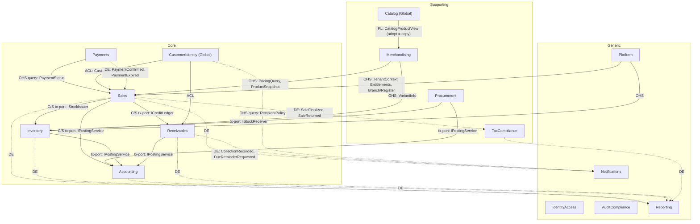
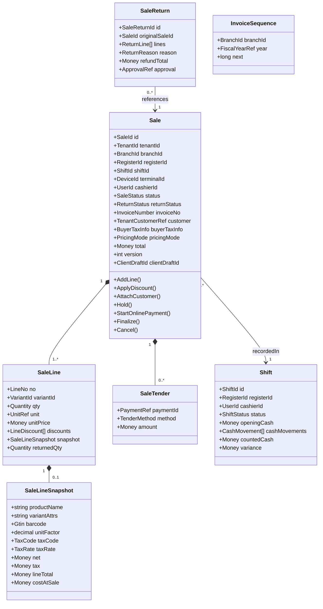
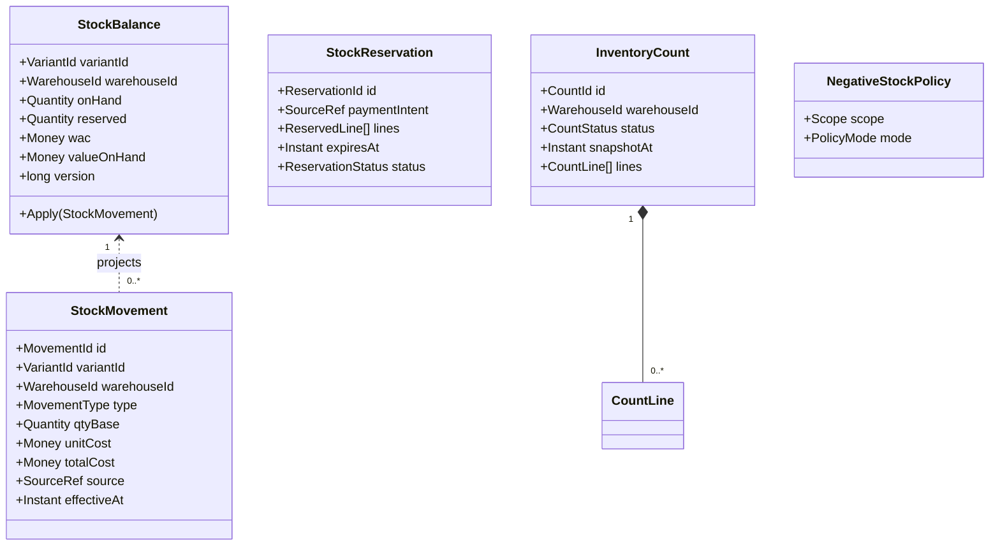
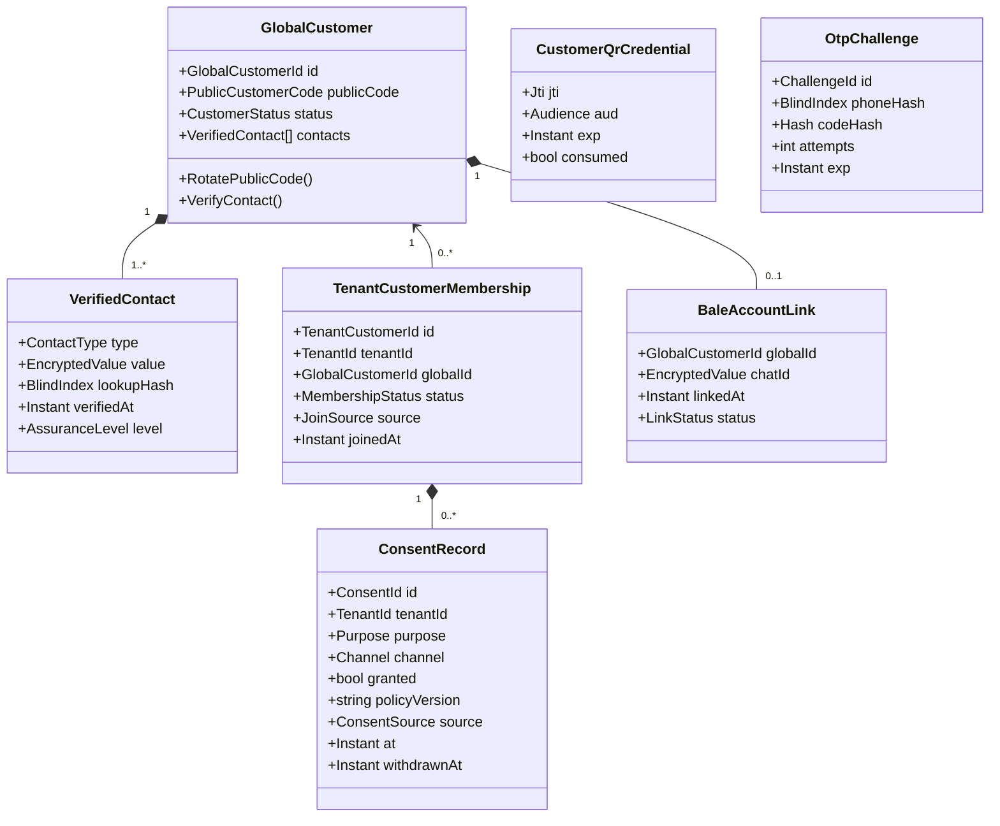

# D03 — مدل دامنه و نقشه Bounded Contextها

> **قرارداد شناسه‌ها در این سند:** `DI-nnn` = Domain Invariant (قید دامنه که همیشه باید برقرار باشد) · `DE-xxx` = Domain/Integration Event · `PM-nn` = Process Manager / Policy. ارجاع به نیازمندی‌ها با شناسه‌های D02 است.

---

## 1. خلاصه

- **۱۵ Bounded Context:** ۱۳ مورد از سند مرجع، به‌علاوه `TaxCompliance` و `Receivables` که از تصمیم‌های کارفرما آمده‌اند.
- **هسته رقابتی (Core Domain):** `Sales`، `Inventory`، `Accounting`، `Payments`، `Receivables`، `CustomerIdentity`. این‌ها بیشترین سرمایه‌گذاری مدل‌سازی و تست را می‌گیرند.
- **یک مرز تراکنشی چندAggregateی آگاهانه:** `FinalizeSale`، `RecordReturn`، `PostGoodsReceipt`، `RecordCollection` و `ConfirmCount` چند Aggregate از چند ماژول را در **یک تراکنش DB** تغییر می‌دهند (D-04). این کار قاعده کلاسیک «یک Aggregate در هر تراکنش» را می‌شکند، و توجیهش این است که هر ۵ عملیات Invariant مالی دارند (§11) و همه ماژول‌ها یک DB مشترک دارند. ترتیب قفل سراسری (بخش 6) جلوی Deadlock را می‌گیرد.
- **بقیه ارتباط‌ها ناهمگام** و از طریق Outbox هستند و مصرف‌کننده Idempotent است.

---

## 2. زبان مشترک (Ubiquitous Language) — نام‌های کد

| مفهوم فارسی | نام در کد | Context مالک | توضیح |
|---|---|---|---|
| فروشگاه / مستاجر | `Tenant` | Platform | — |
| شعبه | `Branch` | Platform | — |
| صندوق | `Register` | Platform | منطقی؛ دستگاه = `Terminal` |
| شیفت | `Shift` | Sales | — |
| فاکتور فروش | `Sale` | Sales | پیش از Finalize هم `Sale` است (Draft) |
| قلم فاکتور | `SaleLine` | Sales | — |
| برگشت از فروش | `SaleReturn` | Sales | سند مستقل |
| قصد پرداخت | `PaymentIntent` | Payments | فقط آنلاین |
| پرداخت | `Payment` | Payments | هر روش |
| بازپرداخت | `Refund` | Payments | — |
| کالا (فروشگاه) | `TenantProduct` / `TenantVariant` | Merchandising | — |
| کالا (عمومی) | `CatalogProduct` | Catalog | — |
| گردش کالا | `StockMovement` | Inventory | append-only |
| موجودی | `StockBalance` | Inventory | Projection |
| رزرو موجودی | `StockReservation` | Inventory | فقط پرداخت آنلاین |
| انبارگردانی | `InventoryCount` | Inventory | — |
| سند حسابداری | `JournalEntry` | Accounting | — |
| حساب | `Account` | Accounting | — |
| دوره مالی | `FiscalPeriod` | Accounting | — |
| حساب اعتباری مشتری | `CustomerCreditAccount` | Receivables | — |
| ردیف دفتر دریافتنی | `ReceivableEntry` | Receivables | append-only |
| دریافت از مشتری | `Collection` | Receivables | — |
| مشتری سراسری | `GlobalCustomer` | CustomerIdentity | — |
| عضویت مشتری | `TenantCustomerMembership` | CustomerIdentity | شناسه بیرونی: `TenantCustomerId` |
| رضایت | `ConsentRecord` | CustomerIdentity | — |
| صورتحساب مالیاتی | `TaxInvoice` | TaxCompliance | — |
| کلید امضا | `SigningKey` | TaxCompliance | ارجاع به کلید HSM، نه خود کلید |
| اعلان | `Notification` | Notifications | — |
| رکورد ممیزی | `AuditRecord` | AuditCompliance | — |

**واژه‌های ممنوع یا مبهم در کد:** `Order` (ابهام با سفارش خرید؛ به جای آن `Sale` یا `PurchaseOrder`)، `Customer` بدون پیشوند (همیشه `GlobalCustomer` یا `TenantCustomer`)، `Price` بدون نوع (همیشه `UnitPrice`، `UnitCost` یا `LineTotal`)، `Delete` برای اسناد مالی (همیشه `Reverse` یا `Cancel`).

---

## 3. طبقه‌بندی Subdomainها

| Context | Subdomain | Schema | سرمایه‌گذاری مدل | جداسازی آینده (§23) |
|---|---|---|---|---|
| Sales | **Core** | `sales` | عمیق (Aggregate غنی، State Machine) | نزدیک بماند |
| Inventory | **Core** | `inv` | عمیق (Ledger، WAC، هم‌زمانی) | نزدیک بماند |
| Accounting | **Core** | `acc` | عمیق (Invariant تراز، Posting Rules) | نزدیک بماند |
| Payments | **Core** | `pay` | عمیق (State Machine، Reconciliation) | نزدیک بماند |
| Receivables | **Core** | `ar` | متوسط تا عمیق | نزدیک بماند |
| CustomerIdentity | **Core** (تمایز محصول) | `cid` | عمیق (امنیت و Privacy) | کاندید (شبکه مشتری بزرگ) |
| Merchandising | Supporting | `merch` | متوسط | — |
| Catalog | Supporting | `catalog` | متوسط (Provider Chain) | **کاندید اول** |
| Procurement | Supporting | `proc` | سبک | — |
| TaxCompliance | Supporting (اجباری قانونی) | `tax` | متوسط؛ وابسته به قرارداد بیرونی | کاندید (ایزوله‌سازی کلید) |
| Notifications | Generic | `notif` | سبک | **کاندید اول** |
| Reporting | Generic | `rpt` | فقط Read Model | کاندید (Analytics) |
| Platform | Generic | `platform` | سبک | — |
| IdentityAccess | Generic (+ IdP آماده) | `iam` | سبک؛ احراز با IdP | — |
| AuditCompliance | Generic | `audit` | سبک | — |

---

## 4. Context Map

### 4.1 نمودار



**راهنما:** `OHS` = Open Host Service (رابط عمومی پایدار ماژول بالادست) · `PL` = Published Language · `C/S` = Customer/Supplier (پایین‌دست نیاز را تعریف می‌کند و بالادست قرارداد را تأمین می‌کند) · `ACL` = Anti-Corruption Layer · `tx-port` = Port هم‌زمان که **داخل تراکنش فراخواننده** اجرا می‌شود · خط‌چین = رویداد ناهمگام از Outbox. همه ماژول‌ها از طریق `IAuditWriter` (درون تراکنش) به AuditCompliance می‌نویسند؛ برای خوانایی رسم نشده است.

### 4.2 جدول روابط

| بالادست → پایین‌دست | الگو | سازوکار | قرارداد (در `X.Contracts`) | دلیل |
|---|---|---|---|---|
| Platform → همه | OHS | Query درون‌فرایندی + Cache | `ITenantContext`, `IEntitlementQuery`, `IBranchDirectory` | Generic؛ قرارداد پایدار |
| Catalog → Merchandising | PL + Conformist | Query، سپس **کپی** فیلدهای مجاز | `CatalogProductView v1` | CAT-005: هیچ ارجاع زنده‌ای که داده Tenant را به Global وصل کند |
| Merchandising → Sales | OHS | Query درون‌فرایندی | `IPricingQuery.Price(variantId, branchId, qty, at)` → `PriceQuote`؛ `IProductSnapshotQuery` | Sales قیمت را Snapshot می‌کند (SAL-005) |
| Sales → Inventory | C/S، **tx-port** | فراخوانی هم‌زمان در UoW مشترک | `IStockIssuer.Issue(IssueRequest)` → `IssueResult{lines[{variantId, qty, unitCost}]}` | Atomic (D-04)؛ Sales نیاز (مقدار) را می‌دهد و Inventory بها را برمی‌گرداند |
| Sales → Accounting | C/S، **tx-port** | همان | `IPostingService.Post(PostingRequest{eventType, ruleVersion, amounts, sourceRef})` | Sales حساب‌ها را **نمی‌شناسد**؛ فقط «رویداد مالی» با مبالغ دسته‌بندی‌شده می‌فرستد و Accounting با PostingRule حساب‌ها را تعیین می‌کند |
| Sales → Receivables | C/S، **tx-port** | همان | `ICreditLedger.Charge(customerRef, amount, saleRef, dueDate)` → `Approved | Rejected(reason)` | BR-082 |
| Payments → Sales | OHS + Event | Query هم‌زمان پیش از تراکنش + رویداد | `IPaymentStatusQuery`, `DE-PAY-002 PaymentConfirmed` | پرداخت مستقل از Sale زنده است (Callback دیررس) |
| CustomerIdentity → Sales / Receivables | **ACL** | Query | `ICustomerResolver.Resolve(qrToken | publicCode)` → `TenantCustomerRef | NotMember | Invalid` | Sales هرگز `GlobalCustomerId` نمی‌بیند (Summary ب-۲ قاعده ۵) |
| Procurement → Inventory / Accounting | C/S، tx-port | همان | `IStockReceiver`, `IPostingService` | PRC-002 |
| Inventory → Accounting | C/S، tx-port | همان | `IPostingService` | تعدیل و انبارگردانی |
| Sales → TaxCompliance | Event (PL) | Outbox | `DE-SAL-001 SaleFinalized v1` (شامل Snapshot مالیاتی کامل) | BR-070، BR-071: Tax هرگز در تراکنش فروش نیست |
| Sales / AR → Notifications | Event | Outbox | `ReceiptDeliveryRequested`, `DueReminderRequested` | — |
| CustomerIdentity → Notifications | OHS | Query | `IRecipientPolicy.Resolve(tenantCustomerRef, purpose)` → `channels[] | none` | رضایت در CID است؛ Notifications شماره یا chatId را فقط لحظه ارسال می‌گیرد |
| همه → Reporting | Event | Outbox → Projectors | رویدادهای نسخه‌دار | RPT-002 |

### 4.3 قواعد Port درون‌تراکنشی (`tx-port`) `[DEC D-27]`

1. Port فقط در `Contracts` ماژول بالادست تعریف می‌شود و پیاده‌سازی‌اش در `Application` همان ماژول است.
2. فراخواننده **تراکنش را باز می‌کند**. Port تراکنش جدید باز نمی‌کند و Commit نمی‌کند. UoW مشترک یک `DbConnection` و یک `DbTransaction` است که بین `DbContext`های ماژول‌ها به اشتراک گذاشته می‌شود (جزئیات در D04).
3. Port فقط Aggregateهای ماژول خودش را تغییر می‌دهد و فقط DTOهای `Contracts` را برمی‌گرداند.
4. Port هرگز I/O خارجی ندارد (BR-035).
5. اگر Port ناموفق شود، Exception دامنه‌ای نوع‌دار برمی‌گرداند (`InsufficientStock`, `CreditLimitExceeded`, `PeriodClosed`) و فراخواننده کل تراکنش را Rollback می‌کند.
6. **فهرست بسته:** فقط Portهای این جدول مجازند: `IStockIssuer`, `IStockReceiver`, `IStockReservation`, `IPostingService`, `ICreditLedger`, `IAuditWriter`, `IOutbox`. افزودن Port جدید ADR می‌خواهد. Architecture Test فهرست را کنترل می‌کند.

---

## 5. طراحی تاکتیکی به تفکیک Context

> برای هر Context: Aggregateها (ریشه ← اعضا)، Value Objectها، Invariantها، Commandها، Eventها و راهبرد هم‌زمانی. ریشه Aggregate با **پررنگ** آمده است.

### 5.1 Sales



| Aggregate | مرز و دلیل | هم‌زمانی |
|---|---|---|
| **Sale** (← SaleLine، SaleLineSnapshot، SaleTender، AppliedDiscount) | قیمت، تخفیف، مالیات و جمع فقط با هم سازگارند (BR-013 تا BR-015) | Optimistic (`version`)؛ در Finalize: `SELECT … FOR UPDATE` |
| **SaleReturn** (← ReturnLine) | سند مستقل قانونی (D-22) | Lock خطوط Sale اصلی برای کنترل `returnedQty` |
| **Shift** (← CashMovement) | موجودی نقد مورد انتظار | Optimistic؛ در Finalize نقدی: Lock شیفت (در ترتیب قفل) |
| **InvoiceSequence** | شماره بدون فاصله (BR-056) | Lock ردیف |

**Value Objects:** `Money`, `Quantity`, `TaxRate`, `TaxCode`, `Gtin`, `InvoiceNumber` (`{branchCode}-{jalaliYear}-{seq:000000}` `[ASM]`), `TenantCustomerRef`, `BuyerTaxInfo` (`{type, nationalId?, economicCode?}`، رمزنگاری‌شده)، `PricingMode`، `LineDiscount` (`{kind: Percent|Amount, value, source: Manual|Rule, approvalRef?}`).

**Invariantها**
| ID | قید | نیازمندی | محل اعمال |
|---|---|---|---|
| DI-001 | `Sale.total = Σ line.lineTotal` و هر `lineTotal = net + tax` (BR-013) | ACC-005 | Domain |
| DI-002 | Σ سهم تخفیف سندی = تخفیف سندی (Largest Remainder) | BR-014 | Domain + Property Test |
| DI-003 | Sale در `Finalized` هیچ تغییری جز `returnStatus` و افزایش `returnedQty` نمی‌پذیرد | BR-051 | Domain + Trigger DB |
| DI-004 | Finalize ⇒ Σ tender تأییدشده = total | SAL-006 | Domain (Application بررسی می‌کند) |
| DI-005 | `0 ≤ returnedQty ≤ qty` برای هر قلم | BR-053 | Domain + CHECK |
| DI-006 | Σ refund همه برگشت‌های یک Sale ≤ Sale.total | BR-054 | Domain + Aggregate-level check با Lock |
| DI-007 | در `PendingPayment` هیچ تغییر اقلامی مجاز نیست | 6.1 D02 | Domain |
| DI-008 | یک Register حداکثر یک Shift باز دارد | 6.6 D02 | Unique Partial Index |
| DI-009 | `invoiceNo` به ازای `(tenant, branch, fiscalYear)` یکتا و بدون فاصله است | BR-056 | Unique + Lock |
| DI-010 | `clientDraftId` به ازای tenant یکتاست (Sync آفلاین بدون تکرار) | SAL-013 | Unique |

**Commandها:** `CreateSale`, `AddLine`, `UpdateLine`, `RemoveLine`, `ApplyLineDiscount`, `ApplySaleDiscount`, `AttachCustomer`, `SetBuyerTaxInfo`, `HoldSale`, `ResumeSale`, `RecordTender`, `StartOnlinePayment`, `FinalizeSale`, `CancelSale`, `RecordReturn`, `OpenShift`, `RecordCashMovement`, `BeginCloseShift`, `CloseShift`, `ApproveShiftVariance`.

**Eventها:** `DE-SAL-001 SaleFinalized`، `DE-SAL-002 SaleCancelled`، `DE-SAL-003 SaleReturned`، `DE-SAL-004 ShiftClosed`، `DE-SAL-005 CustomerAttachedToSale`.

### 5.2 Payments

| Aggregate | اعضا | هم‌زمانی |
|---|---|---|
| **Payment** | `method`، `amount`، `status`، `saleRef`، `providerRef?`، `manualRef?` (برای کارتخوان)، `gatewayId?`، `attempts[]` | Optimistic + Unique `(tenant, gatewayId, providerRef)` و `(tenant, terminalNo, manualRef, date)` |
| **PaymentIntent** | زیرنوع Payment برای `OnlineGateway`: `expiresAt`، `reservationRef`، `callbackLog[]`، `verifyResult` | Lock ردیف هنگام Verify (جلوگیری از Verify موازی) |
| **Refund** | `paymentRef`، `amount`، `status (Requested/Processing/Completed/Failed/NeedsReview/ManualCompleted)`، `providerRefundRef?`، `approvalRef` | Unique `(tenant, idempotencyKey)` |
| **GatewayConfig** | به ازای Tenant: `gatewayType`، `credentialsRef (Vault)`، `capabilities`، `enabled` | — |
| **SettlementImport** | فایل تسویه، ردیف‌ها، نتیجه تطبیق | — |

| ID | قید | نیازمندی |
|---|---|---|
| DI-020 | Payment از حالت نهایی (`Failed`، `Reversed`، `Refunded`) خارج نمی‌شود | 6.2 D02 |
| DI-021 | `Confirmed` آنلاین فقط پس از Verify با `verified.amount = intent.amount` و `verified.orderId = intent.id` | PAY-003.1 |
| DI-022 | یک `providerRef` فقط به یک Payment تعلق دارد | PAY-003.1 |
| DI-023 | Σ Refund یک Payment ≤ amount آن Payment | PAY-006 |
| DI-024 | `credentialsRef` هرگز مقدار Secret را در DB ندارد | PAY-005 |

**Eventها:** `DE-PAY-001 PaymentIntentCreated`، `DE-PAY-002 PaymentConfirmed`، `DE-PAY-003 PaymentFailed`، `DE-PAY-004 PaymentExpired`، `DE-PAY-005 PaymentNeedsReview`، `DE-PAY-006 RefundCompleted`، `DE-PAY-007 RefundFailed`.

**نکته طراحی `[DEC D-28]`:** «نسیه» (`CustomerCredit`) در Payments یک **Payment** نیست. یک `SaleTender` با `method=CustomerCredit` است که منبع تأییدش `ICreditLedger` (Receivables) در تراکنش Finalize است. دلیل: Payments با پول واقعی و PSP سروکار دارد و نسیه تعهد مشتری است. مخلوط کردن این دو، Reconciliation را پیچیده می‌کند.

### 5.3 Inventory



| Aggregate | توضیح | هم‌زمانی |
|---|---|---|
| **StockBalance** به ازای `(variant, warehouse)` | Aggregate **نوشتنی**. هر Movement از متد `Apply` آن عبور می‌کند تا WAC و Policy منفی اعمال شود. Movement رکورد تغییرناپذیر حاصل آن است. | Pessimistic (`FOR UPDATE`) با ترتیب `(warehouse_id, variant_id)` |
| **StockReservation** | — | Lock ردیف Balance هنگام رزرو |
| **InventoryCount** (← CountLine، CountEntry) | چند شمارنده هم‌زمان: `CountEntry` append-only و `CountLine` جمع آن | Append + جمع در پایان |
| **StockTransfer** | MVP تک‌مرحله‌ای؛ مدل `InTransit` آماده | — |
| **Warehouse** | — | — |

**تصمیم `[DEC D-29]`: «Ledger-backed Aggregate».** Aggregate واقعی `StockBalance` است و `StockMovement` Event تغییرناپذیرِ ثبت‌شده‌ی آن. موجودی همیشه از Σ Movement قابل بازسازی است (INV-001)، ولی خواندن داغ مسیر فروش از `StockBalance` انجام می‌شود. این کار Event Sourcing کامل نیست. دلیل: Invariant موجودی منفی به خواندن سریع و قفل نیاز دارد.

| ID | قید | نیازمندی |
|---|---|---|
| DI-030 | `onHand = Σ movements.qtyBase` (برای هر variant و warehouse) | INV-001 |
| DI-031 | Policy `Forbid` ⇒ `onHand − reserved ≥ 0` پس از هر Issue (Reservation همان Intent از `reserved` کم می‌شود) | INV-003، INV-004 |
| DI-032 | Movement خروجی: `unitCost = wac` لحظه، و `totalCost = round(qty × unitCost)` | INV-006 |
| DI-033 | Movement ورودی با بها: WAC طبق BR-042 و BR-043 | INV-006 |
| DI-034 | `valueOnHand = Σ movements.totalCost` (با علامت) و اختلاف گردکردن روی آخرین واحد خروجی جذب می‌شود: وقتی `onHand` به ۰ برسد، `totalCost` آخرین خروج = `valueOnHand` باقیمانده | INV-006، دقت ارزش موجودی |
| DI-035 | Movement تغییرناپذیر است و `(tenant, sourceType, sourceId, sourceLine)` یکتاست | BR-032 |
| DI-036 | Reservation `Active` با `expiresAt ≤ now` قابل مصرف نیست | INV-004.1 |

**Eventها:** `DE-INV-001 StockMoved` (دسته‌ای به ازای سند)، `DE-INV-002 StockBelowReorderPoint`، `DE-INV-003 CountConfirmed`، `DE-INV-004 ProjectionDriftDetected`.

### 5.4 Accounting

| Aggregate | اعضا | هم‌زمانی |
|---|---|---|
| **JournalEntry** | `lines[]`، `status`، `effectiveDate`، `periodRef`، `sourceRef`، `ruleVersion`، `reversalOf?`، `reversedBy?` | Insert-only برای خودکار؛ سند دستی Draft با Optimistic |
| **Account** (درختی) | `code`، `name`، `type (Asset/Liability/Equity/Revenue/Expense)`، `level`، `isSystem`، `requiresDetail` | Optimistic |
| **FiscalYear** (← FiscalPeriod) | دوره‌ها و وضعیت | Lock ردیف دوره هنگام Post (Share Lock) و Close (Exclusive Lock) |
| **PostingRuleSet** (نسخه‌دار) | `eventType → [{side, accountRole, amountComponent}]` | Immutable نسخه؛ فعال‌سازی نسخه جدید |
| **AccountMapping** | `accountRole → accountId` به ازای Tenant (و اختیاری Branch) | Optimistic |
| **DetailAccount** (تفصیلی) | ارجاع به مشتری، تأمین‌کننده یا شعبه | — |

**تصمیم `[DEC D-30]`: Posting بر اساس نقش حساب (Account Role).** PostingRule به **نقش** اشاره می‌کند (`SalesRevenue`, `OutputVat`, `Inventory`, `COGS`, `CashOnHand`, `Bank`, `GatewayInTransit`, `TradeReceivables`, `CustomerAdvances`, `TradePayables`, `InputVat`, `InventoryShrinkage`, `InventoryOverage`, `CashShortage`, `CashOverage`, `BadDebtExpense`, `InventoryCostAdjustment`, `OpeningBalanceEquity`، و `CardInTransit` (افزوده در D08، D-59)). Mapping نقش به حساب واقعی برای هر Tenant جداست. Sales و Inventory فقط `PostingRequest` با **مؤلفه‌های مبلغ** (`net`, `tax`, `cost`, `tender[method]`، …) می‌فرستند.

| ID | قید | نیازمندی |
|---|---|---|
| DI-040 | Posted ⇒ Σ debit = Σ credit، ≥ ۲ سطر، هر سطر > ۰ و یک‌طرفه | ACC-002 |
| DI-041 | Posted تغییرناپذیر (جز `reversedBy`) | ACC-003 |
| DI-042 | Post فقط در دوره `Open`؛ `effectiveDate ∈ period` | ACC-009، BR-022 |
| DI-043 | سطری که `requiresDetail` دارد بدون تفصیلی Post نمی‌شود (مثلاً دریافتنی بدون مشتری) | CRD-003 |
| DI-044 | `(tenant, sourceType, sourceId, purpose)` یکتاست؛ purpose مثلاً `revenue` یا `cogs` | BR-032 |
| DI-045 | Reversal دقیقاً قرینه سند اصلی است و به آن ارجاع می‌دهد؛ یک سند حداکثر یک Reversal دارد | ACC-003 |
| DI-046 | همه حساب‌های یک سند متعلق به همان Tenant هستند | BR-002 |

**Eventها:** `DE-ACC-001 JournalPosted`، `DE-ACC-002 JournalReversed`، `DE-ACC-003 PeriodClosed`.

### 5.5 Receivables (جدید)

| Aggregate | اعضا | هم‌زمانی |
|---|---|---|
| **CustomerCreditAccount** | `tenantCustomerRef`، `creditIdentity (encrypted)`، `creditLimit`، `paymentTermDays`، `status`، `outstanding`، `oldestOverdueDueDate?`، `blockOnOverdue`، `version` | **Pessimistic** در Charge و Collection |
| **ReceivableEntry** (اعضای ثبت‌شده حساب) | `type (Charge/Collection/CreditNote/WriteOff/Adjustment)`، `amount`، `dueDate?`، `sourceRef`، `openAmount` (برای Charge) | Insert-only، به‌علاوه به‌روزرسانی `openAmount` در تخصیص |
| **Collection** (← Allocation) | دریافت و تخصیص به Chargeها | داخل Lock حساب |

| ID | قید | نیازمندی |
|---|---|---|
| DI-050 | `outstanding = Σ Charge − Σ (Collection + CreditNote + WriteOff) ± Adjustment` | BR-083 |
| DI-051 | Charge جدید ⇒ `outstanding + amount ≤ creditLimit` (مگر Approval ثبت‌شده) | BR-082 |
| DI-052 | `blockOnOverdue` و وجود Charge با `dueDate < today` و `openAmount > 0` ⇒ Charge جدید رد می‌شود (مگر Approval) | BR-082 |
| DI-053 | `0 ≤ charge.openAmount ≤ charge.amount`؛ Σ تخصیص یک Collection ≤ مبلغ آن؛ مازاد ← `CustomerAdvance` | BR-084 |
| DI-054 | حساب `Suspended` یا `Closed` Charge نمی‌پذیرد ولی Collection می‌پذیرد | CRD-008 |

**Eventها:** `DE-AR-001 CreditCharged`، `DE-AR-002 CollectionRecorded`، `DE-AR-003 CreditAccountSuspended`، `DE-AR-004 DueReminderRequested`، `DE-AR-005 ReceivableWrittenOff`.

### 5.6 CustomerIdentity



| Aggregate | مرز | Scope داده |
|---|---|---|
| **GlobalCustomer** (← VerifiedContact، BaleAccountLink) | هویت و کانال‌ها | **Global**: RLS خاص بدون `tenant_id`؛ فقط نقش DB ماژول CID به آن دسترسی دارد `[DEC D-31]` — **اصلاح در D05 (D-36):** در MVP با GRANT به `rc_app` و `rc_worker`؛ نقش جدا P1 |
| **TenantCustomerMembership** (← ConsentRecord) | عضویت و رضایت در یک Tenant | Tenant-scoped |
| **OtpChallenge** | یک‌بارمصرف | Global، TTL |
| **CustomerQrCredential** | `jti` مصرف‌شده | Global، TTL (Redis + DB) |
| **StoreInvite** | QR پیشخوان | Tenant-scoped |
| **ReceiptAccessGrant** | Receipt Link | Tenant-scoped |
| **TenantCustomerProfile** | یادداشت CRM و داده اعتباری **Tenant** | Tenant-scoped (داده اعتباری در Receivables) |

| ID | قید | نیازمندی |
|---|---|---|
| DI-060 | هر شماره تأییدشده حداکثر به یک GlobalCustomer فعال تعلق دارد: Unique روی `lookupHash` با `status=Active` | CUS-001، CUS-008 |
| DI-061 | `publicCode` در کل پلتفرم یکتاست و پس از Rotate هرگز دوباره صادر نمی‌شود | CUS-002.1 |
| DI-062 | Membership `(tenantId, globalId)` یکتاست | CUS-003 |
| DI-063 | `jti` فقط یک بار مصرف می‌شود | CUS-005 |
| DI-064 | هیچ Query خروجی CID به Context دیگر `GlobalCustomerId` یا شماره خام برنمی‌گرداند؛ فقط `TenantCustomerRef` و داده Masked. استثنا: `IRecipientPolicy` که Notifications فقط هنگام ارسال آدرس کانال را می‌گیرد، با ممیزی | BR-061، BR-064 |
| DI-065 | رضایت `withdrawn` ⇒ هیچ Notification با آن purpose و channel صادر نمی‌شود (بررسی هنگام ارسال، نه فقط هنگام Queue) | CUS-007 |

**Eventها:** `DE-CID-001 CustomerVerified`، `DE-CID-002 MembershipLinked`، `DE-CID-003 ConsentChanged`، `DE-CID-004 PublicCodeRotated`، `DE-CID-005 BaleLinked`، `DE-CID-006 CustomersMerged`.

### 5.7 TaxCompliance

| Aggregate | اعضا | هم‌زمانی |
|---|---|---|
| **TaxProfile** (به ازای Tenant ← IssuingUnit به ازای شعبه) | نوع مودی، شناسه ملی، کد اقتصادی، شناسه حافظه هر واحد، `activeKeyRef`، `submissionEnabled` | Optimistic |
| **SigningKey** | `kmsKeyRef`، `publicKeyFingerprint`، `status (Generated/Registered/Active/Retired/Revoked)`، `createdAt` | Optimistic |
| **TaxInvoice** (← TaxInvoiceLine، SubmissionAttempt) | Snapshot از فاکتور، `pattern`، `type`، `taxUniqueNo`، `contentHash`، `status`، `relatedTo? (اصلاحی/برگشتی/ابطال)`، `periodRef`، `deadlineAt` | Optimistic؛ Worker با `SKIP LOCKED` برای برداشتن صف |
| **TaxSubmissionPolicy** (Platform، نسخه‌دار) | BR-075 | Immutable نسخه |

| ID | قید | نیازمندی |
|---|---|---|
| DI-070 | یک `TaxInvoice` اصلی به ازای هر Sale و یک صورتحساب مرتبط به ازای هر SaleReturn: Unique `(tenant, sourceType, sourceId, kind)` | BR-070، BR-072 |
| DI-071 | `contentHash` پس از `Signed` تغییر نمی‌کند. هر اصلاح صورتحساب جدید است | BR-074، TAX-008 |
| DI-072 | فقط کلید `Active` همان Tenant و همان واحد صدور امضا می‌کند | TAX-002 |
| DI-073 | `deadlineAt` از Policy معتبر در `issueDate` محاسبه می‌شود | BR-075 |

**Eventها:** `DE-TAX-001 TaxInvoiceSubmitted`، `DE-TAX-002 TaxInvoiceAccepted`، `DE-TAX-003 TaxInvoiceRejected`، `DE-TAX-004 TaxInvoiceNeedsReview`، `DE-TAX-005 SigningKeyRevoked`.

### 5.8 Merchandising

| Aggregate | اعضا | قیدهای کلیدی |
|---|---|---|
| **TenantProduct** (← TenantVariant، VariantAxis، TenantProductBarcode، UnitConversion) | CAT-001، CAT-002، CAT-008 | DI-080: بارکد فعال در Tenant یکتاست (CAT-002.1). DI-081: Variantهای یک Product ترکیب Axis یکتا دارند. DI-082: واحد پایه پس از اولین Movement تغییر نمی‌کند (BR-044). |
| **PriceList** (← PriceListItem نسخه‌دار) | CAT-009 | DI-083: برای هر `(variant, at)` حداکثر یک قیمت معتبر وجود دارد (بازه‌های بدون هم‌پوشانی، با Exclusion Constraint). |
| **DiscountRule** | CAT-010 | — |
| **WeightedBarcodeProfile** | CAT-007 | DI-084: Prefixهای Profileهای یک Tenant هم‌پوشانی ندارند. |
| **ReceiptTemplate** (Override Tenant) | BR-086 | DI-085: Override فیلدهای قفل‌شده صنف را حذف نمی‌کند. |

> `ReceiptTemplate` صنف (سطح پلتفرم) در **Platform** است و Override Tenant در Merchandising `[DEC D-32]`. دلیل: محتوای فاکتور به داده کالا و برند فروشگاه نزدیک است.

**Eventها:** `DE-MER-001 ProductCreated`، `DE-MER-002 VariantChanged`، `DE-MER-003 PriceChanged`، `DE-MER-004 BarcodeAssigned`، `DE-MER-005 ProductsMerged`.

### 5.9 Catalog (Global)

| Aggregate | اعضا | قیدها |
|---|---|---|
| **CatalogProduct** (← CatalogVariant، GlobalBarcode) | داده عمومی بدون قیمت | DI-090: هیچ ستون قیمت، بهای خرید، تأمین‌کننده یا موجودی وجود ندارد (Schema Test). DI-091: هر فیلد منبع و License دارد. |
| **CatalogSourceRecord** | داده خام هر Provider: `source_id, license, attribution, retrieved_at, expires_at` | DI-092: پس از `expires_at`، فقط به اندازه مجوز Cache نگه داشته می‌شود. |
| **CatalogSuggestion** / **CatalogReview** | پیشنهاد Tenant و Moderation | DI-093: Suggestion شامل فیلدهای Tenant-private نیست (Allowlist). |
| **ProviderHealth** | Circuit State و Metric | — |

**Eventها:** `DE-CAT-001 CatalogProductPublished`، `DE-CAT-002 CatalogLookupMissed`.

### 5.10 Procurement

**Supplier**، **GoodsReceipt** (← ReceiptLine)، **PurchaseReturn**، **SupplierPayment**. قید DI-100: `GoodsReceipt` پس از Post تغییرناپذیر است و اصلاح آن فقط با برگشت از خرید ممکن است. Eventها: `DE-PRC-001 GoodsReceived`، `DE-PRC-002 SupplierPaid`.

### 5.11 Platform، IdentityAccess، Notifications، AuditCompliance، Reporting

| Context | Aggregateها | قیدهای کلیدی |
|---|---|---|
| Platform | **Tenant** (← Subscription، Entitlement)، **Branch** (← Register، Warehouse ref)، **Terminal**، **IndustryProfile** (صنف ← ReceiptTemplate صنف، شجره حساب پیش‌فرض)، **RetentionPolicy**، **TaxSubmissionPolicy** (فقط تعریف؛ مالک مصرف: Tax) | DI-110: Entitlement فقط سمت سرور. DI-111: Tenant `Suspended` ⇒ Commandهای نوشتنی کسب‌وکار رد می‌شوند (به جز صف Tax و Collection، TEN-004). |
| IdentityAccess | **MerchantUser** (← TenantMembership، RoleAssignment با Scope)، **Role** (← Permission)، **ApprovalRequest**، **SupportAccessGrant**، **PinCredential** | DI-120: `ApprovalRequest.approver ≠ requester`. DI-121: SupportAccessGrant `expiresAt ≤ grantedAt + 4h`. |
| Notifications | **Notification** (← Attempt)، **Template**، **ChannelConfig** | DI-130: `Delivered` فقط با Receipt Provider. DI-131: تلاش‌ها ≤ ۵. |
| AuditCompliance | **AuditRecord** (append-only، hash-chained)، **AuditChainHead** | DI-140: `record.hash = H(prev.hash ‖ canonical(record))`. |
| Reporting | فقط Projection | DI-150: هر Projection از رویدادها قابل بازسازی است و هیچ Command کسب‌وکاری روی آن نوشته نمی‌شود. |

---

## 6. مرزهای تراکنشی چندماژولی و ترتیب قفل سراسری

### 6.1 عملیات اتمی مجاز (فهرست بسته)

| عملیات | هماهنگ‌کننده (Application Service) | Aggregateهای تغییر‌یافته در یک تراکنش | Outbox |
|---|---|---|---|
| `FinalizeSale` | `Sales.Application.FinalizeSaleHandler` | Sale، InvoiceSequence، Shift (اگر نقد)، StockBalance×n + StockMovement×n، StockReservation (اگر آنلاین)، CustomerCreditAccount + ReceivableEntry (اگر نسیه)، JournalEntry×(۱–۲)، IdempotencyRecord، AuditRecord | `SaleFinalized`، `TaxInvoiceRequested`، `ReceiptDeliveryRequested?`، `CreditCharged?`، `StockMoved` |
| `RecordReturn` | `Sales.Application.RecordReturnHandler` | SaleReturn، Sale (returnedQty)، StockBalance×n + Movement×n، CustomerCreditAccount + ReceivableEntry (اگر نسیه)، Shift (اگر بازپرداخت نقد)، JournalEntry×۲، Refund (Requested)، IdempotencyRecord، AuditRecord | `SaleReturned`، `TaxCreditNoteRequested`، `RefundRequested` |
| `PostGoodsReceipt` | `Procurement.Application` | GoodsReceipt، StockBalance×n + Movement×n، JournalEntry | `GoodsReceived`، `StockMoved` |
| `RecordCollection` | `Receivables.Application` | Collection، CustomerCreditAccount، ReceivableEntry×n، Shift (اگر نقد)، JournalEntry | `CollectionRecorded` |
| `ConfirmCount` / `PostAdjustment` / `PostTransfer` | `Inventory.Application` | InventoryCount/Adjustment/Transfer، StockBalance×n + Movement×n، JournalEntry | `StockMoved`، `CountConfirmed` |
| `CloseShift` | `Sales.Application` | Shift، JournalEntry (مغایرت) | `ShiftClosed` |

هر عملیات دیگری که بیش از یک Aggregate را تغییر دهد، **باید** از Event و Eventual Consistency استفاده کند یا یک ADR داشته باشد.

### 6.2 ترتیب قفل سراسری `[DEC D-33]`

همه عملیات 6.1 قفل‌ها را **فقط به این ترتیب** می‌گیرند. داخل هر سطح، ترتیب بر اساس کلید صعودی است:

| # | منبع | کلید ترتیب |
|---|---|---|
| 1 | `IdempotencyRecord` (Insert با `ON CONFLICT`) | key |
| 2 | `Sale` / `SaleReturn` / `GoodsReceipt` / `Collection` (ریشه سند) | id |
| 3 | خطوط `SaleLine` فاکتور اصلی (فقط در Return) | (sale_id, line_no) |
| 4 | `FiscalPeriod` (Share Lock: `FOR SHARE`) | period_id |
| 5 | `InvoiceSequence` | (branch_id, fiscal_year) |
| 6 | `Shift` | shift_id |
| 7 | `StockReservation` | id |
| 8 | `StockBalance` | (warehouse_id, variant_id) |
| 9 | `CustomerCreditAccount` | id |
| 10 | Insertها (Movement، Journal، ReceivableEntry، Outbox، Audit) | — (قفل ردیف موجود ندارند) |

**دلیل جایگاه InvoiceSequence (۵) قبل از موجودی (۸):** شماره فاکتور گلوگاه سطح شعبه است. گرفتن آن پیش از Lockهای پرتعداد موجودی، زمان نگه‌داشتن قفل‌های جزئی را در صف کوتاه می‌کند. Trade-off: تراکنش‌هایی که در کنترل موجودی شکست می‌خورند، شماره را تا Rollback قفل نگه می‌دارند. با تراکنش کوتاه (هدف p95 < 150ms داخل DB) پذیرفتنی است. **جایگزین**، اگر Load Test گلوگاه نشان دهد (DQ-01): تخصیص شماره در انتهای تراکنش (بعد از سطح ۸).

**Fitness Test:** یک تست Integration با ۵۰ Finalize و Return هم‌زمان متقاطع روی اقلام مشترک (به ترتیب تصادفی اقلام سبد) اجرا می‌شود و باید صفر Deadlock داشته باشد. یک Analyzer هم هشدار می‌دهد اگر Port داخلی ترتیب را نقض کند (Lock Registry در UoW در حالت Debug ترتیب را Assert می‌کند).

### 6.3 گام‌های `FinalizeSale` (مرجع پیاده‌سازی)

```text
Handle(FinalizeSale cmd):                                   // خارج از تراکنش
  1  idem = Idempotency.TryGet(tenant, cmd.key)
     if idem.completed: return idem.response (replay)        // BR-031
     if idem.inProgress: return 409 in-progress (retry-after)
  2  payments = PaymentStatusQuery.ForSale(cmd.saleId)       // فقط خواندن؛ Verify آنلاین قبلاً انجام شده
  BEGIN TRANSACTION (ReadCommitted + row locks)
  3  SET LOCAL app.tenant_id = ctx.tenantId
  4  Idempotency.Insert(key, payloadHash, status=InProgress) // L1
  5  sale = Sales.LoadForUpdate(cmd.saleId)                  // L2; version == cmd.expectedVersion
  6  quote = Pricing.Recalculate(sale, now)                  // Merchandising OHS (فقط خواندن)
     if quote.total != cmd.expectedTotal: throw PriceChanged
  7  period = Accounting.Periods.LockShared(today)           // L4; Open
  8  invoiceNo = InvoiceSequence.Next(branch, fiscalYear)    // L5
  9  if cashTender: Shift.LockAndAddCash(...)                // L6
 10  issue = IStockIssuer.Issue(lines, warehouse, reservationRef?)   // L7, L8 (sorted); InsufficientStock?
 11  if creditTender: ICreditLedger.Charge(customer, amount, dueDate) // L9; CreditLimitExceeded?
 12  sale.Finalize(invoiceNo, quote, issue.costs, tenders)   // DI-001..004
 13  IPostingService.Post(SaleRevenue{net, tax, tenders[]}, source=sale)  // DI-040
 14  IPostingService.Post(SaleCogs{cost}, source=sale)
 15  Outbox.Add(SaleFinalized v1, TaxInvoiceRequested v1, ReceiptDeliveryRequested?, ...)
 16  Audit.Write(...)
 17  Idempotency.Complete(key, response)
  COMMIT
 18  return response
```

**پیاده‌سازی (US-006):** `Idempotency.MapIdempotentPost` در `BuildingBlocks.Api` و `PostgresIdempotencyStore` روی `core.idempotency_record`. گام ۱ جدا انجام نمی‌شود: گام ۴ (`INSERT … ON CONFLICT DO NOTHING`) داخل تراکنش است. درخواست تکراری هم‌زمان روی کلید اصلی منتظر می‌ماند. اگر اولی Commit شود، پاسخ آن Replay می‌شود و اگر Rollback شود، دومی اجرا می‌شود. حداکثر انتظار ۵ ثانیه است (`lock_timeout` داخل Savepoint) و بعد از آن `409 in-progress` برمی‌گردد. Hash روی Operation، مسیر (شامل شناسه‌های Route) و بدنه‌ی دقیق است. پاسخ به‌صورت متن دقیق ذخیره می‌شود (نه `jsonb`)، تا Replay بایت‌به‌بایت یکسان باشد.

**خطاها:** هر Exception دامنه‌ای در ۵ تا ۱۶ ← Rollback و پاک شدن رکورد `InProgress` (چون داخل تراکنش بود). پاسخ خطای **کسب‌وکاری** (۴۰۹ و ۴۲۲) هم ذخیره می‌شود تا تکرار همان کلید همان خطا را بدهد؟ **خیر** `[DEC D-34]`: فقط پاسخ موفق ذخیره می‌شود. خطای کسب‌وکاری قابل اصلاح است (مثلاً موجودی بعداً اضافه شود) و کلاینت باید بتواند با همان کلید و همان Payload دوباره تلاش کند. اگر Payload تغییر کند، کلید هم عوض می‌شود.

---

## 7. کاتالوگ رویدادها (Integration Events)

### 7.1 Envelope مشترک

```json
{
  "eventId": "01J…(ULID)",
  "eventType": "sales.sale-finalized",
  "eventVersion": 1,
  "tenantId": "uuid",
  "occurredAt": "2026-11-22T10:15:30.123Z",
  "correlationId": "trace-id",
  "causationId": "command-or-event-id",
  "producer": "Sales",
  "payload": { }
}
```

**قواعد:**
- (۱) **Additive-only** در یک نسخه؛ تغییر ناسازگار ← `eventVersion + 1` و انتشار موازی دو نسخه تا مهاجرت مصرف‌کننده‌ها.
- (۲) Payload هیچ PII خام ندارد. مشتری فقط با `tenantCustomerId` می‌آید. استثنا: `BuyerTaxInfo` در رویدادهای مالیاتی، رمزنگاری‌شده با کلید Tax Context.
- (۳) مبالغ به‌صورت رشته‌ی عدد صحیح ریال (`"amount": "12500000"`) هستند تا در JSON و JS دقت از دست نرود.
- (۴) مصرف‌کننده از طریق Inbox `(consumer, eventId)` Dedup می‌کند.

### 7.2 فهرست

| ID | eventType | تولیدکننده | مصرف‌کنندگان | Payload کلیدی |
|---|---|---|---|---|
| DE-SAL-001 | `sales.sale-finalized` v1 | Sales | TaxCompliance، Notifications (از طریق ReceiptDeliveryRequested)، Reporting، CustomerIdentity (آمار عضویت) | saleId، invoiceNo، branchId، registerId، cashierId، tenantCustomerId?، pricingMode، lines[{variantId, qty, unit, unitPrice, discount, net, taxCode, taxRate, tax, lineTotal, costAtSale, productTaxId}]، tenders[{method, amount, ref?}]، totals، buyerTaxInfo (enc)?، finalizedAt، receiptTemplateVersion |
| DE-SAL-002 | `sales.sale-cancelled` v1 | Sales | Reporting | saleId، reason |
| DE-SAL-003 | `sales.sale-returned` v1 | Sales | TaxCompliance، Notifications، Reporting، Payments (RefundRequested) | returnId، saleId، lines[{lineNo, qty, net, tax, lineTotal, costAtSale}]، refundTotal، refundMethod، reason |
| DE-SAL-004 | `sales.shift-closed` v1 | Sales | Reporting | shiftId، expected، counted، variance، byMethod[] |
| DE-PAY-002 | `payments.payment-confirmed` v1 | Payments | Sales (PM-01) | paymentId، saleId، amount، gateway، providerRef |
| DE-PAY-004 | `payments.payment-expired` v1 | Payments | Sales، Inventory (آزادسازی) | paymentId، saleId، reservationId |
| DE-PAY-005 | `payments.payment-needs-review` v1 | Payments | Notifications (داخلی)، Reporting | paymentId، reason |
| DE-PAY-006 | `payments.refund-completed` v1 | Payments | Sales، Notifications، Reporting | refundId، returnId، amount |
| DE-INV-001 | `inventory.stock-moved` v1 | Inventory | Reporting | sourceRef، movements[{variantId, warehouseId, type, qty, unitCost, totalCost}] |
| DE-INV-002 | `inventory.stock-below-reorder` v1 | Inventory | Notifications (داخلی) | variantId، warehouseId، onHand، reorderPoint |
| DE-INV-004 | `inventory.projection-drift-detected` v1 | Inventory | Ops Alert | variantId، warehouseId، ledger، projection |
| DE-ACC-001 | `accounting.journal-posted` v1 | Accounting | Reporting | journalId، sourceRef، lines[{accountId, detailRef?, debit, credit}] |
| DE-ACC-003 | `accounting.period-closed` v1 | Accounting | Reporting، TaxCompliance (هشدار) | periodId |
| DE-AR-001 | `receivables.credit-charged` v1 | Receivables | Reporting | accountId، tenantCustomerId، saleId، amount، dueDate |
| DE-AR-002 | `receivables.collection-recorded` v1 | Receivables | Notifications، Reporting | collectionId، amount، allocations[] |
| DE-AR-004 | `receivables.due-reminder-requested` v1 | Receivables (PM-07) | Notifications | tenantCustomerId، openCharges[] |
| DE-CID-002 | `cid.membership-linked` v1 | CustomerIdentity | Reporting | tenantCustomerId، source |
| DE-CID-003 | `cid.consent-changed` v1 | CustomerIdentity | Notifications (لغو صف) | tenantCustomerId، purpose، channel، granted |
| DE-CID-006 | `cid.customers-merged` v1 | CustomerIdentity | Sales، Receivables، Reporting (بازنگاشت) | tenantId، fromTenantCustomerId، toTenantCustomerId |
| DE-TAX-002/003 | `tax.invoice-accepted/rejected` v1 | TaxCompliance | Reporting، Notifications (داخلی) | taxInvoiceId، saleRef، status، errorCodes? |
| DE-MER-003 | `merch.price-changed` v1 | Merchandising | Reporting، Catalog Cache POS | variantId، branchId?، newPrice، validFrom |
| DE-CAT-002 | `catalog.lookup-missed` v1 | Catalog | Reporting (KPI-07) | gtin، tenantId، sourcesTried[] |

**رویدادهای فرمان‌گونه (Outbox → Worker)**، که Event دامنه نیستند و فقط «کار پس‌زمینه» هستند: `TaxInvoiceRequested`، `TaxCreditNoteRequested`، `ReceiptDeliveryRequested`، `RefundRequested`، `ExportRequested`، `CatalogFetchRequested`.

---

## 8. Process Managerها و Policyها

| ID | نام | محرک | گام‌ها | Timeout / Compensation |
|---|---|---|---|---|
| PM-01 | **OnlinePaymentToFinalize** | `PaymentConfirmed` برای Sale در `PendingPayment` | اگر POS هنوز Finalize نکرده و Policy «Finalize خودکار» فعال باشد ← `FinalizeSale` با کلید مشتق `pay:{paymentId}` | اگر Finalize با `InsufficientStock`/`PeriodClosed` شکست بخورد ← `RefundRequested` + `PaymentNeedsReview` |
| PM-02 | **PaymentExpiry & LateInquiry** | Timer (هر دقیقه) | Intentهای `AwaitingCustomer` با `expiresAt < now` ← `Expired` + آزادسازی Reservation ← Inquiry در +۵ و +۳۰ دقیقه | Inquiry موفق ← PM-01 |
| PM-03 | **ReservationExpiry** | Timer | Reservationهای منقضی بدون Intent فعال ← Release | — |
| PM-04 | **TaxSubmission** | `TaxInvoiceRequested` / `TaxCreditNoteRequested` | Build ← Validate ← Sign ← Submit ← Inquiry (Backoff: ۱m، ۵m، ۳۰m، ۲h، ۶h، سپس روزانه) | خطای دائمی ← `NeedsReview`؛ هشدار مهلت (BR-076) |
| PM-05 | **ReceiptDelivery** | `ReceiptDeliveryRequested` | RecipientPolicy ← Channel اول ← Retry ← Fallback (NOT-008) | پنج شکست ← DeadLetter + نمایش در فاکتور: «ارسال نشد» |
| PM-06 | **DraftAutoExpire** | Timer | Draft/Held با آخرین فعالیت > ۲۴h و بدون پرداخت تأییدشده ← Cancel | با پرداخت تأییدشده ← هشدار به مدیر (هرگز لغو خودکار نمی‌شود) |
| PM-07 | **DueReminder & AutoSuspend** | Timer روزانه (۰۹:۰۰ Tenant TZ) | Chargeهای نزدیک یا گذشته از سررسید ← `DueReminderRequested` (اگر فعال) ← مسدودی خودکار (CRD-008) | — |
| PM-08 | **RefundExecution** | `RefundRequested` | بر اساس روش: آنلاین ← PSP Refund؛ سایر ← انتظار ثبت دستی | شکست ← `NeedsReview`؛ بدهی در `CustomerAdvances` می‌ماند |
| PM-09 | **ProjectionVerification** | Timer شبانه | Ledger و Balance؛ دفتر دریافتنی و حساب کنترل؛ تراز اسناد؛ زنجیره Audit | Drift ← Alert + `DE-INV-004` |
| PM-10 | **RetentionEnforcement** | Timer هفتگی | داده‌های گذشته از `RetentionPolicy` بدون Legal Hold ← حذف یا ناشناس‌سازی دسته‌ای + Audit | خطا ← توقف و Alert (هرگز حذف نیمه‌کاره بی‌گزارش نیست) |
| PM-11 | **CustomerMergeRemap** | `CustomersMerged` | Sales، Receivables و Reporting ارجاع‌ها را بازنگاشت می‌کنند (فقط Read Model و ارجاع جدید؛ اسناد قدیمی تغییر نمی‌کنند و از جدول نگاشت استفاده می‌کنند) | — |

**قاعده Timerها:** Workerها با `FOR UPDATE SKIP LOCKED` کار برمی‌دارند. هر کار `tenantId` صریح دارد و پیش از اجرا `SET LOCAL app.tenant_id` می‌کند. Job سراسری هر Tenant را **جدا** پردازش می‌کند و هرگز یک Query بدون Tenant روی جداول Tenant-owned اجرا نمی‌کند. نقش DB مخصوص Worker هم `BYPASSRLS` ندارد.

---

## 9. Value Objectهای مشترک (`BuildingBlocks.Domain`)

| VO | نمایش | قواعد |
|---|---|---|
| `Money` | `{amount: long, currency: Currency}` | جمع و تفریق فقط با ارز یکسان؛ ضرب در `decimal` فقط با `Round(mode)` صریح؛ عملگر تقسیم ندارد، فقط `Allocate(weights)` (Largest Remainder)؛ مقدار منفی مجاز است ولی متدهای دامنه علامت را کنترل می‌کنند |
| `Currency` | `IRR` (MVP) | ISO 4217؛ `minorUnits = 0` برای IRR `[ASM A-22]` |
| `Quantity` | `{value: decimal(18,6), unit: UnitRef}` | دقت طبق Unit؛ تبدیل با `UnitConversion` نسخه‌دار |
| `TaxRate` | `{basisPoints: int}` | ۹٪ = ۹۰۰؛ بدون Float |
| `Percentage` | `{basisPoints: int}` | ۰ تا ۱۰٬۰۰۰ |
| `Gtin` | `{normalized14: string, original: string, kind}` | Check Digit؛ `IsInternal` |
| `PhoneNumber` | E.164 (`+98912…`) | نرمال‌سازی ورودی فارسی و انگلیسی و صفر اول؛ فقط در CID به‌صورت رمزنگاری‌شده ذخیره می‌شود |
| `PublicCustomerCode` | `CU-XXXXXXXX` | Crockford Base32، بدون حروف مبهم |
| `TenantCustomerRef` | `{tenantCustomerId}` | تنها ارجاع مشتری بیرون از CID |
| `JalaliDate` | فقط نمایش و ورودی | تبدیل به `LocalDate` میلادی و سپس بازه UTC طبق TZ Tenant |
| `FiscalPeriodRef` | `{yearId, periodNo}` | — |
| `SourceRef` | `{type, id, line?}` | برای یکتایی (BR-032) |
| `IdempotencyKey` | UUID/ULID کلاینت | ۱۶ تا ۶۴ نویسه |
| `TenantId`، `BranchId`، … | Strongly-typed UUID (v7 برای ترتیب زمانی) `[DEC]` | هیچ متد عمومی تبدیل از رشته ورودی کاربر به `TenantId` وجود ندارد (BR-001) |

---

## 10. نگاشت Invariant ← نیازمندی ← تست

| DI | REQ | تست (D10) | لایه |
|---|---|---|---|
| DI-001, DI-002 | BR-013..015 | Property-based: ۱۰٬۰۰۰ سبد تصادفی؛ Σ = total | Unit |
| DI-003, DI-041 | BR-051، ACC-003 | UPDATE مستقیم SQL روی سند Finalized یا Posted ← خطای Trigger | Integration |
| DI-004 | SAL-006 | Finalize با پرداخت ناقص ← 409 | Unit + API |
| DI-005, DI-006 | BR-053/054 | AT-230..232 | Integration (هم‌زمانی) |
| DI-009 | BR-056 | ۱۰۰ Finalize موازی در یک شعبه ← دنباله ۱..۱۰۰ بدون فاصله و تکرار | Integration |
| DI-010 | SAL-013 | Sync دوباره Draft آفلاین ← یک Sale | API |
| DI-021, DI-022 | PAY-003.1 | AT-270/271؛ Verify با مبلغ متفاوت ← NeedsReview | Contract + Integration |
| DI-030, DI-034 | INV-001/006 | Rebuild Projection از Ledger = Balance؛ فروش کامل موجودی ← ارزش صفر | Integration |
| DI-031 | INV-003/004 | AT-211 | Integration (Race) |
| DI-040, DI-044 | ACC-002، BR-032 | Insert سند نامتوازن مستقیم در DB ← Deferred Trigger رد کند؛ Post دوباره ← Unique Violation | Integration |
| DI-042 | ACC-009 | Post در دوره Closed ← 409 | Unit + Integration |
| DI-050..053 | CRD | AT-310..312؛ Property: Σ تخصیص‌ها | Unit + Integration |
| DI-060..065 | CUS | AT-220..223؛ Schema Test: هیچ Contract خروجی CID فیلد `globalCustomerId` ندارد | Unit + Architecture |
| DI-070..072 | TAX | AT-261/262 | Integration |
| DI-080, DI-083 | CAT-002.1، CAT-009 | Insert بارکد تکراری یا بازه قیمت هم‌پوشان ← Constraint | Integration |
| DI-090 | CAT-005 | Schema Test روی ستون‌های `catalog.*` | Architecture |
| DI-140 | AUD-002 | دستکاری یک رکورد ← وارسی زنجیره شکست | Integration |
| ترتیب قفل (6.2) | INV-004، SAL-007 | Deadlock Fitness Test | Integration |

---

## 11. ملاحظات جداسازی آینده (§23)

| Context | چه چیزی جداسازی را آسان می‌کند | چه چیزی باید عوض شود |
|---|---|---|
| Notifications | فقط مصرف‌کننده Event است؛ Query `IRecipientPolicy` تنها وابستگی هم‌زمان است | تبدیل Query به API داخلی، یا Snapshot کانال در Event (با رمزنگاری) |
| Catalog | Global و بدون Port درون‌تراکنشی | Merchandising از API به‌جای Query درون‌فرایندی استفاده می‌کند |
| TaxCompliance | فقط Event مصرف می‌کند؛ کلید در HSM | جداسازی فیزیکی `TaxSigningService` پیشنهاد امنیتی **از روز اول** است (D04) |
| CustomerIdentity | ACL مشخص | `ICustomerResolver` به API تبدیل می‌شود، Cache کوتاه، و تأخیر در مسیر POS باید سنجیده شود |
| Sales / Inventory / Accounting / Receivables / Payments | — | **جدا نشوند.** جداسازی، Port درون‌تراکنشی را به Saga تبدیل می‌کند و Invariantهای DI-004، DI-031، DI-040 و DI-051 را تضعیف می‌کند. |

---

## 12. فرضیات، تصمیم‌ها و پرسش‌های باز

### 12.1 فرضیات
| ID | فرض |
|---|---|
| A-22 | IRR بدون واحد خرد ذخیره می‌شود. اگر روزی «ریال جدید» یا حذف صفرها قانونی شود، مهاجرت با ارز جدید و نرخ ثابت تبدیل انجام می‌شود، نه تغییر معنای ستون. |
| A-23 | قالب شماره فاکتور `{branchCode}-{jalaliYear}-{seq}` قابل تنظیم است. شماره منحصربه‌فرد مالیاتی جداست و Tax آن را می‌سازد. |

### 12.2 تصمیم‌ها
| ID | تصمیم | بخش |
|---|---|---|
| D-27 | قواعد و فهرست بسته tx-portها | 4.3 |
| D-28 | نسیه Payment نیست؛ SaleTender با تأیید Receivables | 5.2 |
| D-29 | StockBalance به‌عنوان Aggregate نوشتنی با Ledger تغییرناپذیر | 5.3 |
| D-30 | Posting بر اساس Account Role و Mapping به ازای Tenant | 5.4 |
| D-31 | داده Global مشتری در Schema `cid` با نقش DB اختصاصی | 5.6 |
| D-32 | محل ReceiptTemplate: صنف در Platform، Override در Merchandising | 5.8 |
| D-33 | ترتیب قفل سراسری | 6.2 |
| D-34 | Idempotency فقط پاسخ موفق را ذخیره می‌کند | 6.3 |

### 12.3 پرسش‌های باز
| ID | پرسش | Default | Owner | مهلت |
|---|---|---|---|---|
| DQ-01 | محل تخصیص شماره فاکتور در تراکنش (ابتدا یا انتها) | ابتدا؛ بازبینی پس از Load Test | Architect | Gate D |
| DQ-02 | آیا Finalize خودکار پس از پرداخت آنلاین (PM-01) پیش‌فرض روشن باشد؟ | روشن | PM | قبل از D08 |
| DQ-03 | آیا مشتری حقوقی (B2B) در MVP چند «شخص مجاز خرید» دارد؟ | خیر؛ یک Membership | PM | قبل از D05 |
| DQ-04 | آیا برگشت کالای فروش‌رفته در شعبه X در شعبه Y مجاز است؟ | بله، با Movement ورود به انبار شعبه Y و سند همان Tenant | PM | قبل از D08 |
