# D08 — جریان‌های فرایندی و تعاملی

> **قرارداد نمادها.** فرایندها با `flowchart` و Swimlane (هر `subgraph` یک Lane = نقش یا سیستم) رسم شده‌اند. این نمودارها **معادل عملیاتی BPMN** هستند، طبق اجازه سند مرجع. لوزی = Gateway تصمیم؛ ⏱ = رویداد زمانی؛ ⚡ = رویداد خطا یا Compensation. Sequenceها نام **operationId** در D07 را دارند تا قابل ردیابی باشند. همه نمودارها با Mermaid 11.4.1 در Chromium Render و بررسی شده‌اند (بخش 17).

## فهرست

| # | جریان | UC | مهم‌ترین قیدها |
|---|---|---|---|
| F-01 | تعریف کالا با اسکن | UC-01 | CAT-004.1، CAT-005 |
| F-02 | فروش و Finalize (نقد/کارتخوان) | UC-02 | DI-001..010، BR-056، P0-3 |
| F-03 | پرداخت آنلاین | UC-08 | PAY-003.x، PM-01/02 |
| F-04 | برگشت و بازپرداخت | UC-04 | BR-052..055، DI-005/006 |
| F-05 | عضویت با QR پیشخوان، اتصال بله و شناسایی در POS | UC-03 | CUS-004/005، BR-061 |
| F-06 | ارسال فاکتور و Fallback کانال | PM-05 | NOT-005/006/008 |
| F-07 | فروش نسیه، دریافت، یادآوری و مسدودی | UC-11 | BR-080..085 |
| F-08 | مؤدیان: راه‌اندازی کلید، ارسال، رد، اصلاح | UC-07 | BR-070..076، ADR-011 |
| F-09 | خط لوله Posting و مثال‌های عددی اسناد | — | DI-040..046، 5.8.1 D02 |
| F-10 | رسید خرید و WAC | UC-05 | BR-042/043 |
| F-11 | انبارگردانی | UC-09 | INV-009 |
| F-12 | شیفت و مغایرت صندوق | UC-06 | D-24 |
| F-13 | Draft آفلاین و Sync | — | ADR-006، DI-010 |
| F-14 | Approval لحظه‌ای | — | IAM-007، SoD-01 |
| F-15 | دسترسی JIT پشتیبانی | — | IAM-008 |

---

## F-01 — تعریف کالا با اسکن (UC-01)

### فرایند
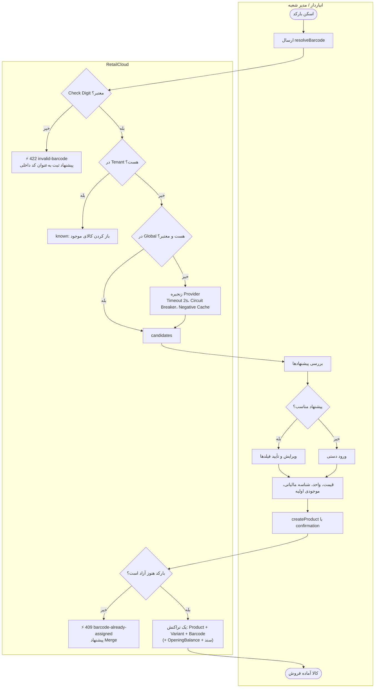

### توالی
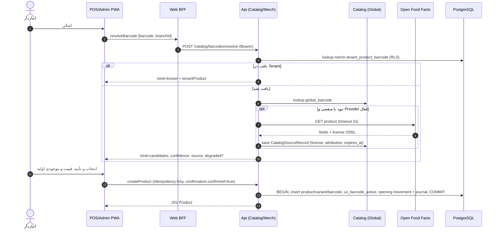

**نکته:** داده Open Food Facts فقط در `CatalogSourceRecord` ذخیره می‌شود و در `CatalogProduct` ادغام نمی‌شود تا تأیید حقوقی ODbL (ADR-007).

---

## F-02 — فروش و Finalize (UC-02)

### فرایند
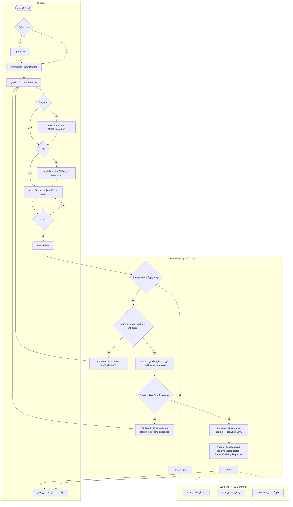

### توالی Finalize با Retry شبکه
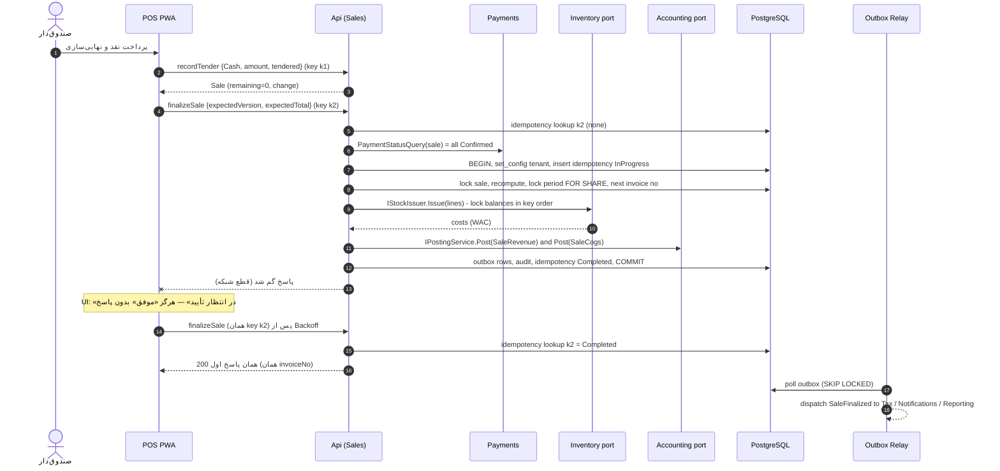

**گزینه‌های خطا و پاسخ UI:**

| پاسخ | معنا | رفتار POS |
|---|---|---|
| `409 price-changed` | قیمت یا قاعده تخفیف بین Draft و Finalize عوض شده | نمایش قیمت جدید، تأیید صندوق‌دار، اصلاح پرداخت در صورت تغییر مبلغ، Finalize با **کلید جدید** |
| `409 insufficient-stock` | `context.shortages[]` | علامت‌گذاری اقلام، حذف یا کاهش، Finalize مجدد |
| `409 payment-not-confirmed` | Tender آنلاین هنوز تأیید نشده | ادامه F-03 |
| `409 in-progress` | درخواست هم‌کلید هنوز در حال اجراست (دو تب یا Retry زودهنگام) | صبر برای `Retry-After` |
| `409 period-closed` | دوره امروز بسته است (ناهنجاری) | توقف و پیام به مدیر و حسابدار |
| `403 approval-required` | تخفیف یا نسیه بالای سقف | F-14 |

---

## F-03 — پرداخت آنلاین (UC-08)

### توالی
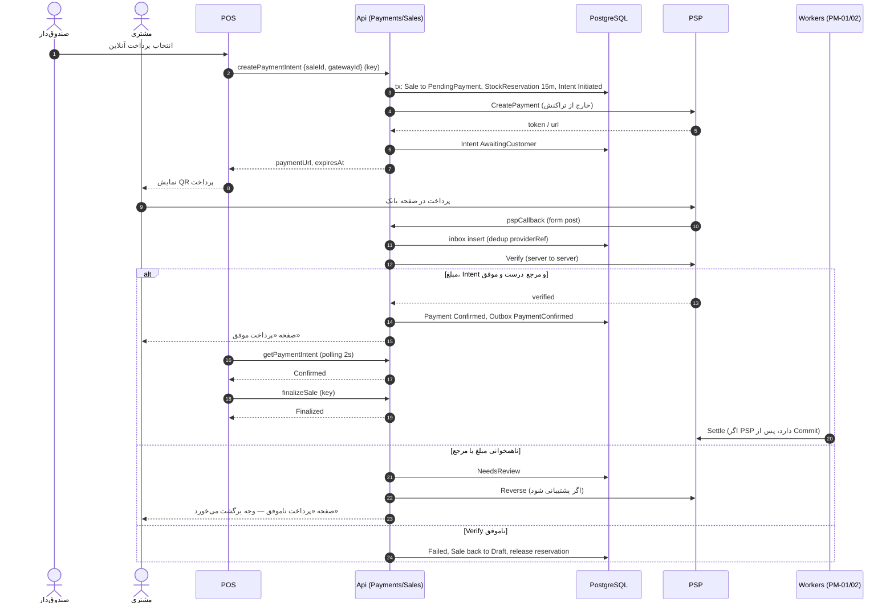

### Timeout، Callback دیررس و Finalize خودکار
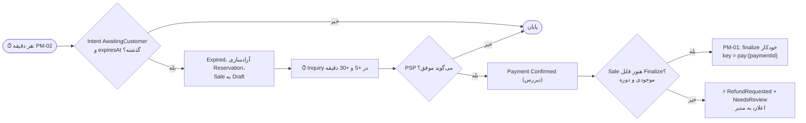

**قاعده:** پول تأییدشده هرگز «رها» نمی‌شود. یا فاکتور می‌گیرد یا Refund و NeedsReview (AT-272).

---

## F-04 — برگشت و بازپرداخت (UC-04)

### فرایند
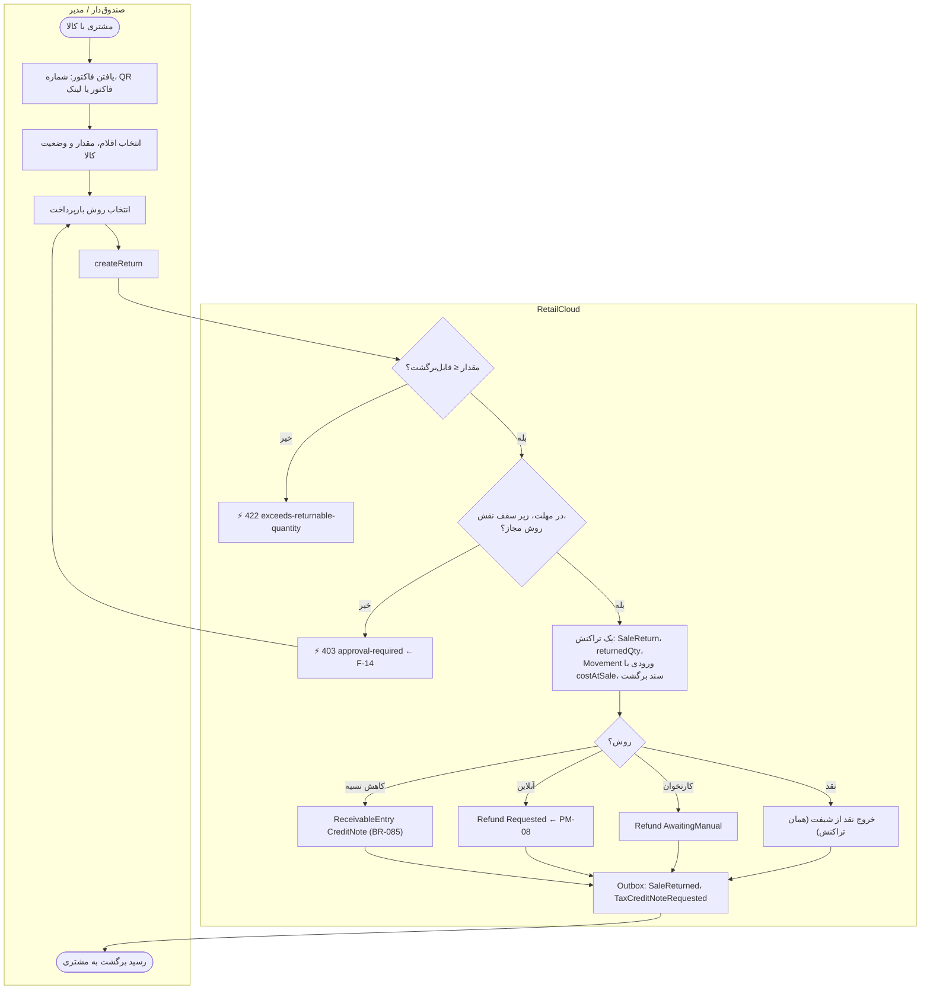

### مثال عددی سهم برگشت (BR-054)

فاکتور: ۳ واحد × ۴۰۰٬۰۰۰ = ۱٬۲۰۰٬۰۰۰ ریال؛ تخفیف سندی ۱۰۰٬۰۰۰ ← net = ۱٬۱۰۰٬۰۰۰؛ مالیات ۱۰٪ = ۱۱۰٬۰۰۰؛ lineTotal = **۱٬۲۱۰٬۰۰۰**.

| برگشت | محاسبه | مبلغ |
|---|---|---|
| ۱ واحد (اول) | round(1٬210٬000 × 1/3) = round(403٬333.33) | ۴۰۳٬۳۳۳ |
| ۱ واحد (دوم) | round(1٬210٬000 × 1/3) | ۴۰۳٬۳۳۳ |
| ۱ واحد (آخر) | **باقیمانده دقیق**: 1٬210٬000 − 806٬666 | **۴۰۳٬۳۳۴** |
| جمع | | **۱٬۲۱۰٬۰۰۰** = lineTotal ✓ (DI-006) |

همین روش برای تفکیک `net` و `tax` سهم هر برگشت اعمال می‌شود تا صورتحساب برگشتی مؤدیان دقیقاً قرینه باشد.

---

## F-05 — عضویت با QR پیشخوان، اتصال بله و شناسایی در POS (UC-03)

### عضویت و اتصال بله
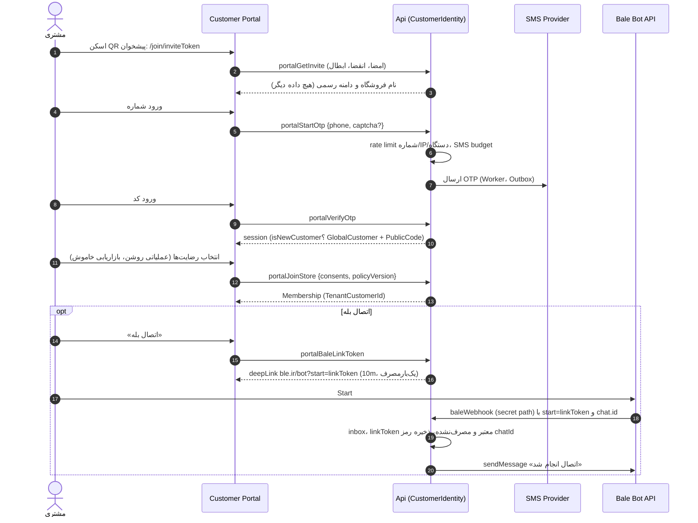

### شناسایی در POS
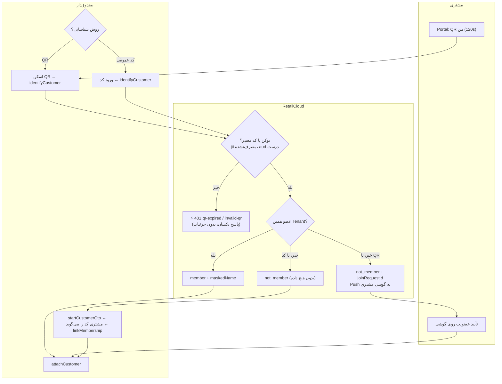

**چرا QR عضویت را بدون OTP ممکن می‌کند ولی کد عمومی نه:** QR فقط با Session فعال خود مشتری در Portal صادر می‌شود. پس Proof of Possession است. کد عمومی را هر کسی می‌تواند بگوید (CUS-004).

---

## F-06 — ارسال فاکتور و Fallback کانال (PM-05)

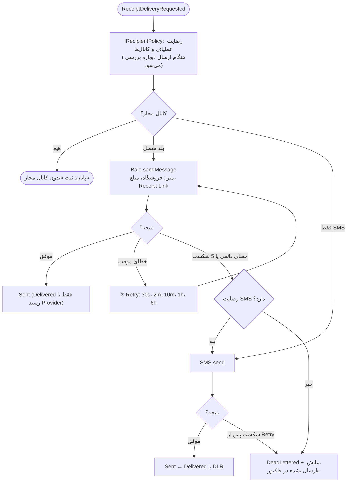

**قاعده:** هیچ شکستی در این جریان روی فروش اثر ندارد (BR-071، P0-7). صندوق‌دار می‌تواند `deliverReceipt` را دوباره صدا بزند (سقف ۵ در ساعت).

---

## F-07 — فروش نسیه، دریافت، یادآوری و مسدودی (UC-11)

### فروش نسیه و دریافت
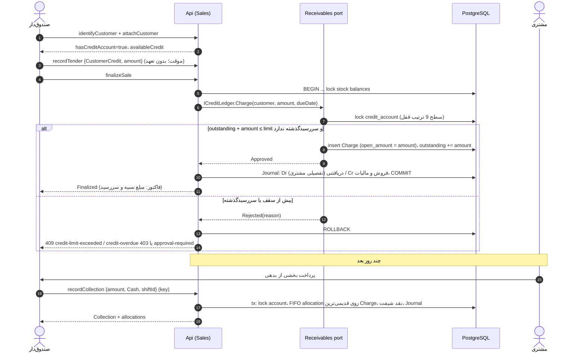

### پایش روزانه (PM-07)
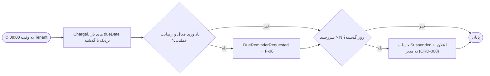

---

## F-08 — مؤدیان: راه‌اندازی کلید، ارسال، رد و اصلاح (UC-07)

### راه‌اندازی کلید (یک‌بار برای هر واحد صدور)
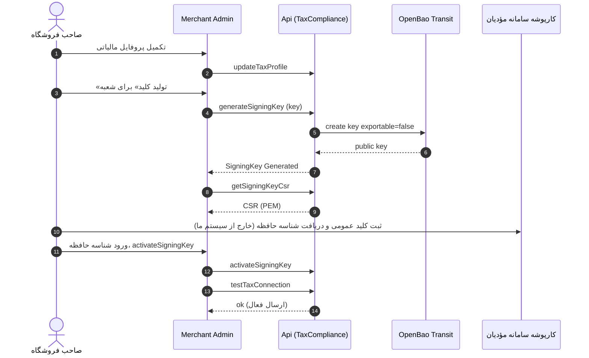

### ارسال، رد و اصلاح
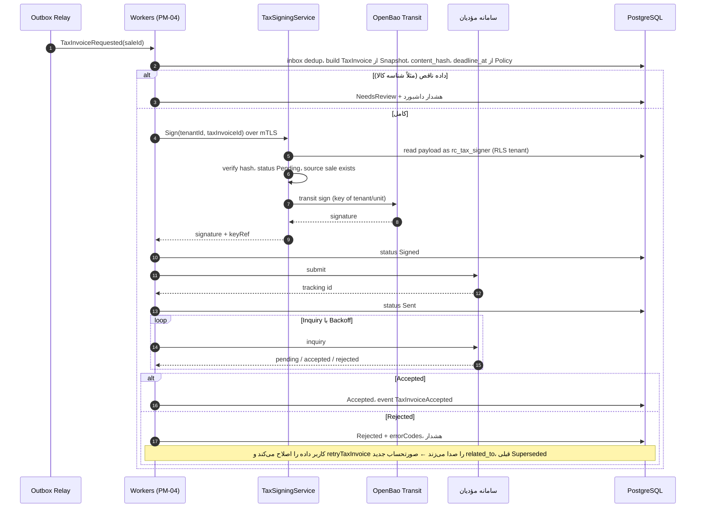

**هشدار مهلت (BR-076):** Job ساعتی صورتحساب‌های `Pending/NeedsReview/Rejected` را با `deadline_at` مقایسه می‌کند و در ۵۰، ۸۰ و ۹۵ درصد زمان هشدار می‌دهد.

---

## F-09 — خط لوله Posting و مثال‌های عددی

### خط لوله
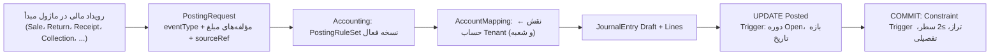

### مثال‌ها (نرخ مالیات فرضی ۱۰٪، TaxExclusive، WAC = ۳۰۰٬۰۰۰ ریال)

> ارقام صرفاً آموزشی‌اند (همانند §11.4 سند مرجع). نرخ واقعی مالیات از Tax Policy نسخه‌دار می‌آید. همه اسناد زیر متوازن‌اند و با یک اسکریپت بررسی شده‌اند (بخش 17).

| # | رویداد | بدهکار | بستانکار |
|---|---|---|---|
| J1 | فروش نقد ۲ × ۵۰۰٬۰۰۰ | صندوق ۱٬۱۰۰٬۰۰۰ | فروش ۱٬۰۰۰٬۰۰۰ · مالیات بر ارزش افزوده پرداختنی ۱۰۰٬۰۰۰ |
| J2 | بهای تمام‌شده J1 | بهای تمام‌شده کالای فروش‌رفته ۶۰۰٬۰۰۰ | موجودی کالا ۶۰۰٬۰۰۰ |
| J3 | همان فروش، پرداخت ترکیبی: ۵۰۰٬۰۰۰ نقد + ۶۰۰٬۰۰۰ کارتخوان | صندوق ۵۰۰٬۰۰۰ · وجوه کارتخوان در راه ۶۰۰٬۰۰۰ | فروش ۱٬۰۰۰٬۰۰۰ · مالیات پرداختنی ۱۰۰٬۰۰۰ |
| J4 | تطبیق تسویه کارتخوان (PAY-002.2) | بانک ۶۰۰٬۰۰۰ | وجوه کارتخوان در راه ۶۰۰٬۰۰۰ |
| J5 | فروش نسیه ۱٬۱۰۰٬۰۰۰ | حساب‌های دریافتنی (مشتری X) ۱٬۱۰۰٬۰۰۰ | فروش ۱٬۰۰۰٬۰۰۰ · مالیات پرداختنی ۱۰۰٬۰۰۰ |
| J6 | دریافت نقد از مشتری X | صندوق ۱٬۱۰۰٬۰۰۰ | حساب‌های دریافتنی (مشتری X) ۱٬۱۰۰٬۰۰۰ |
| J7 | برگشت ۱ واحد از J1 (نقد) | برگشت از فروش ۵۰۰٬۰۰۰ · مالیات پرداختنی ۵۰٬۰۰۰ | صندوق ۵۵۰٬۰۰۰ |
| J8 | برگشت بهای J7 (به costAtSale) | موجودی کالا ۳۰۰٬۰۰۰ | بهای تمام‌شده ۳۰۰٬۰۰۰ |
| J9 | رسید خرید ۱۰ × ۲۸۰٬۰۰۰ + مالیات خرید ۱۰٪ | موجودی کالا ۲٬۸۰۰٬۰۰۰ · مالیات خرید (اعتبار) ۲۸۰٬۰۰۰ | حساب‌های پرداختنی (تأمین‌کننده Y) ۳٬۰۸۰٬۰۰۰ |
| J10 | کسری انبار ۱ واحد | هزینه کسری و ضایعات ۳۰۰٬۰۰۰ | موجودی کالا ۳۰۰٬۰۰۰ |
| J11 | کسری صندوق | کسری صندوق ۱۰۰٬۰۰۰ | صندوق ۱۰۰٬۰۰۰ |
| J12 | فروش با درگاه آنلاین ۱٬۱۰۰٬۰۰۰ | وجوه درگاه در راه ۱٬۱۰۰٬۰۰۰ | فروش ۱٬۰۰۰٬۰۰۰ · مالیات پرداختنی ۱۰۰٬۰۰۰ |
| J13 | سوخت مطالبات مشتری Z | هزینه مطالبات سوخت‌شده ۲۰۰٬۰۰۰ | حساب‌های دریافتنی (مشتری Z) ۲۰۰٬۰۰۰ |
| J14 | موجودی افتتاحیه ۵ × ۳۰۰٬۰۰۰ | موجودی کالا ۱٬۵۰۰٬۰۰۰ | تعدیلات افتتاحیه (حقوق مالکانه) ۱٬۵۰۰٬۰۰۰ |
| J15 | اصلاح WAC پس از موجودی منفی (BR-043؛ مثال F-10) | موجودی کالا ۴۰٬۰۰۰ | تعدیل بهای موجودی ۴۰٬۰۰۰ |

**تصمیم `[DEC D-59]`:** نقش حساب جدید **`CardInTransit`** (وجوه کارتخوان در راه) به فهرست D-30 اضافه می‌شود. فروش با کارتخوان مستقیم به «بانک» ثبت نمی‌شود، چون وجه یک تا دو روز بعد و گاهی با کسر کارمزد تسویه می‌شود. تطبیق فایل تسویه (J4) آن را صفر می‌کند و اختلاف به «کارمزد بانکی» می‌رود.

### بستن دوره
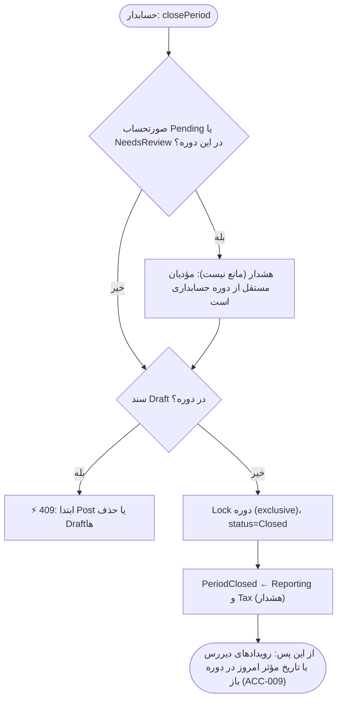

---

## F-10 — رسید خرید و WAC (UC-05)

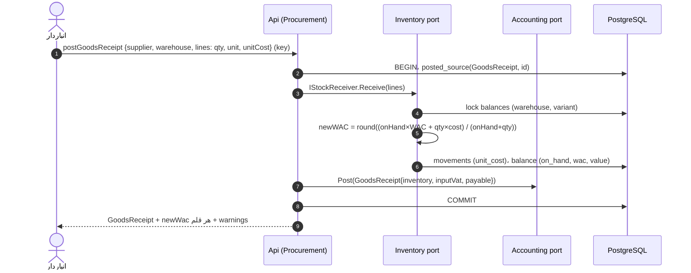

| حالت | قبل | ورود | WAC جدید | توضیح |
|---|---|---|---|---|
| عادی | ۱۰ واحد، WAC ۳۰۰٬۰۰۰، ارزش ۳٬۰۰۰٬۰۰۰ | ۱۰ × ۲۸۰٬۰۰۰ = ۲٬۸۰۰٬۰۰۰ | round(5٬800٬000 ÷ 20) = **۲۹۰٬۰۰۰** | BR-042 |
| پس از موجودی منفی | −۲ واحد، WAC ۳۰۰٬۰۰۰، ارزش −۶۰۰٬۰۰۰ | ۱۰ × ۲۸۰٬۰۰۰ | **۲۸۰٬۰۰۰** (= بهای ورودی) | BR-043: ارزش باید ۸ × ۲۸۰٬۰۰۰ = ۲٬۲۴۰٬۰۰۰ باشد. Σ ارزش Ledger = ۲٬۲۰۰٬۰۰۰ ← اختلاف ۴۰٬۰۰۰ با سند J15 |
| بهای صفر (جایزه یا هدیه) | ۱۰ @ ۳۰۰٬۰۰۰ | ۲ × ۰ | round(3٬000٬000 ÷ 12) = ۲۵۰٬۰۰۰ | هشدار و تأیید صریح کاربر (UC-05) |

---

## F-11 — انبارگردانی (UC-09)

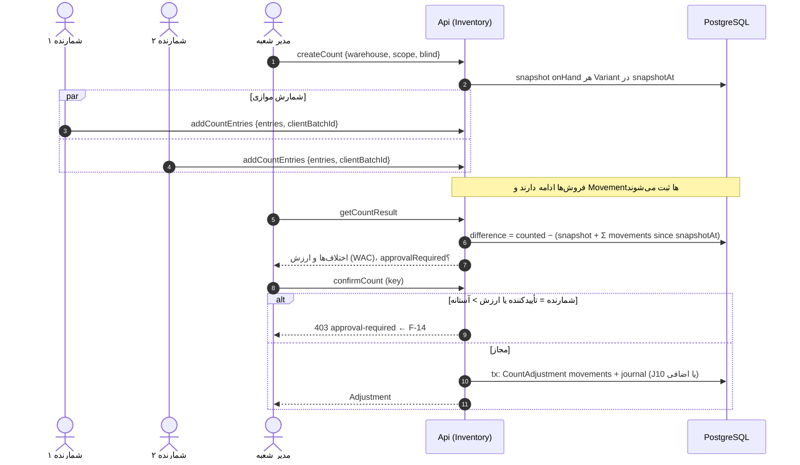

---

## F-12 — شیفت و مغایرت صندوق (UC-06)

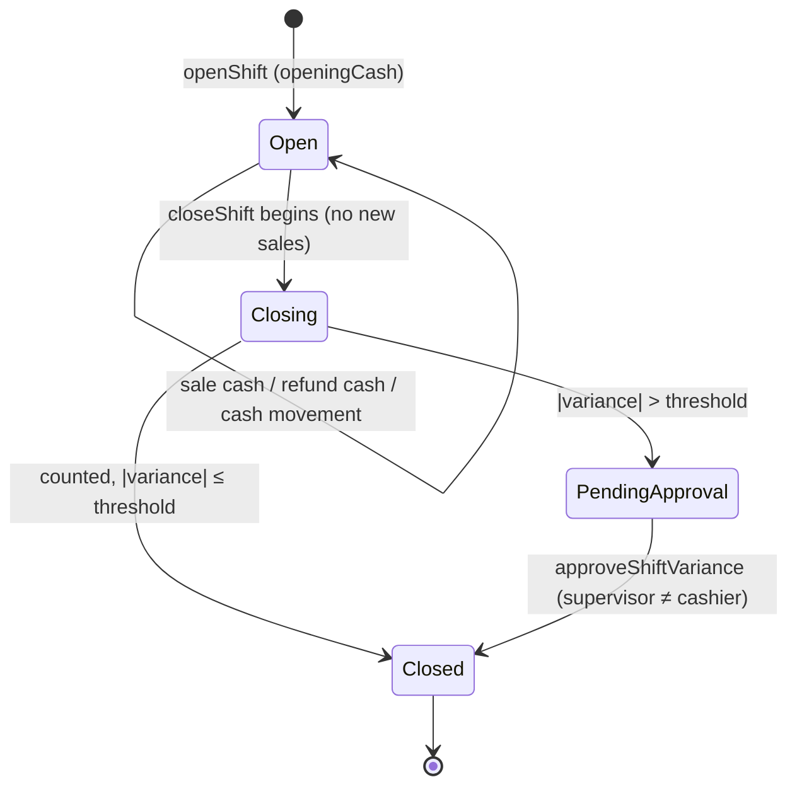

`PendingApproval` یک زیروضعیت منطقی `Closing` است: در DB `status=Closing` و `approval_request_id` تنظیم‌شده `[DEC D-60]`. نقد مورد انتظار در حالت Blind Close فقط پس از ثبت شمارش نمایش داده می‌شود (D-24).

---

## F-13 — Draft آفلاین و Sync (ADR-006)

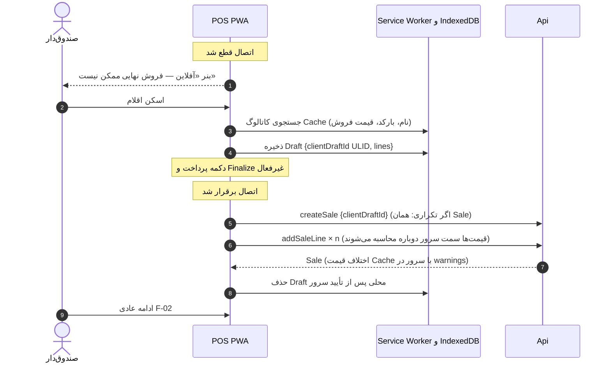

---

## F-14 — Approval لحظه‌ای (IAM-007)

```mermaid
sequenceDiagram
  autonumber
  actor K as صندوق‌دار
  actor BM as مدیر شعبه
  participant P as POS
  participant API as Api

  K->>P: تخفیف ۲۰٪ (سقف نقش ۰٪)
  P->>API: applyDiscount
  API-->>P: 403 approval-required + approvalRequestId + context(limit, value)
  alt مدیر روی همان دستگاه
    BM->>P: ورود PIN و MFA
    P->>API: decideApproval {Approve, pin}
  else مدیر از دستگاه خودش
    API-->>BM: اعلان درون‌برنامه‌ای
    BM->>API: decideApproval {Approve}
  end
  API->>API: approver ≠ requester، مجوز و Scope مدیر، MFA تازه
  API-->>P: Approved
  P->>API: applyDiscount {approvalId}
  API-->>P: Sale (تخفیف با approvalRef ممیزی‌شده)
```

اعتبار Approval: **۵ دقیقه**، یک‌بارمصرف، و فقط برای همان `action + resource + value` `[DEC D-61]`.

---

## F-15 — دسترسی JIT پشتیبانی (IAM-008)

```mermaid
flowchart TB
  S1(["Support: platformRequestSupportAccess<br/>(دلیل، مدت ≤ 4h)"]) --> S2["اعلان به TenantOwner"]
  S2 --> S3{"Owner تأیید می‌کند؟"}
  S3 -- "خیر" --> S4(["Rejected"])
  S3 -- "بله" --> S5["Grant تا grantedUntil<br/>Token Support با claim jit و Masking اجباری"]
  S5 --> S6["همه اقدام‌ها: Audit با actorKind=Support"]
  S6 --> S7{"⏱ پایان زمان یا لغو Owner؟"}
  S7 -- "بله" --> S8(["Revoked + گزارش اقدام‌ها به Owner"])
```

---

## 16. تصمیم‌ها و پرسش‌های باز

| ID | نوع | شرح |
|---|---|---|
| D-59 | DEC | نقش حساب `CardInTransit` برای کارتخوان مستقل؛ تسویه از طریق تطبیق فایل |
| D-60 | DEC | Approval مغایرت شیفت به‌صورت زیروضعیت Closing |
| D-61 | DEC | Approval پنج‌دقیقه‌ای، یک‌بارمصرف و مقید به action، resource و value |
| D-62 | DEC | پاسخ یکسان 401 برای QR منقضی، تکراری یا متعلق به Audience دیگر (بدون افشای دلیل دقیق به POS) |
| D-63 | DEC | حذف Draft آفلاین فقط پس از تأیید سرور |
| FQ-01 | OQ | کارمزد بانکی کارتخوان و درگاه: در تطبیق تسویه خودکار به هزینه ثبت شود؟ (Default: بله، با حساب «کارمزد بانکی») |
| FQ-02 | OQ | یادآوری سررسید نسیه: چند روز قبل و بعد؟ (Default: ۳ روز قبل، ۱ و ۷ روز بعد؛ پیش‌فرض خاموش) |
| FQ-03 | OQ | آیا مشتری می‌تواند بدون Membership فقط با OTP لحظه‌ای فاکتور بگیرد و بعداً عضو شود (اتصال فاکتورهای قبلی)؟ (Default: بله، فقط فاکتورهای همان شماره و همان Tenant، با تأیید مشتری) |
| FQ-04 | OQ | Settle درگاه‌هایی که مرحله جدا دارند: بلافاصله پس از Commit یا دسته‌ای پایان روز؟ (Default: بلافاصله) |

---

## 17. اعتبارسنجی این سند

- **Render همه نمودارها:** اسکریپت Mermaid 11.4.1 در Chromium (Playwright) همه بلوک‌های Mermaid این سند و سایر اسناد را Render کرد (نتیجه در گزارش Commit).
- **تراز اسناد F-09:** جمع بدهکار و بستانکار هر سند J1 تا J15 با یک اسکریپت محاسبه و برابر بود. مقادیر WAC جدول F-10 و سهم برگشت F-04 هم با همان اسکریپت بازمحاسبه شدند.
