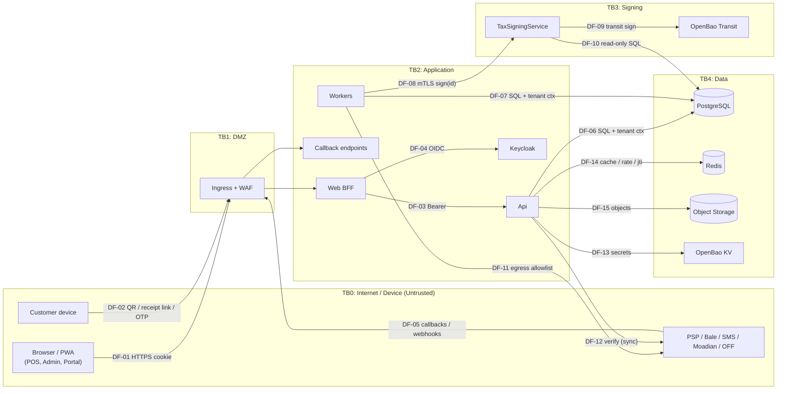

# D06 — مدل تهدید امنیتی و کنترل‌ها

> **روش:** STRIDE روی عناصر و جریان‌های داده D04 · Abuse Caseهای کسب‌وکاری (تقلب داخلی و خارجی) · نگاشت به OWASP API Security Top 10 (2023) و فصل‌های OWASP ASVS 5.0 · هر کنترل یک **تست** دارد (`SEC-T-nnn` یا `AT-nnn`) که در D10 اجرایی می‌شود.
>
> **امتیاز ریسک:** احتمال (L) و اثر (I) هر کدام ۱ تا ۵؛ `R = L × I`. R ≥ 15 = **Critical**، 10–14 = High، 5–9 = Medium، کمتر از ۵ = Low. امتیازها **پیش از کنترل** (Inherent) هستند. ستون Residual پس از کنترل‌هاست.

---

## 1. دارایی‌ها

| ID | دارایی | طبقه (D05 §10) | پیامد نقض | مالک |
|---|---|---|---|---|
| AS-01 | داده هر Tenant (فروش، موجودی، اسناد، مشتریان عضو، قیمت‌ها، بهای خرید) | Confidential-Tenant | نشت به رقیب؛ از دست رفتن اعتماد؛ پیامد قراردادی | Tenant |
| AS-02 | هویت و PII مشتری نهایی (شماره، کد ملی خریدار نسیه، chatId بله) | PII-High | نقض حریم خصوصی؛ پیامد قانونی | پلتفرم (کنترل‌گر) + Tenant |
| AS-03 | **درستی مالی** (فاکتور، سند، موجودی، نسیه) | Integrity-Critical | تقلب، گزارش غلط، اختلاف مالیاتی | Tenant |
| AS-04 | **کلید امضای مالیاتی هر Tenant** | Secret-Critical | صدور صورتحساب جعلی به نام فروشگاه؛ پیامد قانونی برای Tenant | Tenant (نگهداری: پلتفرم) |
| AS-05 | اعتبارنامه PSP، توکن بله، کلید SMS | Secret | تراکنش جعلی؛ ارسال انبوه پیام به هزینه ما | پلتفرم/Tenant |
| AS-06 | **دسترس‌پذیری فروش** | Availability | توقف صندوق‌ها | پلتفرم |
| AS-07 | زنجیره ممیزی | Integrity | از بین رفتن شواهد | پلتفرم |
| AS-08 | حساب‌های Platform Admin و Support | Privileged | دسترسی به همه Tenantها | پلتفرم |
| AS-09 | زنجیره تأمین (کد، Image، وابستگی، CI) | Integrity | Backdoor در همه Tenantها | پلتفرم |
| AS-10 | اعتبار پیامکی و هزینه Provider | Financial-Platform | SMS Pumping و زیان مالی | پلتفرم |

## 2. بازیگران تهدید

| ID | بازیگر | توان | انگیزه |
|---|---|---|---|
| TA-01 | مهاجم اینترنتی ناشناس | اسکنر، Bot، Credential Stuffing | داده، باج، هزینه پیامکی |
| TA-02 | **کاربر مخرب داخل یک Tenant** (صندوق‌دار، انباردار) | دسترسی مشروع محدود | دزدی نقد و کالا، تخفیف بی‌مجوز، برگشت جعلی |
| TA-03 | Tenant رقیب یا کنجکاو | حساب معتبر در Tenant خودش | داده Tenant دیگر یا مشتریان آن |
| TA-04 | مشتری مخرب | حساب مشتری؛ QR و Receipt Link | جعل هویت، دیدن فاکتور دیگران، سوءاستفاده از نسیه |
| TA-05 | کارمند پشتیبانی یا اپراتور پلتفرم (Insider) | دسترسی ممتاز | کنجکاوی، فروش داده |
| TA-06 | مدیر زیرساخت یا DBA | دسترسی به DB و Cluster | دسترسی خارج از کنترل Application |
| TA-07 | مهاجم زنجیره تأمین | بسته npm/NuGet مخرب، Image آلوده | Backdoor |
| TA-08 | مهاجم میانی (Network) | شبکه عمومی، Wi-Fi فروشگاه | شنود، جعل Callback |
| TA-09 | Provider بیرونی آسیب‌دیده (PSP، SMS، Catalog) | پاسخ مخرب | تزریق، SSRF، داده غلط |

---

## 3. مرزهای اعتماد و جریان‌های داده



---

## 4. STRIDE به تفکیک عنصر

> ستون «تست» به `SEC-T-nnn` (این سند، در D10 اجرایی) یا تست‌های موجود ارجاع می‌دهد (`T..` = `docs/05-data/sql/tests/tests.sql`، `AT-..` = D02).

### 4.1 Browser/PWA و BFF (DF-01، DF-03، DF-04)

| ID | S/T/R/I/D/E | تهدید | L | I | R | کنترل‌ها | تست | Residual |
|---|---|---|---|---|---|---|---|---|
| TM-001 | S | سرقت Session با XSS | 3 | 5 | 15 | Token در مرورگر نیست (BFF)؛ Cookie `HttpOnly; Secure; SameSite=Lax`؛ CSP سخت (nonce، بدون `unsafe-inline`)؛ React Escaping؛ Sanitization ورودی‌های متنی که در HTML یا PDF فاکتور رندر می‌شوند (نام کالا، یادداشت) | SEC-T-001 (CSP header)، SEC-T-002 (XSS payload در نام کالا ← فاکتور و PDF) | Low |
| TM-002 | S | CSRF روی BFF | 3 | 4 | 12 | `SameSite=Lax` + CSRF Token (Double-submit) برای همه درخواست‌های تغییر وضعیت؛ بررسی `Origin` | SEC-T-003 | Low |
| TM-003 | I | داده حساس در Cache مرورگر یا IndexedDB (دستگاه مشترک صندوق) | 3 | 3 | 9 | فقط Draft و کاتالوگ فروش در IndexedDB (ADR-006)؛ پاک‌سازی با خروج و قفل؛ `Cache-Control: no-store` برای پاسخ‌های حساس | SEC-T-004 | Low |
| TM-004 | T | دستکاری قیمت یا مبلغ در کلاینت | 4 | 4 | 16 | **قیمت و جمع فقط سمت سرور** (BR-018)؛ `expectedTotal` فقط برای مقایسه؛ DTOها فیلد قیمت را از کلاینت نمی‌پذیرند (Allowlist ورودی) | SEC-T-005، AT-064 | Low |
| TM-005 | E | Clickjacking روی صفحه Approval مدیر | 2 | 4 | 8 | `frame-ancestors 'none'` | SEC-T-001 | Low |
| TM-006 | S | Session Fixation یا عدم چرخش پس از ورود و MFA | 2 | 4 | 8 | Session جدید پس از احراز و پس از تغییر Tenant فعال | SEC-T-006 | Low |

### 4.2 Api (DF-03، DF-06)

| ID | STRIDE | تهدید | L | I | R | کنترل‌ها | تست | Residual |
|---|---|---|---|---|---|---|---|---|
| TM-010 | E/I | **BOLA:** دستکاری `saleId`، `customerId`، `exportId` و … برای دسترسی به منبع Tenant دیگر | 5 | 5 | **25** | Tenant از Session (BR-001)؛ RLS FORCE (T01–T06)؛ FK مرکب (T03)؛ 404 یکسان (BR-003)؛ شناسه‌های UUID غیرترتیبی | **SEC-T-010: ماتریس خودکار BOLA** (هر Endpoint × دو Tenant × هر شناسه مسیر و بدنه، تولیدشده از OpenAPI) | Low |
| TM-011 | E | **BOLA درون Tenant:** صندوق‌دار شعبه ۱ فاکتور شعبه ۲ را برمی‌گرداند | 4 | 3 | 12 | Scope (Branch/Register/OwnShift) در Policy هر Command؛ RLS فقط Tenant را پوشش می‌دهد و **Scope شعبه در Application است** | SEC-T-011 (ماتریس Scope) | Medium (وابسته به کد) |
| TM-012 | E | **BFLA:** صندوق‌دار Endpoint مدیریتی را صدا می‌زند (تعدیل، Mapping حساب، Export) | 4 | 4 | 16 | `RequirePermission` اجباری روی همه Endpointها (R7)؛ Default Deny | SEC-T-012 (هر Endpoint × هر نقش) | Low |
| TM-013 | T | **Mass Assignment / BOPLA:** ارسال `status`، `invoiceNo`، `costAtSale`، `creditLimit`، `tenantId` در بدنه | 4 | 4 | 16 | DTOهای Command جدا با Allowlist؛ Mapping دستی (D04 §5.4)؛ رد فیلدهای ناشناخته (`UnmappedMemberHandling.Disallow`) | SEC-T-013 | Low |
| TM-014 | I | **BOPLA خواندن:** پاسخ شامل فیلدهای حساس (بهای خرید برای صندوق‌دار، شماره کامل مشتری) | 4 | 3 | 12 | DTO پاسخ به ازای مجوز (`costVisible` فقط با `reports.view` یا `catalog.product.manage`)؛ Masking (BR-062) | SEC-T-014 | Low |
| TM-015 | D | **مصرف بی‌حد منابع:** Export بزرگ، صفحه‌بندی بی‌سقف، سبد ۱۰٬۰۰۰ قلمی | 3 | 4 | 12 | سقف صفحه (۲۰۰)؛ سقف قلم سبد (۵۰۰)؛ سقف Body (۱MB؛ Import جدا)؛ Rate Limit به ازای کاربر و Tenant؛ Export ناهمگام | SEC-T-015 | Low |
| TM-016 | T | Replay یا تکرار Finalize و Refund | 4 | 5 | 20 | Idempotency + Unique Source (T13، T35، AT-210) | AT-210 | Low |
| TM-017 | R | انکار عملیات (صندوق‌دار: «من برگشت نزدم») | 3 | 3 | 9 | Audit با `who/where(device)/when` و زنجیره Hash (T70–T74)؛ Approval با هویت تأییدکننده | AT-190..192 | Low |
| TM-018 | I | نشت اطلاعات در خطا (Stack Trace، SQL) | 3 | 2 | 6 | `problem+json` با `traceId`؛ جزئیات فقط در Log | SEC-T-016 | Low |
| TM-019 | E | تزریق SQL در Queryهای دست‌نویس (Dapper) | 2 | 5 | 10 | فقط پارامتر؛ Analyzer ممنوعیت Concatenation؛ نقش DB بدون DDL | SEC-T-017 (SAST rule) | Low |
| TM-020 | T | Race روی سقف اعتبار، موجودی یا مقدار برگشتی | 4 | 4 | 16 | Lock با ترتیب سراسری (D03 §6.2)؛ CHECKهای DB (T12، T26، T40) | AT-211، AT-231، AT-310 | Low |

### 4.3 Callback Endpoints (DF-05)

| ID | STRIDE | تهدید | L | I | R | کنترل‌ها | تست |
|---|---|---|---|---|---|---|---|
| TM-030 | S | **Callback جعلی PSP** («پرداخت موفق») | 5 | 5 | **25** | فقط Verify سرور-به-سرور اعتبار دارد (PAY-003.1/2)؛ تطبیق مبلغ، Intent و مرجع؛ Inbox | AT-270، SEC-T-030 |
| TM-031 | T | Replay Callback | 4 | 4 | 16 | Inbox Dedup؛ Intent در وضعیت نهایی تغییر نمی‌کند (DI-020) | AT-271 |
| TM-032 | S | Webhook جعلی بله (اتصال chatId مهاجم به مشتری) | 3 | 4 | 12 | Secret Token مسیر و Header (طبق قابلیت بله؛ Verification)؛ اتصال فقط با `linkToken` یک‌بارمصرف ۱۰ دقیقه‌ای که خود مشتری پس از OTP گرفته | SEC-T-031 |
| TM-033 | D | Flood روی Callback | 3 | 3 | 9 | Rate Limit جدا؛ پاسخ سریع و پردازش در Worker؛ سقف Payload ۶۴KB | SEC-T-032 |

### 4.4 Workers، Adapters و Egress (DF-07، DF-11، DF-12)

| ID | STRIDE | تهدید | L | I | R | کنترل‌ها | تست |
|---|---|---|---|---|---|---|---|
| TM-040 | E/I | **SSRF** از URL تصویر کالا یا Provider کاتالوگ | 3 | 5 | 15 | Egress Proxy با Allowlist دامنه؛ مسدودسازی IPهای خصوصی و Metadata؛ بدون Redirect خودکار؛ دانلود در Worker با سقف حجم و MIME | SEC-T-040 |
| TM-041 | T | پاسخ مخرب Provider (HTML یا Script در نام کالا) | 3 | 3 | 9 | داده Provider فقط «پیشنهاد» است (تأیید انسانی)؛ Sanitization و Encoding خروجی؛ طول بیشینه | SEC-T-041 |
| TM-042 | I | Worker بدون Tenant Context داده همه Tenantها را پردازش کند | 2 | 5 | 10 | `rc_worker` بدون BYPASSRLS؛ هر کار با Context (D05 §5.3)؛ تابع فهرست Tenant محدود | T05، SEC-T-042 |
| TM-043 | D | **SMS Pumping / Toll Fraud** از طریق OTP مشتری | **5** | 4 | **20** | Rate Limit به ازای شماره، IP، دستگاه و ASN (CUS-001)؛ CAPTCHA تطبیقی پس از آستانه؛ فقط شماره‌های ایران (`+98 9`)؛ سقف روزانه هزینه SMS پلتفرم و Tenant با Circuit Breaker؛ Alert نرخ | SEC-T-043 |
| TM-044 | I | افشای شماره مشتری در Log یا Trace یا Metric | 3 | 4 | 12 | Scrubber در Logger (NFR-PRIV-002)؛ آدرس گیرنده در Notification ذخیره نمی‌شود (ADR-008) | SEC-T-044 |

### 4.5 TaxSigningService و KMS (DF-08، DF-09، DF-10)

| ID | STRIDE | تهدید | L | I | R | کنترل‌ها | تست |
|---|---|---|---|---|---|---|---|
| TM-050 | E | **امضای دلخواه با کلید Tenant** پس از نفوذ به Api یا Workers | 3 | 5 | 15 | TSS فقط `taxInvoiceId` می‌پذیرد، محتوا را خودش می‌خواند و Hash را تطبیق می‌دهد (ADR-011، AT-262)؛ Api به KMS دسترسی شبکه ندارد | SEC-T-050 |
| TM-051 | T | نفوذ هم‌زمان به DB و Workers ← درج صورتحساب جعلی در DB و درخواست امضا | 2 | 5 | 10 | صورتحساب باید `source` به Sale Finalized موجود داشته باشد (TSS بررسی می‌کند)؛ Alert نرخ غیرعادی امضا؛ Audit جدا در TSS؛ کشف از طریق تطبیق روزانه «فروش‌ها در برابر صورتحساب‌ها» | SEC-T-051 |
| TM-052 | I | استخراج کلید از KMS | 1 | 5 | 5 | `exportable=false`؛ Policy OpenBao؛ Unseal با Shamir 3/5؛ Audit Device OpenBao؛ Break-glass دونفره | SEC-T-052 |
| TM-053 | D | KMS Down ← توقف امضا | 2 | 3 | 6 | HA Raft ۳ نود؛ صف امضا منتظر می‌ماند و فروش ادامه دارد (BR-071)؛ مهلت سه‌ماهه | AT-260 |
| TM-054 | R | انکار صورتحساب توسط Tenant («ما این را صادر نکردیم») | 2 | 4 | 8 | زنجیره Sale ← TaxInvoice ← Audit امضا ← Hash؛ همه در Audit زنجیره‌ای | AT-166 |

### 4.6 داده (PostgreSQL، Redis، Object Storage، OpenBao KV)

| ID | STRIDE | تهدید | L | I | R | کنترل‌ها | تست |
|---|---|---|---|---|---|---|---|
| TM-060 | I | **نشت Context Tenant در Connection Pool** | 3 | 5 | 15 | فقط `set_config(…, true)` درون تراکنش؛ PgBouncer Transaction Pooling؛ تست دو Tenant پیاپی روی یک اتصال | SEC-T-060 |
| TM-061 | E | جدول یا Partition جدید بدون RLS | 3 | 5 | 15 | Fitness Function (D05، Self-test PASS) در CI | Fitness |
| TM-062 | I | DBA یا مدیر زیرساخت داده را مستقیم می‌خواند (TA-06) | 3 | 4 | 12 | رمزنگاری فیلدهای PII با KEK در OpenBao (DBA به Transit دسترسی ندارد)؛ Login شخصی DBA با ممیزی (`pgaudit`)؛ عدم استفاده از Superuser در عملیات روزمره | SEC-T-062 |
| TM-063 | T | دستکاری مستقیم اسناد مالی یا ممیزی در DB | 2 | 5 | 10 | Triggerهای تغییرناپذیری (T22–T38)؛ زنجیره Audit + Head در WORM (T74)؛ PITR | T74، SEC-T-063 |
| TM-064 | I | Backup بدون رمز یا در دسترس عموم | 2 | 5 | 10 | pgBackRest با رمزنگاری؛ Bucket خصوصی؛ Object Lock | SEC-T-064 |
| TM-065 | I | Cache Key بدون Tenant (نشت قیمت یا کالا) | 3 | 4 | 12 | Helper اجباری `TenantCacheKey`؛ Analyzer ممنوعیت کلید خام | SEC-T-065 |
| TM-066 | I | Object Storage: دسترسی به PDF فاکتور یا Export با حدس کلید | 3 | 4 | 12 | کلید `tenants/{tenantId}/{random}`؛ دسترسی فقط با Presigned URL کوتاه‌عمر (۵ دقیقه) صادرشده پس از AuthZ | SEC-T-066 |

### 4.7 IdP، CI/CD و زنجیره تأمین

| ID | STRIDE | تهدید | L | I | R | کنترل‌ها | تست |
|---|---|---|---|---|---|---|---|
| TM-070 | S | Credential Stuffing روی ورود Merchant | 4 | 4 | 16 | MFA اجباری برای نقش‌های حساس (IAM-003)؛ Brute-force Detection در Keycloak؛ Rate Limit؛ بررسی رمز در برابر فهرست رمزهای لو رفته (k-anonymity آفلاین) | SEC-T-070 |
| TM-071 | E | Token یک Realm در Realm دیگر | 2 | 5 | 10 | بررسی `iss` و `aud` (BR-004) | SEC-T-071 |
| TM-072 | T | بسته npm یا NuGet مخرب | 3 | 5 | 15 | Mirror داخلی با Allowlist؛ Lockfile؛ SCA؛ تأخیر ۱۴ روزه برای نسخه‌های جدید (Quarantine) `[DEC D-43]`؛ مجوزها (AQ-03) | SEC-T-072 |
| TM-073 | T | Image آلوده یا جایگزینی Image در Registry | 2 | 5 | 10 | Cosign Sign و Verify در Admission Controller؛ Digest-pinning | SEC-T-073 |
| TM-074 | E | سرقت Secret از CI | 3 | 5 | 15 | OIDC کوتاه‌عمر به OpenBao (بدون Secret ثابت در CI)؛ Runner جدا برای Production با تأیید دستی؛ Branch Protection | SEC-T-074 |
| TM-075 | E | دسترسی Admin به Kubernetes بدون کنترل | 2 | 5 | 10 | RBAC Kubernetes؛ دسترسی موقت از طریق Bastion با MFA؛ Audit Log | SEC-T-075 |

---

## 5. Abuse Caseهای کسب‌وکاری

> این‌ها تهدیدهایی هستند که «کاربر مجاز» انجام می‌دهد. STRIDE معمولاً آن‌ها را نمی‌بیند، ولی در خرده‌فروشی رایج‌ترین زیان را می‌سازند (OWASP API6: Sensitive Business Flows).

| ID | سوءاستفاده | بازیگر | کنترل پیشگیرانه | کنترل کشف | تست |
|---|---|---|---|---|---|
| AB-01 | **تخفیف بی‌مجوز** به آشنا | TA-02 | سقف تخفیف نقش (BR-021) + Approval لحظه‌ای با هویت مدیر (IAM-007) | گزارش تخفیف به تفکیک صندوق‌دار؛ Alert نرخ غیرعادی | AT-033، SEC-T-101 |
| AB-02 | **برگشت جعلی** (بدون کالای واقعی، و برداشتن نقد) | TA-02 | برگشت فقط با ارجاع به فاکتور (BR-053)؛ بازپرداخت نقد برای پرداخت کارتی با Approval (BR-055)؛ مهلت (BR-052) | گزارش برگشت به تفکیک صندوق‌دار و دلیل (RPT-001.2)؛ Alert «برگشت بلافاصله پس از فروش» | AT-230، SEC-T-102 |
| AB-03 | **Void یا Cancel پس از دریافت نقد** (فروش بدون ثبت) | TA-02 | Cancel فقط بدون پرداخت Confirmed (6.1 D02)؛ Draft و Held پس از ۲۴h لغو می‌شوند ولی پرداخت‌دارها هرگز (PM-06) | گزارش «سبدهای لغوشده» و «قلم‌های حذف‌شده پیش از Finalize» به تفکیک صندوق‌دار `[DEC D-44]` | SEC-T-103 |
| AB-04 | **دزدی نقد شیفت** | TA-02 | Blind Close (D-24)؛ مغایرت بالای آستانه با Approval | روند مغایرت به تفکیک صندوق‌دار | AT-250 |
| AB-05 | **تعدیل موجودی برای پوشاندن سرقت** | TA-02 | دلیل اجباری؛ Approval بالای آستانه (BR-033)؛ تفکیک وظایف: شمارنده ≠ تأییدکننده (SoD-03) | گزارش تعدیل‌ها و ارزش آن‌ها | AT-280، SEC-T-104 |
| AB-06 | **تغییر قیمت موقت** (کم کردن، فروش، برگرداندن) | TA-02 | `catalog.price.manage` جدا از `pos.sell`؛ Approval تغییرات بزرگ (BR-041)؛ Price List نسخه‌دار با `validFrom` | گزارش «تغییرات قیمت با بازگشت در ۲۴ ساعت» | SEC-T-105 |
| AB-07 | **سوءاستفاده از نسیه** (حساب برای مشتری ساختگی) | TA-02/TA-04 | ایجاد حساب اعتباری با `credit.account.manage` (نه صندوق‌دار)؛ هویت اعتباری اجباری (BR-080)؛ Membership با اثبات مالکیت شماره (CUS-004) | Aging؛ Alert «حساب جدید با مصرف کامل سقف در ۲۴h» | AT-300، SEC-T-106 |
| AB-08 | **عبور از سقف اعتبار با فروش هم‌زمان** | TA-02/TA-04 | Lock حساب در تراکنش (BR-082) | — | AT-310 |
| AB-09 | **شمارش ضعیف کد عمومی مشتری** برای یافتن مشتریان | TA-03 | کد ۴۰ بیتی تصادفی؛ Rate Limit؛ پاسخ Lookup فقط «عضو/غیرعضو» در همان Tenant و Masked (BR-061) | Alert Enumeration (۱۰ خطای پیاپی) | AT-121، AT-221 |
| AB-10 | **Replay QR مشتری** برای اتصال فاکتور به حساب دیگران (مثلاً برای امتیاز یا نسیه) | TA-04 | QR یک‌بارمصرف، ۱۲۰ ثانیه، `aud` (CUS-005)؛ نسیه به QR وابسته نیست و حساب اعتباری جدا دارد | — | AT-220 |
| AB-11 | **QR پیشخوان جعلی** (برچسب روی QR فروشگاه ← فیشینگ OTP) | TA-01 | QR امضاشده با دامنه رسمی؛ صفحه عضویت نام فروشگاه و دامنه را برجسته نشان می‌دهد؛ OTP فقط در دامنه رسمی وارد می‌شود و پیام OTP شامل هشدار «این کد را به کسی ندهید» و نام دامنه است | گزارش مشتری | SEC-T-107 |
| AB-12 | **Scraping لینک فاکتور** | TA-01 | Token ۱۲۸ بیتی، Rate Limit و ممیزی (CUS-009)؛ عدم نمایش PII | Alert نرخ 404 روی `/r/*` | SEC-T-108 |
| AB-13 | **دریافت کالا با پرداخت آنلاینی که بعداً Reverse می‌شود** | TA-04 | Finalize فقط پس از Verify؛ Settle پس از Commit؛ Reconciliation | گزارش مغایرت تسویه | AT-272 |
| AB-14 | **ثبت شماره پیگیری جعلی کارتخوان** | TA-02 | یکتایی مرجع (PAY-002.1)؛ تطبیق با فایل تسویه (PAY-002.2) | گزارش «پرداخت دستی بدون تطبیق» به تفکیک صندوق‌دار | AT-082/083 |
| AB-15 | **سرکوب ارسال به مؤدیان** (Tenant می‌خواهد فروش را گزارش نکند) | Tenant | ارسال خودکار برای همه فاکتورها (BR-070)؛ Tenant نمی‌تواند صورتحساب Pending را حذف کند (T62، trigger) | — | SEC-T-109 |
| AB-16 | **Export انبوه داده مشتریان** پیش از ترک شرکت | TA-02/TA-05 | Export با مجوز جدا و ممیزی؛ شماره کامل در Export فقط با `customers.pii.view` | Alert «Export بزرگ یا تکراری» | SEC-T-110 |
| AB-17 | **سوءاستفاده Support** از دسترسی JIT | TA-05 | تأیید Tenant، حداکثر ۴h، Masking (IAM-008) | گزارش دسترسی‌های Support برای Tenant در پنل خودش | AT-017 |
| AB-18 | **CSV Injection** در Export (فرمول در نام کالا) | TA-02 | Escape سلول‌هایی که با `= + - @` شروع می‌شوند | — | SEC-T-111 |
| AB-19 | **حذف یا تغییر سابقه با بستن و باز کردن دوره** | TA-02/Accountant | باز کردن دوره بسته در MVP **ممکن نیست** (فقط P1 با Approval دونفره) `[DEC D-45]` | — | AT-109 |

---

## 6. مدل مجوزدهی (RBAC + ABAC)

### 6.1 الگوریتم تصمیم

```text
Decide(user, action, resource, context):
  1. tenant = context.session.tenantId                    # BR-001
  2. if resource.tenantId != tenant: return NotFound      # BR-003 (RLS also enforces)
  3. assignments = Roles(user, tenant)                     # iam.role_assignment
  4. candidates = assignments.where(role.permissions ∋ action.permission)
  5. if none: return Deny
  6. if none of candidates.scope ⊇ resource.scope: return Deny   # Branch/Warehouse/Register
  7. for each ABAC condition of action (6.3):
        if violated: return RequiresApproval(condition) or Deny
  8. if action.sensitive and not session.mfaFresh(≤ 12h for admin ops): return StepUpRequired
  9. return Allow (+ audit if action.audited)
```

پیاده‌سازی: `IAuthorizationService` در `BuildingBlocks.Application`، فراخوانی‌شده توسط Filter (D04 §4.1) **و** دوباره داخل Handler برای شرط‌های وابسته به داده (مبلغ، مالکیت شیفت).

### 6.2 ماتریس نقش × مجوز (پیش‌فرض‌های سیستمی؛ Tenant می‌تواند نقش سفارشی بسازد، ولی نقش‌های سیستمی قابل ویرایش نیستند)

| مجوز | Owner | Admin | BranchMgr | Cashier | WhClerk | Purchasing | Accountant | Auditor | Analyst |
|---|---|---|---|---|---|---|---|---|---|
| `tenant.settings.manage` | ✓ | ✓ | — | — | — | — | — | — | — |
| `iam.users.manage` | ✓ | ✓ | B | — | — | — | — | — | — |
| `catalog.product.manage` | ✓ | ✓ | ✓ | — | ✓ | ✓ | — | — | — |
| `catalog.price.manage` | ✓ | ✓ | B | — | — | — | — | — | — |
| `inventory.receipt.create` | ✓ | ✓ | B | — | W | W | — | — | — |
| `inventory.adjust` | ✓ | ✓ | B | — | — | — | — | — | — |
| `inventory.transfer` | ✓ | ✓ | B | — | W | — | — | — | — |
| `inventory.count` | ✓ | ✓ | B | — | W | — | — | — | — |
| `pos.sell` | ✓ | ✓ | B | R+OS | — | — | — | — | — |
| `pos.discount.apply` | ✓ | ✓ | B | R (سقف ۰٪) | — | — | — | — | — |
| `pos.sale.cancel` | ✓ | ✓ | B | OS | — | — | — | — | — |
| `sales.return.create` | ✓ | ✓ | B | B (سقف) | — | — | — | — | — |
| `payments.refund` | ✓ | ✓ | B | — | — | — | — | — | — |
| `sales.credit.sell` | ✓ | ✓ | B | R | — | — | — | — | — |
| `credit.account.manage` | ✓ | ✓ | — | — | — | — | ✓ | — | — |
| `receivables.collect` | ✓ | ✓ | B | B | — | — | ✓ | — | — |
| `receivables.writeoff` | ✓ | — | — | — | — | — | ✓ (+Approval Owner) | — | — |
| `shift.manage` | ✓ | ✓ | B | R | — | — | — | — | — |
| `shift.supervise` | ✓ | ✓ | B | — | — | — | — | — | — |
| `accounting.journal.post` | ✓ | — | — | — | — | — | ✓ | — | — |
| `accounting.period.close` | ✓ | — | — | — | — | — | ✓ | — | — |
| `accounting.read` | ✓ | ✓ | B | — | — | — | ✓ | ✓ | ✓ |
| `customers.lookup` | ✓ | ✓ | B | B | — | — | ✓ | — | — |
| `customers.pii.view` | ✓ | — | — | — | — | — | — | — | — |
| `tax.manage` | ✓ | ✓ | — | — | — | — | ✓ | — | — |
| `reports.view` | ✓ | ✓ | B | — | W (موجودی) | ✓ | ✓ | ✓ | ✓ |
| `audit.view` | ✓ | ✓ | — | — | — | — | — | ✓ | — |
| `integrations.manage` | ✓ | ✓ | — | — | — | — | — | — | — |
| `templates.receipt.manage` | ✓ | ✓ | — | — | — | — | — | — | — |
| `data.export` | ✓ | ✓ | — | — | — | — | ✓ (مالی) | ✓ | — |

✓ = Scope Tenant · B = شعب تخصیص‌یافته · W = انبارهای تخصیص‌یافته · R = صندوق‌های تخصیص‌یافته · OS = فقط شیفت خود.

**نقش‌های پلتفرم:** `PlatformSuperAdmin` (مدیریت Tenant، Plan و Policyهای Global؛ **بدون** دسترسی به داده کسب‌وکار؛ هر دسترسی از مسیر JIT)، `PlatformSupport` (فقط JIT)، `CatalogModerator` (فقط `catalog.*` Global)، `BillingOperator` (فقط `platform.subscription.*`).

### 6.3 شرط‌های ABAC

| شرط | Attributeها | عملیات |
|---|---|---|
| ABAC-01 مالکیت شیفت | `shift.cashierId == user.id` | فروش، لغو، بستن شیفت (OS) |
| ABAC-02 سقف مبلغ و درصد | `amount ≤ role.limit[action]` | تخفیف، برگشت، تعدیل، افزایش سقف اعتبار |
| ABAC-03 مهلت | `now − sale.finalizedAt ≤ tenant.returnWindow` | برگشت |
| ABAC-04 دستگاه | `session.deviceId ∈ branch.terminals` | POS (فروش فقط از Terminal ثبت‌شده) `[DEC D-46]` |
| ABAC-05 تازگی MFA | `now − session.mfaAt ≤ 12h` (و ≤ ۱۵ دقیقه برای `customers.pii.view`، `integrations.manage`، `tax.manage`، Export) | Step-up |
| ABAC-06 ساعت کاری (اختیاری Tenant) | `localTime ∈ branch.hours` | فروش و برگشت خارج از ساعت ← Approval |
| ABAC-07 تفکیک وظایف | `approver ≠ requester` (DI-120) | همه Approvalها |

### 6.4 تفکیک وظایف (Separation of Duties)

| ID | قاعده |
|---|---|
| SoD-01 | درخواست‌کننده یک Approval نمی‌تواند تأییدکننده آن باشد. |
| SoD-02 | کسی که حساب اعتباری می‌سازد یا سقف می‌دهد، نمی‌تواند سوخت مطالبات همان حساب را تأیید کند. |
| SoD-03 | شمارنده انبارگردانی نمی‌تواند تأییدکننده نتیجه همان شمارش باشد (اگر Tenant بیش از یک کاربر مجاز دارد؛ وگرنه هشدار). |
| SoD-04 | سند دستی بالاتر از آستانه، تأیید شخص دوم می‌خواهد (Tenant-configurable؛ پیش‌فرض خاموش برای SMB). |
| SoD-05 | `PlatformSupport` نمی‌تواند به خودش JIT بدهد. تأیید فقط با TenantOwner. |

---

## 7. احراز هویت و نشست — کنترل‌های قابل تست

| ID | کنترل | مقدار | تست |
|---|---|---|---|
| AUTH-01 | جریان ورود Merchant | OIDC Code + PKCE از طریق BFF؛ Keycloak Realm `merchant` | SEC-T-006 |
| AUTH-02 | MFA اجباری | Owner، Admin، Accountant، همه نقش‌های Platform: TOTP یا WebAuthn؛ بدون MFA ← `403 mfa-required` | AT-012، AT-290 |
| AUTH-03 | سیاست رمز | حداقل ۱۲ نویسه؛ بدون قاعده ترکیب اجباری؛ بررسی در برابر فهرست رمزهای لو رفته (آفلاین)؛ Hash مطابق Keycloak (PBKDF2-SHA512 با تکرار بالا یا Argon2 اگر پشتیبانی شود — SecQ-01) | SEC-T-070 |
| AUTH-04 | Lockout | ۱۰ خطا در ۱۵ دقیقه ← تأخیر تصاعدی (نه قفل دائمی، برای جلوگیری از DoS حساب) | SEC-T-070 |
| AUTH-05 | Access Token | ≤ ۱۰ دقیقه؛ امضای RS256 یا ES256؛ `aud` و `iss` اجباری؛ JWKS با Cache و چرخش | SEC-T-071 |
| AUTH-06 | Refresh Token | فقط سمت BFF؛ Rotation با تشخیص استفاده مجدد (کل خانواده باطل)؛ حداکثر عمر ۱۲h برای POS و ۸h برای Admin | SEC-T-006 |
| AUTH-07 | Session BFF | Cookie `__Host-rc_sid`؛ `HttpOnly; Secure; SameSite=Lax; Path=/`؛ Idle Timeout (IAM-005)؛ اتصال به `deviceId` برای POS | SEC-T-003 |
| AUTH-08 | PIN صندوق | ۴–۶ رقم؛ Argon2id (m=64MB, t=3, p=1)؛ فقط روی Terminal ثبت‌شده؛ ۵ خطا ← قفل و نیاز به ورود کامل | AT-013 |
| AUTH-09 | OTP مشتری | ۶ رقم؛ ۲ دقیقه؛ ۵ تلاش؛ HMAC ذخیره؛ Rate Limit (CUS-001)؛ ارسال فقط پس از CAPTCHA در صورت ریسک | AT-120، SEC-T-043 |
| AUTH-10 | ابطال | غیرفعال‌سازی کاربر ← ابطال Sessionهای Keycloak و BFF و حذف Cache Membership در ≤ ۶۰s | AT-018 |
| AUTH-11 | Step-up | ABAC-05 | SEC-T-080 |
| AUTH-12 | Session مشتری | Realm `customer`؛ Session کوتاه (۳۰ دقیقه Idle)؛ بدون «مرا به خاطر بسپار» برای عملیات حساس (اتصال بله، تغییر شماره) | SEC-T-081 |
| AUTH-13 | Platform Admin | دامنه جدا، IP Allowlist، WebAuthn اجباری، Session ۳۰ دقیقه | SEC-T-082 |

---

## 8. حریم خصوصی (Privacy by Design)

| اصل | پیاده‌سازی | مرجع |
|---|---|---|
| حداقل‌سازی | فروش بدون مشتری مجاز است. فاکتور دیجیتال فقط با OTP لحظه‌ای برای Guest. اقلام در پیام نیستند. Notification آدرس نگه نمی‌دارد. | CUS-011، NOT-002، ADR-008 |
| تفکیک Global و Tenant | هیچ Tenant Membership، رضایت یا سابقه Tenant دیگر را نمی‌بیند. Sales فقط `TenantCustomerId` دارد. | BR-064، DI-064، T54 |
| رضایت هدف‌دار | عملیاتی و بازاریابی جدا، به ازای کانال و Tenant؛ نسخه سیاست؛ لغو فوری؛ بررسی هنگام ارسال | BR-063، DI-065 |
| شفافیت | Portal: «فروشگاه‌های من»، «رضایت‌های من»، «فاکتورهای من»، و تاریخچه دسترسی فروشگاه‌ها به پروفایل (Lookupهای موفق) `[DEC D-47]` | CUS-010 |
| حقوق مشتری | Export داده خود؛ لغو عضویت؛ حذف حساب (ناشناس‌سازی هویت، حفظ اسناد مالی Tenantها طبق Retention) | NFR-PRIV-003، D05 §9 |
| Masking پیش‌فرض | شماره `0912***4567`؛ نام `م*** ر***`؛ کد ملی `***-***-1234` | BR-062 |
| عدم انتقال خارج | همه پردازش داخل ایران؛ هیچ SDK تحلیلی شخص ثالث در Portal یا POS | A-02، NFR-PRIV-004 |
| Logها | Scrubber با الگوهای شماره ایران، کد ملی، ۱۶ رقم کارت، JWT و OTP | NFR-PRIV-002، SEC-T-044 |
| PIA | ارزیابی اثر حریم خصوصی پیش از Gate E (مسئول حقوقی) | SecQ-04 |

---

## 9. رمزنگاری

| کاربرد | الگوریتم و پارامتر | کلید و چرخش |
|---|---|---|
| انتقال | TLS 1.3 (1.2 با Cipher Suiteهای AEAD برای سازگاری)؛ HSTS ۱ سال + preload | گواهی‌ها با تمدید خودکار |
| داخلی | mTLS برای Workers ← TSS، و TSS ← KMS؛ (P1) Service Mesh برای همه | CA داخلی (OpenBao PKI)؛ گواهی ۳۰ روزه |
| فیلدهای PII | AES-256-GCM با Envelope Encryption: DEK به ازای (Tenant یا Global، ماه)، و KEK در OpenBao Transit | KEK سالانه با Rewrap تدریجی؛ DEK هرگز در Log |
| Blind Index شماره | HMAC-SHA256 با کلید جدا از KEK؛ ورودی E.164 نرمال‌شده | کلید ثابت (چرخش = بازسازی ایندکس؛ Runbook) |
| OTP و Token Receipt | OTP: HMAC-SHA256 با Pepper. Receipt Token: ۱۲۸ بیت تصادفی؛ در DB فقط SHA-256 آن | — |
| PIN | Argon2id (AUTH-08) | — |
| QR مشتری و QR پیشخوان | JWS با ES256 (کلید جدا به ازای نوع QR)؛ `aud`، `exp`، `jti` | چرخش ۹۰ روزه با `kid` |
| امضای مالیاتی | طبق الزام سامانه مؤدیان (Verification Required)؛ در OpenBao Transit | به ازای Tenant؛ چرخش طبق TAX-002 |
| Audit Chain | SHA-256 (T70–T74) | — |
| Backup | AES-256 (pgBackRest)؛ کلید در OpenBao + نسخه آفلاین Shamir | سالانه |
| تصادفی | CSPRNG سیستم (`RandomNumberGenerator`) برای همه شناسه‌های امنیتی (کد عمومی، Token، OTP) | — |

**ممنوع:** MD5 و SHA-1 برای امنیت، ECB، رمزنگاری دست‌ساز، و کلید در کد یا فایل پیکربندی.

---

## 10. نگاشت به OWASP ASVS 5.0 (سطح هدف: L2)

> نگاشت در سطح **فصل** است. نگاشت در سطح الزام تک‌تک (شماره‌های `Vx.y.z`) با ابزار چک‌لیست در D10 و پیش از Gate F انجام می‌شود، با ارجاع به متن رسمی نسخه 5.0. شماره الزام از حافظه نقل نشده تا خطای نگاشت ایجاد نشود.

| فصل ASVS 5.0 | کنترل‌های این طرح | تست یا شاهد |
|---|---|---|
| V1 Encoding and Sanitization | Encoding خروجی React؛ Sanitization نام کالا در PDF/HTML؛ Escape برای CSV (AB-18)؛ Query پارامتری | SEC-T-002، 017، 111 |
| V2 Validation and Business Logic | Validation سمت سرور؛ قیمت سمت سرور؛ Abuse Caseها (بخش 5)؛ محدودیت‌های جریان کسب‌وکار | SEC-T-005، 101–110 |
| V3 Web Frontend Security | CSP، Cookie flags، `frame-ancestors`، CORS Allowlist، بدون اسکریپت شخص ثالث | SEC-T-001، 003 |
| V4 API and Web Service | Allowlist DTO، رد فیلد ناشناخته، `problem+json`، سقف Body، نسخه‌بندی | SEC-T-013، 015، 016 |
| V5 File Handling | آپلود تصویر و Import: سقف حجم، MIME واقعی، ذخیره خارج Web Root، Presigned URL | SEC-T-066، 040 |
| V6 Authentication | AUTH-01..09 | بخش 7 |
| V7 Session Management | AUTH-05..07، AUTH-10، AUTH-12 | SEC-T-006 |
| V8 Authorization | بخش 6؛ RLS؛ ماتریس BOLA/BFLA | SEC-T-010..012، T01–T07 |
| V9 Self-contained Tokens | JWT با `aud/iss/exp`؛ QR JWS با `jti`؛ JWKS | SEC-T-071، AT-220 |
| V10 OAuth and OIDC | Keycloak؛ PKCE؛ Confidential Client در BFF؛ Redirect URI دقیق | SEC-T-006 |
| V11 Cryptography | بخش 9 | SEC-T-052، 062 |
| V12 Secure Communication | TLS 1.3، mTLS داخلی | SEC-T-090 |
| V13 Configuration | Secrets در OpenBao؛ Hardening Image؛ Dependency Pinning؛ Header امنیتی | SEC-T-072..074 |
| V14 Data Protection | Data Protection Map (D05 §10)؛ Masking؛ Retention؛ `no-store` | SEC-T-004، 044، 064 |
| V15 Secure Coding and Architecture | Architecture Tests (R1–R9)؛ Fitness RLS؛ Threat Model زنده | Fitness، Architecture.Tests |
| V16 Security Logging and Error Handling | Audit زنجیره‌ای؛ Logهای امن؛ Alertها (بخش 12) | T70–T74، SEC-T-044 |
| V17 WebRTC | **خارج از دامنه** (استفاده نمی‌شود) | — |

---

## 11. نگاشت به OWASP API Security Top 10 (2023)

| ریسک | تهدیدهای این سند | کنترل اصلی |
|---|---|---|
| API1 Broken Object Level Authorization | TM-010، TM-011 | RLS + Scope + ماتریس خودکار |
| API2 Broken Authentication | TM-070، TM-071، AUTH-* | Keycloak، MFA، BFF |
| API3 Broken Object Property Level Authorization | TM-013، TM-014 | DTO Allowlist، پاسخ وابسته به مجوز |
| API4 Unrestricted Resource Consumption | TM-015، TM-033، TM-043 | Rate Limit، سقف‌ها، SMS Budget |
| API5 Broken Function Level Authorization | TM-012 | `RequirePermission` اجباری |
| API6 Unrestricted Access to Sensitive Business Flows | AB-01..AB-19 | Approval، ABAC، کشف تقلب |
| API7 Server Side Request Forgery | TM-040 | Egress Allowlist |
| API8 Security Misconfiguration | TM-061، TM-072..075 | Fitness، Hardening، IaC Review |
| API9 Improper Inventory Management | — | OpenAPI به‌عنوان منبع حقیقت (D07)؛ تست «Endpoint بدون مستند = خطا»؛ حذف نسخه‌های قدیمی API با Sunset Header |
| API10 Unsafe Consumption of APIs | TM-041، TM-030 | داده Provider «پیشنهاد» است؛ Verify سرور-به-سرور؛ Validation پاسخ‌ها؛ Timeout |

---

## 12. کاتالوگ تست‌های امنیتی (اجرایی در D10)

| شناسه | شرح خلاصه | نوع | زمان اجرا |
|---|---|---|---|
| SEC-T-001..006 | Headerها، XSS در محتوای رندرشده، CSRF، Cache مرورگر، دستکاری قیمت، چرخش Session | Integration/E2E (Playwright) | هر PR |
| **SEC-T-010** | **ماتریس BOLA:** برای هر Operation در OpenAPI، دو Tenant، جایگزینی هر شناسه مسیر/بدنه با شناسه Tenant دیگر ← انتظار 404 | تولید خودکار از OpenAPI | هر PR |
| SEC-T-011/012 | ماتریس Scope و نقش: هر Operation × هر نقش سیستمی ← انتظار مطابق 6.2 | تولید خودکار از ماتریس 6.2 | هر PR |
| SEC-T-013..017 | Mass Assignment (فیلدهای ممنوع در بدنه)، BOPLA پاسخ، سقف‌ها، خطاها، SAST قاعده SQL | Integration + SAST | هر PR |
| SEC-T-030..032 | Callback جعلی، Replay، Webhook بله، Flood | Integration (PSP Fake) | هر PR |
| SEC-T-040..044 | SSRF (IP خصوصی و Metadata)، Payload مخرب Provider، Worker بدون Context، SMS Pumping (شبیه‌سازی Bot)، Scrubber | Integration | هر PR / شبانه |
| SEC-T-050..052 | TSS: امضای ID ناموجود یا متعلق به Tenant دیگر، Hash ناهمخوان، تلاش Export کلید | Integration (OpenBao dev) | هر PR |
| SEC-T-060..066 | Pool Context Leak، Fitness، Field Encryption، Trigger تغییرناپذیری، Backup، Cache Key، Presigned URL | Integration | هر PR / شبانه |
| SEC-T-070..075 | Brute-force، Token cross-realm، SCA و Quarantine، Cosign، CI Secrets، K8s RBAC | Pipeline/Config Test | هر PR / هفتگی |
| SEC-T-080..082، 090 | Step-up، Session مشتری، Platform Admin Allowlist، TLS Config | E2E/Config | هر Release |
| SEC-T-101..111 | Abuse Caseها: سناریوی کسب‌وکاری + بررسی Alert یا گزارش کشف | Integration + UAT | هر Release |
| PEN-01 | Pentest مستقل (Black/Grey box) روی Staging با داده مصنوعی | خارجی | پیش از Gate F |
| DAST-01 | ZAP Baseline + API Scan با OpenAPI | Pipeline | شبانه |

---

## 13. پایش امنیتی و پاسخ به حادثه

### 13.1 قواعد کشف (Detections)
| ID | رویداد | آستانه پیش‌فرض | اقدام خودکار |
|---|---|---|---|
| DET-01 | خطای RLS یا Policy (`42501` از نقش App) | > ۰ در ۵ دقیقه | Alert P1 (نشانه باگ یا حمله) |
| DET-02 | نرخ 404 روی منابع با شناسه معتبر، به ازای کاربر | > ۵۰ در ۵ دقیقه | Throttle کاربر + Alert |
| DET-03 | Lookup ناموفق مشتری (Enumeration) | ۱۰ پیاپی | قفل موقت Lookup برای کاربر و دستگاه |
| DET-04 | ارسال OTP | > ۳ برابر میانگین ساعتی یا شماره‌های متوالی | CAPTCHA اجباری + Alert |
| DET-05 | نرخ امضای مالیاتی به ازای Tenant | > ۳ برابر میانگین ساعتی | Alert P1؛ (اختیاری) توقف موقت صف امضای آن Tenant |
| DET-06 | Hash Mismatch در TSS | > ۰ | Alert P1 امنیتی |
| DET-07 | Journal Imbalance یا Drift موجودی (PM-09) | > ۰ | Alert P1 |
| DET-08 | Export بزرگ یا متعدد | > ۳ در روز یا > ۱۰۰ هزار ردیف | Alert به Owner Tenant |
| DET-09 | ورود Platform Admin یا JIT Support | هر رخداد | اطلاع به تیم امنیت؛ برای JIT به Tenant |
| DET-10 | Duplicate Payment Ref، Callback Verify Fail | > ۰ | Alert |
| DET-11 | الگوهای تقلب صندوق (AB-01..06) | قواعد آماری به ازای Tenant | گزارش روزانه به Owner |

### 13.2 Playbookهای حادثه (خلاصه؛ کامل در D11)
| حادثه | گام‌های اولیه (اولین ساعت) |
|---|---|
| IR-01 نشت Cross-Tenant مشکوک | تأیید با Audit و Trace ← غیرفعال‌سازی Feature یا Endpoint ← حفظ شواهد ← ارزیابی دامنه ← اطلاع‌رسانی به Tenantهای متأثر طبق قرارداد و قانون |
| IR-02 سوءاستفاده از کلید مالیاتی | توقف صف امضای Tenant ← Revoke کلید در OpenBao ← اطلاع به Tenant و راهنمای ابطال در کارپوشه ← بررسی صورتحساب‌های امضاشده از زمان مشکوک ← کلید جدید |
| IR-03 تقلب پرداخت (Callback یا Verify) | توقف Adapter PSP ← تطبیق با PSP ← Reverse یا Refund ← اصلاح |
| IR-04 SMS Pumping | Circuit Breaker هزینه ← CAPTCHA اجباری ← مسدودسازی محدوده‌ها |
| IR-05 آلودگی زنجیره تأمین | Freeze Deploy ← شناسایی نسخه آلوده (SBOM) ← Rebuild از Mirror پاک ← چرخش Secrets |
| IR-06 افشای اعتبارنامه PSP یا بله | چرخش در Provider ← به‌روزرسانی OpenBao ← بررسی تراکنش‌ها |

---

## 14. ریسک‌های باقیمانده (پذیرفته‌شده یا در انتظار تصمیم)

| ID | ریسک | دلیل پذیرش یا اقدام | Owner |
|---|---|---|---|
| RR-01 | Scope شعبه (درون Tenant) فقط در Application کنترل می‌شود، نه RLS | RLS شعبه پیچیدگی و هزینه زیادی دارد؛ ماتریس Scope خودکار (SEC-T-011) جبران می‌کند | Architect |
| RR-02 | نفوذ هم‌زمان به DB و Workers می‌تواند صورتحساب جعلی امضاشده بسازد | تطبیق روزانه فروش و صورتحساب + DET-05؛ جداسازی بیشتر (امضا با تأیید دوم) هزینه عملیاتی زیادی دارد | Security |
| RR-03 | PWA روی دستگاه مشترک، آسیب‌پذیر به بدافزار دستگاه | خارج از کنترل ما؛ راهنمای Hardening دستگاه (MDM اختیاری) برای Tenant | PM |
| RR-04 | وابستگی به امنیت Providerهای داخلی (SMS، PSP) | قرارداد و Adapter دوم | بازرگانی |
| RR-05 | DBA با Superuser می‌تواند Trigger را غیرفعال کند (T74 نشان داد) | کشف با زنجیره Audit و Head در WORM؛ `pgaudit`؛ دسترسی Superuser فقط Break-glass | Ops |
| RR-06 | قابلیت‌های امنیتی بله (احراز Webhook) هنوز تأیید نشده‌اند | پشت Feature Flag تا Verification (ADR-008) | Security |

---

## 15. فرضیات، تصمیم‌ها و پرسش‌های باز

| ID | نوع | شرح |
|---|---|---|
| A-30 | ASM | Keycloak نسخه پشتیبانی‌شده جاری WebAuthn و TOTP را پشتیبانی می‌کند و Custom Authenticator برای OTP مشتری ممکن است (Spike) |
| A-31 | ASM | OpenBao Transit الگوریتم امضای موردنیاز سامانه مؤدیان را پشتیبانی می‌کند (Verification؛ در غیر این صورت HSM — AQ-05) |
| A-32 | ASM | Tenantها دستگاه POS را در مالکیت خود دارند (نه دستگاه شخصی صندوق‌دار)؛ اگر BYOD باشد ABAC-04 بازنگری می‌شود |
| D-43 | DEC | قرنطینه ۱۴ روزه نسخه‌های جدید وابستگی‌ها در Mirror (به جز Patch امنیتی با Review) |
| D-44 | DEC | ثبت حذف قلم و لغو سبد برای کشف تقلب |
| D-45 | DEC | باز کردن دوره بسته در MVP ممکن نیست |
| D-46 | DEC | فروش فقط از Terminal ثبت‌شده |
| D-47 | DEC | نمایش تاریخچه دسترسی فروشگاه‌ها به مشتری در Portal |
| D-48 | DEC | 404 یکسان برای «وجود ندارد» و «متعلق به دیگری» در همه APIها (تأیید BR-003) |
| D-49 | DEC | Presigned URL پنج‌دقیقه‌ای برای همه فایل‌های Tenant |
| D-50 | DEC | SMS Budget Circuit Breaker به ازای پلتفرم و Tenant |
| D-51 | DEC | QRها با JWS (ES256) و کلید جدا به ازای نوع |
| D-52 | DEC | Pentest مستقل پیش از Gate F اجباری است |
| SecQ-01 | OQ | الگوریتم Hash رمز در Keycloak (PBKDF2 با تکرار بالا در برابر Argon2): بر اساس پشتیبانی نسخه منتخب |
| SecQ-02 | OQ | آیا Tenantهای بزرگ «IP Allowlist» برای پنل مدیریت خود می‌خواهند؟ (P1) |
| SecQ-03 | OQ | سیاست اطلاع‌رسانی نقض داده (مهلت و مخاطب) طبق قانون و قرارداد — حقوقی |
| SecQ-04 | OQ | مسئول ارزیابی اثر حریم خصوصی (PIA) و DPO |
| SecQ-05 | OQ | آیا امضای مالیاتی بالاتر از سقف مبلغ (مثلاً فاکتورهای بسیار بزرگ) تأیید دوم انسانی بخواهد؟ (کاهش RR-02) — Default: خیر |
| SecQ-06 | OQ | آیا MDM یا قفل دستگاه POS به Tenantها توصیه یا الزام شود؟ |
