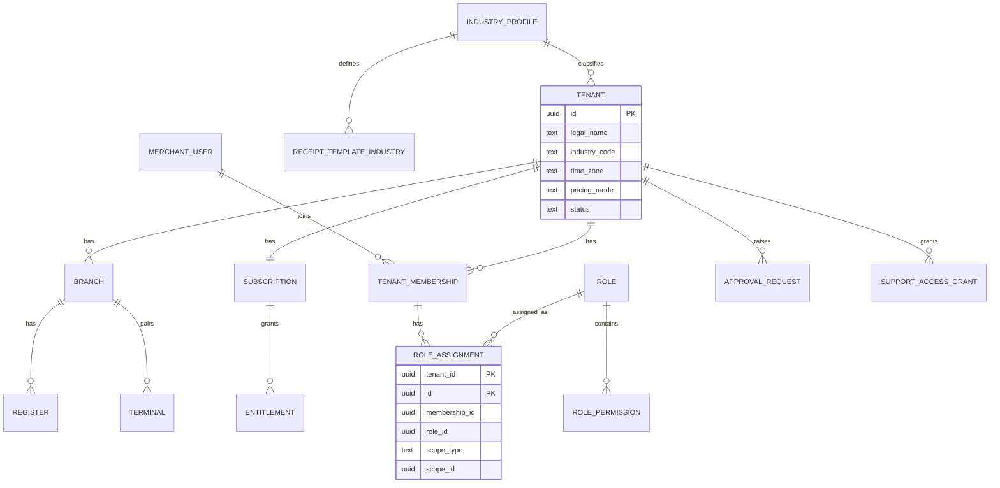
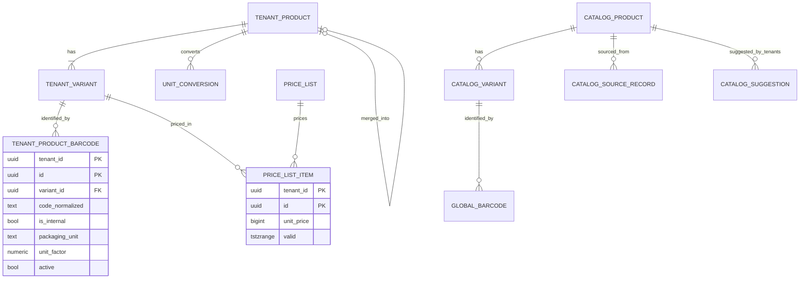
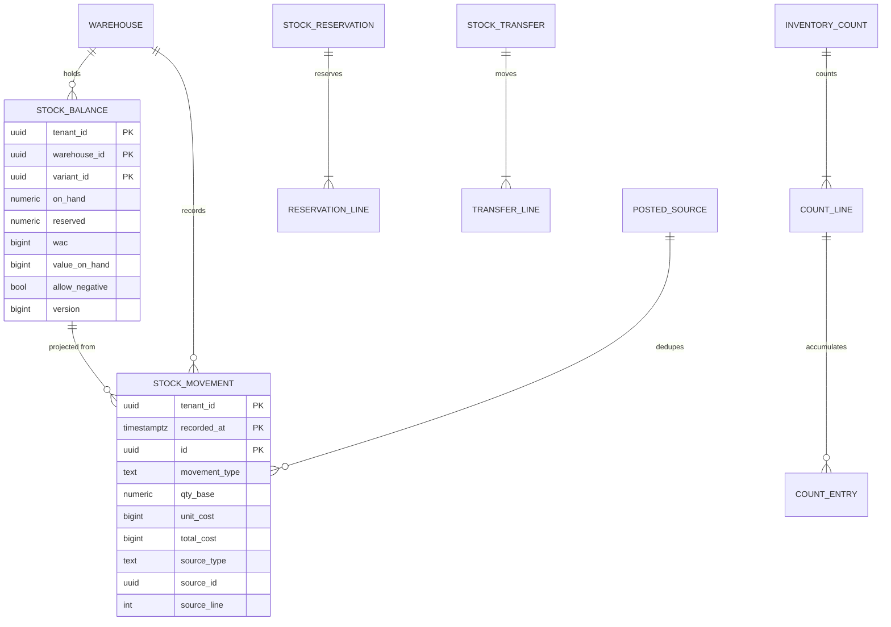
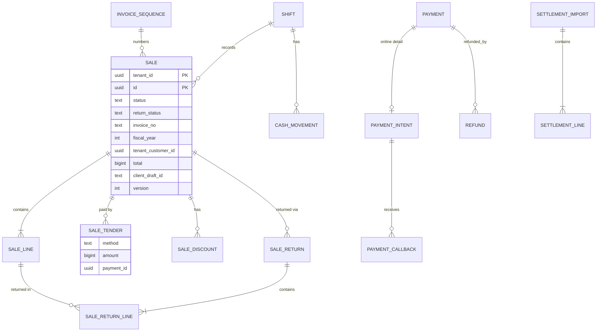
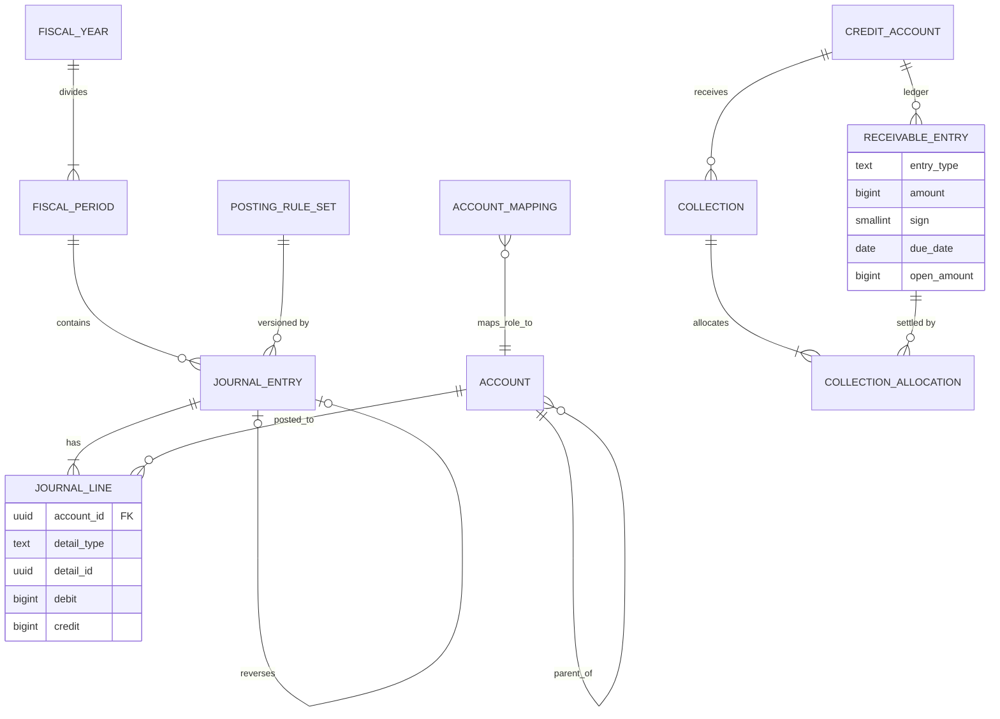
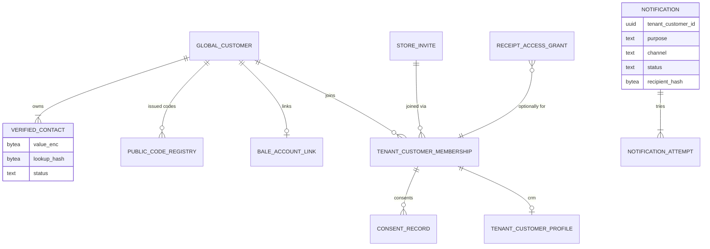
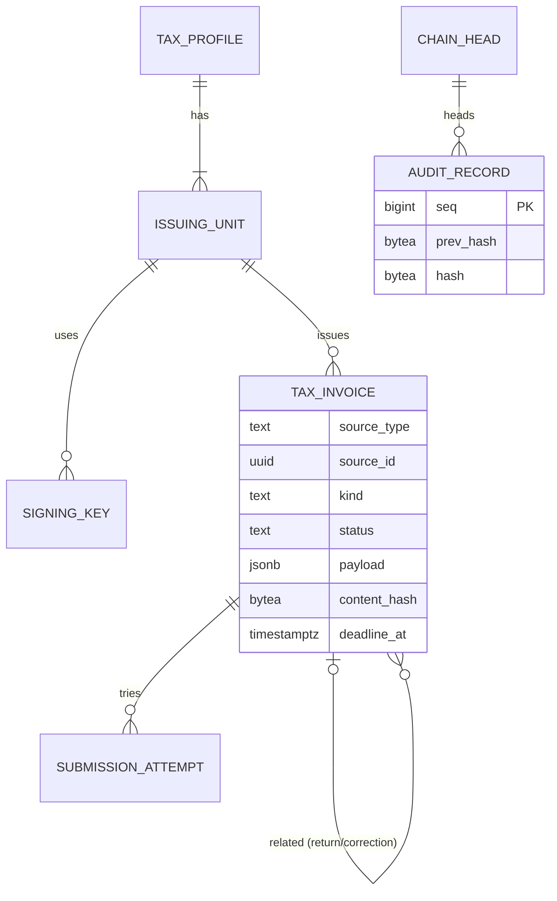

# D05 — طراحی پایگاه داده

> **SQL این سند اجرا و تست شده است.** پوشه [`sql/`](sql/) شامل DDL نمونه برای هسته (Platform، Merchandising، Inventory، Sales، Accounting، Receivables، CustomerIdentity، Tax، Audit) و یک مجموعه **۵۲ بررسی خودکار** است. این بررسی‌ها روی PostgreSQL 16.15 اجرا شدند و همه PASS شدند، به‌علاوه Fitness Function و Self-test آن. **Oracleهای تطبیق** (`91_oracles.sql`؛ D10 §5.13، PM-09) هم با ۵ بررسی (`tests/oracles_test.sql`) PASS شدند: سه ناهنجاری عمدی داده تست را کشف می‌کنند و هیچ مثبت کاذبی ندارند. هدف Production نسخه 17 یا 18 است. هیچ ویژگی مخصوص ۱۷ یا ۱۸ استفاده نشده است.
>
> ```bash
> PGHOST=… PGPORT=… PGUSER=postgres docs/05-data/sql/tests/run_all.sh
> ```
>
> DDL نمونه **مرجع طراحی** است، نه Migration نهایی. Migrationهای واقعی به ازای ماژول و با `RetailCloud.Migrator` اجرا می‌شوند (بخش 11، `[DEC D-96]`)، ولی باید همین قیدها، Triggerها و Policyها را داشته باشند و همین تست‌ها را پاس کنند.

---

## 1. قراردادهای عمومی

| موضوع | قاعده | دلیل |
|---|---|---|
| کلید اصلی جداول Tenant-owned | `PRIMARY KEY (tenant_id, id)` | FK مرکب ارتباط Cross-Tenant را در DB غیرممکن می‌کند (T03). ایندکس پیش‌فرض با `tenant_id` شروع می‌شود. |
| شناسه | `uuid` تولیدشده در Application (UUIDv7 برای ترتیب زمانی و Locality ایندکس) | بدون Round-trip؛ قابل استفاده در Idempotency و Outbox پیش از Insert |
| پول | `bigint` (ریال) | ADR-009 |
| مقدار | `numeric(18,6)` | BR-012 |
| نرخ و درصد | `int` (basis points) | — |
| زمان | `timestamptz` | BR-020 |
| بازه | `tstzrange` با `[)` و Exclusion Constraint | دوره مالی، اعتبار قیمت |
| Enum | `text` + `CHECK (… IN (…))` به جای `CREATE TYPE … AS ENUM` `[DEC D-35]` | افزودن مقدار با Migration ساده و بدون Lock سنگین؛ Rename آسان |
| نام‌گذاری | `snake_case`؛ Schema = ماژول؛ ایندکس `ix_`، Unique `ux_`، Check `ck_`، Trigger `tr_` | — |
| ستون‌های استاندارد | `created_at`، `version` (Optimistic Concurrency) در جداول قابل ویرایش | BR-034 |
| حذف | **حذف نرم برای اسناد مالی ممنوع است** (Reverse/Cancel). برای داده مرجع از `status = Inactive` استفاده می‌شود. حذف فیزیکی فقط با RetentionPolicy (PM-10). | ACC-003، BR-087 |
| JSONB | فقط برای Snapshot، Payload رویداد، ویژگی‌های Variant و جزئیات Audit. هرگز برای داده‌ای که Query یا Constraint کسب‌وکار دارد. | — |
| کدهای خطای سفارشی | `RC0xx` (SQLSTATE کلاس سفارشی) ← نگاشت به `problem+json` در Api | جدول بخش 4 |

---

## 2. Schemaها و مالکیت

| Schema | ماژول | جداول اصلی (✓ = در DDL نمونه پیاده و تست‌شده) | Tenant-scoped |
|---|---|---|---|
| `core` | BuildingBlocks | `current_tenant()` ✓، `enable_tenant_rls()` ✓، `forbid_update_delete()` ✓ | — |
| `platform` | Platform | `tenant` ✓، `branch` ✓، `register` ✓، `terminal`، `subscription`، `entitlement`، `industry_profile` ✓ (Global)، `receipt_template_industry` ✓ (Global، نسخه‌دار)، `integration_key` ✓ (فقط Hash راز؛ INT-001)، `retention_policy` ✓ (Global، نسخه‌دار، فقط‌افزودنی)، `tenant_retention` ✓ (انتخاب فروشگاه، فقط بیشتر از کف)، `legal_hold` ✓، `retention_run` ✓، `tenant_status_change` ✓ (تاریخچه‌ی تعلیق و بستن)، `tax_submission_policy` (Global) | بله، جز Globalها |
| `iam` | IdentityAccess | `merchant_user` (Global: فقط `sub` و پروفایل)، `tenant_membership`، `role`، `role_permission`، `role_assignment` (Scope)، `approval_request`، `support_access_grant`، `pin_credential` | بله، جز `merchant_user` |
| `merch` | Merchandising | `tenant_product` ✓، `tenant_variant` ✓، `tenant_product_barcode` ✓، `unit_conversion`، `price_list` ✓، `price_list_item` ✓، `discount_rule` ✓، `manual_discount_cap` ✓، `weighted_barcode_profile` ✓، `receipt_template_override` ✓، `receipt_template_override` ✓، `weighted_barcode_settings` ✓، `receipt_template_override` | بله |
| `catalog` | Catalog | `catalog_product` ✓، `catalog_variant`، `global_barcode` ✓، `catalog_source_record` ✓ (Cache Provider)، `catalog_suggestion` ✓ (با تصمیم Moderation؛ US-047)، `catalog_review` (ادغام در `catalog_suggestion`)، `provider_health` | **Global** |
| `inv` | Inventory | `warehouse` ✓، `stock_balance` ✓، `stock_movement` ✓ (Partitioned)، `posted_source` ✓، `stock_reservation` ✓، `inventory_count` ✓، `count_line` ✓، `count_entry` ✓، `stock_transfer` ✓، `reorder_point` ✓، `negative_stock_policy` ✓، `stock_adjustment` ✓، `supplier` ✓، `goods_receipt` ✓، `goods_receipt_line` ✓، `supplier_payment` ✓، `purchase_return` ✓، `purchase_return_line` ✓، `cost_layer` (رزرو برای FIFO) | بله |
| `proc` | Procurement | `supplier`، `goods_receipt`، `goods_receipt_line`، `purchase_return`، `supplier_payment` (فعلاً در `inv` پیاده شده‌اند؛ RQ-12) | بله |
| `sales` | Sales | `shift` ✓، `cash_movement`، `invoice_sequence` ✓، `sale` ✓، `sale_line` ✓، `sale_tender` ✓، `receipt_link` ✓ (فقط Hash؛ CUS-009)، `sale_discount`، `sale_return`، `sale_return_line` (Outbox: `core.outbox` ✓، Idempotency: `core.idempotency_record` ✓، مشترک همه ماژول‌ها — US-006) | بله |
| `pay` | Payments | `payment` ✓، `payment_intent`، `payment_callback` (Inbox)، `refund`، `gateway_config`، `settlement_import` ✓، `settlement_line` ✓ | بله |
| `acc` | Accounting | `account` ✓، `account_mapping`، `detail_account`، `fiscal_year`، `fiscal_period` ✓ (بستن یک‌طرفه، RC033)، `journal_entry` ✓، `journal_line` ✓، `posting_rule_set` | بله |
| `ar` | Receivables | `credit_account` ✓، `receivable_entry` ✓، `collection`، `collection_allocation` | بله |
| `cid` | CustomerIdentity | `otp_challenge` ✓ (کد و شماره فقط Hash؛ شماره‌ی رمزشده تا ساخت مشتری)، `store_invite` ✓ (QR پیشخوان؛ قابل ابطال)، `qr_token` ✓ (QR مشتری؛ ۱۲۰ ثانیه، یک‌بار)، `join_request` ✓، `global_customer` ✓، `public_code_registry` ✓، `verified_contact` ✓، `otp_challenge`، `bale_account_link` (Global)؛ `tenant_customer_membership` ✓، `consent_record` ✓، `store_invite`، `receipt_access_grant`، `tenant_customer_profile` (Tenant) | ترکیبی |
| `tax` | TaxCompliance | `tax_profile`، `issuing_unit`، `signing_key`، `tax_invoice` ✓، `submission_attempt` | بله |
| `notif` | Notifications | `notification`، `notification_attempt`، `template`، `template_override` ✓ (نسخه‌دار؛ فقط نام و امضای فروشگاه، NOT-009)، `channel_config` | بله |
| `rpt` | Reporting | Projectionها: `daily_sales`، `stock_value`، `ar_aging`، … | بله |
| `audit` | AuditCompliance | `audit_record` ✓، `chain_head` ✓ | بله |

Outbox و Inbox **مشترک** هستند: `core.outbox` (ستون `producer`؛ `event_type` باید با نام ماژول تولیدکننده شروع شود) و `core.inbox` `(tenant_id, consumer, event_id)`. این جایگزین «جدول به ازای Schema» شد (US-005، اصلاح ADR-013).

---

## 3. ERD

> ERDها **منطقی** هستند. ستون‌های کامل در DDL (`sql/`) آمده‌اند. همه FKهای داخل Schema مرکب با `tenant_id` هستند و برای خوانایی فقط نام رابطه نوشته شده است. **بین Schemaها FK وجود ندارد**؛ ارجاع فقط با شناسه است (خط‌چین در توضیح).

### 3.1 Platform و IAM



`ROLE_ASSIGNMENT.scope_type ∈ {Tenant, Branch, Warehouse, Register}`. اگر `scope_id` تهی باشد، یعنی کل Tenant. `OwnShift` قاعده Runtime است، نه رکورد.

### 3.2 Merchandising و Catalog



`TENANT_PRODUCT.catalog_product_id` ارجاع بدون FK به `catalog.catalog_product` است (کپی هنگام Adopt؛ CAT-005).

### 3.3 Inventory



### 3.4 Sales و Payments



`SALE_TENDER.payment_id` ← `pay.payment.id` (بدون FK؛ بین Schemaها). برای `CustomerCredit` تهی است (D-28) و به `ar.receivable_entry.source_id = sale.id` نگاشت می‌شود.

### 3.5 Accounting و Receivables



### 3.6 CustomerIdentity و Notifications



`NOTIFICATION` آدرس گیرنده را ذخیره **نمی‌کند**. فقط `recipient_hash` نگه داشته می‌شود برای ممیزی (ADR-008).

### 3.7 Tax و Audit



---

## 4. نگاشت Invariantها به سازوکار DB و تست اجراشده

| DI / قاعده | سازوکار DB | تست (`sql/tests/tests.sql`) | کد خطا ← HTTP |
|---|---|---|---|
| BR-001/002 جداسازی | RLS `FORCE` + Policy `tenant_isolation` | T01، T02، T04، T05، T06، T15، T54 | 42501 ← 404 |
| FK Cross-Tenant | FK مرکب `(tenant_id, …)` | T03 | 23503 ← 422 |
| Partition بدون Policy | بدون Grant روی Partition؛ Fitness (2) | T07، Fitness | 42501 |
| DI-080 بارکد یکتا | Unique Partial `WHERE active` | T10 | 23505 ← 409 `barcode-already-assigned` |
| DI-083 قیمت بدون هم‌پوشانی | `EXCLUDE USING gist` | T11 | 23P01 ← 409 |
| DI-031 موجودی منفی | `CHECK (allow_negative OR on_hand - reserved >= 0)` | T12 | 23514 ← 409 `insufficient-stock` |
| BR-032 ثبت دوباره سند | `inv.posted_source` PK؛ Unique Source در `acc` و `ar` | T13، T35 | 23505 ← Idempotent replay یا 409 |
| Ledger append-only | بدون Grant UPDATE/DELETE + Trigger `forbid_update_delete` | T14، T53، T71 | 42501 / RC001 |
| DI-008 یک شیفت باز | Unique Partial | T20 | 23505 ← 409 `shift-already-open` |
| Finalized ⇒ شماره فاکتور | CHECK | T21 | 23514 |
| DI-003 تغییرناپذیری فاکتور | Trigger `guard_finalized_sale/line` | T22–T25 | RC002 ← 409 `sale-finalized` |
| DI-005 مقدار برگشتی | CHECK | T26 | 23514 ← 422 `exceeds-returnable-quantity` |
| DI-001 (سطح قلم) | CHECK `line_total = net + tax` | T28 | 23514 ← 500 (باگ Application) |
| DI-010 Draft آفلاین | Unique `(tenant, client_draft_id)` | T29 | 23505 ← Idempotent |
| DI-040 تراز سند | Constraint Trigger Deferred | T30، T32 | RC010 ← 500 (باگ) + Alert |
| یک‌طرفه بودن سطر | CHECK | T31 | 23514 |
| DI-041 سند Posted | Trigger `guard_entry/line` | T33، T34 | RC012 ← 409 |
| DI-044 Post دوباره | Unique Partial Source | T35 | 23505 |
| DI-042 دوره بسته و بازه | Trigger با `FOR SHARE` روی دوره | T36، T37 | RC013/RC014 ← 409 `period-closed` |
| DI-043 تفصیلی اجباری | Constraint Trigger | T38 | RC011 ← 500 (باگ) |
| دوره بدون هم‌پوشانی | `EXCLUDE` | T39 | 23P01 |
| DI-053 مبلغ باز نسیه | CHECK + Trigger | T40–T43 | 23514 / RC001 |
| DI-060 شماره یکتا | Unique Partial روی Blind Index | T50 | 23505 ← مسیر «ورود به حساب موجود» |
| کد عمومی | CHECK Regex (Crockford) | T51 | 23514 |
| DI-062 عضویت یکتا | Unique | T52 | 23505 ← Idempotent |
| Global مشتری فقط برای App | Grant (بدون دسترسی Reporting و TaxSigner) | T55، Fitness (4) | 42501 |
| ستون‌های حساس مالیاتی | Column-level Grant | T56 | 42501 |
| Hash محتوا | Trigger `guard_invoice` | T60 | RC021 |
| DI-071 محتوای امضاشده | Trigger | T61 | RC020 |
| DI-070 یک صورتحساب زنده | Unique Partial `WHERE status <> 'Superseded'` | T62 | 23505 |
| AUD-002 زنجیره | Trigger `SECURITY DEFINER` + `verify_chain()` | T70، T72–T74 | — |
| NFR-SEC-003 | `90_fitness.sql` | Fitness PASS + Self-test | CI fail |

**قیدهایی که عمداً در DB نیستند** (Domain و تست Integration):
- DI-002: سرشکن تخفیف.
- DI-004: Σ tender = total؛ چون tender و total در مراحل جدا نوشته می‌شوند. **کاندید Constraint Trigger** در `sales.sale` هنگام گذار به Finalized `[REC]`.
- DI-006: Σ refund ≤ total.
- DI-051/052: سقف اعتبار؛ Lock + Domain. CHECK ممکن نیست چون Approval می‌تواند از سقف بگذرد.
- DI-030: `on_hand = Σ movements`؛ PM-09 شبانه.

---

## 5. RLS، نقش‌ها و دسترسی

### 5.1 ماتریس نقش × Schema

| Schema | `rc_app` | `rc_worker` | `rc_reporting` | `rc_tax_signer` |
|---|---|---|---|---|
| platform | SIU | S | S | — |
| merch | SIU | S | S | — |
| inv | SIU (Movement: SI) | S | S | — |
| sales | SIU (+D روی Draft line) | S + U روی outbox | S | — |
| acc | SIU (+D روی Draft) | S | S | — |
| ar | SIU | S | S | — |
| cid (Global) | SIU (consent: SI) | S | **—** | **—** |
| tax | SIU | SIU | S (ستون‌های غیرحساس) | S (۷ ستون) |
| audit | SI | SI + `verify_chain` | S | — |
| rpt | — | SIUD | S | — |

S=SELECT، I=INSERT، U=UPDATE، D=DELETE. همه با RLS، جز Globalها. `rc_migrator` مالک همه است. Login Userها (مثلاً `api_svc_<ttl>`) عضو Group Roleها هستند و Credential کوتاه‌عمر از OpenBao می‌گیرند.

### 5.2 الگوی Policy
```sql
CALL core.enable_tenant_rls('sales.sale');   -- ENABLE + FORCE + policy tenant_isolation
-- USING (tenant_id = core.current_tenant()) WITH CHECK (tenant_id = core.current_tenant())
```
`core.current_tenant()` برای تنظیم‌نشده یا خالی، `NULL` برمی‌گرداند. پس هیچ ردیفی دیده نمی‌شود و هر Insert رد می‌شود (T05، T06).

### 5.3 نکات و استثناها
1. **Partitionها Policy ارث نمی‌برند.** دسترسی فقط از جدول والد است و Grant روی Partition ممنوع است (Fitness بند ۲، T07). Job ساخت Partition هم نباید Grant بدهد.
2. **جداول Global** (`cid.global_customer`، `cid.verified_contact`، `catalog.*`، `platform.industry_profile` و …) RLS ندارند و با Grant محدود شده‌اند. **اصلاح D-31 `[DEC D-36]`:** در MVP، دسترسی به Global مشتری با `rc_app` و `rc_worker` است و مرز ماژول در کد و Architecture Test (DI-064) اعمال می‌شود. نقش DB جدا برای ماژول CID (اتصال یا `SET ROLE` جدا) به P1 موکول شد. دلیل: یک Connection Pool واحد در UoW مشترک.
3. **`SECURITY DEFINER`** فقط در `audit.chain_before_insert()` استفاده شده، با `SET search_path` امن، تا App به `chain_head` دسترسی مستقیم نداشته باشد (T72). هر استفاده دیگر ADR می‌خواهد (ADR-002).
4. **Workerها:** `rc_worker` بدون `BYPASSRLS`. هر کار `SET LOCAL app.tenant_id` می‌کند. Relay Outbox برای پیدا کردن کارها به ازای همه Tenantها از یک تابع `SECURITY DEFINER` محدود به نام `core.pending_outbox_tenants()` استفاده می‌کند که **فقط فهرست tenant_id** را برمی‌گرداند `[DEC D-37]`، و سپس هر Tenant را جدا با Context پردازش می‌کند. **پیاده‌سازی و تست شد** (`91_oracles.sql`): `core.list_tenant_ids()` متعلق به نقش `rc_tenant_directory` است. این **تنها** نقش غیر Superuser با `BYPASSRLS` است و فقط به ستون‌های `id` و `status` جدول `platform.tenant` دسترسی دارد. Fitness بند ۵ این را کنترل می‌کند. `core.run_oracles()` با نقش `rc_worker` هر Tenant را با Context خودش بررسی می‌کند.
5. **TaxSigningService:** با `rc_tax_signer`، `tenantId` را از درخواست Worker می‌گیرد، Context را تنظیم می‌کند و می‌خواند. اگر فاکتور در آن Tenant نباشد، چیزی یافت نمی‌شود. پس کلید همان Tenant با محتوای همان Tenant جفت می‌شود (ADR-011).
6. **Migration داده (Data Migration)** با `FORCE RLS`، حتی برای مالک، فقط به ازای Tenant و با Context انجام می‌شود. برای عملیات اضطراری نقش `rc_maintenance` با `BYPASSRLS` وجود دارد که **NOLOGIN است و فقط با Break-glass دونفره** فعال می‌شود، با ممیزی جدا `[DEC D-38]`.
7. **Reporting Replica:** RLS روی Replica هم اعمال می‌شود (همان Catalog). Projectionهای `rpt` هم `tenant_id` و RLS دارند.

---

## 6. راهبرد ایندکس

**قواعد:**
1. هر ایندکس روی جدول Tenant-owned با `tenant_id` شروع می‌شود.
2. ایندکس Partial برای صف‌ها و وضعیت‌های فعال (`WHERE published_at IS NULL`، `WHERE status IN (…)`).
3. ایندکس جدید روی جدول بزرگ فقط با `CREATE INDEX CONCURRENTLY` در Migration جدا (بخش 11).
4. هر Query تعاملی Plan تست‌شده دارد (Integration Test با `EXPLAIN` روی داده حجیم مصنوعی برای ۵ Query داغ).

| Query داغ | ایندکس |
|---|---|
| Lookup بارکد (POS) | `ux_barcode_active (tenant_id, code_normalized) WHERE active` |
| قیمت معتبر Variant | Exclusion GiST `(tenant_id, price_list_id, variant_id, valid)` (برای Lookup هم استفاده می‌شود) |
| جستجوی نام کالا | `pg_trgm` GIN روی `normalized_name` (ستون تولیدشده با نرمال‌سازی فارسی CAT-011) `[REC]` |
| موجودی Variant | PK `stock_balance (tenant_id, warehouse_id, variant_id)` |
| کاردکس | `ix_movement_variant (tenant_id, variant_id, warehouse_id, recorded_at)` |
| فاکتورهای باز و منقضی | `ix_sale_open … WHERE status IN ('Draft','Held','PendingPayment')` |
| سابقه خرید مشتری در Tenant | `ix_sale_customer … WHERE tenant_customer_id IS NOT NULL` |
| فاکتورهای نسیه باز | `ix_ar_open_charges … WHERE entry_type='Charge' AND open_amount > 0` |
| صف Outbox | `ix_outbox_pending (next_attempt_at, id) WHERE published_at IS NULL` |
| صف مؤدیان | `ix_tax_queue (status, deadline_at) WHERE status IN (…)` |
| گردش حساب | `ix_journal_line_account (tenant_id, account_id)` + Join به entry با effective_at (در P1: ستون `effective_at` Denormalized در line) |

---

## 7. Partitioning

| جدول | کلید | دانه‌بندی | مدیریت | بایگانی |
|---|---|---|---|---|
| `inv.stock_movement` | `recorded_at` (RANGE) | ماهانه | Job داخلی (Workers) هر ماه Partitionهای ۳ ماه آینده را می‌سازد. Partition `DEFAULT` به‌عنوان Safety Net با Alert اگر ردیف بگیرد. | پس از بسته شدن دو سال مالی: `DETACH` ← Export به Parquet در Object Storage ← نگهداری طبق RetentionPolicy |
| `acc.journal_line` و `acc.journal_entry` | `effective_at` | سالانه (سال مالی) | — | — |
| `audit.audit_record` | `occurred_at` | ماهانه | — | WORM Object Storage |
| `{schema}.outbox` و `inbox` | `occurred_at` | روزانه یا هفتگی | `DROP PARTITION` بعد از ۷ روز (ADR-013) | — |
| `notif.notification_attempt` | `created_at` | ماهانه | — | ۶ ماه |
| `sales.sale` و `sale_line` | — (MVP) | — | **Partition نمی‌شود تا حجم واقعی** `[DEC D-39]` | — |

**محدودیت مهم:** در جدول Partitioned، Unique Constraint باید کلید Partition را داشته باشد. برای همین Idempotency سندی گردش انبار در جدول غیرPartitioned `inv.posted_source` است (T13)، به جای Unique روی `(source_type, source_id, source_line)` در خود Movement. اگر `acc.journal_entry` پارتیشن شود، همین مشکل پیش می‌آید: `ux_journal_source` شامل `effective_at` نیست و دیگر ممکن نیست. **راه‌حل:** همان الگوی `posted_source` برای `acc` در زمان Partition (BQ-02).

---

## 8. برآورد حجم (بر پایه NFR-CAP-001)

فرض: ۱۰۰ Tenant، ۶۰۰ صندوق، میانگین روزانه (نه Peak) ۴۰۰ فروش به ازای صندوق ≈ **۲۴۰٬۰۰۰ فروش در روز** `[ASM A-27]`، با ۱۵ قلم.

| جدول | ردیف در روز | ردیف در سال | اندازه تقریبی سالانه (با ایندکس) |
|---|---|---|---|
| `sales.sale` | ۲۴۰ هزار | ۸۸ میلیون | حدود ۴۰ GB |
| `sales.sale_line` | ۳٫۶ میلیون | ۱٫۳ میلیارد | حدود ۶۰۰ GB (snapshot jsonb غالب است) |
| `inv.stock_movement` | ۳٫۶ میلیون | ۱٫۳ میلیارد | حدود ۳۵۰ GB |
| `acc.journal_line` | حدود ۱٫۵ میلیون (۲ سند × حدود ۳ سطر) | ۵۵۰ میلیون | حدود ۱۰۰ GB |
| `audit.audit_record` | حدود ۵۰۰ هزار | ۱۸۰ میلیون | حدود ۸۰ GB |
| `tax.tax_invoice` | ۲۴۰ هزار | ۸۸ میلیون | حدود ۱۲۰ GB (payload) |

**پیامدها:**
- (۱) `sale_line.snapshot` در جدول جدا با فشرده‌سازی (`lz4` TOAST) یا فیلدهای ستونی به جای JSONB کامل (BQ-01).
- (۲) Partitioning `sale_line` در سال اول محتمل است (بازبینی D-39 پس از پایلوت).
- (۳) سخت‌افزار DB: NVMe، دست‌کم ۲ TB برای سال اول با Headroom.
- (۴) با ۱٬۰۰۰ Tenant، اعداد ×۱۰ می‌شوند. Partitioning کامل و Replica چندگانه لازم است و Sharding بر اساس Tenant (Citus یا DB به ازای گروه Tenant) معیار بازنگری ADR-002 است.

---

## 9. نگهداری و بایگانی (پیاده‌سازی BR-087)

| دسته داده (`RetentionPolicy.category`) | جداول | سازوکار پایان دوره | کف پیش‌فرض پلتفرم (تا تأیید حقوقی) |
|---|---|---|---|
| `FinancialDocuments` | acc.*، sales.sale*، ar.*، proc.* | بایگانی سرد (Detach + Parquet)؛ **حذف فقط پس از کف قانونی** | ۱۰ سال |
| `TaxInvoices` | tax.* | همان | ۱۰ سال |
| `InventoryLedger` | inv.stock_movement | بایگانی سرد | ۱۰ سال |
| `Audit` | audit.* | WORM | ۱۰ سال |
| `CustomerCrm` | cid.tenant_customer_profile، consent_record | ناشناس‌سازی: `tenant_customer_id` در اسناد مالی می‌ماند و پروفایل حذف می‌شود | ۲ سال پس از آخرین فعالیت |
| `CustomerIdentity` | cid.verified_contact و … | درخواست حذف ← `status=Anonymized`، `value_enc` حذف، `lookup_hash` حذف | با درخواست + ۳۰ روز |
| `Notifications` | notif.* | حذف | ۶ ماه |
| `TechnicalLogs` | Loki | حذف | ۹۰ روز |
| `Idempotency/Outbox/Inbox` | — | حذف | ۷ روز |

**Legal Hold:** جدول `platform.legal_hold (tenant_id, category, reason, until)` که PM-10 پیش از هر حذف بررسی می‌کند.

**پیاده‌سازی (US-173):** کف و پیش‌فرض هر دسته در `platform.retention_policy` (نسخه‌دار؛ نسخه‌ی بعدی با `valid_from`)؛ فروشگاه فقط با `platform.tenant_retention` بیشتر از کف نگه می‌دارد (`RC036` برای کمتر). اپراتور Legal Hold را فقط با `platform.set_legal_hold` / `release_legal_hold` می‌گذارد و برمی‌دارد. نگهبان `platform.retention_delete_guard` (BEFORE DELETE) هر حذفی را که داخل مدت اعمال‌شده یا زیر Legal Hold باشد با `RC036` رد می‌کند؛ Job شبانه‌ی Workers (`RetentionJob`) پیامک‌های پایان‌یافته‌ی قدیمی را حذف و هر اجرا را در `platform.retention_run` ثبت می‌کند. دسته‌های بایگانی‌شونده (اسناد مالی، صورتحساب، گردش انبار، ممیزی) فعلاً Job حذف ندارند و فقط نگهبان برای آن‌ها آماده است.

---

## 10. نقشه حفاظت داده (Data Protection Map)

| داده | محل | طبقه | حفاظت | نمایش |
|---|---|---|---|---|
| شماره موبایل مشتری | `cid.verified_contact.value_enc` | PII-High | Envelope Encryption (DEK به ازای رکورد یا ماه، KEK در OpenBao Transit) + Blind Index HMAC | Masked؛ کامل فقط با `customers.pii.view` و ممیزی |
| کد ملی و شناسه اقتصادی خریدار نسیه | `ar.credit_account.credit_identity_enc` | PII-High | همان | فقط `credit.account.manage` |
| شناسه خریدار در فاکتور (BuyerTaxInfo) | `sales.sale` (ستون رمز)، `tax.tax_invoice.payload` | PII-High | رمز در Sales؛ در payload مالیاتی (الزام قانونی) با Column Grant | فقط Tax و Accountant |
| chatId بله | `cid.bale_account_link` | PII-Med | رمز | هرگز |
| کد عمومی مشتری | `cid.global_customer.public_code` | Identifier | — | به خود مشتری و صندوق (پس از Lookup مجاز) |
| اعتبارنامه PSP، توکن بله، کلید SMS | OpenBao KV | Secret | **هرگز در DB** | — |
| کلید امضای مالیاتی | OpenBao Transit | Secret-Critical | غیرقابل استخراج | — |
| OTP | `cid.otp_challenge.code_hash` | Secret | Hash (HMAC) + TTL | — |
| PIN صندوق‌دار | `iam.pin_credential` | Secret | Argon2id | — |
| مبالغ و اسناد | acc، sales، … | Confidential-Tenant | RLS + TLS + رمز دیسک | طبق مجوز |
| Audit details | `audit.audit_record.details` | Confidential | بدون PII خام (AUD-003)؛ Scrubber | `audit.view` |

---

## 11. راهبرد Migration

### 11.1 ابزار و سازمان
- **Migration با فایل‌های SQL نسخه‌دار به ازای ماژول** `[DEC D-96]` (US-004): فهرست مرتب گام‌ها در `sql/migrations.json` (ماژول، شناسه `NNNN_name`، فایل). تاریخچه هر ماژول در Schema خودش است: `sales.migration_history` (شناسه، Checksum SHA-256، زمان، اجراکننده، مدت).
- **اجراکننده `RetailCloud.Migrator`** (پروژه جدا؛ Api و Workers به آن ارجاع ندارند و هرگز Migration اجرا نمی‌کنند؛ تست معماری R11):
  - هر گام در یک تراکنش، همراه با ثبت تاریخچه‌اش؛ `lock_timeout = 3s` با ۳ بار تلاش و `statement_timeout = 5min`.
  - فقط یک اجراکننده در هر لحظه (Advisory Lock).
  - توقف اگر: فایل گامِ اجراشده تغییر کرده باشد (Checksum)؛ گامی در DB باشد که در فهرست نیست؛ یا ترتیب به هم خورده باشد.
  - گامی که خط اولش `-- rc:no-transaction` است بیرون از تراکنش اجرا می‌شود (`CREATE INDEX CONCURRENTLY`).
  - پس از اجرا، Fitness (`90_fitness.sql`) باید خالی باشد؛ وگرنه خروج با کد ۲.
- **نقش‌ها:** بخش Superuser (`00_bootstrap_superuser.sql`: نقش‌ها، Extensionها، Schemaها) یک بار برای هر DB با `--bootstrap`. اجرای عادی با یک Login **غیر Superuser** که عضو `rc_migrator` و `rc_tenant_directory` است. واگذاری مالکیت تابع به `rc_tenant_directory` به `CREATE` روی Schema نیاز دارد؛ این مجوز فقط برای همان دستور داده و در همان تراکنش پس گرفته می‌شود (Fitness قاعده ۶).
- **CI** (`scripts/check-migrations.sh`): اجرای Migrator با Login غیر Superuser روی DB خالی؛ `pg_dump` آن باید با Schema مرجع (اجرای مستقیم فایل‌ها) **یکسان** باشد؛ اجرای دوم باید بی‌اثر باشد؛ سپس Fitness و `tests.sql`.
- فایل‌های SQL همراه باینری Migrator منتشر می‌شوند، پس هر Release دقیقاً همان Migrationهایی را اجرا می‌کند که با آن ساخته شده است.
- **تا اولین Release تولیدی**، گام‌های `0001_baseline` هنوز ویرایش می‌شوند (DBهای توسعه از نو ساخته می‌شوند). پس از آن، هر تغییر یک گام جدید است.
- ترتیب اجرا: `core` ← `platform` ← `iam` ← سایر ماژول‌ها به ترتیب وابستگی منطقی (Migrationها بین Schemaها FK ندارند، پس ترتیب فقط برای `core` مهم است).

### 11.2 قواعد Zero-downtime (Expand/Contract)
| تغییر | روش مجاز |
|---|---|
| افزودن ستون | `NULL` یا با `DEFAULT` ثابت (در PG 11+ بدون Rewrite) |
| ستون `NOT NULL` جدید | Expand: افزودن nullable ← Backfill دسته‌ای به ازای Tenant ← `CHECK … NOT VALID` ← `VALIDATE CONSTRAINT` ← `SET NOT NULL` |
| تغییر نام ستون | ستون جدید + نوشتن دوگانه + Backfill + خواندن از جدید + حذف قدیم در Release بعد |
| تغییر نوع | همان الگوی ستون جدید |
| ایندکس | `CREATE INDEX CONCURRENTLY` در Migration جدا با `suppressTransaction` |
| FK جدید روی جدول بزرگ | `NOT VALID` و سپس `VALIDATE` |
| افزودن مقدار به Enum (text+CHECK) | `DROP CONSTRAINT` + `ADD CONSTRAINT … NOT VALID` + `VALIDATE` |
| حذف ستون یا جدول | فقط یک Release بعد از توقف استفاده (Contract) |

- همه Migrationها `SET lock_timeout = '3s'` و `statement_timeout` دارند و با Retry اجرا می‌شوند. Migration طولانی‌تر از ۵ دقیقه ممنوع است و به Job Backfill تبدیل می‌شود.
- **Backward Compatibility:** نسخه N و N-1 کد باید با Schema نسخه N کار کنند (Rolling Deploy).

### 11.3 Rollback
- **رو به جلو ترجیح دارد:** خطای Migration با Migration اصلاحی جدید رفع می‌شود.
- هر Migration بخش `Down` دارد، ولی برای تغییرات داده‌ای Down فقط اگر بی‌خطر باشد. در غیر این صورت `Down` خطا می‌دهد و Runbook اجرا می‌شود (بازگشت به Snapshot یا PITR در بدترین حالت).
- قبل از هر Migration در Production، یک Backup نقطه‌ای (pgBackRest Incremental) و برچسب LSN گرفته می‌شود.

### 11.4 تست Migration
- CI: (۱) اعمال همه Migrationها روی DB خالی (Testcontainers)؛ (۲) اعمال روی Snapshot ناشناس‌شده Staging؛ (۳) Fitness و `tests.sql`؛ (۴) تست Rolling: اجرای Integration Tests نسخه N-1 روی Schema نسخه N.

### 11.5 داده اولیه (Seed)
- **Global:** IndustryProfileها (سوپرمارکت، پوشاک، عمومی)، قالب فاکتور صنف، RetentionPolicy پیش‌فرض، TaxSubmissionPolicy، نقش‌ها و مجوزهای سیستمی.
- **به ازای Tenant (در ثبت‌نام، TEN-001.1):** شجره حساب پیش‌فرض صنف، AccountMapping نقش‌ها، سال و دوره مالی جاری، شعبه، انبار و صندوق اول، Price List پیش‌فرض.
- Seed نسخه‌دار و Idempotent است (`ON CONFLICT DO NOTHING` با کلید طبیعی).

---

## 12. فرضیات، تصمیم‌ها و پرسش‌های باز

| ID | نوع | شرح |
|---|---|---|
| A-27 | ASM | میانگین روزانه ۴۰۰ فروش به ازای صندوق برای برآورد حجم |
| A-28 | ASM | `pg_trgm` و `btree_gist` در زیرساخت داخلی قابل نصب‌اند (Extensionهای استاندارد contrib) |
| A-29 | ASM | EF Core (نسخه همراه .NET LTS جاری) و Npgsql پشتیبانی کامل `tstzrange` و `jsonb` را دارند (Verification در Spike) |
| D-35 | DEC | Enum با `text + CHECK` |
| D-36 | DEC | اصلاح D-31: دسترسی Global مشتری با Grant در MVP؛ نقش جدا P1 |
| D-37 | DEC | Relay Outbox با تابع محدود فهرست Tenantها |
| D-38 | DEC | نقش `rc_maintenance` با BYPASSRLS فقط Break-glass |
| D-39 | DEC | Partition نکردن `sale` و `sale_line` در MVP |
| D-40 | DEC | الگوی ثبت سند: Insert Draft ← Lines ← Update Posted، با بررسی Deferred در Commit |
| D-41 | DEC | `inv.posted_source` برای Idempotency سندی روی Ledger پارتیشن‌شده |
| D-42 | DEC | زنجیره Audit با Trigger در DB (نه در Application) تا Caller نتواند seq یا hash را تعیین کند |
| D-96 | DEC | Migration با SQL نسخه‌دار و `RetailCloud.Migrator`، نه EF Core Migrations: بخش اصلی Schema (RLS، Policy، Trigger، تابع SECURITY DEFINER، Grant) در EF مدل‌پذیر نیست و D05 آن را از قبل با `migrationBuilder.Sql` از همین فایل‌ها می‌خواست؛ EF Core برای دسترسی به داده (A-01) بدون تغییر می‌ماند. Schema حاصل در CI با DDL مرجع مقایسه می‌شود (US-004). **تأیید کارفرما 2026-11-23** |
| D-97 | DEC | Entitlementها (TEN-003) در DB اعمال می‌شوند: Trigger از نوع AFTER روی `platform.branch`، `platform.register` و `iam.tenant_membership` با قفل Advisory به ازای Tenant و منبع (دو درخواست هم‌زمان آخرین ظرفیت را با هم نمی‌گیرند و هیچ مسیر کدی آن را دور نمی‌زند). تنها وابستگی DB بین ماژول‌ها همین OHS پلتفرم است. کد خطا `RC030` سراسری است و مرکزی به 403 نگاشت می‌شود؛ RC001–RC029 محلی‌اند (فهرست در `01_core.sql`). پلن‌ها داده سراسری `platform.plan`، نامحدود = NULL؛ Tenant بدون اشتراک هیچ ظرفیتی ندارد (Fail-closed) |
| D-98 | DEC | فقط‌خواندنی (TEN-004): دلیل در DB (`platform.read_only_reason()`: تعلیق، بسته، پایان دوره آزمایشی) و اعمال در API با فیلتر پیش‌فرض‌ممنوع برای همه نوشتن‌ها؛ استثناها فقط با `x-allowed-when-read-only` در D07 (تست هم‌خوانی). App هرگز `status` فروشگاه را تغییر نمی‌دهد (فقط ستون‌های `TenantUpdate` قابل ویرایش‌اند)، پس فروشگاه نمی‌تواند تعلیق خودش را بردارد. Workers (صف مؤدیان) از این فیلتر عبور نمی‌کنند |
| BQ-01 | OQ | ذخیره Snapshot قلم: JSONB یا ستون‌های صریح؟ (اثر حجم) — Default: ستون‌های صریح برای فیلدهای مالیاتی و JSONB کوچک برای بقیه |
| BQ-02 | OQ | Partitioning اسناد حسابداری در سال اول یا بعد از رسیدن به آستانه؟ |
| BQ-03 | OQ | آیا Restore یک Tenant منفرد (نه کل DB) الزام قراردادی است؟ اگر بله: ابزار Export و Import منطقی به ازای Tenant در P0 |
| BQ-04 | OQ | Constraint Trigger برای DI-004 (Σ tender = total) در DB هم اضافه شود؟ — Default: بله (`[REC]`) |
