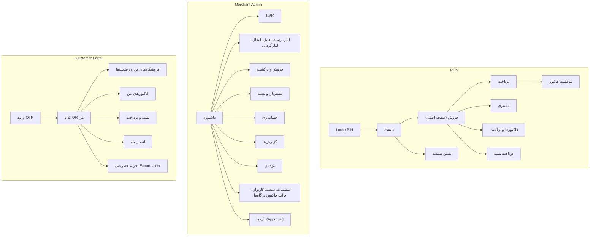

# D09 — مشخصات تجربه کاربری و Wireframe

> **نحوه خواندن Wireframeها.** طرح‌واره‌ها ASCII هستند و برچسب‌هایشان انگلیسی است، چون متن فارسی در فونت Monospace جابه‌جا می‌شود. **همه صفحات RTL هستند:** آنچه در طرح‌واره «سمت راست» آمده، در UI واقعی **شروع خط (Start)** است. متن فارسی هر صفحه در جدول Copy همان صفحه آمده است. این سند «Figma-ready» است: Tokenها (بخش 4) نام Variable در Figma دارند، کامپوننت‌ها (بخش 5) نام Component دارند و قاب‌ها (بخش 3) اندازه مشخص دارند.

---

## 1. اصول تجربه

| # | اصل | معیار سنجش |
|---|---|---|
| UX-P1 | **صندوق اول**: کمترین لمس در مسیر فروش | فروش تک‌قلم نقدی ≤ **۴ لمس** پس از اسکن (KPI-06)؛ فروش ۵ قلمی ≤ ۹ لمس (اسکن پیوسته = بدون لمس اضافه) |
| UX-P2 | **صداقت وضعیت** (PRD-PR-2) | هیچ صفحه «موفق» بدون پاسخ سرور؛ «ارسال شد» ≠ «تحویل شد»؛ وضعیت آفلاین همیشه دیده می‌شود |
| UX-P3 | **خطای قابل اقدام** | هر خطا: پیام فارسی + اقدام بعدی + `traceId` قابل کپی (NFR-UX-004) |
| UX-P4 | **RTL واقعی** | آینه شدن چیدمان؛ ارقام و کدها با Bidi Isolation؛ بدون متن شکسته |
| UX-P5 | **حداقل داده و حریم خصوصی در UI** | شماره و نام مشتری Masked؛ بهای خرید فقط برای نقش مجاز؛ هیچ PII در Toast یا Notification سیستم‌عامل |
| UX-P6 | **عملیات حساس آگاهانه** | Confirm برای مخرب‌ها؛ Approval با هویت مدیر؛ دلیل اجباری برای تعدیل و برگشت |
| UX-P7 | **سرعت ادراکی** | Skeleton به جای Spinner؛ پاسخ لمس < ۱۰۰ms (Optimistic فقط برای افزودن قلم به سبد، نه برای Finalize) |

---

## 2. کاربران و زمینه استفاده

| Persona (D01) | دستگاه | محیط | پیامد طراحی |
|---|---|---|---|
| رضا — صندوق‌دار | گوشی یا تبلت روی پایه + بارکدخوان USB/BT | ایستاده، صف، نور متغیر، دست‌ها مشغول | دکمه‌های بزرگ (≥ ۵۶px برای اقدام اصلی)، اسکن پیوسته، بازخورد صوتی و لرزشی، حالت یک‌دستی |
| سارا — انباردار | گوشی | انبار، دور از Wi-Fi، دستکش | اسکن با Torch، ورود مقدار با Numpad بزرگ، تحمل آفلاین در شمارش (صف محلی Entryها) |
| مریم — صاحب فروشگاه | گوشی + لپ‌تاپ | خارج از فروشگاه | داشبورد خلاصه موبایل، Approval از راه دور |
| علی — حسابدار | دسکتاپ | دفتر | جداول متراکم، صفحه‌کلید، Export |
| نگار — مدیر بوتیک | تبلت | فروشگاه | ماتریس رنگ × سایز، برگشت و تعویض |
| مشتری | گوشی شخصی | پیشخوان، عجله | جریان عضویت ≤ ۶۰ ثانیه؛ بدون نصب اپ؛ متن کوتاه |

---

## 3. پلتفرم‌ها، قاب‌ها و Breakpointها

| اپ | قاب مرجع Figma | Breakpointها | جهت‌گیری |
|---|---|---|---|
| POS | `POS/Mobile 390×844`، `POS/Tablet 1024×768`، `POS/Desktop 1440×900` | `<600` تک‌ستونی؛ `600–1023` دوستونی (سبد کنار کاتالوگ)؛ `≥1024` سه‌ناحیه | Portrait (موبایل)، Landscape (تبلت/دسکتاپ) |
| Merchant Admin | `Admin/Desktop 1440×900`، `Admin/Mobile 390×844` | `<768` منوی پایینی؛ `≥768` Sidebar راست | — |
| Customer Portal | `Portal/Mobile 390×844` | تک‌ستونی تا ۶۴۰px؛ بزرگ‌تر = Card مرکزی ۴۸۰px | Portrait |
| Platform Admin | `Platform/Desktop 1440×900` | فقط دسکتاپ | — |
| فاکتور چاپی | `Receipt/80mm (576px @ 203dpi)`، `Receipt/A4` | — | — |

---

## 4. Design Tokens (Figma Variables)

### 4.1 رنگ (Semantic؛ Light / Dark)

| Variable | Light | Dark | کاربرد |
|---|---|---|---|
| `color/bg/canvas` | `#F7F8FA` | `#0F1115` | پس‌زمینه |
| `color/bg/surface` | `#FFFFFF` | `#181B21` | کارت، شیت |
| `color/text/primary` | `#14171C` | `#ECEEF2` | متن اصلی |
| `color/text/secondary` | `#4A5260` | `#A9B0BC` | متن کمکی |
| `color/border/default` | `#D9DDE3` | `#2C313A` | جداکننده |
| `color/action/primary` | `#0B5FD7` | `#5B9BFF` | دکمه اصلی (پرداخت، تأیید) |
| `color/status/success` | `#137333` | `#5DD37E` | پرداخت تأییدشده |
| `color/status/warning` | `#8A5A00` | `#F2B84B` | هشدار (موجودی کم، مهلت مؤدیان) |
| `color/status/danger` | `#B3261E` | `#FF8A80` | خطا، حذف، کسری |
| `color/status/offline` | `#5B3A8C` | `#C3A6F2` | بنر آفلاین (عمداً متمایز از خطا) |
| `color/focus/ring` | `#0B5FD7` | `#9CC3FF` | حلقه فوکوس ۲px |

همه جفت‌های متن و پس‌زمینه کنتراست ≥ ۴٫۵:۱ (متن عادی) و ≥ ۳:۱ (اجزای UI) دارند و پیش از Gate F با ابزار وارسی می‌شوند. **رنگ هرگز تنها حامل معنا نیست**؛ همیشه با آیکون و متن همراه است.

### 4.2 تایپوگرافی

| Variable | اندازه/ارتفاع خط | وزن | کاربرد |
|---|---|---|---|
| `type/display` | 28/36 | 700 | جمع کل در POS |
| `type/title` | 20/28 | 700 | عنوان صفحه |
| `type/body` | 16/26 | 400 | متن اصلی (حداقل ۱۶ در موبایل) |
| `type/label` | 14/20 | 500 | برچسب فرم |
| `type/caption` | 12/18 | 400 | توضیح، زمان |
| `type/money-lg` | 24/32 | 700 | مبلغ در شیت پرداخت |

**فونت:** Vazirmatn (مجوز SIL OFL 1.1)، Self-hosted (بدون CDN خارجی، A-02). برای ستون‌های عددی از ارقام هم‌عرض (Tabular) استفاده می‌شود، اگر فونت پشتیبانی کند (UQ-01). در غیر این صورت، کانتینر عددی با عرض ثابت.

### 4.3 فاصله، شعاع، اندازه لمس

| Variable | مقدار |
|---|---|
| `space/1..8` | 4، 8، 12، 16، 20، 24، 32، 48 |
| `radius/sm, md, lg` | 6، 10، 16 |
| `size/touch/min` | **44** (همه اجزای تعاملی) |
| `size/touch/pos-primary` | **56** (پرداخت، Finalize، Numpad) |
| `elevation/sheet` | سایه ۲ لایه؛ در Dark فقط تغییر روشنایی Surface |

---

## 5. فهرست کامپوننت‌ها (Figma Components)

| Component | Variantها | رفتار کلیدی | ارجاع |
|---|---|---|---|
| `AppShell` | POS / Admin / Portal | TopBar + Content + (Sidebar یا BottomNav) | — |
| `ConnectivityIndicator` | Online / Degraded / Offline / Syncing | همیشه در TopBar؛ Offline = بنر تمام‌عرض بنفش | SAL-013 |
| `ScannerView` | Camera / Hardware-only | اسکن پیوسته، Torch، قاب هدف، Debounce ۱٫۵s، Beep و Vibrate اختیاری، Fallback ورود دستی | SAL-002 |
| `CartLine` | Normal / Weighted / Discounted / Shortage / ReturnedQty | لمس = ویرایش؛ Swipe (و دکمه جایگزین) = حذف | — |
| `CartSummary` | Collapsed (موبایل) / Expanded | جمع، تخفیف، مالیات، **جمع کل `type/display`** | BR-015 |
| `QuantityStepper` | — | − / مقدار / + ؛ ورود مستقیم با Numpad | — |
| `Numpad` | Money / Quantity / PIN | ارقام فارسی؛ کلید «۰۰۰» برای مبلغ | — |
| `MoneyText` / `MoneyInput` | IRR / IRT | `<bdi>`، جداکننده هزارگان، واحد صریح | BR-011 |
| `TenderSheet` | Cash / Card / Online / Credit / Split | مبلغ باقیمانده در بالا؛ دکمه‌های مبلغ پیشنهادی | SAL-006 |
| `CustomerChip` | Member / NotMember / Credit | نام Masked؛ نشان «نسیه» با اعتبار قابل استفاده (با مجوز) | BR-061 |
| `QrDisplay` | CustomerQR / PaymentQR / StoreInvite | شمارش معکوس؛ تولید مجدد خودکار | CUS-005 |
| `ApprovalDialog` | OnDevice / Remote | نمایش شرط (سقف و مقدار)؛ PIN و MFA مدیر | IAM-007 |
| `ProblemBanner` / `ProblemToast` | Error / Warning / Info | پیام از جدول 10.1، اقدام، `traceId` | UX-P3 |
| `StatusBadge` | وضعیت‌های Sale، Payment، Tax، Notification | متن + رنگ + آیکون | — |
| `EmptyState` | با یا بدون اقدام | تصویر ساده + یک جمله + یک دکمه | — |
| `Skeleton` | List / Card / Table | — | — |
| `DataTable` | Dense / Comfortable | مرتب‌سازی، فیلتر، صفحه‌بندی Cursor، Export | — |
| `JalaliDateRangePicker` | Presets (امروز، دیروز، این ماه، فصل جاری) | ذخیره UTC | BR-023 |
| `ConfirmDialog` | Normal / Destructive (Typed) | مخرب: تایپ کلمه تأیید برای بستن دوره و سوخت مطالبات | UX-P6 |
| `Wizard` | Steps | ذخیره پیشرفت؛ بازگشت مجاز | UC-10 |
| `ConsentToggle` | Operational / Marketing | متن هدف، نسخه سیاست، لینک جزئیات | BR-063 |

---

## 6. معماری اطلاعات و ناوبری



**ناوبری POS:** هیچ منوی همبرگری در صفحه فروش نیست. اقدامات ثانویه در یک دکمه «بیشتر» در TopBar هستند. **Admin:** Sidebar در دسکتاپ (سمت راست در RTL)؛ BottomNav پنج‌تایی در موبایل (داشبورد، کالا، فروش، تأییدها، بیشتر).

---

## 7. کاتالوگ صفحات

| ID | صفحه | اپ | UC | مجوز (D06) | operationIdهای اصلی (D07) |
|---|---|---|---|---|---|
| SCR-POS-01 | قفل و PIN | POS | — | `pos.sell` | (BFF session) |
| SCR-POS-02 | باز کردن شیفت | POS | UC-06 | `shift.manage` | `openShift` |
| SCR-POS-03 | **فروش** | POS | UC-02 | `pos.sell` | `createSale`، `addSaleLine`، `updateSaleLine`، `removeSaleLine`، `applyDiscount` |
| SCR-POS-04 | اسکنر تمام‌صفحه | POS | UC-02 | `pos.sell` | `addSaleLine` |
| SCR-POS-05 | شناسایی مشتری | POS | UC-03 | `customers.lookup` | `identifyCustomer`، `attachCustomer`، `startCustomerOtp`، `linkMembership` |
| SCR-POS-06 | **پرداخت** | POS | UC-02/08/11 | `pos.sell` (+ `sales.credit.sell`) | `recordTender`، `createPaymentIntent`، `getPaymentIntent`، `finalizeSale` |
| SCR-POS-07 | موفقیت فاکتور | POS | UC-02 | `pos.sell` | `deliverReceipt`، `listSaleNotifications` |
| SCR-POS-08 | فاکتورها و برگشت | POS | UC-04 | `sales.return.create` | `listSales`، `createReturn` |
| SCR-POS-09 | دریافت نسیه | POS | UC-11 | `receivables.collect` | `getCreditAccount`، `recordCollection` |
| SCR-POS-10 | بستن شیفت | POS | UC-06 | `shift.manage` | `closeShift`، `approveShiftVariance` |
| SCR-POS-11 | Approval مدیر | POS | — | (مدیر) | `decideApproval` |
| SCR-ADM-01 | ویزارد ثبت‌نام | Admin | UC-10 | Owner | `registerTenant`، `createBranch`، `createRegister`، `inviteUser` |
| SCR-ADM-02 | داشبورد | Admin | — | `reports.view` | `reportSalesDaily`، `getTaxDashboard`، `listStockBalances` |
| SCR-ADM-03 | **تعریف کالا با اسکن** | Admin/موبایل | UC-01 | `catalog.product.manage` | `resolveBarcode`، `createProduct` |
| SCR-ADM-04 | کالا و ماتریس Variant | Admin | UC-01 | `catalog.product.manage` | `getProduct`، `addVariant`، `addBarcode`، `mergeProduct` |
| SCR-ADM-05 | قیمت‌گذاری | Admin | — | `catalog.price.manage` | `setPrices` |
| SCR-ADM-06 | رسید خرید | Admin/موبایل | UC-05 | `inventory.receipt.create` | `postGoodsReceipt` |
| SCR-ADM-07 | تعدیل موجودی | Admin | — | `inventory.adjust` | `postAdjustment` |
| SCR-ADM-08 | انبارگردانی | موبایل + Admin | UC-09 | `inventory.count` | `createCount`، `addCountEntries`، `getCountResult`، `confirmCount` |
| SCR-ADM-09 | مشتریان و حساب اعتباری | Admin | UC-11 | `credit.account.manage` | `createCreditAccount`، `updateCreditAccount`، `getAging`، `getStatement` |
| SCR-ADM-10 | حسابداری | Admin | — | `accounting.read` | `listJournals`، `getTrialBalance`، `getLedger`، `closePeriod` |
| SCR-ADM-11 | **راه‌اندازی مؤدیان** | Admin | UC-07 | `tax.manage` | `updateTaxProfile`، `generateSigningKey`، `getSigningKeyCsr`، `activateSigningKey`، `testTaxConnection` |
| SCR-ADM-12 | صف مؤدیان | Admin | UC-07 | `tax.manage` | `getTaxDashboard`، `listTaxInvoices`، `retryTaxInvoice` |
| SCR-ADM-13 | گزارش‌ها | Admin | — | `reports.view` | `report*` |
| SCR-ADM-14 | تأییدها | Admin/موبایل | — | (مدیر) | `getApproval`، `decideApproval` |
| SCR-ADM-15 | تنظیمات و کاربران | Admin | — | `tenant.settings.manage` | `updateMyTenant`، `inviteUser`، `updateReceiptTemplate`، `createGatewayConfig` |
| SCR-CP-01 | عضویت با QR پیشخوان | Portal | UC-03 | — | `portalGetInvite`، `portalStartOtp`، `portalVerifyOtp`، `portalJoinStore` |
| SCR-CP-02 | کد و QR من | Portal | UC-03 | customer | `portalGetMe`، `portalIssueQr` |
| SCR-CP-03 | فروشگاه‌ها و رضایت‌ها | Portal | — | customer | `portalListMemberships`، `portalUpdateConsents`، `portalAccessHistory` |
| SCR-CP-04 | فاکتورهای من | Portal | — | customer | `portalListReceipts` |
| SCR-CP-05 | نسیه و پرداخت | Portal | UC-11 | customer | `portalGetCredit`، `portalPayBalance` |
| SCR-CP-06 | اتصال بله | Portal | UC-03 | customer | `portalBaleLinkToken` |
| SCR-CP-07 | پذیرش عضویت از POS | Portal | UC-03 | customer | `portalAcceptJoinRequest` |
| SCR-PUB-01 | فاکتور دیجیتال | عمومی | — | — | `getPublicReceipt` |

---

## 8. Wireframeهای کلیدی

### 8.1 SCR-POS-03 — فروش (موبایل، ۳۹۰×۸۴۴)

```text
+--------------------------------------------------+
| (More)   R1 · Reza · Shift 08:02      (●) Online |  TopBar   [START = right in RTL]
+--------------------------------------------------+
| [Camera]  [ Scan or search name / SKU ......... ]|  always-focused input (keyboard wedge)
+--------------------------------------------------+
|  Milk low-fat 1L                       1,100,000 |  CartLine
|  2 x 500,000   VAT 10%          [-]  2  [+]      |
|--------------------------------------------------|
|  Bread                                   110,000 |
|  1 x 100,000   VAT 10%          [-]  1  [+]      |
|--------------------------------------------------|
|  ! Shoes 42 Black   out of stock (1 left)        |  CartLine/Shortage (after 409)
+--------------------------------------------------+
| [Customer: + add]                [Credit badge]  |  CustomerChip
| Items 3      Discount 0      VAT 110,000         |
| TOTAL                          1,210,000 Rial    |  type/display
| [Hold]   [Discount]   [=======  PAY  =======]    |  PAY = size/touch/pos-primary
+--------------------------------------------------+
```

| عنصر | متن فارسی | رفتار |
|---|---|---|
| ورودی اسکن | «اسکن یا جستجوی نام کالا» | فوکوس دائمی؛ Enter یا اسکن ← `addSaleLine`؛ نتیجه نامعلوم ← Sheet «کالا یافت نشد» (8.8) |
| جمع کل | «جمع کل» + «ریال» یا «تومان» | همیشه از پاسخ سرور؛ برچسب «پیش‌نمایش» تا Finalize (SAL-005.1) |
| پرداخت | «پرداخت» | غیرفعال اگر سبد خالی یا آفلاین |
| نگه‌داشتن | «نگه‌داشتن سبد» | `holdSale`؛ فهرست سبدهای نگه‌داشته در «بیشتر» |
| تخفیف | «تخفیف» | Sheet درصد یا مبلغ؛ بالای سقف ← SCR-POS-11 |
| حذف قلم | Swipe یا دکمه «حذف» در ویرایش قلم | Confirm نمی‌خواهد ولی «بازگردانی» ۵ ثانیه‌ای دارد؛ رویداد برای کشف تقلب ثبت می‌شود (AB-03) |

**Tablet/Desktop:** ستون Start = سبد؛ ستون End = شبکه کالاهای پرفروش و دسته‌ها (برای کالای بدون بارکد). کلیدهای میانبر: `F2` جستجو، `F4` مشتری، `F8` تخفیف، `F12` پرداخت، `Esc` بستن Sheet.

### 8.2 SCR-POS-06 — پرداخت

```text
+--------------------------------------------------+
|  Pay                                   [Close X] |
|  Remaining              1,210,000 Rial           |  type/money-lg
+--------------------------------------------------+
| [ Cash ] [ Card terminal ] [ Online ] [ Credit ] |  segmented; Credit only if customer has account
+--------------------------------------------------+
| CASH: received  [ 1,210,000 ]                    |
|   quick: [exact] [1,500,000] [2,000,000]         |
|   change: 0                                      |
+--------------------------------------------------+
| Paid so far:  -                                  |
| [==========  CONFIRM & FINALIZE  ==========]     |
+--------------------------------------------------+
```

| روش | فیلدها | قاعده UI |
|---|---|---|
| نقد | «مبلغ دریافتی»، دکمه «مبلغ دقیق» | باقیمانده = ۰ ← دکمه «ثبت و صدور فاکتور» یک عمل است (`recordTender` و سپس `finalizeSale`) `[DEC D-64]` |
| کارتخوان | «شماره پیگیری» (اجباری، ۶–۱۲ رقم)، «۴ رقم آخر کارت» (اختیاری) | راهنما: «ابتدا مبلغ را روی کارتخوان بانک بزنید، سپس شماره پیگیری رسید را وارد کنید» |
| آنلاین | QR پرداخت + شمارش معکوس ۱۵ دقیقه | 8.3 |
| نسیه | «اعتبار قابل استفاده» (فقط با مجوز)، «سررسید» محاسبه‌شده | بیش از اعتبار ← پیام credit-limit-exceeded با گزینه «درخواست تأیید مدیر» |
| ترکیبی | فهرست پرداخت‌های ثبت‌شده با امکان حذف پیش از Finalize | — |

**وضعیت «در انتظار تأیید سرور»:** پس از لمس «ثبت و صدور»، دکمه به Spinner با متن «در حال ثبت…» تبدیل می‌شود و **غیرقابل لمس دوباره** است. اگر پاسخ در ۸ ثانیه نرسد ← «اتصال کند است، در حال تلاش مجدد با همان درخواست…» (همان Idempotency-Key؛ F-02). **هرگز صفحه موفقیت بدون پاسخ نمایش داده نمی‌شود.**

### 8.3 پرداخت آنلاین و Timeout

```text
+--------------------------------------------------+
|  Online payment                1,210,000 Rial    |
|            +----------------+                    |
|            |   [ QR CODE ]  |   expires 14:32    |
|            +----------------+                    |
|  [ Send link by SMS to customer ]                |
|  Status: waiting for customer...  (polling 2s)   |
|  [ Cancel payment ]                              |
+--------------------------------------------------+
```

| وضعیت Intent | متن | اقدام |
|---|---|---|
| AwaitingCustomer | «منتظر پرداخت مشتری» | — |
| PendingVerification | «در حال تأیید با بانک…» | — |
| Confirmed | «پرداخت تأیید شد» | Finalize خودکار (DQ-02) |
| Failed | «پرداخت ناموفق بود» | «تلاش دوباره» یا «روش دیگر» |
| Expired | «زمان پرداخت تمام شد. اگر مشتری پرداخت کرده، چند دقیقه دیگر وضعیت به‌روز می‌شود.» | «روش دیگر»؛ فاکتور به Draft برمی‌گردد |
| NeedsReview | «پرداخت نیاز به بررسی دارد؛ وجه در صورت کسر برگشت داده می‌شود» | اعلان به مدیر |

### 8.4 SCR-POS-07 — موفقیت فاکتور

```text
+--------------------------------------------------+
|     (✓)  Invoice B1-1405-000124 issued           |
|          TOTAL 1,210,000   CHANGE 290,000         |
|  Receipt:  [Print 80mm] [Show QR] [Send]         |
|  Delivery: Bale - Sent   (not "Delivered" yet)   |
|  [=============  NEXT SALE  =============]       |
+--------------------------------------------------+
```

«باقیمانده پول مشتری» درشت نمایش داده می‌شود. وضعیت ارسال از `listSaleNotifications` با متن دقیق: «در صف» / «ارسال شد» / «تحویل شد» / «ارسال نشد — تلاش مجدد».

### 8.5 SCR-POS-05 — شناسایی مشتری

```text
+--------------------------------------------------+
|  Customer                                [Close] |
|  [  Scan customer QR  ]   (camera)               |
|  or enter public code  [ CU-________ ]  [Find]   |
|--------------------------------------------------|
|  Result: Member  "M*** R***"   [Credit: 2,000,000 available] |
|  [ Attach to this sale ]                         |
|--------------------------------------------------|
|  Result: Not a member                            |
|  [ Ask customer to approve on phone ]  (QR path) |
|  [ Send code to customer's phone ]  (code path)  |
+--------------------------------------------------+
```

هیچ‌گاه شماره، نام کامل یا هر اطلاعاتی از فروشگاه دیگر نمایش داده نمی‌شود (BR-061). خطای QR فقط یک پیام دارد: «این QR معتبر نیست یا منقضی شده؛ از مشتری بخواهید QR جدید نشان دهد» (D-62).

### 8.6 SCR-ADM-03 — تعریف کالا با یک اسکن

```text
+--------------------------------------------------+
| New product                       (camera view)  |
| Barcode 6260000000017  ✓ valid EAN-13            |
|--------------------------------------------------|
| Suggestions (choose one or enter manually)       |
| ( ) Milk low-fat 1L · Brand X  [Global 0.92]     |
|     verified 1405/07/09                          |
| ( ) Low fat milk 1L  [Open Food Facts 0.61]      |
|     license ODbL · attribution shown             |
| ( ) Enter manually                               |
| ! The two suggestions conflict - confirm fields  |
|--------------------------------------------------|
| Name [..........]  Brand [......]  Unit [EA v]   |
| Sale price [ 500,000 ]  Tax code [....]  VAT [10%]|
| Opening stock  qty [ 0 ]  unit cost [ 0 ]        |
| [x] I confirmed the details                      |
| [===========  SAVE PRODUCT  ===========]          |
+--------------------------------------------------+
```

- برچسب منبع و Confidence با متن «پیشنهاد سیستم — لطفاً بررسی کنید» (CAT-004.1).
- «ذخیره» تا تیک «مشخصات را تأیید می‌کنم» فعال نیست.
- منبع بیرونی در دسترس نیست ← Banner «منابع بیرونی فعلاً در دسترس نیستند؛ می‌توانید دستی ادامه دهید» (degraded).
- شناسه کالا/خدمت مالیاتی خالی ← هشدار زرد «بدون شناسه مالیاتی، صورتحساب این کالا برای مؤدیان نیاز به بررسی پیدا می‌کند» (TAX-003).

### 8.7 SCR-ADM-11 — راه‌اندازی مؤدیان (Wizard چهارگامی)

| گام | محتوا | خطاها و حالت‌ها |
|---|---|---|
| ۱. پروفایل | نوع شخص، شناسه ملی، کد اقتصادی، شعب و شناسه حافظه هر شعبه | اعتبارسنجی قالب |
| ۲. تولید کلید | توضیح: «کلید خصوصی در سامانه امن نگهداری می‌شود و قابل دانلود نیست» ← «تولید کلید» | — |
| ۳. ثبت در کارپوشه | دانلود CSR + راهنمای گام‌به‌گام ثبت در کارپوشه (متن از مشاور مالیاتی) + ورود شناسه حافظه دریافتی | — |
| ۴. تست و فعال‌سازی | «تست اتصال» ← موفق ← «فعال‌سازی ارسال خودکار» | ناموفق ← پیام سامانه + «تلاش دوباره» |

داشبورد صف (SCR-ADM-12): کارت‌های وضعیت (در صف، ارسال‌شده، پذیرفته، رد شده، نیاز به بررسی)، «نزدیک‌ترین مهلت» با رنگ هشدار در ۸۰٪ و ۹۵٪ زمان (BR-076)، فهرست ردشده‌ها با کد خطا و «راهنمای اصلاح».

### 8.8 حالت «کالا یافت نشد» (POS)

```text
+--------------------------------------------------+
|  No product for 6260000000099                    |
|  [ Search by name ]                              |
|  [ Define product now ]   (if permitted)         |
|  [ Sell as "misc item" ]  (if tenant enabled; manager approval) |
|  [ Cancel ]                                      |
+--------------------------------------------------+
```

«فروش به‌عنوان کالای متفرقه» پیش‌فرض **خاموش** است `[DEC D-65]`، چون کالای بدون تعریف شناسه مالیاتی و موجودی ندارد. اگر Tenant روشنش کند، Approval مدیر لازم است.

### 8.9 SCR-CP-01 — عضویت مشتری با QR پیشخوان

```text
  [Store logo]  Welcome to "Store Name"            <- domain shown: shop.<official-domain>
  Your mobile number [ 09__ ___ ____ ]
  [=========  Send code  =========]
  ----
  Enter the 6-digit code  [ _ _ _ _ _ _ ]  (paste allowed; autofill one-time-code)
  ----
  [x] Receive invoices and transaction messages from this store   (Operational)
  [ ] Receive offers and news                                      (Marketing, default OFF)
  [=========  Join  =========]
  ----
  Done! Your code: CU-7P4K9X2Q   [Show my QR]  [Connect Bale]
```

هدف زمانی: ≤ ۶۰ ثانیه از اسکن تا «عضو شدید» (UQ-02: اندازه‌گیری در پایلوت).

### 8.10 SCR-PUB-01 — فاکتور دیجیتال (و چاپ ۸۰mm)

ساختار (از بالا به پایین): لوگو و نام فروشگاه، شعبه ← **متن قانونی صنف** (BR-086؛ قفل) ← شماره و تاریخ فاکتور (شمسی و ساعت) ← اقلام: نام، مقدار، قیمت واحد، تخفیف، مالیات، جمع ← جمع‌ها ← روش‌های پرداخت (کارتخوان: ۴ رقم آخر و شماره پیگیری) ← **اگر نسیه:** مبلغ نسیه و سررسید ← وضعیت مؤدیان (اختیاری: «ارسال‌شده به سامانه مؤدیان») ← QR لینک فاکتور ← متن آزاد فروشگاه. **بدون شماره یا نام کامل مشتری.**

---

## 9. جریان‌های الزامی Wireframe (§18.5)

| # | جریان | گام‌ها (لمس‌ها) | معیار |
|---|---|---|---|
| W-1 | اولین ورود Merchant و ساخت فروشگاه | شماره و OTP ← فعال‌سازی TOTP (اسکن QR در Authenticator) ← فرم کسب‌وکار (۴ فیلد) ← شعبه، انبار و صندوق (پیش‌فرض پرشده) ← «دعوت کارکنان» (اختیاری) ← داشبورد با Checklist راه‌اندازی (کالا، قیمت، مؤدیان، درگاه) | ≤ ۱۰ دقیقه بدون پشتیبانی (J-01) |
| W-2 | تعریف کالا با یک اسکن | اسکن (۰) ← انتخاب پیشنهاد (۱) ← ورود قیمت (Numpad) ← تیک تأیید (۲) ← ذخیره (۳) | ≤ ۳ لمس + ورود قیمت؛ KPI-05 |
| W-3 | فروش با دوربین موبایل | اسکن اقلام (۰، پیوسته) ← «پرداخت» (۱) ← «نقد» (پیش‌فرض: آخرین روش؛ ۰ یا ۱) ← «مبلغ دقیق» (۲) ← «ثبت و صدور» (۳) | **۳ تا ۴ لمس** (KPI-06) |
| W-4 | خریدار جدید با QR پیشخوان و اتصال بله | SCR-CP-01 ← «اتصال بله» ← بله باز می‌شود ← Start ← بازگشت | ≤ ۶۰s عضویت + ≤ ۳۰s بله |
| W-5 | مرجوعی، اصلاح موجودی و مغایرت صندوق | برگشت: اسکن QR فاکتور ← انتخاب قلم و مقدار ← وضعیت کالا ← روش بازپرداخت ← ثبت. تعدیل: انبار ← کالا ← مقدار ± ← دلیل ← ثبت (Approval در صورت نیاز). بستن شیفت: شمارش (Numpad یا اسکناس) ← مغایرت ← دلیل ← ثبت | دلیل اجباری؛ Approval با هویت |
| W-6 | خطای اینترنت، عدم وجود بارکد، Timeout پرداخت | 10.2، 8.8، 8.3 | پیام صادق و مسیر بازیابی |

---

## 10. الگوهای حالت

### 10.1 نگاشت کد خطا (D07 `x-error-catalog`) به پیام فارسی

| code | پیام کاربر | اقدام پیشنهادی در UI |
|---|---|---|
| `version-conflict` | «این سبد در دستگاه دیگری تغییر کرده است.» | بارگذاری مجدد و نمایش تغییرات |
| `idempotency-key-reused` | «درخواست تکراری با اطلاعات متفاوت.» | (خطای برنامه) گزارش با traceId |
| `idempotency-key-required` | (خطای برنامه؛ به کاربر نمایش داده نمی‌شود) | گزارش با traceId |
| `internal` | «خطای غیرمنتظره رخ داد. کد پیگیری: {traceId}» | تلاش دوباره؛ گزارش با کد پیگیری |
| `forbidden` | «نقش شما اجازه این کار را نمی‌دهد.» | تماس با مدیر فروشگاه |
| `duplicate-assignment` | «این کاربر همین نقش را در همین محدوده دارد.» | — |
| `last-owner` | «فروشگاه باید دست‌کم یک مالک داشته باشد.» | ابتدا مالک دیگری تعیین کنید |
| `validation` | «اطلاعات واردشده معتبر نیست.» + خطای هر فیلد از `context.errors[]` | اصلاح فیلدها |
| `in-progress` | «در حال ثبت… لطفاً صبر کنید.» | تلاش خودکار پس از Retry-After |
| `insufficient-stock` | «موجودی کافی نیست: {کالا} (موجود: {n}).» | علامت‌گذاری قلم؛ کاهش یا حذف |
| `price-changed` | «قیمت {کالا} از {قبلی} به {جدید} تغییر کرده است.» | «تأیید قیمت جدید» |
| `payment-not-confirmed` | «پرداخت هنوز تأیید نشده است.» | بازگشت به پرداخت |
| `payment-failed` | «پرداخت ناموفق بود.» | روش دیگر |
| `period-closed` | «دوره مالی بسته است؛ با حسابدار تماس بگیرید.» | توقف |
| `sale-finalized` | «این فاکتور قبلاً صادر شده و قابل ویرایش نیست.» | «ثبت برگشت» |
| `shift-not-open` | «برای فروش ابتدا شیفت را باز کنید.» | رفتن به SCR-POS-02 |
| `shift-already-open` | «روی این صندوق شیفت باز دیگری وجود دارد.» | نمایش صاحب شیفت؛ تماس با مدیر |
| `barcode-already-assigned` | «این بارکد برای کالای «{نام}» ثبت شده است.» | «باز کردن کالا» / «ادغام» |
| `duplicate-reference` | «این شماره پیگیری قبلاً ثبت شده است.» | بررسی رسید؛ Override مدیر |
| `credit-limit-exceeded` | «اعتبار کافی نیست (قابل استفاده: {مبلغ}).» | کاهش مبلغ نسیه یا تأیید مدیر |
| `credit-overdue` | «مشتری بدهی سررسیدگذشته دارد.» | دریافت بدهی یا تأیید مدیر |
| `credit-account-suspended` | «حساب اعتباری این مشتری مسدود است.» | روش دیگر |
| `exceeds-returnable-quantity` | «بیش از مقدار قابل برگشت ({n}).» | اصلاح مقدار |
| `confirmation-required` | «لطفاً مشخصات پیشنهادی را بررسی و تأیید کنید.» | تیک تأیید |
| `invalid-barcode` | «بارکد معتبر نیست.» | اسکن دوباره / کد داخلی |
| `approval-required` | «این عملیات به تأیید مدیر نیاز دارد.» | ApprovalDialog |
| `mfa-required` | «نقش شما در این فروشگاه ورود دومرحله‌ای لازم دارد.» | BFF کاربر را خودکار به تأیید مرحله دوم می‌برد؛ اگر TOTP یا کلید عبور ثبت نشده باشد، همان‌جا ثبت می‌شود (US-022) |
| `step-up-required` | «برای ادامه، هویت خود را دوباره تأیید کنید.» | تأیید دوباره‌ی مرحله دوم (هر بار، حداکثر ۱۵ دقیقه اعتبار؛ ABAC-05) |
| `entitlement-exceeded` | «سقف پلن شما ({مورد}) پر شده است.» | ارتقای پلن |
| `tenant-read-only` | «حساب فروشگاه در حالت فقط‌خواندنی است.» | تماس با پشتیبانی یا تمدید |
| `terminal-not-registered` | «این دستگاه برای فروش ثبت نشده است.» | جفت‌سازی دستگاه |
| `qr-expired` / `invalid-qr` | «این QR معتبر نیست یا منقضی شده است.» | QR جدید |
| `otp-invalid` | «کد واردشده درست نیست ({n} تلاش باقی).» | ورود دوباره / ارسال مجدد پس از {زمان} |
| `rate-limited` | «تعداد درخواست‌ها زیاد است؛ {ثانیه} ثانیه دیگر تلاش کنید.» | شمارش معکوس |
| `not-found` | «موردی پیدا نشد.» | بازگشت به فهرست |
| `invalid-token` | «نشست شما معتبر نیست؛ دوباره وارد شوید.» | ورود مجدد |
| `user-not-provisioned` | «حساب کاربری شما فعال نیست یا هنوز به فروشگاهی دعوت نشده‌اید.» | تماس با مدیر فروشگاه |
| `tenant-not-selected` | «ابتدا فروشگاه را انتخاب کنید.» | باز کردن انتخاب فروشگاه |
| `csrf` | «نشست شما منقضی شده یا درخواست از صفحه‌ی دیگری آمده است. صفحه را دوباره باز کنید.» | بارگذاری دوباره‌ی صفحه |
| `login-expired` | «زمان ورود تمام شد. دوباره وارد شوید.» | شروع دوباره‌ی ورود |
| `login-failed` | «ورود کامل نشد. دوباره تلاش کنید.» | شروع دوباره‌ی ورود |
| `mfa-not-completed` | «تأیید مرحله دوم انجام نشد.» | تلاش دوباره |
| `upstream-unavailable` | «سرویس موقتاً در دسترس نیست. چند لحظه بعد دوباره تلاش کنید.» | تلاش دوباره |
| (شبکه) | «اتصال برقرار نیست.» | 10.2 |
| (500) | «خطای غیرمنتظره رخ داد. کد پیگیری: {traceId}» | کپی کد |

### 10.2 آفلاین و اتصال ناپایدار
- بنر بنفش تمام‌عرض: «آفلاین هستید — می‌توانید سبد را آماده کنید، ولی فروش نهایی و پرداخت ممکن نیست. آخرین همگام‌سازی: {زمان}.»
- دکمه‌های «پرداخت» و «ثبت» غیرفعال‌اند، با Tooltip همان پیام.
- **Degraded** (مثلاً SMS یا درگاه از کار افتاده): بنر زرد «ارسال پیامک موقتاً با تأخیر انجام می‌شود» یا «پرداخت آنلاین در دسترس نیست؛ از نقد یا کارتخوان استفاده کنید». فروش ادامه دارد (NFR-AVL-004).
- انبارگردانی: Entryها در صف محلی ذخیره و پس از اتصال با `clientBatchId` ارسال می‌شوند `[DEC D-66]`.

### 10.3 خالی، بارگذاری و موفقیت
| حالت | الگو |
|---|---|
| خالی | `EmptyState`: یک جمله + یک اقدام («هنوز کالایی ندارید — با اسکن اولین کالا شروع کنید») |
| بارگذاری | `Skeleton`؛ Spinner فقط برای عملیات کوتاه کمتر از ۲ ثانیه |
| موفقیت | Toast سبز ۳ ثانیه‌ای برای عملیات عادی؛ صفحه کامل فقط برای فاکتور |
| Read Model کهنه | متن کوچک زیر گزارش: «به‌روزشده در {زمان}» (RPT-002) |

---

## 11. دسترس‌پذیری (WCAG 2.2 AA در حد قابل اجرا)

| معیار | پیاده‌سازی |
|---|---|
| کنتراست (1.4.3، 1.4.11) | Tokenهای 4.1 |
| اندازه هدف (2.5.8 حداقل ۲۴px) | حداقل ما ۴۴px و POS ۵۶px |
| فوکوس قابل مشاهده و پنهان‌نشده (2.4.7، 2.4.11) | حلقه ۲px؛ Sheetها فوکوس را به دام می‌اندازند و با Esc بسته می‌شوند؛ TopBar ثابت فوکوس را نمی‌پوشاند |
| جایگزین کشیدن (2.5.7) | هر Swipe (حذف قلم) دکمه معادل دارد |
| ورود تکراری (3.3.7) | اطلاعات واردشده در Wizard و Return دوباره پرسیده نمی‌شود |
| احراز هویت قابل دسترس (3.3.8) | OTP با Paste و `autocomplete="one-time-code"`؛ CAPTCHA در صورت نیاز با گزینه بدون آزمون شناختی (مثلاً چالش نامرئی یا صوتی) — UQ-03 |
| کمک یکنواخت (3.2.6) | لینک «راهنما و پشتیبانی» همیشه در یک محل |
| جهت و زبان | `lang="fa" dir="rtl"`؛ کدها و شماره‌ها `<bdi dir="ltr">`؛ خوانش صحیح Screen Reader برای مبالغ («یک میلیون و دویست و ده هزار ریال» با `aria-label`) |
| حرکت | بدون انیمیشن ضروری؛ احترام به `prefers-reduced-motion` |
| بازخورد اسکن | صدا و لرزش اختیاری + تغییر بصری (برای کم‌شنوایان) |

---

## 12. راهنمای متن (Microcopy)

- زبان رسمی-ساده، جمله کوتاه، فعل مثبت («ثبت کنید» به جای «فراموش نکنید که…»).
- واحد پول همیشه صریح است: «ریال» یا «تومان». هرگز عدد بدون واحد در مبلغ نیست.
- ارقام فارسی در نمایش؛ ورودی هر دو نوع رقم را می‌پذیرد و نرمال می‌کند.
- اصطلاحات ثابت: «فاکتور» (نه رسید) برای فروش؛ «برگشت از فروش»؛ «نسیه»؛ «صورتحساب مؤدیان» فقط برای صورتحساب سامانه مؤدیان (تمایز با فاکتور دیجیتال؛ D01 §7).
- پیام‌های امنیتی: «این کد را به هیچ‌کس، حتی فروشنده، ندهید» در پیام OTP پورتال. در OTP اتصال در POS: «این کد را فقط به صندوق‌دار همین فروشگاه بگویید» (AB-11).
- متن قانونی فاکتور از قالب صنف می‌آید و در UI ویرایش‌پذیر نیست (BR-086).

---

## 13. آزمون کاربردپذیری (پایلوت، پیش از Gate F)

| وظیفه | Persona | معیار موفقیت | سنجه |
|---|---|---|---|
| T1 فروش ۵ قلم نقدی | صندوق‌دار | ۹۰٪ بدون کمک | زمان، لمس، خطا |
| T2 فروش با کالای ناموجود در سبد | صندوق‌دار | درک پیام insufficient-stock و اصلاح | زمان بازیابی |
| T3 تعریف ۱۰ کالا با اسکن | انباردار | ≤ ۴۵ ثانیه برای هر کالای شناخته‌شده | KPI-05 |
| T4 عضویت مشتری با QR | مشتری واقعی | ≤ ۶۰ ثانیه | زمان، نرخ رهاکردن |
| T5 برگشت جزئی | مدیر شعبه | بدون خطای مقدار | — |
| T6 بستن شیفت با مغایرت | صندوق‌دار و مدیر | Approval درست | — |
| T7 راه‌اندازی مؤدیان | صاحب فروشگاه + مشاور | تکمیل Wizard | گام‌های مشکل‌دار |

روش: ۵ تا ۸ شرکت‌کننده به ازای Persona؛ Think-aloud؛ ضبط صفحه بدون داده واقعی مشتری؛ SUS در پایان.

---

## 14. تصمیم‌ها و پرسش‌های باز

| ID | نوع | شرح |
|---|---|---|
| D-64 | DEC | «ثبت و صدور فاکتور» یک لمس: Tender نهایی و Finalize پشت‌سرهم (با کلیدهای Idempotency جدا) |
| D-65 | DEC | فروش «کالای متفرقه» پیش‌فرض خاموش؛ با Approval اگر فعال شود |
| D-66 | DEC | صف محلی Entryهای انبارگردانی برای کار در انبار بدون شبکه |
| D-67 | DEC | Vazirmatn Self-hosted؛ بدون CDN یا فونت خارجی |
| D-68 | DEC | بنر آفلاین با رنگ متمایز (بنفش)، نه قرمز خطا |
| D-69 | DEC | آخرین روش پرداخت به‌عنوان پیش‌فرض Sheet پرداخت (کاهش لمس) |
| D-70 | DEC | حذف قلم با «بازگردانی» ۵ ثانیه‌ای به جای Confirm |
| D-71 | DEC | میانبرهای صفحه‌کلید POS دسکتاپ: F2، F4، F8، F12، Esc |
| UQ-01 | OQ | پشتیبانی ارقام Tabular در نسخه منتخب Vazirmatn (بررسی فنی) |
| UQ-02 | OQ | هدف زمانی عضویت ۶۰ ثانیه پس از پایلوت بازبینی شود |
| UQ-03 | OQ | نوع CAPTCHA داخلی بدون وابستگی خارجی که الزام 3.3.8 را برآورده کند |
| UQ-04 | OQ | آیا Figma واقعی (Design File) هم تحویل شود؟ این سند Spec است. خروجی Figma یا نمونه HTML تعاملی در صورت درخواست ساخته می‌شود. |
| UQ-05 | OQ | لوگو، رنگ برند و نام تجاری محصول (فعلاً «RetailCloud» نام کاری است) |
| UQ-06 | OQ | تم Dark برای POS در MVP لازم است؟ (Tokenها آماده‌اند) |
