# D11 — عملیات، Runbook و SLO

> همه اعداد ظرفیت و سخت‌افزار **برآورد طراحی** هستند (از NFR-CAP-001 و D05 §8) و پس از L1 و L2 (D10) بازبینی می‌شوند. هیچ قیمت یا تعرفه‌ای فرض نشده است. انتخاب ارائه‌دهنده زیرساخت داخلی باز است (AQ-01).

---

## 1. محیط‌ها و توپولوژی

| محیط | هدف | زیرساخت | داده | دسترسی |
|---|---|---|---|---|
| Dev | توسعه محلی | Docker Compose (Postgres، Redis، MinIO، Keycloak، OpenBao dev، Fake PSP، Fake SMS/Bale، Fake مؤدیان، Mailpit) | Fixture | توسعه‌دهنده |
| CI | Build و تست | Runner داخلی + Testcontainers | Fixture | Pipeline |
| Staging | یکپارچگی، E2E، UAT داخلی | K8s (۳ نود) + Postgres تک‌نود + Sandbox Providerها | مصنوعی | تیم |
| Perf | D10 §7 | K8s هم‌اندازه Prod (TQ-01) | مصنوعی حجیم | QA/SRE |
| **Prod** | تولید | منطقه A داخل ایران | واقعی | Break-glass و Bastion |
| **DR** | تداوم | منطقه B داخل ایران (دیتاسنتر دیگر) | Replica و Backup | Break-glass |

### 1.1 ظرفیت اولیه Production (۱۰۰ Tenant) `[ASM A-34]`

| جزء | تعداد × مشخصات | توضیح |
|---|---|---|
| K8s Worker (App) | ۳ × (۱۶ vCPU، ۶۴GB) | Api (۴–۱۰ Pod، HPA)، Workers (۲–۶)، BFF (۳–۸)، Keycloak (۲)، Ingress (۲) |
| K8s Control Plane | ۳ × (۴ vCPU، ۸GB) | — |
| PostgreSQL Primary + Sync Standby | ۲ × (۳۲ vCPU، ۱۲۸GB، NVMe ۴TB RAID10) | D05 §8: حدود ۱٫۳TB داده سال اول + ایندکس + Headroom |
| PostgreSQL Reporting Replica | ۱ × (۱۶ vCPU، ۶۴GB، NVMe ۴TB) | RPT-002 |
| PgBouncer | ۲ Pod | — |
| Redis/Valkey | ۳ (Sentinel) × (۴ vCPU، ۱۶GB) | — |
| OpenBao | ۳ × (۴ vCPU، ۸GB) Raft | Namespace و Node Pool جدا (Signing Zone) |
| TaxSigningService | ۲ Pod روی Node Pool جدا | ADR-011 |
| MinIO | ۴ نود × (NVMe یا HDD ۸TB) Erasure Coding | Backup، Export، تصاویر |
| Observability | ۳ × (۸ vCPU، ۳۲GB، ۲TB) | Prometheus، Loki، Tempo، Grafana |
| Harbor + Nexus | ۲ × (۸ vCPU، ۱۶GB، ۲TB) | زنجیره تأمین (ADR-010) |
| **DR (منطقه B)** | ۱ Postgres Async Standby + MinIO Replica + K8s حداقلی (Cold-warm) | §6 |

---

## 2. CI/CD

### 2.1 Pipeline
مراحل تست طبق D10 §13. مراحل استقرار:

```mermaid
flowchart LR
  A["Merge to main"] --> B["Build images (from internal base)<br/>SBOM (Syft), scan (Trivy), sign (Cosign)"]
  B --> C["Push to Harbor (digest)"]
  C --> D["GitOps PR: bump digests in env repo (staging)"]
  D --> E["Argo CD sync staging<br/>+ migrations job (rc_migrator)"]
  E --> F["Post-deploy: smoke E2E + oracles"]
  F --> G{"Manual approval<br/>(2 people) for prod"}
  G --> H["Prod: migrations (expand)"]
  H --> I["Canary 10% (Api, Workers=1)<br/>15 min, SLO watch"]
  I --> J{"SLO OK?"}
  J -- "yes" --> K["Rollout 100%"]
  J -- "no" --> R["Auto rollback to previous digest"]
  K --> L["Post-deploy oracles + smoke"]
  L --> M["(next release) contract migrations"]
```

| قاعده | مقدار |
|---|---|
| ابزار | GitLab CI Self-hosted (پیشنهاد AQ-04) + **Argo CD** برای GitOps `[DEC D-80]` |
| Artifact | فقط Image امضاشده با Digest. Admission Controller (Kyverno یا Sigstore Policy Controller) Image بدون امضا را رد می‌کند |
| Migration | Job جدا با Credential کوتاه‌عمر `rc_migrator` از OpenBao. **پیش از** Rollout کد (Expand) و قراردادی (Contract) در Release بعد (D05 §11) |
| Canary | Api: ۱۰٪ ترافیک به مدت ۱۵ دقیقه با Ingress Weighted. Workers: یک Pod جدید. **Gate:** نرخ 5xx، p95 Finalize، خطای Outbox |
| Rollback خودکار | اگر Canary SLO را نقض کند ← برگشت Digest در Argo CD. Migration Expand سازگار با نسخه قبلی است، پس Rollback DB لازم نیست |
| Feature Flag | Unleash Self-hosted یا جدول داخلی. همه قابلیت‌های وابسته به Verification (بله، Provider جدید) پشت Flag هستند |
| Freeze | **۱۵ اسفند تا ۱۵ فروردین** (Peak فروش و نوروز) و **۷ روز آخر هر فصل** (نزدیکی مهلت مؤدیان) فقط Hotfix `[DEC D-81]` |
| تأیید | Prod: دو نفر (Dev Lead + SRE)؛ تغییر Policyهای امنیتی: + Security |

### 2.2 زنجیره تأمین (ADR-010)
- **Mirrorها:** Harbor (Proxy Cache Docker Hub، GHCR، Quay با Allowlist Repo)، Nexus (NuGet، npm، PyPI، apt). Sync هر ۶ ساعت. **قرنطینه ۱۴ روزه** نسخه‌های جدید، جز Patch امنیتی با Review (D-43).
- **Base Imageها:** `rc-base/dotnet-runtime`، `rc-base/node`، `rc-base/nginx`. Build هفتگی از Mirror، Scan و امضا.
- **Alert سن Mirror:** اگر آخرین Sync موفق بیش از ۲۴ ساعت قبل باشد ← OPS-ALERT.
- **Dependency Pinning:** `Directory.Packages.props`، `pnpm-lock.yaml`، Digest Image. Renovate Self-hosted برای PR به‌روزرسانی.

---

## 3. پیکربندی و Secrets

| نوع | محل | دسترسی | چرخش |
|---|---|---|---|
| پیکربندی غیرحساس | ConfigMap در Env Repo (GitOps) | Pod | با Release |
| Credential DB | OpenBao **Database Secrets Engine** (Dynamic، TTL ۱ ساعت) | Api، Workers، Migrator و TSS (هر کدام نقش خود) | خودکار |
| اعتبارنامه PSP هر Tenant | OpenBao KV `psp/{tenantId}/{gatewayId}` | فقط Adapter Payments (Policy) | با تغییر در Provider؛ Alert سن > ۱ سال |
| توکن بله، کلید SMS | OpenBao KV `providers/*` | Workers | سالانه یا در حادثه |
| کلید امضای مالیاتی | OpenBao **Transit** (`exportable=false`) | فقط TSS: `sign`. TaxCompliance: `create` و `rotate` | TAX-002 |
| KEK رمزنگاری PII | OpenBao Transit `pii-kek` | Api و Workers: `encrypt` و `decrypt` | سالانه + Rewrap تدریجی |
| کلید Blind Index | OpenBao KV `cid/blind-index` | Api | فقط با Runbook RB-19 (بازسازی ایندکس) |
| کلید JWS برای QR | OpenBao Transit `qr-*` | Api | ۹۰ روز (`kid`) |
| TLS داخلی | OpenBao PKI | cert-manager | ۳۰ روز |
| Unseal | Shamir 3 از 5 بین ۵ نفر (CTO، Security Lead، دو SRE، مدیر عملیات) | — | سالانه یا با تغییر افراد |

**احراز Podها به OpenBao:** Kubernetes Auth با Service Account جدا به ازای Deployment. **هیچ Secret در Env Var ثابت یا Image نیست.** Secretها با OpenBao Agent Injector به فایل `tmpfs` تزریق می‌شوند `[DEC D-82]`.

**Break-glass:** حساب `breakglass-*` با Policy گسترده، فقط با دو نفر (Split Token)، ثبت در Audit Device OpenBao، اعلان فوری به تیم امنیت (DET-09)، و بازبینی Postmortem.

---

## 4. Observability

### 4.1 سیگنال‌ها
| سیگنال | ابزار | نگهداری | قاعده |
|---|---|---|---|
| Trace | OpenTelemetry SDK ← Collector ← Tempo | ۷ روز (Sampling: همه خطاها + ۱۰٪ موفق‌ها؛ ۱۰۰٪ برای Finalize) | `traceId` در `problem+json` |
| Metric | OTel + Prometheus | ۳۰ روز Raw، ۱۳ ماه Downsampled | Label Cardinality کنترل‌شده: **بدون** `tenantId` در Metricهای پرحجم؛ Tenant فقط در Metricهای کسب‌وکاری کم‌حجم با Top-N `[DEC D-83]` |
| Log | JSON ساختاریافته ← Loki | ۹۰ روز (BR-087 TechnicalLogs) | Scrubber PII (NFR-PRIV-002)؛ سطح Info در Prod |
| Audit | DB (`audit.*`) + Head در MinIO Object Lock | ۱۰ سال | جدا از Log فنی |
| Synthetic | k6 Browser یا Playwright هر ۵ دقیقه: ورود، فروش آزمایشی در Tenant Synthetic، Portal | — | Tenant مخصوص `synthetic-monitor` که در گزارش‌ها حذف می‌شود |

### 4.2 Metricهای کلیدی (نام‌ها قرارداد با کد هستند)

| Metric | نوع | Label |
|---|---|---|
| `rc_http_server_duration_seconds` | Histogram | `operation` (operationId D07)، `status_class` |
| `rc_finalize_total` | Counter | `result` (`ok`، `conflict`، `error`)، `code` |
| `rc_outbox_oldest_pending_seconds` | Gauge | `producer` |
| `rc_outbox_pending` | Gauge | `producer` |
| `rc_outbox_dead` | Gauge | `producer` (هر مقدار > ۰ یعنی پیام Dead-letter منتظر بررسی دستی است) |
| `rc_outbox_published_total`، `rc_outbox_handler_failures_total` | Counter | `producer`/`consumer`، `event_type` |
| `rc_oracle_violations` | Gauge | `oracle` (O-2..O-14) — خروجی `core.run_oracles()` |
| `rc_db_rls_denied_total` | Counter | `table` (از Log خطای 42501 نقش App) |
| `rc_audit_chain_broken_total` | Counter | — (وارسی روزانه `AuditChainVerifier` در Workers؛ هر افزایش = Alert `RCAuditChainBroken`، Sev-1) |
| `rc_export_large_total` | Counter | `reason` (`rows` بیش از ۱۰۰ هزار ردیف، `frequency` بیش از ۳ خروجی در روز؛ DET-08، US-016) |
| `rc_tax_invoices` | Gauge | `status` |
| `rc_tax_deadline_at_risk` | Gauge | `threshold` (`50`، `80`، `95`) |
| `rc_tax_invoices_rejected_total` | Counter | — |
| `rc_tax_sign_total` | Counter | `result`؛ و `rc_tax_sign_rate_ratio` (نسبت به میانگین ساعتی Tenant، Top-N) |
| `rc_notification_attempts_total` | Counter | `channel`، `result` |
| `rc_otp_sent_total` | Counter | `purpose`، `result` |
| `rc_sms_spend_ratio` | Gauge | — (مصرف روز ÷ سقف) |
| `rc_payment_intents` | Gauge | `status`، `gateway` |
| `rc_payment_verify_failed_total` | Counter | `gateway`، `reason` |
| `rc_customer_lookup_failed_total` | Counter | — |
| `rc_export_rows_total` | Counter | `category` |
| `rc_backup_last_success_timestamp` | Gauge | `kind` (`full`، `diff`، `wal`) |
| `rc_mirror_last_sync_timestamp` | Gauge | `registry` |
| `rc_partition_default_rows` | Gauge | `table` |
| `rc_cert_expiry_seconds` | Gauge | `name` |

### 4.3 داشبوردها
- (۱) **POS Health:** نرخ Finalize، خطا به تفکیک `code`، p95 و p99، و Lock Wait.
- (۲) **Money Integrity:** Oracleها، پرداخت‌های NeedsReview، Duplicate Reference و Refundهای معلق.
- (۳) **Tax:** صف بر اساس وضعیت، مهلت‌ها و نرخ امضا.
- (۴) **Customer & Messaging:** OTP، هزینه SMS، تحویل و Fallback.
- (۵) **Platform:** CPU، حافظه، Pool، Replica Lag، Backup، Mirror و گواهی‌ها.
- (۶) **SLO و Error Budget.**

---

## 5. SLOها و Error Budget

| SLI | تعریف دقیق | SLO (۳۰ روز) | منبع |
|---|---|---|---|
| **S1 دسترس‌پذیری فروش** | نسبت درخواست‌های `finalizeSale`، `addSaleLine` و `recordTender` با پاسخ غیر 5xx و غیر Timeout، به کل (بدون 4xx کسب‌وکاری) | **۹۹٫۹٪** (حدود ۴۳ دقیقه در ماه) | NFR-AVL-001 |
| **S2 تأخیر Finalize** | `finalizeSale` p95 در هر پنجره ۵ دقیقه‌ای < ۲s | ۹۹٪ پنجره‌ها | NFR-PERF-002 |
| S3 تأخیر Lookup | Lookup بارکد (یافت در Tenant/Global) p95 < ۳۰۰ms | ۹۹٪ پنجره‌ها | NFR-PERF-001 |
| S4 تازگی اعلان | p95 «Finalize تا اولین تلاش ارسال» < ۱۰s | ۹۹٪ | NFR-PERF-007 |
| S5 تأخیر Outbox | `rc_outbox_oldest_pending_seconds` < ۶۰s | ۹۹٫۵٪ زمان | ADR-013 |
| **S6 مؤدیان** | سهم صورتحساب‌هایی که پیش از **۵۰٪** مهلت Policy `Accepted` یا `Rejected` (وضعیت نهایی) شده‌اند | ۹۹٪ | BR-075/076 |
| S7 Portal | دسترس‌پذیری Endpointهای `/c/*` و `/r/*` | ۹۹٫۵٪ | — |
| **S8 درستی (غیرقابل‌مذاکره)** | `rc_oracle_violations` = ۰ | **۱۰۰٪** — هر نقض = حادثه Sev-1 | D10 §5.13 |

**سیاست Error Budget `[DEC D-84]`:**
- مصرف > ۵۰٪ budget ماهانه S1 یا S2 ← توقف Featureهای پرریسک و اولویت قابلیت اطمینان در Sprint بعد.
- مصرف > ۱۰۰٪ ← Freeze تا بازگشت و Postmortem.
- Alertها **Burn-rate** چندپنجره‌ای هستند (۱h/۵m با ضریب ۱۴٫۴ برای Page؛ ۶h/۳۰m با ضریب ۶ برای Ticket)، نه آستانه خام.
- **RPO ≤ ۱۵ دقیقه و RTO ≤ ۴ ساعت** اهداف DR هستند (§6)، نه SLI ماهانه.

---

## 6. Backup، بازیابی و DR

### 6.1 Backup
| داده | روش | زمان‌بندی | نگهداری | مقصد |
|---|---|---|---|---|
| PostgreSQL اصلی | pgBackRest: Full هفتگی، Diff روزانه، **WAL Archiving پیوسته** (`archive_timeout = 60s`) | پیوسته | Full ۸ هفته؛ WAL ۳۵ روز؛ ماهانه ۱۲ ماه؛ سالانه طبق Retention | MinIO منطقه A + Replication به منطقه B؛ رمزنگاری AES-256 |
| Keycloak DB | pgBackRest جدا | همان | همان | همان |
| OpenBao | Raft Snapshot | ساعتی | ۳۰ روز | MinIO (رمزنگاری‌شده؛ Unseal Keys جدا) + نسخه آفلاین ماهانه |
| MinIO (Export، PDF، تصاویر) | Bucket Replication بین سایت‌ها + Versioning | پیوسته | طبق Lifecycle | منطقه B |
| Audit Head | Object Lock (Compliance mode) | روزانه | ۱۰ سال | MinIO |
| Redis | **بدون Backup** (داده قابل بازسازی) `[DEC D-85]` | — | — | — |
| Env Repo و Config | Git + Mirror | — | — | — |

**RPO واقعی:** WAL Archive هر ≤ ۶۰ ثانیه + Async Standby در منطقه B (Lag هدف < ۱۰s) ← RPO عملی حدود ۱ دقیقه در خرابی منطقه؛ **≤ ۱۵ دقیقه** تضمین طراحی حتی اگر Standby عقب باشد.

### 6.2 گزینه‌های DR (تصمیم هزینه کارفرما — OpsQ-01)

| سطح | منطقه B | RTO | RPO | پیچیدگی |
|---|---|---|---|---|
| T1 Backup-only | فقط MinIO Replica | ۸–۲۴ ساعت (ساخت Cluster + Restore) | ≤ ۱۵ دقیقه | کم |
| **T2 Warm (پیشنهادی)** | Postgres Async Standby + K8s حداقلی (یک نود هر نقش) + Images در Harbor Replica | **≤ ۴ ساعت** | ≤ ۱ دقیقه عملی / ≤ ۱۵ تضمینی | متوسط |
| T3 Hot | ظرفیت کامل در B؛ Failover DNS | ≤ ۳۰ دقیقه | ≤ ۱ دقیقه | زیاد |

### 6.3 Restore Drill (ماهانه؛ D10 DR-01)
1. Provision محیط ایزوله از Terraform.
2. `pgbackrest restore --type=time --target="<T-10m>"`.
3. اجرای `core.run_oracles()`، Fitness و `audit.verify_chain()` برای همه Tenantها.
4. Smoke E2E با Tenant Synthetic.
5. ثبت زمان‌ها در گزارش Drill (RTO اندازه‌گیری‌شده).
6. تخریب محیط.

**شکست Drill = حادثه Sev-2.**

---

## 7. مقیاس‌پذیری و نگهداری

| موضوع | قاعده |
|---|---|
| HPA Api | CPU > ۶۰٪ یا `rc_http_server_duration` p95 > ۸۰۰ms ← Scale Out؛ حداقل ۴ Pod (دو Zone) |
| HPA Workers | `rc_outbox_pending` > ۱۰۰۰ یا سن > ۳۰s |
| PgBouncer | `default_pool_size` بر اساس `max_connections` DB (هدف ۳۰۰ اتصال واقعی)؛ Alert در ۸۰٪ |
| Partition | Job ماهانه: ساخت Partitionهای ۳ ماه آینده (D05 §7)؛ Alert اگر `rc_partition_default_rows` > ۰ |
| Vacuum | Autovacuum Tuning برای جداول Append-heavy (`stock_movement`، `audit_record`، `outbox`) |
| Outbox Cleanup | `MessagingRetention` در Workers (هر ساعت، به ازای هر Tenant): Outbox منتشرشده > ۷ روز، Inbox > ۳۰ روز، Idempotency > ۸ روز. Partition زمانی وقتی حجم لازم کند (معیار: > ۱۰ میلیون ردیف) |
| Retention | PM-10 هفتگی (D03)؛ گزارش به داشبورد |
| بازبینی ظرفیت | ماهانه؛ آستانه اقدام: DB > ۷۰٪ CPU پایدار یا > ۶۰٪ دیسک |

---

## 8. Runbookها

> قالب: **محرک** (Alert) · **اثر** · **تشخیص** · **کاهش اثر** · **بازیابی** · **وارسی** · **ارتباط**. شناسه هر Runbook در `runbook_url` Alertهای `alerts/retailcloud-rules.yaml` آمده است.

### RB-01 — افزایش خطای Finalize
- **محرک:** `RCFinalizeErrorBudgetBurn` · **اثر:** فروش متوقف یا کند.
- **تشخیص:** داشبورد POS Health ← `code` غالب: (الف) `5xx` ← Trace؛ (ب) `insufficient-stock` ناگهانی ← Drift موجودی؟ (O-2)؛ (ج) `period-closed` ← دوره به اشتباه بسته شده؛ (د) Lock Wait بالا ← کالای داغ.
- **کاهش اثر:** (الف) Rollback آخرین Release اگر هم‌زمان بوده؛ (ج) حسابدار دوره جدید را باز کند (اگر تعریف نشده) — بازگشایی دوره بسته در MVP ممکن نیست؛ (د) فعال‌سازی Flag «Hot SKU»: کاهش Batch قفل.
- **وارسی:** S1 بازگشت؛ Oracleها صفر.
- **ارتباط:** پیام وضعیت به Tenantها در صورت بیش از ۱۰ دقیقه (قالب §9.3).

### RB-02 — عقب‌ماندگی Outbox
- **محرک:** `RCOutboxLag` · **اثر:** تأخیر فاکتور دیجیتال، مؤدیان و گزارش (فروش ادامه دارد).
- **تشخیص:** Workers زنده‌اند؟ خطای Handler خاص (Poison Message)؟ DB Lock؟
- **کاهش اثر:** Scale Workers؛ انتقال پیام Poison به Dead Letter پس از ۵ تلاش (خودکار)؛ Restart.
- **وارسی:** `rc_outbox_oldest_pending_seconds` < ۶۰s؛ Inbox جلوی تکرار را گرفته است (بدون ارسال دوباره پیامک).

### RB-03 — نقض Oracle مالی (O-4، O-5، O-12، O-13)
- **محرک:** `RCOracleViolation` (Sev-1) · **اثر:** احتمال اشتباه مالی.
- **تشخیص:** `SELECT * FROM core.run_oracles()` با نقش Worker؛ شناسایی Tenant و منبع؛ Trace و Audit رویداد مبدأ.
- **کاهش اثر:** اگر الگو در کد است ← Feature Flag مسیر مربوط را خاموش کن، یا Freeze. **هرگز داده مالی را مستقیم اصلاح نکن.** اصلاح فقط با سند اصلاحی و Reversal از مسیر Application، با تأیید حسابدار Tenant.
- **وارسی:** Oracle صفر؛ Postmortem اجباری.

### RB-04 — Drift موجودی (O-2، O-3)
- **محرک:** `RCOracleViolation{oracle="O-2"}` · **تشخیص:** مقایسه Ledger و Balance برای Variant؛ آخرین Movementها.
- **بازیابی:** فرمان مدیریتی «بازسازی Projection از Ledger» برای `(tenant, warehouse, variant)`، که خودش ممیزی می‌شود. Ledger منبع حقیقت است (INV-001).
- **وارسی:** O-2 صفر.

### RB-05 — جهش RLS Denied (DET-01)
- **محرک:** `RCRlsDenied` (Sev-1 تا رد شدن نشت) · **اثر:** باگ یا تلاش حمله.
- **تشخیص:** جدول و Endpoint از Log؛ آیا Context خالی است (Worker یا Job)؟ آیا کاربر خاص است (حمله)؟
- **کاهش اثر:** باگ ← Rollback. حمله ← مسدودسازی کاربر یا IP و IR-01 (D06 §13.2).
- **وارسی:** Fitness، O-1 در تست‌های Regression.

### RB-06 — Failover پایگاه داده (درون منطقه)
- **محرک:** Patroni Failover خودکار یا `RCPostgresPrimaryDown`.
- **گام‌ها:**
  - (۱) تأیید Leader جدید (`patronictl list`).
  - (۲) PgBouncer به Leader جدید (Service DNS).
  - (۳) بررسی Replica گزارش.
  - (۴) بازسازی Node قدیمی به‌عنوان Standby.
- **وارسی:** S1؛ Oracleها.
- **انتظار:** خطای موقت کمتر از ۳۰ ثانیه (FI-03). Retry کلاینت با Idempotency امن است.

### RB-07 — اعلام DR و Promote منطقه B
- **تصمیم:** Incident Commander + CTO (خرابی منطقه A بیش از ۳۰ دقیقه بدون چشم‌انداز بازگشت).
- **گام‌ها:**
  - (۱) Freeze Deploy.
  - (۲) Fence کردن Primary منطقه A (جلوگیری از Split-brain: قطع شبکه یا STONITH).
  - (۳) Promote Standby منطقه B.
  - (۴) Unseal OpenBao منطقه B (۳ از ۵).
  - (۵) Scale Up K8s منطقه B از Terraform.
  - (۶) Argo CD Sync به Env `dr`.
  - (۷) تغییر DNS (TTL ۶۰s از پیش تنظیم‌شده).
  - (۸) اجرای Oracleها و Smoke.
  - (۹) اعلام به Tenantها.
- **Fail-back:** پس از بازسازی A به‌عنوان Standby و Drill کنترل‌شده در پنجره کم‌ترافیک.

### RB-08 — عقب‌ماندگی صف مؤدیان یا نزدیکی مهلت
- **محرک:** `RCTaxDeadlineAtRisk`، `RCTaxRejectedSpike`.
- **تشخیص:** وضعیت سامانه مؤدیان (قطعی سراسری یا خطای ما)؛ کدهای رد غالب (داده کالا، کلید، قالب).
- **کاهش اثر:** قطعی بیرونی ← صبر با Backoff (فروش ادامه دارد) و اطلاع به Tenantها در ۸۰٪. خطای داده ← فهرست Tenantها و راهنمای اصلاح در داشبورد. خطای کلید ← RB-09.
- **وارسی:** S6.

### RB-09 — سوءاستفاده یا افشای کلید مالیاتی (IR-02)
- **محرک:** `RCTaxSignRateAnomaly`، `RCTaxHashMismatch` (Sev-1).
- **گام‌ها:**
  - (۱) توقف صف امضای Tenant (Flag).
  - (۲) Revoke کلید در OpenBao و `SigningKey.status = Revoked`.
  - (۳) فهرست صورتحساب‌های امضاشده از زمان مشکوک.
  - (۴) اطلاع فوری به Tenant با راهنمای ابطال در کارپوشه.
  - (۵) تحقیق: Audit Device OpenBao، Audit TSS، تطبیق فروش و صورتحساب.
  - (۶) کلید جدید (F-08).
  - (۷) گزارش امنیتی.

### RB-10 — قطعی یا خطای PSP
- **محرک:** `RCPaymentVerifyFailures`، نرخ Expired بالا.
- **کاهش اثر:** Flag «درگاه X غیرفعال» ← UI پیام «پرداخت آنلاین موقتاً در دسترس نیست» (D09 10.2)؛ نقد و کارتخوان ادامه دارند.
- **بازیابی:** PM-02 Inquiry برای Intentهای معلق؛ تطبیق دستی NeedsReview.

### RB-11 — SMS Pumping (IR-04)
- **محرک:** `RCOtpSurge`، `RCSmsBudget`.
- **گام‌ها:** CAPTCHA اجباری سراسری (Flag) ← مسدودسازی محدوده IP یا ASN ← بررسی شماره‌های مقصد (Premium یا متوالی) ← افزایش موقت سخت‌گیری Rate Limit.
- **وارسی:** `rc_sms_spend_ratio` < ۰٫۸.

### RB-12 — Backup ناموفق یا WAL Archive عقب
- **محرک:** `RCBackupStale`، `RCWalArchiveLag`.
- **گام‌ها:** فضای MinIO، دسترسی شبکه و Credential. اجرای دستی `pgbackrest backup --type=diff`. اگر WAL Archive بیش از ۱۵ دقیقه عقب است ← Sev-2 (RPO در خطر).

### RB-13 — انقضای گواهی
- **محرک:** `RCCertExpiringSoon` (۱۴ روز) · **گام‌ها:** بررسی cert-manager و ACME یا CA؛ تمدید دستی؛ Reload Ingress.

### RB-14 — Migration ناموفق در Production
- **گام‌ها:**
  - (۱) توقف Pipeline؛ Rollout کد انجام نشده (Migration پیش از Rollout است).
  - (۲) اگر Migration در تراکنش بود ← Rollback خودکار. اگر `CONCURRENTLY` بود ← حذف ایندکس `INVALID`.
  - (۳) اصلاح رو به جلو با Migration جدید.
  - (۴) در بدترین حالت: PITR به LSN پیش از Migration (D05 §11.3)، فقط با تصمیم IC.

### RB-15 — مشکوک به نشت Cross-Tenant (IR-01)
- **گام‌ها:**
  - (۱) Sev-1.
  - (۲) غیرفعال کردن Endpoint یا Feature مشکوک.
  - (۳) حفظ شواهد (Log، Trace، Audit، Snapshot).
  - (۴) دامنه: کدام Tenantها و داده‌ها (Query روی Audit و Access Log).
  - (۵) اصلاح + تست Regression (ماتریس BOLA).
  - (۶) اطلاع‌رسانی طبق SecQ-03.
  - (۷) Postmortem عمومی برای Tenantهای متأثر.

### RB-16 — آلودگی زنجیره تأمین (IR-05)
- **گام‌ها:** Freeze؛ شناسایی Artifact با SBOM؛ Rebuild از Mirror پاک با Pin نسخه سالم؛ چرخش Secrets دسترس‌پذیر از Podهای آلوده؛ بررسی Egress Log.

### RB-17 — Redis Down
- **اثر:** طبق D-77: OTP و Lookup مشتری بسته (Fail-closed)؛ POS کندتر. Session BFF از دست می‌رود ← ورود مجدد (PIN روی Terminal).
- **گام‌ها:** Sentinel Failover؛ اگر کل خوشه ← Restart خالی (داده قابل بازسازی).

### RB-18 — OpenBao Sealed یا Down
- **اثر:** Credential جدید DB صادر نمی‌شود (Leaseهای فعال تا TTL ادامه دارند)، امضای مالیاتی و رمزگشایی PII متوقف می‌شود.
- **گام‌ها:** Unseal (۳ از ۵)؛ اگر خوشه خراب ← Restore Snapshot (RB-12). **فوری** است، چون Lease DB یک‌ساعته است ← Sev-1 اگر بیش از ۳۰ دقیقه طول بکشد.

### RB-19 — چرخش کلید Blind Index (برنامه‌ریزی‌شده)
- **گام‌ها:** ستون `lookup_hash_v2` ← Backfill دسته‌ای با کلید جدید (رمزگشایی `value_enc`) ← Lookup دوگانه ← سوئیچ ← حذف v1. در پنجره کم‌ترافیک.

### RB-20 — Mirror کهنه (زنجیره تأمین)
- **محرک:** `RCMirrorStale` (آخرین Sync موفق بیش از ۲۴ ساعت قبل).
- **اثر:** Patch امنیتی و Build جدید عقب می‌مانند؛ تولید فعلی بی‌اثر است.
- **گام‌ها:** بررسی دسترسی شبکه Harbor و Nexus به مبدأ (پروکسی، فیلترینگ)؛ Sync دستی Repoهای حیاتی؛ اگر بیش از ۷۲ ساعت قطع است و Patch Critical در انتظار است ← انتقال دستی و امن Artifact امضاشده (Air-gap) با تأیید Security.

### RB-21 — ردیف در Partition پیش‌فرض
- **محرک:** `RCPartitionDefaultRows` · **اثر:** Job ساخت Partition شکست خورده است. Insert ادامه دارد ولی Partition Default بزرگ می‌شود و Detach آینده سخت می‌شود.
- **گام‌ها:** اجرای دستی Job ساخت Partition؛ انتقال ردیف‌ها از Default به Partition درست در پنجره کم‌ترافیک (`ALTER TABLE … DETACH`/`ATTACH` با جدول موقت)؛ بررسی علت شکست Job.

---

### RB-22 — شکست زنجیره ممیزی (AUD-002)
- **محرک:** `RCAuditChainBroken` (Sev-1) یا Log `audit.chain-broken` با `tenant` و نخستین `seq` خراب · **اثر:** احتمال دست‌کاری سابقه ممیزی.
- **تشخیص:** `audit.verify_chain()` برای همان Tenant؛ مقایسه با آخرین `audit.chain_anchor` سالم (seq و Hash ثبت‌شده در وارسی‌های قبلی). ردیف‌های پس از آخرین Anchor سالم مظنون‌اند.
- **کاهش اثر:** **هیچ ردیفی اصلاح یا حذف نشود** (شواهد). IR-01 (D06 §13.2)؛ بررسی Log دسترسی DBA و نقش‌هایی که می‌توانستند Trigger را دور بزنند.
- **وارسی:** پس از بررسی، Anchor جدید با یادداشت حادثه ثبت می‌شود؛ زنجیره از آن نقطه دوباره وارسی می‌شود.

## 9. مدیریت حادثه و On-call

### 9.1 شدت و زمان پاسخ
| Sev | تعریف (هم‌راستا با D10 §12) | پاسخ (Ack) | به‌روزرسانی وضعیت | Postmortem |
|---|---|---|---|---|
| Sev-1 | نقض درستی مالی یا امنیتی؛ نشت؛ توقف فروش بیش از ۵٪ Tenantها | ۵ دقیقه، ۲۴×۷ | هر ۳۰ دقیقه | اجباری، ۵ روز کاری |
| Sev-2 | توقف یک جریان اصلی؛ RPO یا RTO در خطر | ۱۵ دقیقه، ۲۴×۷ | هر ساعت | اجباری |
| Sev-3 | اختلال جزئی با راه‌حل جایگزین | روز کاری | روزانه | اختیاری |

### 9.2 نقش‌ها
- Incident Commander (چرخشی SRE).
- Ops Lead فنی.
- مسئول ارتباط با Tenantها (پشتیبانی).
- Security Lead برای Sev-1 امنیتی.
- **کانال Page:** پیامک داخلی + بله + تماس صوتی برای Sev-1؛ مستقل از خود سامانه (Alertmanager با دو Provider پیامک) `[DEC D-86]`.

### 9.3 قالب پیام به Tenantها (فارسی)
> «همکار گرامی، از ساعت {زمان} {سرویس} با اختلال مواجه است. {اثر: مثلاً «فروش نقد و کارتخوان عادی است؛ پرداخت آنلاین موقتاً در دسترس نیست»}. تیم فنی در حال رفع مشکل است. به‌روزرسانی بعدی: {زمان}.»

پیام‌ها در صفحه وضعیت (Status Page) Self-hosted و بنر درون‌برنامه‌ای منتشر می‌شوند.

### 9.4 Postmortem (بدون سرزنش)
قالب: خلاصه، Timeline، اثر (Tenantها، فاکتورها، مبالغ)، علت ریشه‌ای (۵ چرا)، چه خوب کار کرد، اقدامات اصلاحی با Owner و تاریخ، و تست Regression یا Alert جدید.

---

## 10. عملیات امنیتی

| فعالیت | دوره | مسئول |
|---|---|---|
| Patch امنیتی Critical (CVSS ≥ ۹) | ≤ ۷۲ ساعت پس از در دسترس بودن در Mirror | SRE |
| Patch High | ≤ ۱۴ روز | SRE |
| بازبینی دسترسی‌ها (K8s، OpenBao، DB، CI، Platform Admin) | فصلی | Security |
| بازبینی Audit دسترسی‌های JIT و Break-glass | ماهانه | Security |
| چرخش Unseal Shares و تست Break-glass | سالانه | CTO + Security |
| Threat Model Review (D06) | هر Release اصلی یا تغییر معماری | Security Architect |
| Pentest | پیش از Gate F و سپس سالانه | خارجی (TQ-03) |
| Drill حادثه (Tabletop: نشت، کلید مالیاتی، DR) | شش‌ماهه | IC |

---

## 11. قواعد Alert (فایل اجرایی)

[`alerts/retailcloud-rules.yaml`](alerts/retailcloud-rules.yaml) — Prometheus Rule Groups. هر Alert `severity` و `runbook_url` به یکی از Runbookهای §8 دارد. ساختار فایل، و وجود هر Runbook ارجاع‌داده‌شده در این سند، با اسکریپت بررسی شده است. **نحو PromQL با `promtool` بررسی نشده است** (ابزار در این محیط نبود؛ OpsQ-06).

---

## 12. تصمیم‌ها و پرسش‌های باز

| ID | نوع | شرح |
|---|---|---|
| A-34 | ASM | ظرفیت اولیه §1.1؛ بازبینی پس از L2 |
| D-80 | DEC | GitLab CI Self-hosted + Argo CD (GitOps) |
| D-81 | DEC | Freeze نوروز و ۷ روز پایان هر فصل |
| D-82 | DEC | Secrets فقط از OpenBao Agent به tmpfs؛ بدون Env ثابت |
| D-83 | DEC | بدون `tenantId` در Label Metricهای پرحجم |
| D-84 | DEC | سیاست Error Budget و Burn-rate Alerting |
| D-85 | DEC | Redis بدون Backup |
| D-86 | DEC | مسیر Page مستقل از سامانه (دو Provider پیامک + بله + تماس) |
| D-87 | DEC | DR سطح T2 (Warm) پیشنهادی |
| D-88 | DEC | Tenant Synthetic برای پایش مصنوعی، حذف از گزارش‌ها |
| D-89 | DEC | اصلاح داده مالی فقط از مسیر Application با سند اصلاحی؛ هرگز SQL مستقیم (RB-03) |
| OpsQ-01 | OQ | سطح DR (T1/T2/T3) با توجه به هزینه |
| OpsQ-02 | OQ | پوشش On-call ۲۴×۷ از روز اول پایلوت یا ساعات کاری + Best-effort؟ |
| OpsQ-03 | OQ | دامنه‌ها: `.ir` و/یا بین‌المللی؛ و CA گواهی TLS در دسترس |
| OpsQ-04 | OQ | Status Page عمومی یا فقط درون‌برنامه‌ای؟ |
| OpsQ-05 | OQ | قرارداد SLA با Tenantها (اعتبار جبرانی) — حقوقی و بازرگانی |
| OpsQ-06 | OQ | افزودن `promtool check rules` و `amtool` به CI (نیاز به Mirror باینری Prometheus) |

### RB-23 — خروجی بزرگ یا پرتکرار داده (DET-08)
- **محرک:** `RCExportLarge` (Ticket) یا Log `export.large` با `tenant`، `export`، `reason`، `rows`، `today` · **اثر:** احتمال استخراج انبوه داده (AB-16).
- **تشخیص:** سابقه ممیزی همان فروشگاه با `action=platform.export.` (درخواست، تکمیل و صدور لینک، با کاربر و IP)؛ آیا کاربر تازه نقش گرفته یا در حال ترک است؟
- **کاهش اثر:** اطلاع به مالک فروشگاه؛ در صورت سوءاستفاده، حذف نقش آن کاربر (حتی در حالت فقط‌خواندنی مجاز است) و IR-01 (D06 §13.2). فایل‌ها پس از ۲۴ ساعت خودکار حذف می‌شوند.
- **وارسی:** نبود خروجی تازه از همان کاربر؛ ثبت تصمیم در سابقه ممیزی.
