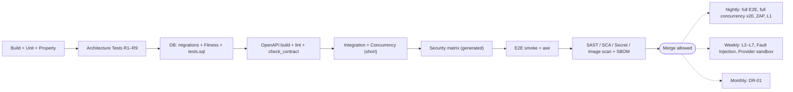

# D10 — طرح تست و پذیرش

## 0. خلاصه

| مورد | مقدار |
|---|---|
| تست‌های کاتالوگ ([`test-catalog.csv`](test-catalog.csv)) | **۲۶۵**: ۱۶۰ تست پذیرش (`AT-`)، ۵۳ تست امنیتی (`SEC-T-`)، ۵۲ بررسی DB (`T..`) |
| وضعیت فعلی | **۵۲ بررسی DB اجرا شده و PASS** (D05). بقیه با پیاده‌سازی هر Vertical Slice خودکار می‌شوند. |
| پوشش نیازمندی | **۱۳۹ از ۱۳۹** نیازمندی P0 در D02 دست‌کم یک تست یا Use Case دارند (تنها مورد بدون تست، NOT-007، در این سند با AT-148 پوشش داده شد) |
| یکپارچگی ارجاع‌ها | هر شناسه تستی که در هر سند آمده، در کاتالوگ تعریف شده است. `build_test_catalog.py` در غیر این صورت خطا می‌دهد. |
| سناریوهای بحرانی | ۱۰ سناریوی P0 سند مرجع + ۲ سناریوی جدید (قطعی مؤدیان، Race نسیه) در بخش 5 |

> کاتالوگ **از اسناد تولید می‌شود**، نه دستی `[DEC D-72]`: هدف هر تست از متن نیازمندی یا معیار پذیرشی که به آن ارجاع داده برداشته می‌شود، پس نمی‌تواند از اسناد جدا شود. قواعد تعیین Gate و لایه در بخش 4 آمده است.

---

## 1. دامنه و اهداف

**در دامنه:** همه نیازمندی‌های P0 در D02، Invariantهای D03، قیدهای D05، کنترل‌های D06، قراردادهای D07، جریان‌های D08 و معیارهای UX در D09.

**اهداف کیفی (به ترتیب):**
- (۱) صفر نشت Cross-Tenant.
- (۲) صفر سند نامتوازن و صفر ثبت تکراری.
- (۳) ادامه فروش در قطعی سرویس‌های بیرونی.
- (۴) SLOهای کارایی.
- (۵) کاربردپذیری صندوق.

**خارج از دامنه MVP:** تست سخت‌افزار ESC/POS خام، Load Test در مقیاس ۱۰٬۰۰۰ Tenant (فقط مدل‌سازی)، و Pentest زیرساخت فیزیکی دیتاسنتر.

---

## 2. لایه‌ها و ابزار

| لایه | هدف | ابزار | محیط | زمان اجرا |
|---|---|---|---|---|
| Domain Unit | Money، گردکردن، سرشکن تخفیف، مالیات، WAC، State Machineها، Invariantهای D03 | xUnit + **FsCheck** (Property-based) | In-memory | هر Commit |
| DB Integration | RLS، قیدها، Triggerها، Fitness | `docs/05-data/sql/tests` + Testcontainers PostgreSQL | Container | هر PR |
| Application Integration | Handlerها با UoW واقعی، tx-portها، Outbox و Inbox | xUnit + Testcontainers (PostgreSQL، Redis، MinIO، OpenBao dev) | Container | هر PR |
| Concurrency | Race روی موجودی، شماره فاکتور، برگشت، سقف اعتبار، Deadlock Fitness | xUnit + Barrier/Parallel؛ تکرار ۲۰ بار برای کشف Flaky | Container | هر PR (کوتاه)، شبانه (کامل) |
| Contract (API) | انطباق پاسخ‌ها با OpenAPI D07 | Schemathesis یا تست تولیدی از OpenAPI + `check_contract.py` | Staging-like | هر PR |
| Contract (Provider) | PSP، SMS، Bale، مؤدیان، OFF | Fake Server با Recorded Fixtures قانونی (بدون داده واقعی)؛ Sandbox رسمی پیش از Gate D و E | Fake / Sandbox | هر PR / هفتگی |
| Security Automated | ماتریس BOLA، Scope و نقش؛ Mass Assignment؛ SSRF؛ Rate Limit؛ Headerها | تولید خودکار از D07 (بخش 6) + ZAP | Staging | هر PR / شبانه |
| E2E | جریان‌های POS، Admin و Portal | **Playwright** (موبایل: Pixel 7 و iPhone 14 Emulation؛ دسکتاپ Chromium و WebKit) | Staging | هر PR (Smoke)، شبانه (کامل) |
| Performance | بار، Peak، Spike، Soak | **k6** | Perf (هم‌اندازه Prod) | هفتگی + پیش از هر Gate |
| Resilience | تزریق خطا | Toxiproxy + Kill Pod + Fake Providerهای خراب | Perf/Staging | هفتگی |
| DR | Restore و Failover | pgBackRest + Runbook D11 | DR | ماهانه |
| Accessibility | WCAG 2.2 AA | axe-core در Playwright + بازبینی دستی Screen Reader | Staging | هر PR (axe)، پیش از Gate F (دستی) |
| UAT و Usability | وظایف D09 §13 | دستی، با Persona | Pilot | پیش از Gate F |

---

## 3. محیط‌ها و داده تست

| محیط | داده | قاعده |
|---|---|---|
| Local / CI | Fixtureهای قطعی: Tenant A (سوپرمارکت، ۲ شعبه) و Tenant B (پوشاک، ۱ شعبه)، کاربران با همه نقش‌های سیستمی، ۲۰۰ کالا شامل وزنی و Variant رنگ × سایز، مشتری عضو هر دو Tenant | هیچ PII واقعی؛ شماره‌ها از محدوده رزرو تست (`+98 900 000 xxxx`) `[DEC D-73]` |
| Staging | Generator داده مصنوعی: ۲۰ Tenant، ۶ ماه فروش مصنوعی | Clock قابل تنظیم برای تست مهلت‌ها |
| Perf | ۱۰۰ Tenant × ۳ شعبه × ۲ صندوق (NFR-CAP-001)، ۵۰٬۰۰۰ Variant در Tenantهای بزرگ، ۱ سال داده تاریخی مصنوعی | — |
| Pilot | داده واقعی فروشگاه‌های پایلوت با قرارداد و رضایت | Backup جدا، دسترسی محدود |

**Clock:** همه کدهای زمان‌محور (`IClock`) در تست قابل کنترل‌اند. مثال‌ها: انقضای QR، Reservation، Draft، مهلت مؤدیان و سررسید نسیه.

---

## 4. کاتالوگ تست و قواعد

**فایل:** [`test-catalog.csv`](test-catalog.csv) (UTF-8 با BOM برای Excel). ستون‌ها: `id, source, objective, priority, method, layer, gate, p0_scenario, automation`.

**بازسازی و بررسی:**
```bash
python3 docs/09-testing/tools/build_test_catalog.py
```

| قاعده | مقدار |
|---|---|
| Gate بر اساس حوزه منبع | TEN، IAM، AUD ← **B** · CAT، INV، PRC ← **C** · SAL، PAY، ACC، CRD، TAX ← **D** · CUS، NOT ← **E** · RPT، INT ← **F**؛ Use Caseها بر اساس حوزه غالب |
| لایه | از روش وارسی D02 (T، I، D) و کلیدواژه‌ها: هم‌زمانی یا قفل ← `Integration-Concurrency`؛ D بدون T ← `UAT`؛ T+D ← `E2E`؛ I ← `Inspection` |
| تست‌های DB | `T01`–`T74` در `tests.sql` (**PASS**) |
| شناسه جدید | هر تست جدید باید از یک سند (D02 یا D06) ارجاع بگیرد. تست بی‌منبع در کاتالوگ ظاهر نمی‌شود `[DEC D-74]` |

**توزیع فعلی:** Gate B: ۶۶، C: ۳۹، D: ۱۰۱، E: ۵۱، F: ۸. لایه‌ها: API-Integration ۱۴۳، Security ۵۳، DB ۵۲، Concurrency ۱۱، E2E ۵، Inspection ۱.

---

## 5. سناریوهای پذیرش بحرانی (P0)

> هر سناریو با **Oracle** پایان می‌یابد: Query یا شرطی که درستی را مستقل از پاسخ API وارسی می‌کند (بخش 5.13).

### P0-1 — نشت Cross-Tenant (AT-202، SEC-T-010، T01–T07، T15، T54)
- **پیش‌شرط:** Tenantهای A و B با داده کامل؛ کاربر `Owner` در B.
- **گام‌ها:**
  - (۱) برای **هر Operation در D07** که شناسه در مسیر، Query یا بدنه دارد، درخواست با شناسه منبع A و Token B (ماتریس خودکار بخش 6).
  - (۲) Resolve بارکدی که A قیمت‌گذاری کرده، از B.
  - (۳) Export در B.
  - (۴) جستجوی مشتری مشترک از B.
- **انتظار:** همه 404 (یا نتیجه خالی). هیچ فیلد A در پاسخ‌ها، Exportها و Logها نیست.
- **Oracle:** O-1 (هیچ ردیف `tenant_id = A` در پاسخ‌ها یا فایل‌ها)؛ Fitness D05.

### P0-2 — آخرین واحد هم‌زمان (AT-211، AT-043، T12)
- **پیش‌شرط:** Variant با `on_hand = 1`، Policy `Forbid`؛ دو صندوق با شیفت باز و سبد شامل همان کالا.
- **گام‌ها:** دو `finalizeSale` هم‌زمان (Barrier) × ۲۰۰ تکرار.
- **انتظار:** در هر تکرار دقیقاً یکی 200 و دیگری `409 insufficient-stock`. بدون Deadlock و بدون Timeout.
- **Oracle:** O-2 (`on_hand = 0`؛ Σ Movement = −۱)؛ O-3.

### P0-3 — ۱۰۰ بار Checkout یکسان (AT-210، AT-067)
- **گام‌ها:**
  - (۱) ۱۰۰ درخواست هم‌زمان `finalizeSale` با یک `Idempotency-Key`.
  - (۲) ۱۰۰ درخواست ترتیبی پس از موفقیت.
  - (۳) یک درخواست با همان کلید و `expectedTotal` متفاوت.
- **انتظار:** (۱) و (۲) همه 200 (یا `409 in-progress` موقت در (۱) و سپس 200) با **یک** `invoiceNo`. (۳) `409 idempotency-key-reused`.
- **Oracle:** O-4 (یک Sale Finalized، یک مجموعه Movement، یک Journal با `source=Sale`، یک TaxInvoice).

### P0-4 — تراز اسناد و تغییرناپذیری (AT-102، AT-103، AT-213، T30–T38)
- **گام‌ها:**
  - (۱) اجرای همه سناریوهای مالی (فروش، برگشت، رسید، تعدیل، نسیه، دریافت، مغایرت).
  - (۲) تلاش UPDATE یا DELETE مستقیم روی Posted با نقش App.
  - (۳) تزریق خطا وسط Posting (Kill Process پس از Insert سطرها و پیش از Commit).
- **انتظار:** (۱) همه اسناد متوازن. (۲) RC012. (۳) هیچ سند نیمه‌کاره.
- **Oracle:** O-5 (هیچ سند Posted نامتوازن)، O-6.

### P0-5 — Callback جعلی یا تکراری (AT-270، AT-271، AT-084، SEC-T-030)
- **گام‌ها:**
  - (۱) Callback «موفق» بدون پرداخت واقعی (Fake PSP، Verify ← failed).
  - (۲) Callback واقعی × ۵.
  - (۳) Verify با مبلغ متفاوت.
  - (۴) Return URL دستکاری‌شده.
- **انتظار:** (۱) و (۴) هیچ پرداخت Confirmed. (۲) یک انتقال وضعیت. (۳) `NeedsReview` + Reverse.
- **Oracle:** O-7 (هر Payment Confirmed آنلاین یک `verify_result.ok = true` با مبلغ برابر دارد).

### P0-6 — کد عمومی بدون OTP (AT-221، AT-124، AT-126، SEC-T-107)
- **گام‌ها:**
  - (۱) Lookup کد مشتری عضو B از A.
  - (۲) `linkMembership` بدون OTP.
  - (۳) ۱۰۰۰ کد تصادفی (Enumeration).
- **انتظار:** (۱) `not_member` بدون داده. (۲) 422. (۳) قفل پس از ۱۰ خطا و Alert DET-03.
- **Oracle:** O-8 (هیچ پاسخ Lookup شماره، نام کامل یا شناسه Global ندارد).

### P0-7 — قطع بله یا SMS (AT-212، AT-146)
- **گام‌ها:** Fake SMS و Bale در حالت 5xx یا Timeout ← ۵۰ Finalize ← بازگرداندن Providerها.
- **انتظار:** همه Finalizeها 200 در زمان SLO. Notificationها `Retrying` و سپس `Sent`. Fallback فقط با رضایت.
- **Oracle:** O-9 (تعداد Sale Finalized = تعداد Notificationهای ساخته‌شده برای Saleهای دارای گیرنده؛ هیچ Rollback).

### P0-8 — خطای Provider کاتالوگ (AT-202، AT-203، SEC-T-041)
- **گام‌ها:** Provider داده غلط یا مخرب برمی‌گرداند (HTML یا Script در نام، بارکد دیگر)؛ Provider کند (۱۰s).
- **انتظار:** فقط پیشنهاد. Encoding خروجی درست است. پاسخ در ≤ ۵s با `degraded=true`. هیچ قیمت یا موجودی از Tenant دیگر.
- **Oracle:** O-10 (هیچ ستون قیمت یا موجودی در `catalog.*`؛ Schema Test).

### P0-9 — PWA آفلاین (AT-071، SEC-T-004)
- **گام‌ها (Playwright، `context.setOffline(true)`):** ساخت سبد ← تلاش پرداخت ← Reload ← بازگشت اتصال ← Sync ← تکرار Sync.
- **انتظار:** دکمه پرداخت غیرفعال. Draft حفظ می‌شود. پس از Sync دقیقاً یک Sale وجود دارد (DI-010). داده محلی پس از خروج پاک می‌شود.
- **Oracle:** O-11.

### P0-10 — Restore واقعی (NFR-AVL-003)
- **گام‌ها:** Restore آخرین Backup + PITR به `T−10min` در محیط DR ← اجرای همه Oracleها ← Smoke E2E.
- **انتظار:** RPO ≤ ۱۵ دقیقه، RTO ≤ ۴ ساعت، همه Oracleها PASS، زنجیره Audit سالم.
- **Oracle:** O-1 تا O-12 روی DB بازیابی‌شده.

### P0-11 (جدید) — قطعی سامانه مؤدیان (AT-260، AT-261، AT-262)
- **گام‌ها:**
  - (۱) Fake مؤدیان Down به مدت ۴۸ ساعت شبیه‌سازی‌شده (Clock).
  - (۲) ۱۰۰۰ فروش و ۵۰ برگشت.
  - (۳) بازگشت سرویس.
  - (۴) پیام تکراری در Outbox.
  - (۵) درخواست امضا با Hash دستکاری‌شده.
- **انتظار:** (۲) فروش بدون خطا. (۳) همه صورتحساب‌ها ارسال و Accepted. (۴) یک ارسال. (۵) رد + DET-06. هشدارهای مهلت در ۵۰، ۸۰ و ۹۵ درصد (Clock).
- **Oracle:** O-12 (هر Sale Finalized دقیقاً یک TaxInvoice زنده `Original` و هر SaleReturn یک `Return` دارد).

### P0-12 (جدید) — Race سقف نسیه (AT-310، AT-311، AT-312)
- **گام‌ها:** سقف ۱۰M و مانده ۸M ← ۲۰ فروش نسیه هم‌زمان ۱٫۵M از ۵ صندوق.
- **انتظار:** دقیقاً یکی موفق.
- **Oracle:** O-13 (`outstanding = Σ ledger`؛ `outstanding ≤ limit` مگر Approval ثبت‌شده؛ Σ دفتر معین = حساب کنترل).

### 5.13 Oracleهای مستقل (SQL؛ پس از هر سناریو و هر Load Test اجرا می‌شوند)

| ID | شرط (باید صفر ردیف برگرداند) |
|---|---|
| O-1 | ردیف‌هایی که در پاسخ یا Export Tenant X آمده‌اند ولی `tenant_id ≠ X` دارند (مقایسه Log تست با DB) |
| O-2 | `stock_balance` که `on_hand ≠ Σ stock_movement.qty_base` به ازای (warehouse، variant) |
| O-3 | `stock_balance` با `allow_negative = false AND on_hand - reserved < 0` |
| O-4 | `(tenant, source_type, source_id, purpose)` تکراری در `acc.journal_entry`؛ Sale با بیش از یک `invoice_no`؛ `sales.idempotency_record` با یک کلید و دو پاسخ متفاوت |
| O-5 | `journal_entry` Posted با `Σ debit ≠ Σ credit` یا کمتر از ۲ سطر |
| O-6 | `journal_entry` Posted که `posted_at` آن پس از بسته شدن دوره‌اش است (Backdate غیرمجاز) |
| O-7 | Payment آنلاین Confirmed بدون نتیجه Verify موفق با مبلغ برابر |
| O-8 | پاسخ‌های Lookup ثبت‌شده در Log تست که فیلد `phone`، `globalCustomerId` یا نام کامل دارند |
| O-9 | Sale Finalized دارای گیرنده و رضایت عملیاتی بدون Notification |
| O-10 | ستون با نام شامل `price`، `cost`، `stock` یا `supplier` در Schema `catalog` |
| O-11 | دو Sale با `client_draft_id` یکسان (Unique آن را تضمین می‌کند؛ Oracle برای Log) |
| O-12 | Sale Finalized بدون TaxInvoice زنده یا با بیش از یکی |
| O-13 | `credit_account.outstanding ≠ Σ(sign × amount)` دفتر معین؛ یا Σ مانده‌ها ≠ مانده حساب کنترل دریافتنی در دفترکل |
| O-14 | `audit.verify_chain()` غیر NULL برای هر Tenant |

این Oracleها همان Jobهای PM-09 در Production هستند. **یک کد، دو کاربرد** `[DEC D-75]`. **وضعیت:** O-2، O-3، O-4، O-5، O-12، O-13 و O-14 در [`docs/05-data/sql/91_oracles.sql`](../05-data/sql/91_oracles.sql) پیاده و تست شده‌اند (`oracles_test.sql`: کشف ناهنجاری‌های عمدی، بدون مثبت کاذب). O-1، O-6 تا O-11 به Log تست یا ماژول‌های پیاده‌نشده در DDL نمونه وابسته‌اند و با Sliceها پیاده می‌شوند.

---

## 6. تست امنیتی خودکار (تولید از D07)

```text
for each operation in D07:
  for each role in D06 §6.2 (+ anonymous, + other-audience token):
     expected = allow if role has x-permission at x-scope else (401 | 403)
     send minimal valid request (from schema + fixtures)       -> assert status class   (SEC-T-012)
  for each id parameter (path/query/body) of type uuid:
     substitute id of the same resource type from the other tenant -> assert 404, body has no foreign data (SEC-T-010)
  if x-scope in (Branch, Warehouse, Register, OwnShift):
     substitute id from another branch/register/shift of the SAME tenant -> assert 403/404 (SEC-T-011)
  for each request schema:
     add forbidden fields (tenantId, status, invoiceNo, costAtSale, creditLimit, unknown) -> assert 400 (SEC-T-013)
```

- **تعداد تقریبی موارد تولیدی:** ۱۵۸ Operation × ۱۲ نقش ≈ ۱٬۹۰۰ تست نقش، به‌علاوه حدود ۳۵۰ جایگزینی شناسه و حدود ۲۰۰ Mass Assignment. اجرا موازی در کمتر از ۱۰ دقیقه است (هدف).
- **ASVS 5.0 در سطح الزام:** پیش از Gate F، چک‌لیست رسمی L2 (نسخه 5.0 از مخزن OWASP) به Excel تبدیل می‌شود. برای هر الزام: «مرتبط/نامرتبط»، کنترل (D06)، شاهد (شناسه تست یا Review) و نتیجه. الزامی که شاهد ندارد، Gate F را مسدود می‌کند مگر استثنای ثبت‌شده داشته باشد `[DEC D-76]`.
- **DAST:** ZAP Baseline شبانه + API Scan با OpenAPI. **Pentest مستقل** پیش از Gate F (D-52): Critical و High باید بسته شوند، Medium با برنامه.

---

## 7. تست کارایی

### 7.1 مدل بار (از NFR-CAP-001)

| پارامتر | مقدار پایه | منبع |
|---|---|---|
| صندوق فعال | ۶۰۰ | ۱۰۰ × ۳ × ۲ |
| نرخ فروش در Peak | ۱ فروش در ۴۵ ثانیه به ازای صندوق ← **۱۳٫۳ Finalize در ثانیه** | A-15 |
| اقلام در هر فروش | ۱۵ ← حدود ۲۰۰ `addSaleLine` در ثانیه و حدود ۲۰۰ Movement در ثانیه | A-15 |
| ترکیب پرداخت | ۴۵٪ کارتخوان، ۳۵٪ نقد، ۱۰٪ آنلاین، ۱۰٪ نسیه `[ASM A-33]` | — |
| سایر بارها | Lookup بارکد = ۱٫۲ × addLine؛ گزارش ۲ در ثانیه؛ رسید خرید ۰٫۲ در ثانیه | — |

### 7.2 سناریوها و معیار پذیرش

| سناریو | بار | مدت | معیار PASS |
|---|---|---|---|
| L1 Steady | ۱× (۱۳٫۳ Finalize در ثانیه) | ۳۰ دقیقه | Finalize p95 < 2s و p99 < 4s؛ addLine p95 < 250ms؛ Lookup p95 < 300ms؛ خطا < ۰٫۱٪ (بدون 409های کسب‌وکاری مورد انتظار) |
| L2 Target | **۳×** (۴۰ در ثانیه) | ۳۰ دقیقه | همان SLOها |
| L3 Spike (شب عید) | ۵× به مدت ۱۰ دقیقه | ۲۰ دقیقه | بدون Error Cascade؛ p95 Finalize < 4s؛ بازگشت به SLO در ≤ ۵ دقیقه |
| L4 Soak | ۱× | ۸ ساعت | بدون نشت حافظه (رشد Heap < ۱۰٪)؛ Outbox Backlog < ۱ دقیقه؛ Connection Pool پایدار |
| L5 Hot SKU | ۵۰ صندوق، یک کالا (نان)، ۲ فروش در ثانیه به ازای صندوق | ۱۰ دقیقه | بدون Deadlock؛ Lock Wait p95 < 200ms؛ O-2 و O-3 PASS |
| L6 Reporting under load | L2 + ۲۰ گزارش هم‌زمان | ۱۵ دقیقه | SLOهای POS بدون تغییر (RPT-002) |
| L7 OTP Abuse | ۵۰۰ درخواست OTP در ثانیه از ۱۰۰ IP | ۵ دقیقه | Rate Limit و CAPTCHA فعال؛ هزینه SMS زیر سقف (D-50)؛ بدون اثر بر POS |

پس از هر سناریو **همه Oracleها** (5.13) اجرا می‌شوند. PASS بدون Oracle سالم معنا ندارد.

### 7.3 نمونه k6 (مسیر Finalize)

```javascript
// k6 run finalize.js  —  illustrative; fixtures provide sale templates per register
import http from 'k6/http';
import { check } from 'k6';
import { uuidv4 } from 'https://jslib.k6.io/k6-utils/1.4.0/index.js';
export const options = {
  scenarios: { target: { executor: 'constant-arrival-rate', rate: 40, timeUnit: '1s', duration: '30m',
                         preAllocatedVUs: 400 } },
  thresholds: { 'http_req_duration{op:finalize}': ['p(95)<2000', 'p(99)<4000'],
                'checks{op:finalize}': ['rate>0.999'] },
};
export default function () {
  const sale = createSaleWithLines(15);                     // helper: createSale + addSaleLine x15 + recordTender
  const res = http.post(`${__ENV.BASE}/sales/${sale.id}/finalize`,
    JSON.stringify({ expectedVersion: sale.version, expectedTotal: sale.total }),
    { headers: { 'Idempotency-Key': uuidv4(), 'Content-Type': 'application/json', Authorization: sale.token },
      tags: { op: 'finalize' } });
  check(res, { 'finalized': r => r.status === 200 && r.json('status') === 'Finalized' }, { op: 'finalize' });
}
```

---

## 8. Resilience و Fault Injection

| ID | آزمایش | انتظار |
|---|---|---|
| FI-01 | Kill Pod Api حین Finalize (پس از Commit، پیش از پاسخ) | Retry کلاینت ← پاسخ ذخیره‌شده؛ O-4 PASS |
| FI-02 | Kill Pod حین Posting (پیش از Commit) | Rollback کامل؛ O-5 و O-2 PASS |
| FI-03 | Failover Primary DB (Patroni) زیر بار L1 | خطاهای موقت < ۳۰ ثانیه؛ Retry امن؛ بدون داده تکراری |
| FI-04 | Latency ۲ ثانیه روی DB (Toxiproxy) | Timeout تراکنش POS ۵s؛ پیام «اتصال کند» در UI؛ بدون تراکنش نیمه‌کاره |
| FI-05 | Redis Down | POS بدون Cache کار می‌کند (کندتر)؛ Rate Limit به حالت محافظه‌کار (Fail-closed برای OTP، Fail-open محدود برای POS) `[DEC D-77]` |
| FI-06 | OpenBao Down | فروش ادامه دارد؛ امضای مؤدیان و افزودن درگاه متوقف؛ Alert |
| FI-07 | PSP Timeout و Callback دیررس | F-03؛ AT-272 |
| FI-08 | Outbox Relay متوقف به مدت ۳۰ دقیقه | Backlog Alert در ۵ دقیقه؛ پس از بازگشت تخلیه به ترتیب؛ Inbox جلوی تکرار را می‌گیرد |
| FI-09 | پیام تکراری و خارج از ترتیب در Outbox | Handlerها Idempotent؛ Projection درست |
| FI-10 | Clock Skew بین Podها (± ۵ دقیقه) | منطق زمانی از DB `now()` یا Clock مرکزی؛ QR و Reservation درست |
| FI-11 | پر شدن دیسک Partition Default موجودی | Alert؛ Job ساخت Partition؛ بدون از دست رفتن Insert |
| FI-12 | قطع شبکه POS حین نمایش QR پرداخت | پس از اتصال وضعیت درست (Polling از سر گرفته می‌شود) |

---

## 9. DR، Backup و Migration

| ID | تست | دوره | معیار |
|---|---|---|---|
| DR-01 | Restore کامل + PITR در محیط جدا | ماهانه | P0-10 |
| DR-02 | Promote سایت DR (Runbook D11) | فصلی | RTO ≤ ۴h؛ RPO ≤ ۱۵m |
| DR-03 | Restore کلیدهای OpenBao (Shamir) در محیط ایزوله | شش‌ماهه | امضای آزمایشی با کلید بازیابی‌شده |
| MG-01 | اعمال همه Migrationها روی DB خالی + Fitness + `tests.sql` | هر PR | PASS |
| MG-02 | اعمال روی Snapshot ناشناس Staging | هر Release | زمان < حد Runbook؛ بدون Lock طولانی |
| MG-03 | Rolling: تست‌های نسخه N-1 روی Schema N | هر Release | PASS (Expand/Contract) |

---

## 10. UAT و پایلوت

- **سناریوهای UAT:** همان وظایف D09 §13 (T1 تا T7)، به‌علاوه یک «روز کامل فروشگاه»: باز کردن شیفت، ۲۰۰ فروش ترکیبی، ۵ برگشت، ۳ نسیه، ۱ دریافت، یک رسید خرید، یک تعدیل، بستن شیفت، گزارش روزانه، بررسی صف مؤدیان.
- **پذیرش کسب‌وکار:** صاحب فروشگاه پایلوت و حسابدار گزارش روزانه را با شمارش فیزیکی و دفاتر تطبیق می‌دهند (اختلاف صفر یا قابل توضیح).
- **Pilot Coverage بارکد (KPI-07):** ۲۰۰ تا ۵۰۰ بارکد واقعی هر فروشگاه ← نرخ Hit به تفکیک منبع؛ گزارش به کارفرما پیش از Gate C.
- **امضا:** فرم پذیرش با فهرست باگ‌های باز (هیچ Sev-1 یا Sev-2).

---

## 11. معیارهای ورود و خروج Gateها

| Gate | ورود | خروج (همه لازم) |
|---|---|---|
| **A** معماری | D01–D12 Draft | تأیید کارفرما بر D01–D06 و D07؛ پاسخ پرسش‌های باز مسدودکننده؛ Risk Register بدون ریسک Critical بی‌Owner |
| **B** پایه پلتفرم | Slice پلتفرم، IAM و Audit | همه تست‌های Gate B کاتالوگ PASS (شامل T01–T07، SEC-T-010/011/012 ماتریس کامل)؛ Fitness PASS؛ SAST و SCA بدون Critical |
| **C** کاتالوگ و انبار | Slice کالا و انبار | تست‌های Gate C PASS؛ L5 Hot SKU PASS؛ Pilot پوشش بارکد انجام‌شده |
| **D** فروش، پرداخت، حسابداری، نسیه، مؤدیان | Slice فروش و مالی | تست‌های Gate D PASS؛ P0-2، 3، 4، 5، 11، 12 PASS؛ Contract با **Sandbox** حداقل یک PSP و **سامانه مؤدیان**؛ L1 و L2 PASS؛ FI-01 تا FI-04 PASS |
| **E** مشتری و اعلان | Slice هویت مشتری و Notification | تست‌های Gate E PASS؛ P0-6 و P0-7 PASS؛ Sandbox بله (یا تصمیم حذف بله از MVP)؛ PIA انجام‌شده (SecQ-04) |
| **F** آمادگی تولید | همه Sliceها | همه P0 (۱ تا ۱۲) PASS؛ L3، L4، L6، L7 PASS؛ DR-01 و DR-02 PASS؛ Pentest بدون Critical یا High باز؛ ASVS L2 چک‌لیست کامل؛ axe بدون خطای Serious؛ UAT امضاشده |

---

## 12. شدت نقص و قواعد انتشار

| شدت | تعریف | نمونه | قاعده |
|---|---|---|---|
| Sev-1 | نقض Invariant مالی یا امنیتی، یا نشت داده | سند نامتوازن، نشت Cross-Tenant، فاکتور تکراری، امضای مالیاتی ناخواسته | توقف انتشار؛ Hotfix؛ Postmortem |
| Sev-2 | توقف یک جریان اصلی بدون راه‌حل جایگزین | Finalize برای یک روش پرداخت کار نمی‌کند | مانع انتشار |
| Sev-3 | خطای عملکردی با راه‌حل جایگزین | گزارش با فیلتر خاص خطا می‌دهد | برنامه‌ریزی در Sprint |
| Sev-4 | ظاهری یا متنی | ترجمه، تراز | Backlog |

**Flaky Test:** تستی که در ۲۰ اجرا بیش از یک بار ناپایدار باشد، قرنطینه و ظرف ۴۸ ساعت اصلاح می‌شود. تست‌های P0 هرگز قرنطینه نمی‌شوند؛ ناپایداری آن‌ها خودش Sev-2 است `[DEC D-78]`.

---

## 13. Pipeline تست در CI (ترتیب)



---

## 14. گزارش‌دهی

- **داشبورد کیفیت:** درصد PASS به تفکیک Gate و لایه (از کاتالوگ)، روند Flaky، پوشش کد Domain (NFR-MNT-003: ≥ ۹۰٪ در ماژول‌های مالی)، و زمان Pipeline.
- **ماتریس ردیابی زنده:** CSV کاتالوگ + نتایج JUnit ← جدول REQ ← تست ← آخرین نتیجه. جزو Artifact هر Release است.
- **گزارش Gate:** فهرست تست‌های Gate با نتیجه، Oracleها، استثناها با Owner و تاریخ.

---

## 15. تصمیم‌ها و پرسش‌های باز

| ID | نوع | شرح |
|---|---|---|
| D-72 | DEC | کاتالوگ تست از اسناد تولید می‌شود |
| D-73 | DEC | فقط داده مصنوعی و شماره‌های محدوده تست در غیر Pilot |
| D-74 | DEC | تست بدون منبع سندی پذیرفته نمی‌شود |
| D-75 | DEC | Oracleهای تست = Jobهای تطبیق Production (PM-09) |
| D-76 | DEC | ASVS L2 در سطح الزام با شاهد؛ نبودِ شاهد مانع Gate F است |
| D-77 | DEC | Redis Down: Fail-closed برای OTP و Lookup مشتری؛ Fail-open محدود برای POS |
| D-78 | DEC | تست P0 هرگز قرنطینه نمی‌شود |
| D-79 | DEC | دو سناریوی P0 جدید: قطعی مؤدیان (P0-11) و Race نسیه (P0-12) |
| A-33 | ASM | ترکیب روش پرداخت در مدل بار |
| TQ-01 | OQ | محیط Perf هم‌اندازه Production در دسترس است؟ (اثر هزینه؛ جایگزین: Prod-like کوچک‌شده با Extrapolation) |
| TQ-02 | OQ | Sandbox رسمی سامانه مؤدیان و PSPهای منتخب (OQ-08) چه زمانی در دسترس است؟ (مسیر بحرانی Gate D) |
| TQ-03 | OQ | Pentest توسط کدام شرکت مستقل (داخلی و مجاز)؟ |
| TQ-04 | OQ | دستگاه‌های واقعی برای تست POS (مدل‌های رایج Android در فروشگاه‌های پایلوت)؟ |
| TQ-05 | OQ | آیا حسابرس مستقل پیش از Gate F اسناد خودکار را بازبینی کند؟ (توصیه: بله، نمونه‌ای) |
